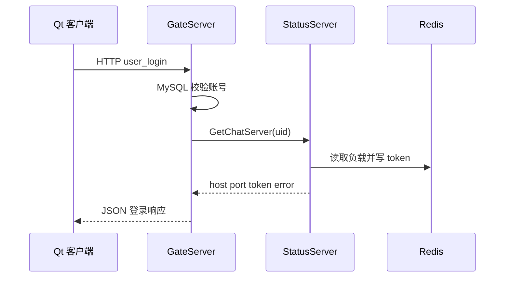

# GateServer 的 gRPC 客户端

## 路由与远端接口

| HTTP 路由 | 客户端封装 | RPC | 响应用途 |
| --- | --- | --- | --- |
| `/get_varifycode` | `VarifyGrpcClient` | `VarifyService.GetVarifyCode` | 返回发送结果与邮箱 |
| `/user_login` | `StatusGrpcClient` | `StatusService.GetChatServer` | 返回 ChatServer 地址、TCP 端口与 token |

[LogicSystem.cpp](../src/LogicSystem.cpp) 解析 JSON 请求后调用封装。验证码生成、Redis 写入与 SMTP 由 Node 服务处理；账号密码校验由网关 MySQL 完成，通过后才向 StatusServer 请求聊天实例。

`StatusGrpcClient::Login` 封装仍存在，当前 ChatServer TCP 登录直接查 Redis，并不经由网关调用该方法。token 当前无 TTL、无一次性消费。

## 配置与依赖

[config.ini](../config.ini) 的 `[VarifyServer] host/port` 指向验证码 RPC，`[StatusServer] host/port` 指向状态 RPC。这些地址是远端服务地址。返回给客户端的 `host/port` 则是 ChatServer TCP 地址，不能拿它作为服务间 RPC 地址。

协议唯一源文件为 [message.proto](../../proto/message.proto)，根 CMake 生成并编译公共 `chat_proto`；[GateServer CMake](../CMakeLists.txt) 链接该目标及 `gRPC::grpc++`。修改协议需更新各相关服务的二进制，Node 服务运行时加载根 proto。

## 单次调用与代理池

[VarifyGrpcClient.cpp](../src/VarifyGrpcClient.cpp) 建立容量 5 的 Stub 池，调用前借出，成功和失败分支均显式归还。[StatusGrpcClient.cpp](../src/StatusGrpcClient.cpp) 建立容量 10 的池，使用 Defer 归还；`GetChatServer` 的 Defer 当前在同步调用之后才创建。

每次调用创建新的 `ClientContext`、请求、响应，填充参数后同步调用 Stub。Channel 长期保存目标和传输状态，创建 Stub 不代表网络已经连通。gRPC 支持 Channel/Stub 并发调用，这里的独占池用于控制应用并发及复用代理。

## 错误与退出边界

`grpc::Status` 非 OK 时封装将响应业务码设为 `RPCFaild`；Status 为 OK 后还需检查响应 `error`，验证码重复等业务拒绝可以正常通过 RPC 返回。

网关这些客户端未设置显式 deadline，池借用也无超时，远端慢调用可能长期占用线程和 Stub。池关闭后借用返回空，现有调用未统一判空；`Close()` 不会等待已借出调用结束，销毁前需停止新的路由执行并结束使用者。

调用凭据为 `InsecureChannelCredentials()`，没有传输加密。验证码 Node 服务监听地址在源码固定为 `0.0.0.0:50051`，应通过网络访问控制限制暴露范围。配置、服务实现和端口检查方法见 [gRPC主文](../../note/grpc.md)；Node 发信流程见 [邮箱认证服务](../../VarifyServer/nodejs搭建邮箱认证服务.md)。
