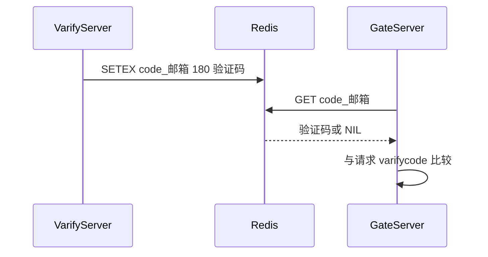

# GateServer 的 Redis 验证码读取

## 跨服务数据约定

VarifyServer 写入 String key `code_<email>`，值为 UUID 前四个字符，通过 `SETEX` 设置 180 秒 TTL。GateServer 在注册和重置密码时使用 [RedisMgr::Get](../src/RedisMgr.cpp) 读取并比较请求的 `varifycode`。两端必须连接同一 Redis 数据集，邮箱字符串也必须一致；当前代码未统一做大小写或空白规范化。



读取路径见 [LogicSystem.cpp](../src/LogicSystem.cpp)。取不到时返回验证码无效/过期，值不同时返回验证码错误。当前 `Get()` 的 bool 同时覆盖 key 缺失和网络等错误，提示“过期”不能单独证明 TTL 已到期。

## 配置与初始化

[config.ini](../config.ini) 的 `[Redis] host/port/passwd` 用于创建连接和执行 AUTH，默认常用端口为 `6379`。配置中的密码应与 Redis 服务端匹配，并通过受限文件权限保护；文档和排查输出不要保存实际值。

[CMakeLists.txt](../CMakeLists.txt) 链接 `redis++::redis++`，实际 [RedisMgr.h](../include/RedisMgr.h) 使用 hiredis C API。池初始化请求 5 条 TCP 连接，每条单独认证。服务没有把该数量读取为 ini 配置项。

运行前需要启动配置对应的 Redis 服务、确认服务账号可认证，再启动验证码和网关进程。排查单个邮箱是否有有效验证码时，在安全认证的 redis-cli 会话中使用：

```redis
TTL code_example@example.com
TYPE code_example@example.com
```

TTL 为 `-2` 表示不存在，`-1` 表示没有过期设置。通常无需读取或传播验证码明文。

## context 与 reply 的使用规则

每次操作借用一个 `redisContext*`，`redisCommand()` 返回 `redisReply*`，判型后复制数据，`freeReplyObject()` 释放响应，再归还连接。context 是独占 socket，同一条连接不能并发执行同步命令。

`GET` 成功为 `REDIS_REPLY_STRING`，不存在为 `REDIS_REPLY_NIL`，空返回指针属于命令失败。池普通借用无超时，初始化全部失败会等待；当前 AUTH reply 缺少空指针判断，停止后归还的裸指针也未在该分支释放。这些边界需要与进程退出顺序一起考虑。

## 验证码使用边界

注册和重置成功后当前没有删除 key，验证码在 TTL 内仍可被再次比较。验证码服务的查重是先 GET 再 SETEX，不能阻止并发请求同时生成不同值。网关只负责校验值，不承担邮件发送，也不存储最终账号数据；账号写入由 MySQL 完成。

Redis 的其他业务职责见 [Redis](../../note/Redis.md)，C API 和二进制安全规则见 [Redis连接库](../../note/Redis连接库.md)，验证码发信配置见 [邮箱认证服务](../../VarifyServer/nodejs搭建邮箱认证服务.md)。
