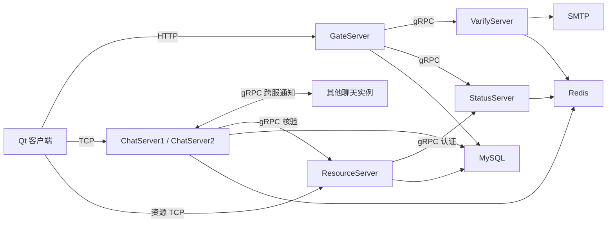

# chat_app

## 服务与通信

| 组件 | 默认端口 | 职责 |
| --- | --- | --- |
| Qt 6 桌面客户端 | — | 账号界面、聊天与群管理、SQLite 缓存、资源传输、好友音视频 |
| GateServer | HTTP 8080 | 注册、登录、重置密码，调用验证码与选服服务 |
| VarifyServer | gRPC 50051 | 邮箱验证码、Redis 有效期、SMTP 邮件 |
| StatusServer | gRPC 50052 | 根据在线计数选择聊天实例，签发和校验 token |
| ChatServer1 | TCP 8090 / gRPC 50055 | 长连接、好友、私聊、群聊、通话信令 |
| ChatServer2 | TCP 8091 / gRPC 50056 | 独立聊天实例、跨服通知 |
| ResourceServer | TCP 9090 / gRPC 50057 | 分片上传下载、资源核验、下载鉴权 |
| MySQL 8 | X Protocol 33060 | 用户、社交关系、会话、消息、群管理事务 |
| Redis | 6379 | 验证码、token、在线路由、在线计数、资料缓存和锁 |



客户端先通过网关验证账号密码，再使用返回的 `host/port/token` 直接建立聊天 TCP 连接。资源连接和媒体连接独立于聊天连接。各端点都必须对客户端可达。

## 功能与数据语义

- 私聊支持文本、图片和普通文件。消息先持久化，再进行同服推送或跨服 gRPC 转发；离线记录通过历史接口恢复。
- 消息区分保存、实时投递、展示 ACK 和已读状态。服务端 `message_id` 用于正式历史及缓存去重，客户端 `msgid` 关联待确认消息；重复发送文本请求仍可能新增正式记录。
- 群聊使用 `thread_id` 作为群号，支持纯文本消息、邀请与申请、审批、管理员、群主转让、公告和群头像。离群、踢出和解散保留历史，客户端展示只读状态。
- 左侧搜索框提供创建群、按完整群号查找及加入入口；群通知处理邀请、申请和结果；群信息窗口处理成员、角色、公告和头像。
- 好友一对一音视频采用 Qt WebEngine、QWebChannel 和 ZLMediaKit；固定 WebM 文件的 **test** 入口独立保留。设备采集在接听后启动。

## 目录与代码入口

| 目录或文件 | 内容 |
| --- | --- |
| `chat_app desktop/` | Qt Widgets 客户端与媒体页面 |
| `GateServer/`、`StatusServer/`、`ChatServer1/`、`ChatServer2/`、`ResourceServer/` | C++ 服务 |
| `VarifyServer/` | Node.js 验证码服务 |
| `proto/message.proto` | 共用 protobuf/gRPC 契约 |
| `sql/` | MySQL 建表、增量迁移与 SQLite 结构参考 |
| `tests/` | 协议、数据库事务、SQLite、资源和容量测试 |
| `deploy/` | ZLMediaKit 启动脚本和配置样例 |
| `DistributeLock/` | 可独立构建的 hiredis 分布式锁组件 |
| `note/` | 按主题组织的知识文档 |

## 开发依赖

| 工具 | 配置要求 |
| --- | --- |
| Windows 10/11、Visual Studio 2022 | C++ 桌面开发工具链，x64 |
| CMake | 使用预设需要 3.21 或更高版本 |
| vcpkg | 根预设默认工具链位于 `D:/cppsoft/vcpkg` |
| Boost | 各服务 CMake 默认使用 `C:/local/boost_1_91_0` |
| MySQL 8 | 启用 X Plugin；服务连接 `33060` |
| Redis、Node.js、SMTP 邮箱 | 用于在线状态及验证码服务 |
| Qt 6.5+ | Core、Widgets、Network、Sql、WebEngineWidgets、WebChannel；Windows 选用包含 WebEngine 的 MSVC kit |

安装 C++ 依赖时使用与预设一致的 triplet：

```powershell
D:/cppsoft/vcpkg/vcpkg.exe install grpc protobuf redis-plus-plus mysql-connector-cpp gtest libpng libjpeg-turbo --triplet x64-windows
```

若依赖安装位置不同，修改 `CMakePresets.json` 的工具链路径及各服务 CMake 的 Boost 路径。Qt 客户端单独配置，服务与客户端的编译器、Qt 库和插件应分别保持 ABI 一致。

## 数据库初始化与迁移

全新环境执行 [sql/create_tables.sql](sql/create_tables.sql)。以下命令在仓库根目录的 PowerShell 中运行，密码由 MySQL 客户端提示输入：

```powershell
$ddl = Get-Content .\sql\create_tables.sql -Raw
mysql --default-character-set=utf8mb4 --protocol=tcp -h 127.0.0.1 -P 3306 -u root -p -e $ddl
```

命令行客户端使用经典协议端口 `3306`；C++ 服务使用 X DevAPI 的 `33060`。全量脚本包含用户、好友、会话、消息、群资料、成员、准入和业务操作记录。`CREATE TABLE IF NOT EXISTS` 只补建缺表，不能升级已有表。

| 已有结构 | 对应脚本与前提 |
| --- | --- |
| 缺少聊天表 | `sql/chat_message_storage.sql` |
| 消息缺少图片或文件字段 | `sql/chat_image_message_migration.sql` |
| 消息缺少展示确认字段 | `sql/chat_message_receipt_migration.sql` |
| 早期群表缺少 `owner_uid/active` | `sql/chat_group_migration.sql`；执行前停写并检查角色转换 |
| 已有 `owner_uid/active` 的群管理结构升级 | `sql/chat_group_management_migration.sql`；保留角色与历史，随新版服务部署 |
| 隔离测试库 | `sql/chat_app_test_local.sql`；仅用于测试 schema |

迁移前确认源结构、备份与停写窗口。旧群迁移会重置管理员角色，已完成该阶段的数据库直接使用对应管理增量脚本。详细约束见 [数据库设计](note/数据库设计.md)。

## 运行配置

1. 修改各 C++ 服务 `config.ini` 的 MySQL、Redis 地址与凭据，业务服务指向同一套数据。
2. 保持 `StatusServer` 的 `[ChatServers]` 与两个聊天实例的 `[SelfChatServer]`、`[PeerServer]` 名称、主机、TCP/gRPC 端口一致。
3. `ResourceServer` 的 `[StatusServer]`、`[Mysql]` 指向相同认证和聊天数据。群头像发布需要为资源服务与 ChatServer 配置匹配的私密服务凭据。
4. 客户端 `config.ini` 的 `[GateServer]`、`[ResourceServer]` 指向可达地址。
5. 初始化验证码配置：

```powershell
Set-Location VarifyServer
Copy-Item config.example.json config.json
npm install
```

填写 SMTP 邮箱及授权码、Redis 地址和密码。`config.json` 含凭据，保持私有。验证码流程使用 SMTP 与 Redis。

音视频另外需要 ZLMediaKit。好友通话与固定文件 test 共用聊天服务 `[VideoTest] enabled/media_url`；当前媒体接入面向可信回环部署，短时媒体授权和公网 ICE 策略见 [WebRTC 视频通信](note/WebRTC视频通信.md)。聊天好友权限不能充当媒体服务访问凭据。

## 构建

在仓库根目录构建 C++ 服务及启用的测试目标：

```powershell
cmake --preset windows-vcpkg
cmake --build --preset debug
```

协议从 `proto/message.proto` 统一生成到构建目录，再链接公共协议库。Visual Studio Debug 产物位于 `build/<服务名>/Debug/`，运行时配置由各服务构建规则复制到产物目录。

Qt Creator 打开 `chat_app desktop/CMakeLists.txt`，选择具备上述模块的 MSVC Qt kit 后配置、构建。运行时保留 `config.ini`、`static/`、`media/` 及 Qt 插件。SQLite 使用 `QSQLITE` 驱动，无需单独数据库服务。

## 启动与连通性检查

先启动 MySQL 和 Redis，再启动验证码服务、StatusServer、两个 ChatServer、ResourceServer、GateServer。音视频功能另外启动 ZLMediaKit。

`start_all.bat` 可打开服务窗口及 WSL 媒体服务。使用前修改脚本中的 `ROOT`、`REDIS`、`CFG`、WSL 发行版、MediaServer 路径及私有媒体配置、日志路径；这些值与本机安装相关。

```powershell
.\start_all.bat
```

手动启动时，验证码服务在 `VarifyServer/` 中执行 `npm run serve`；每个 C++ 服务在其可执行文件目录中执行同名 `.exe`。例如：

```powershell
Set-Location build/ResourceServer/Debug
.\ResourceServer.exe
```

网关可达性检查：

```powershell
curl.exe http://127.0.0.1:8080/get_test
```

| HTTP 方法 | 路径 | 作用 |
| --- | --- | --- |
| GET | `/get_test` | 网关连通性 |
| POST | `/get_varifycode` | 发送邮箱验证码 |
| POST | `/user_register` | 注册 |
| POST | `/user_login` | 验证账号并取得聊天地址与 token |
| POST | `/user_resetpassword` | 凭邮箱验证码重置密码 |

随后用客户端完成注册、登录及双账号通信。网关返回成功仅说明该 HTTP 请求完成，聊天、资源与媒体链路需分别检查。

## 测试入口

```powershell
.\run_tests.ps1
.\run_tests.ps1 -Tests tcp,sqlite
```

脚本调用 CTest，不负责重新构建。数据库用例需要显式隔离 schema 与环境配置；缺少前提可能跳过。群事务、资源 smoke 等入口及其权限要求见 [tests/README.md](tests/README.md)，测试分层与断言含义见 [测试](note/测试.md)。

## 知识阅读路径

| 主题 | 文档 |
| --- | --- |
| 服务架构与一致性 | [全栈聊天室](note/全栈聊天室.md)、[分布式聊天服务设计](note/分布式聊天服务设计.md)、[系统设计问题](note/项目总结.md) |
| 登录与传输 | [登录](note/login.md)、[TCP 服务器](note/TCP服务器.md)、[消息 ID](note/消息ID全链路.md)、[聊天收发](note/聊天信息收发.md) |
| 数据与群管理 | [数据库设计](note/数据库设计.md)、[消息存储](note/聊天信息存储方案.md)、[群聊](note/群聊.md)、[群聊事务](note/总结群聊.md) |
| 资源与可靠性 | [资源服务](note/资源服务.md)、[图片](note/图片传输.md)、[文件](note/文件传输.md)、[可靠性与资源安全](note/聊天可靠性与资源安全提升.md) |
| 并发与生命周期 | [连接池](note/连接池.md)、[分布式锁](note/分布式锁设计.md)、[锁粒度](note/锁的精度控制.md)、[异常处理](note/异常处理.md)、[心跳](note/心跳检测.md) |
| Qt 与音视频 | [Qt 知识](note/Qt知识点.md)、[Qt 网络](note/Qt网络编程.md)、[样式表](note/样式表.md)、[头像](note/Qt头像统一显示.md)、[WebRTC](note/WebRTC视频通信.md) |
| 依赖与常见问题 | [MySQL](note/MySQL连接库.md)、[Redis](note/Redis.md)、[gRPC](note/grpc.md)、[JSON](note/json.md)、[常见问题](note/疑惑.md) |
