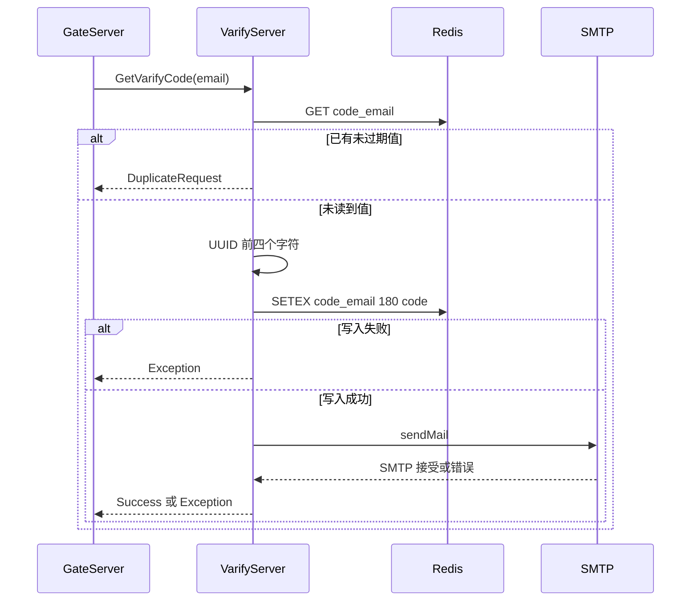

# Node.js 邮箱验证码服务

## 文件与模块职责

| 文件 | 职责 |
| --- | --- |
| [server.js](server.js) | 实现 GetVarifyCode，组织 Redis 与 SMTP 流程，启动 gRPC |
| [proto.js](proto.js) | 运行时加载根目录 message.proto，导出 message package |
| [config.js](config.js) | 读取工作目录的 config.json，导出配置字段 |
| [config.example.json](config.example.json) | 配置字段模板，使用前替换为部署环境值 |
| [redis.js](redis.js) | 建立共享 ioredis 实例，封装 GET、EXISTS、SETEX、quit |
| [email.js](email.js) | 创建 nodemailer transporter，将回调转换为 Promise |
| [const.js](const.js) | code_ 前缀、180 秒有效期与业务错误码 |
| [package.json](package.json) | CommonJS 包依赖与 serve 启动命令 |

Node 的事件循环可在等待 Redis 和 SMTP I/O 时处理其他请求。`await` 暂停当前 async 函数，不会同步阻塞整个事件循环。单进程仍会有多个请求在 await 之间交错，因此读后写操作存在并发竞争。

## gRPC 接口与编码

唯一协议源为 [proto/message.proto](../proto/message.proto)。`VarifyService.GetVarifyCode` 的请求包含 email，响应包含 error、email 和协议声明的 code 字段。当前实现只填 error/email，不通过 RPC 返回验证码；验证码通过邮件发送。

`proto.js` 使用 `@grpc/proto-loader` 动态加载该文件，配置：

- `keepCase: true`：保留 proto 字段命名。
- `longs: String`：64 位整数按字符串呈现，避免 JavaScript Number 精度问题。
- `enums: String`：枚举以字符串形式呈现。
- `defaults: true`：填充默认字段，缺失值不能据此视为用户显式提供。
- `oneofs: true`：提供 oneof 辅助属性。

`server.js` 注册 `VarifyService.service`，固定监听 `0.0.0.0:50051`，使用 `ServerCredentials.createInsecure()`。GateServer 的 `[VarifyServer] host/port` 必须指向这个 RPC 地址。当前监听地址和端口没有从 config.json 读取，也未提供 TLS。

## 验证码的处理顺序



1. 用请求邮箱拼接 `code_<email>`，读取已有值。
2. 只要值非 null，就返回 `DuplicateRequest=1003`，不重发邮件。
3. 生成 UUID v4，截取前四个字符。它是四字符十六进制验证码，不应把前端输入限制为六位数字。
4. `SetRedisExpire()` 调用 `setex(key, 180, value)`；值与 TTL 在一条命令中写入。
5. 构造邮件收件人、主题、正文，调用 `SendMail()`。
6. 发信成功返回 `Success=0`，Redis 写失败、发信异常等返回 `Exception=2`。

`RedisErr=1` 在常量中定义，当前主处理没有专门返回它。回调使用 `callback(null, response)`，业务失败通过 response.error 表达，通常仍是 gRPC 传输成功；调用者需检查两层状态。

## Redis 客户端与生命周期

`redis.js` 实际 `require("ioredis")`。`package.json` 还列有 `redis` 包，但当前生产模块没有使用该客户端 API。无需为了运行已有代码逐个手工安装不同包，依赖清单和锁文件提供安装入口。

共享 RedisCli 使用 `config.redis.host/port/passwd`，每个请求调用 Promise API：`get()`、`exists()`、`setex()`。`GetRedis()` 在 key 不存在和异常时都返回 null，`QueryRedis()` 对不存在和异常同样返回 null，`SetRedisExpire()` 失败返回 false。

error 事件处理器当前会执行 `RedisCli.quit()`。这一行为终止客户端，不能依赖 ioredis 默认重连机制保证进程自动恢复。普通读写没有独立的业务重试流程，未导出区分“未找到”和“连接异常”的完整结果模型。

`SETEX` 解决写值与过期的原子性，先 GET 再 SETEX 没有原子防重能力。同一邮箱的两个并发请求可能都未读到旧值，然后各自覆盖并发送不同验证码；最终 Redis 只保存后写入的值。

## SMTP 配置与发信含义

`email.js` 的 transporter 固定使用：

| 参数 | 当前值来源 |
| --- | --- |
| host | 源码固定为 `smtp.163.com` |
| port | 源码固定为 `465` |
| secure | 源码固定为 `true`，连接即使用 TLS |
| auth.user | config.email.user |
| auth.pass | config.email.pass，通常填写邮箱服务授权码 |

邮箱需在提供商侧启用 SMTP，并使用该账号允许的认证方式。授权码属于凭据，不应提交到仓库、写入文档或出现在命令行历史中。

`server.js` 的 mailOptions.from 当前是源码中的固定发件地址，没有读取 email.user；部署时必须确认该发件人被认证账号允许。修改 config.json 无法改变 SMTP 主机、端口和 from，这些变化需要修改相应源码并重新部署，本文不将其描述为已有配置能力。

`SendMail()` 将 `transport.sendMail()` 的错误作为 Promise rejection 传给外层 catch，成功 resolve SMTP response。成功表示 SMTP 服务接受了本次投递，不保证邮件已进入收件箱；垃圾邮件策略、延迟和最终退信仍由邮件链路决定。

## 安装、配置与启动

在 VarifyServer 目录操作，使用满足 package-lock 中依赖要求的 Node.js/npm 环境：

```powershell
npm ci
Copy-Item config.example.json config.json
```

编辑 config.json，保持以下字段结构，填入实际部署值。示例中的占位符需替换，不包含可用凭据：

```json
{
  "email": {"user": "sender@example.com", "pass": "<SMTP授权码>"},
  "mysql": {"host": "127.0.0.1", "port": 3306, "passwd": "<保留配置字段>"},
  "redis": {"host": "127.0.0.1", "port": 6379, "passwd": "<Redis密码>"}
}
```

`config.js` 当前会直接访问 mysql 对象并导出其字段，因此配置需保留该结构；验证码业务没有连接或查询 MySQL。账号表由 GateServer 访问。SMTP 示例中的认证账户需要结合当前固定 provider 配置填写，任意邮箱域名不保证被该 SMTP 接受。

启动前检查：

- Redis 已启动，配置的地址、端口和密码正确，且与 GateServer 一致。
- SMTP 账号可用，from 与认证账号关系符合提供商要求。
- 根目录 proto 文件可读，50051 未被其他进程占用。
- 当前工作目录为 VarifyServer，因为 config.js 用相对工作目录读取 config.json。

```powershell
npm run serve
```

该脚本执行 `node server.js`。依赖采用 CommonJS 加载，实际 Node 版本需支持锁定依赖的模块兼容行为；不能仅凭 `npm ci` 完成就认定服务已启动。

## 失败与安全边界

- 发信在 Redis 写入之后执行。SMTP 失败不会删除验证码，用户可能需要等待剩余 TTL 后重试；重发按钮立即再次请求通常得到重复请求错误。
- GateServer 注册和重置密码比较验证码后当前不删除 key，TTL 内可再次使用；系统没有验证码失败次数限制与按来源的频率控制。
- 当前主处理没有完整邮箱格式、长度及标准化校验。短验证码和重复请求判断不能替代防滥用策略。
- 服务日志打印邮箱、查询结果与生成的验证码，生产日志具有敏感性，应限制读取和留存，不将其作为文档操作证据。
- gRPC 监听所有 IPv4 接口且没有传输认证，部署需要受限网络或额外安全入口；不能直接暴露为公网发信接口。
- bindAsync 回调当前未处理绑定错误，服务没有完整的信号关闭、gRPC 等待及 Redis/SMTP 清理流程。退出和恢复策略需要由部署管理与源码实现共同约束，单次日志不能证明可用性。

Redis key 的其他用途见 [Redis](../note/Redis.md)，C++ 到 Node 的 RPC 与 deadline 语义见 [gRPC](../note/grpc.md)。
