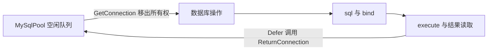

# MySQL Connector/C++ 与 X DevAPI

## 协议、依赖与配置

项目的 MySQL 访问头文件是 `<mysqlx/xdevapi.h>`，CMake 链接 `mysqlcppconnx`。这是 Connector/C++ 的 X DevAPI，通过 MySQL X Protocol 通信，默认端口为 `33060`。MySQL 命令行导入 SQL 通常连接经典协议端口 `3306`；端口可配置，必须与服务器启用的协议匹配。

Connector/C++ 还提供经典 JDBC 风格接口，常见头文件为 `<mysql/jdbc.h>`，使用 `sql::Connection`、`PreparedStatement` 等类型。`<mysqlx/xapi.h>` 属于 X Protocol 的 C API。项目生产访问使用 `mysqlx::Session`，没有使用 Collection 文档数据库接口。

[GateServer CMake](../GateServer/CMakeLists.txt)、[StatusServer CMake](../StatusServer/CMakeLists.txt) 和两台 ChatServer 的 CMake 均链接 `mysqlcppconnx`；[ResourceServer CMake](../ResourceServer/CMakeLists.txt) 也链接该库，其数据库访问用于资源鉴权。依赖安装可使用 vcpkg 的 `mysql-connector-cpp` 端口，具体安装版本由构建环境决定。

[GateServer 配置](../GateServer/config.ini) 的 `[Mysql]` 包含以下字段；示例不含凭据：

```ini
[Mysql]
host = 127.0.0.1
port = 33060
user = chat_service
passwd = <数据库密码>
schema = chat_app_db
poolsize = 5
```

`MySqlPool` 通过 ConfigMgr 读取字符串，再用 `std::stoi` 转换端口和池大小。配置在进程初始化时读取，修改后需重启服务。数据库需启用 X Plugin，账号需有对应 schema 权限。新环境表结构见 [create_tables.sql](../sql/create_tables.sql)；`CREATE TABLE IF NOT EXISTS` 不负责升级已有表。

## 对象与所有权

| 对象 | 作用 | 生命周期要求 |
| --- | --- | --- |
| `mysqlx::Session` | 一条数据库会话，承载 SQL 和事务 | 池内空闲或被一个调用独占借用 |
| `SqlStatement` | SQL 文本与绑定参数 | 在有效 Session 上构造并执行 |
| `SqlResult` | 查询结果或写入结果 | 读取所需结果后再复用会话 |
| `Row` | 单行结果 | `fetchOne()` 返回空行时不能取列 |
| `Value` | 单列数据 | 按 SQL 列类型和空值约定读取 |

Session 构造包含网络连接和认证，可能抛异常。项目用 `std::unique_ptr<mysqlx::Session>` 管理所有权，避免手工 `delete`。`unique_ptr` 析构会销毁会话，只有显式调用 `ReturnConnection` 才会把会话归还池中。



## SQL、绑定和结果读取

下面是 X DevAPI 的查询片段，前提是 `con` 为已借用的有效会话：

```cpp
// 按登录名查询；问号按出现顺序绑定数据值。
auto result = con->sql("SELECT uid, name, email FROM user WHERE name = ?")
                 .bind(name).execute();
auto row = result.fetchOne();
if (row) {
    const int uid = row[0].get<int>();
    const std::string email = row[2].get<std::string>();
}
```

SQL 接口使用位置占位符 `?`。X DevAPI 的 CRUD 表达式存在命名绑定能力，但不能把命名表达式占位符直接当成这里的 SQL 语法。绑定保护的是数据值；动态表名、列名、排序方向仍需由程序限定，不能把用户输入直接拼成 SQL 结构。

`execute()` 返回 `SqlResult`。`fetchOne()` 消费下一行，空结果可用 `if (!row)` 判断；多行查询可以循环取行或使用 `fetchAll()`。聊天服务查询历史、会话及成员均涉及多行，不能假定所有查询只有一个用户。

列下标从 `0` 开始，与 `SELECT` 列顺序一致。修改查询列时要同步读取位置。可空列应先检查 `isNull()`；`get<T>()` 的目标类型要符合列值范围，消息和会话的 64 位 ID 不应窄化到 `int`。

## 事务与业务数据

[GateServer MysqlMgr](../GateServer/src/MysqlMgr.cpp) 的 `RegUser` 在同一 Session 上执行：

1. `startTransaction()` 开启事务。
2. `UPDATE user_id SET id = id + 1` 更新分配器。
3. `SELECT id FROM user_id` 读取本次 uid。
4. 参数绑定插入 `user(uid, name, email, pwd)`。
5. `commit()`；异常路径尝试 `rollback()`。

`user_id` 依赖单行数据约定，初始化值应不小于已有用户最大 uid。InnoDB 的行锁使并发更新串行执行。事务不能跨两个借用的 Session 拆开，否则更新与插入不再属于同一次提交。

[建表 SQL](../sql/create_tables.sql) 中 `user.uid` 和 `user.email` 为唯一索引，`name` 是普通索引。注册入口的“先查询用户名”存在并发窗口，普通索引不提供用户名唯一性约束。数据库实际约束需以 SQL 为准。

两台 ChatServer 的 `MysqlMgr` 还负责好友申请、双向好友关系、私聊、群聊、消息及回执事务；详细模型见 [数据库设计](数据库设计.md)。资源服务的数据库读取用于核查资源请求者与会话关系，不由 Redis 缓存代替授权。

## 会话池与异常边界

[MySqlPool 实现](../GateServer/src/MysqlMgr.cpp) 在借出和归还时执行 `SELECT 1`，发现无效会话后通过 `CreateSession()` 重建。校验按借还发生，没有周期探活线程。数据库重启、空闲回收、网络断开都可能使会话失效；X Protocol 的空闲超时还受服务器 X Plugin 配置影响。

业务中常见的归还片段为：

```cpp
// con 的生命周期必须覆盖 Defer；pool_ 必须在归还结束前保持有效。
auto con = pool_->GetConnection();
Defer release([&con, this]() { pool_->ReturnConnection(std::move(con)); });
```

`Defer` 是项目的作用域清理类。借用后应立即建立清理责任，任何提前返回都应归还。事务失败还需要显式回滚，归还动作本身不等于回滚。

当前实现的边界：

- `SELECT 1`、失效重建均在池互斥锁内执行，网络等待会阻塞其他借还线程。
- `CreateSession()` 可抛异常；部分业务在 `GetConnection()` 后才进入 `try`，取连接异常不在该业务捕获范围内。
- 归还也可能因重建失败抛异常。作用域清理期间抛出异常具有终止进程的风险，不能把 Defer 描述成绝对安全的异常屏障。
- 探活成功后业务仍可能断线。写操作响应丢失时，客户端无法仅凭网络异常判断是否已提交，不能无条件重放。
- `Close()` 唤醒等待者并清空空闲队列；关闭协调仍需等待借用者结束，详见 [连接池](连接池.md)。

## 账号与传输注意事项

当前账号代码比较和保存客户端提供的密码串，客户端异或处理可逆；它不能提供密码哈希保护。生产部署需要独立考虑 TLS、密码哈希、最小权限数据库账号及日志脱敏。库支持的安全能力与当前业务是否配置安全能力应分别核查。

接口细节可查 [Connector/C++ X DevAPI 官方文档](https://dev.mysql.com/doc/dev/connector-cpp/latest/)。
