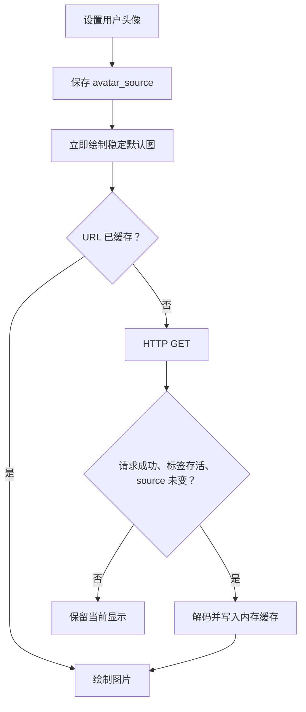

# Qt 头像统一显示

## 用户头像的数据与显示入口

[avatarutil.h](../chat_app%20desktop/avatarutil.h) 和 [avatarutil.cpp](../chat_app%20desktop/avatarutil.cpp) 提供统一的路径选择和裁切函数。会话、联系人、好友资料、申请及消息行应把同一 UID 与服务端头像字段传给这些入口，避免各页面自行选默认图或实现裁切。

| 接口 | 输入与效果 |
| --- | --- |
| `ResolvePath(uid, avatarPath)` | 非空路径按原值保留；全空白或空值按 UID 选择内置头像 |
| `SetRoundAvatar(label, uid, avatarPath)` | 加载本地资源或 HTTP(S) 图片，缩放、中心裁切并绘制到标签 |
| `SetRoundGroupAvatar(label, cachePath)` | 从已验证的群头像缓存加载，缺失时使用统一群图标 |
| `SetRoundGroupAvatar(label, image)` | 显示群头像预览图，空图使用群图标 |

```cpp
// 用户头像：UID 和路径来自该用户的数据对象。
AvatarUtil::SetRoundAvatar(ui->icon_lb, userInfo->_uid, userInfo->_icon);

// 群头像：只传该群已验证的本地缓存。
AvatarUtil::SetRoundGroupAvatar(groupLabel, verifiedCachePath);
```

用户默认头像共有五张。正 UID 的索引为 `uid % 5 + 1`，非正 UID 使用 `head_1.jpg`；最终资源路径为 `:/res/head_%1.jpg`。同一 UID 在不同页面获得相同结果，UID 为 5 时对应第一张，UID 为 1 时对应第二张。资源条目由 [resource.qrc](../chat_app%20desktop/resource.qrc) 编译进程序。

非 HTTP(S) 路径交给 QPixmap 加载，支持 Qt 资源和本地文件；加载失败也选用该 UID 的默认图。路径解析不会把资源服务端文件自动下载到客户端，用户资料中的 `_icon` 需要是客户端实际可读取的地址。

## 比例、裁切与控件尺寸

`ApplyRoundedPixmap()` 先读取 `label->size()`，以 `KeepAspectRatioByExpanding` 和 `SmoothTransformation` 缩放，使图像覆盖目标矩形；随后创建透明画布，设置椭圆 clip，再将图像居中绘制。

- 原图宽高比保持不变，多余边缘在中心裁切时被去除。
- 正方形标签得到圆形头像；非正方形标签得到椭圆。需要圆形时由布局保证宽高相等。
- 标签为空、目标尺寸为空或图片无效时不绘制。
- 裁切使用调用当时的控件尺寸，工具没有为后续 resize 自动重绘；可变尺寸头像应在尺寸确定后调用，或在尺寸变化时重新应用。
- QSS 的 `border-radius` 可以绘制标签边框，但图像像素裁切由上述 QPainter 路径完成。

当前工具按标签尺寸创建 QPixmap，没有像登录标识那样显式按设备像素比扩大画布。高 DPI 显示精度需要结合实际屏幕缩放和图片像素检查，不能由源图尺寸单独保证。

## HTTP(S) 加载与异步覆盖保护

远端头像通过以 QCoreApplication 为父对象的共享 QNetworkAccessManager 下载，并按完整 URL 缓存在进程内 `QHash<QString, QPixmap>` 中。加载流程为：



回调使用 `QPointer<QLabel>` 避免访问已销毁标签；`avatar_source` 防止列表项复用、切换用户或切换群头像后，旧请求覆盖新的显示。群头像同样设置带 `group:` 前缀的 source 标识，因此迟到的用户 HTTP 请求不能覆盖它。

下载采用 `NoLessSafeRedirectPolicy`，完成时删除 reply。网络或解码失败保留默认图。该入口当前没有请求合并、下载大小上限、缓存淘汰、磁盘缓存或缓存有效期；相同 URL 内容改变时，已有进程缓存也不会自动失效。远端地址的访问控制、可信来源、HTTPS 和发布新 URL 的策略需要资源发布端提供，不能把显示工具当作安全资源网关。

工具包含 QPixmap 和 QWidget 操作，应在 GUI 线程调用。共享 manager 的首次创建线程也由调用位置决定。

## 个人设置的上传与资料提交

[settingdialog.cpp](../chat_app%20desktop/settingdialog.cpp) 把选择、上传和持久保存分为不同阶段：

1. 选择本地图片后，用统一工具在设置页预览；预览路径不直接写入全局用户资料。
2. 通过 ResourceClient 向 ResourceServer 分片上传，按服务端确认偏移继续。
3. 完成回包必须包含非空 `resource_url`；`finishResourceUpload()` 将其交给 `sendProfileUpdate()`。
4. 客户端检查聊天连接和地址 UTF-8 长度不超过 255 字节，发送 1031，携带 nick、desc、icon。
5. 只有 ChatServer 明确回复成功后才调用 `UserMgr::UpdateProfile()` 并提交显示状态。上传成功但资料更新失败时保留原有全局资料，页面显示保存失败。

[ResourceServer/src/LogicWorker.cpp](../ResourceServer/src/LogicWorker.cpp) 的 `BuildResourceUrl()` 当前返回服务端最终文件的绝对路径。它只适合客户端能够访问相同文件系统位置的部署，常见情况为同机开发。仓库没有在这个流程中提供可直接跨机器访问的 HTTP 静态头像接口。

跨机器发布可采用带访问策略的 HTTP(S) 资源地址，并让资料保存真实可访问 URL；现有 AvatarUtil 已有 HTTP(S) 加载能力。后端 URL 生成、鉴权、地址长度、缓存失效及隐私规则仍需实际实现，单改字符串格式不能完成部署。

## 群头像的资源身份与验证

群头像由 [groupavatartransfer.h](../chat_app%20desktop/groupavatartransfer.h)、[groupavatartransfer.cpp](../chat_app%20desktop/groupavatartransfer.cpp) 管理，使用与个人头像、私聊附件隔离的任务和回包路由。

| 标识 | 用途 |
| --- | --- |
| accountUid、loginGeneration | 限制异步结果属于当前账号及登录连接 |
| threadId | 限制所属群 |
| avatarVersion、resourceId | 唯一确定当前发布的头像版本与资源 |
| task UUID | 关联一次上传或下载，不以共享连接状态代替任务身份 |
| groupVersion | 表示群一般资料版本；普通公告变化不能直接使同一头像失效 |

上传只接受完整解码成功的 PNG/JPEG，原图上限 2 MiB，宽和高均不超过 1024。资源服务端的 [GroupAvatarDecoder.cpp](../ResourceServer/src/GroupAvatarDecoder.cpp) 同样实施真实格式、尺寸及完整解码检查。

任务阶段依次为等待连接、同步、分片、发布。共享资源连接重新发出 connected 不能使已开始的任务再次同步；每次分片确认必须对应刚发送的结束偏移。上传完成后再通过 ChatServer 发布资源 ID，发布成功前不改本地群信息。

下载要求当前账号、登录代次、有效成员身份、群、头像版本和资源 ID 仍相符。`QSaveFile` 原子提交后再次解码，核对 MIME、尺寸和可信元数据；失效或失败结果不发送给旧个人头像、私聊图片信号。

缓存使用 AppLocalDataLocation 下按账号、群号、头像版本和净化资源 ID 构造的稳定路径。登录代次只过滤回调，不参与磁盘文件名，允许同一账号下次登录复用已验证缓存。

会话列表、群信息预览及聊天标题调用 `SetRoundGroupAvatar()`。无有效群头像时显示绘制的蓝色“群”图标，不能把群号当用户 UID 选择个人默认头像。群权限与发布协议见 [群聊](群聊.md)。
