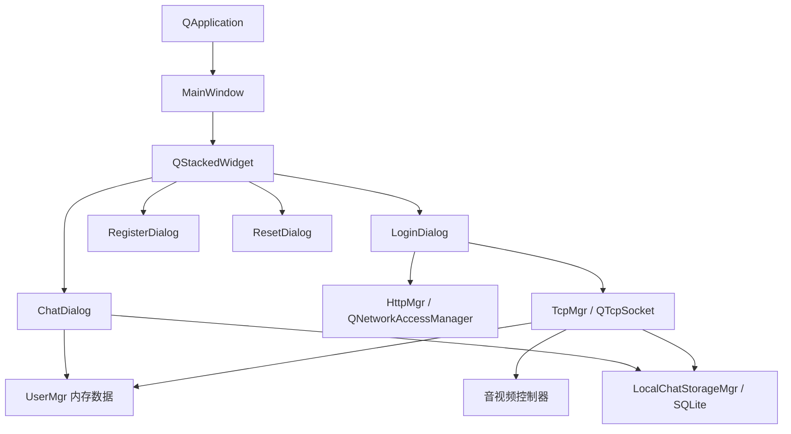
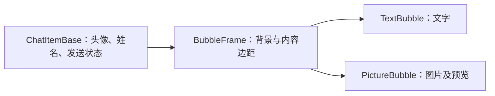
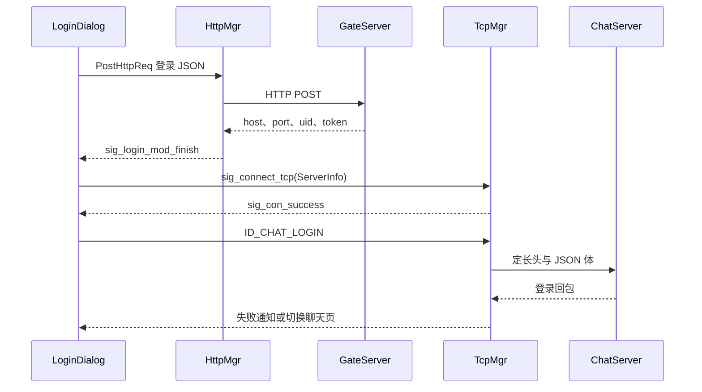

# Qt 客户端知识点

## 工程组成与页面数据

[客户端 CMake](../chat_app%20desktop/CMakeLists.txt) 声明 Qt 最低版本为 6.5，依赖 Core、Widgets、Network、Sql、WebEngineWidgets、WebChannel；实际可用版本还须满足平台、编译器及 WebEngine API 的要求。`qt_standard_project_setup()` 配置 moc/uic，`CMAKE_AUTORCC` 开启资源编译。kit 中的编译器 ABI、位数和 Qt 库必须匹配，工程文件没有规定某一台机器安装的 kit。



[mainwindow.cpp](../chat_app%20desktop/mainwindow.cpp) 在构造时创建四个页面。切换 `QStackedWidget::setCurrentWidget()` 只改变显示，不销毁页面。聊天页因此早于登录数据存在；`SlotSwitchChat()` 先调用 `RefreshLoginData()`，再切页。页面初始化与登录数据刷新是两个生命周期。

| 对象或数据 | 所有者与作用 |
| --- | --- |
| `Ui::MainWindow` 等生成的 UI 包装对象 | 页面析构时删除；其中创建的 QWidget 由 Qt 对象树管理 |
| 页面、布局中的控件 | 由父 QWidget 或接管它的容器管理 |
| `UserMgr` | 保存当前用户、好友、群等内存状态，页面读取它刷新显示 |
| `LocalChatStorageMgr` | 管理 SQLite 数据及数据库连接生命周期 |
| `TcpMgr` | 持有聊天 socket、心跳、请求关联和音视频控制器 |
| `HttpMgr` | 持有 HTTP manager，按业务模块分发响应 |

## 元对象系统与构建工具

QObject 提供对象树、线程亲和性和事件基础；`Q_OBJECT` 为类声明自身的信号、元对象信息等能力。常规多继承写法要求 QObject 派生基类放在首位。moc 扫描类声明后生成信号实现和元调用入口，缺少生成文件会出现链接错误。

[httpmgr.h](../chat_app%20desktop/httpmgr.h) 将 Qt 身份、单例访问和共享所有权组合在一个类中：

```cpp
// HttpMgr 由共享指针持有；QObject 位于首个基类。
class HttpMgr : public QObject, public Singleton<HttpMgr>,
                public std::enable_shared_from_this<HttpMgr>
{
    Q_OBJECT
    // 类内另行声明信号、槽和成员。
};
```

uic 将 `.ui` XML 转换为 `ui_*.h`，`setupUi(this)` 创建控件并建立 Designer 中配置的布局。生成文件由构建工具维护；界面布局修改应写入 `.ui`。Designer 的控件提升用于把标准 QLabel、QPushButton 等替换为自定义类，需要正确的头文件、类名和可接受 `QWidget *parent` 的构造函数。控件提升本身不要求每个类都声明新信号。

`on_对象名_信号名` 槽依赖 `connectSlotsByName` 自动连接。手工 `connect` 同一操作时应检查是否与自动连接重复。

## 信号槽、线程与回调寿命

### 类型安全连接

函数指针形式能在编译期检查签名，信号可以连接普通成员函数、槽、lambda 或另一信号。槽可以少接收尾部参数，但已接收参数的类型必须兼容。

```cpp
// 按钮点击转发为页面切换请求，由主窗口选择页面。
connect(ui->reg_btn, &QPushButton::clicked,
        this, &LoginDialog::switchRegister);

// this 是连接上下文：页面销毁后不再执行这个闭包。
connect(button, &QPushButton::clicked, this, [this] {
    setProperty("state", "selected");
});
```

`emit` 是提示性的宏，信号调用最终进入 Qt 的连接分发。发送方无需知道全部订阅者；连接关系由构造函数等装配位置建立。项目同时使用普通方法调用，例如 `HttpMgr::PostHttpReq()`，两种调用方式按职责组合使用。

### 连接类型

| 类型 | 槽执行位置与时机 | 使用边界 |
| --- | --- | --- |
| `AutoConnection` | 发射当时的线程与接收者线程相同则直接调用，否则排队 | 判断依据是实际发射线程和接收者线程亲和性 |
| `DirectConnection` | 立即在发射线程调用 | 跨线程使用会绕过接收者线程约束 |
| `QueuedConnection` | 参数复制到接收者事件队列，稍后执行 | 接收线程必须有运行中的事件循环，参数类型须支持元类型传递 |
| `BlockingQueuedConnection` | 排队并阻塞调用线程等待 | 同线程会死锁；GUI 路径不宜采用 |

项目网络管理器和界面在主线程创建，默认连接通常直接调用。`sig_send_data` 连接到同一 TcpMgr 的槽，不会因使用了信号就自动获得后台发送或队列隔离。

队列连接能把工作线程结果送回 GUI 线程，但不保护两个线程共同访问的可变数据。QObject 的普通成员调用也不会自动切换线程。把 manager 移到工作线程时，必须同时检查其 socket、timer、调用入口、创建和销毁位置，不能只移动一个外壳对象。

队列按事件处理提供串行入口，嵌套事件循环、主动 `processEvents()` 等仍可能让槽重入。不同线程发送事件的全局业务顺序也需要序号、代次或状态机约束。

### 上下文、弱引用与共享所有权

- 带 QObject 上下文的连接会在上下文销毁时断开，适用于捕获 `this` 的 lambda。
- 无上下文 lambda 的寿命主要跟随发送者，捕获的裸指针需要单独保证有效。
- `QPointer<T>` 在 QObject 销毁后置空，适合保存可能提前关闭的窗口或标签。
- `shared_from_this()` 要求对象已经由对应 `shared_ptr` 控制块管理；它保持 C++ 所有权，不提供线程安全或登录身份校验。

[httpmgr.cpp](../chat_app%20desktop/httpmgr.cpp) 的 finished 闭包捕获 `self`，让 HTTP 管理器在回调期间存活。[avatarutil.cpp](../chat_app%20desktop/avatarutil.cpp) 则用 `QPointer<QLabel>` 检查标签是否存在，并用 `avatar_source` 检查它是否仍显示同一个头像。存活检查与结果归属检查分别解决对象销毁、旧请求覆盖新内容的问题。

## 对象树与退出顺序

QObject 的 parent 析构时删除子对象。布局接管控件的几何管理，容器通常也会调整控件父对象。删除布局项目 `QLayoutItem` 与删除它承载的 QWidget 是两个操作；移除布局项后应按所需寿命分别处理。

```cpp
// 父窗口拥有页面，按钮拥有定时器。
auto *page = new QWidget(parentWindow);
auto *timer = new QTimer(button);
```

堆对象可以交给 Qt 父对象管理，也可以交给明确的 C++ 所有者管理；两套所有权重叠时应避免提前删除或双重销毁。栈上 QObject 的父子关系还受局部变量析构顺序约束。

`deleteLater()` 投递延迟删除事件，适合仍在处理信号的 `QNetworkReply`。它依赖事件循环；程序退出后不能假定延迟事件仍会处理。

[main.cpp](../chat_app%20desktop/main.cpp) 的退出流程为：

1. `aboutToQuit` 调用 `TcpMgr::PrepareForShutdown()`，停止心跳、断开 socket 回调并停止媒体页面。
2. `exec()` 返回后，在 QApplication 仍存活的作用域中显式释放 TcpMgr。
3. 释放 `LocalChatStorageMgr`，移除数据库连接。
4. 最后离开 main 作用域，销毁 QApplication 及其余局部对象。

[singleton.h](../chat_app%20desktop/singleton.h) 的 `std::call_once` 只保证首次构造执行一次。它不保证实例方法线程安全；`DestroyInstance()` 只重置静态共享指针，外部引用仍可能延长寿命。once_flag 不会重置，因此销毁接口用于程序最终退出，随后不能依赖 `GetInstance()` 重建实例。

## 事件、事件过滤器与定时器

事件由 `event()` 分发到 `mousePressEvent()`、`paintEvent()` 等虚函数；信号由对象主动发出，二者可以组合。是否调用基类处理函数取决于是否还需要默认行为：完整接管的事件可以直接返回，未处理的分支交给基类。

`installEventFilter()` 允许一个对象在目标处理前检查事件。返回 true 表示消费，返回 false 或基类结果表示继续。滚动区域的鼠标与滚轮通常发给 `viewport()`，因此 [chatview.cpp](../chat_app%20desktop/chatview.cpp) 把过滤器装到视口上。

```cpp
// 示例：只观察视口进入事件，其余事件保留 Qt 默认行为。
bool Panel::eventFilter(QObject *watched, QEvent *event)
{
    if (watched == scrollArea->viewport() && event->type() == QEvent::Enter)
        scrollArea->verticalScrollBar()->show();
    return QWidget::eventFilter(watched, event);
}
```

自定义滚轮逻辑若已修改滚动位置，再放行同一滚轮事件可能重复滚动。Enter/Leave 应精确判断事件类型，绘制和鼠标移动也会经过过滤器。

[timerbtn.cpp](../chat_app%20desktop/timerbtn.cpp) 用 `QTimer(this)` 实现十秒验证码按钮倒计时。定时器在所属线程事件循环中发 timeout，GUI 被长任务占用时，回调也会推迟。倒计时按钮只限制界面点击频率，服务端仍需实施验证码频率限制。

项目 TimerBtn 在鼠标释放时禁用自身、启动计时并发出 clicked，然后调用 QPushButton 的默认处理；维护此类控件时要同时考虑按钮使能状态、鼠标命中、键盘激活和 clicked 次数。

延时操作可以使用带上下文的 `QTimer::singleShot`：

```cpp
// 示例：三秒后发出切页信号；页面销毁后取消回调。
QTimer::singleShot(3000, this, [this] { emit switchLogin(); });
```

`QEventLoop::exec()` 会运行嵌套事件循环，期间仍处理事件，也会引入重入。`sleep()` 会阻塞所在 GUI 线程，两者的执行语义需要区分。

## 聊天区布局与消息组件

[chatview.cpp](../chat_app%20desktop/chatview.cpp) 使用 QScrollArea 承载内容 QWidget，内容区采用 QVBoxLayout。末尾的空 QWidget 带较大伸缩因子，用来占据剩余高度，让短消息列表靠顶部。

| 操作 | 实际行为 |
| --- | --- |
| `appendChatItem()` | 插入到末尾空控件之前，设置尾插标记，范围变化时滚底 |
| `prependChatItems()` | 输入按时间正序排列，倒序插入布局头部，再补偿滚动位置 |
| `ClearChatItems()` | 删除消息控件和布局项，保留最后的伸缩项 |
| `insertChatItem()` | 当前函数没有实际插入逻辑，不能作为中间插入能力使用 |

头插前记录 `oldValue` 和 `oldMaximum`，布局更新后把最大值增加量补到原位置，保持正在阅读的消息位置。零延时 singleShot 等待当前轮布局更新；`_isPrepending` 阻止程序调整滚动条时误触发“到顶加载”。尾插则通过 `rangeChanged` 与 `isAppended` 控制滚底。两种操作对滚动位置有不同要求，不能共用同一个无条件滚底逻辑。

消息显示由以下组件组合：



[chatitembase.cpp](../chat_app%20desktop/chatitembase.cpp) 根据 Self/Other 镜像头像、姓名、气泡和状态的位置；发送状态属于整行，可被不同内容复用。`setWidget()` 替换气泡内容时处理旧控件的寿命。

[textbubble.cpp](../chat_app%20desktop/textbubble.cpp) 用只读 QTextEdit 保存文本，`QFontMetricsF::horizontalAdvance()` 估算宽度，实际换行高度则依赖 QTextDocument 布局。字符数量不能直接代表像素宽度，连续英文、中文、字体变化和缩放都会影响结果。

[picturebubble.cpp](../chat_app%20desktop/picturebubble.cpp) 保持图片比例生成缩略图，并提供点击查看原图的预览窗口。头像采用独立的圆形裁切入口，参见 [Qt头像统一显示](Qt头像统一显示.md)。

## 动态属性、资源与运行配置

动态视觉状态通过 `setProperty("state", ...)` 写入控件，再调用 [global.cpp](../chat_app%20desktop/global.cpp) 的 `repolish` 重新匹配 QSS；需要时 `update()` 请求重绘。属性名和值是代码与 QSS 的共同约定，详见 [样式表](样式表.md)。

`resource.qrc` 将 QSS 和图像嵌入程序，使用 `:/style/stylesheet.qss`、`:/res/head_1.jpg` 访问。动态拼接的 `head_%1.jpg` 也依赖 qrc 中的资源条目，清理资源时必须考虑格式化路径。

`config.ini` 是外部运行配置。入口按 `applicationDirPath()` 查找它，工作目录变化不会改变配置位置。CMake 在配置阶段复制 config/static，在 post-build 阶段把 config/media 复制到实际目标目录；安装阶段另有媒体安装与 Qt 依赖部署脚本，配置文件的最终安装位置仍须由发布流程准备。

[main.cpp](../chat_app%20desktop/main.cpp) 在 QApplication 前注册媒体 scheme，然后设置 Fusion、字体、全局 QSS、网关地址和窗口图标。编写需要 WebEngine 的启动逻辑时，scheme 注册时机不能移到页面创建之后。

## 登录事件链的阅读方法



HTTP 结果、TCP 已连接、聊天登录成立分别对应不同阶段。界面展示和心跳启动依赖业务登录成功；socket 连接成功只说明传输通道建立。封包、半包状态和业务确认的详细边界见 [Qt网络编程](Qt网络编程.md)。密码异或处理只提供可逆混淆，传输保密需要 TLS 等机制。
