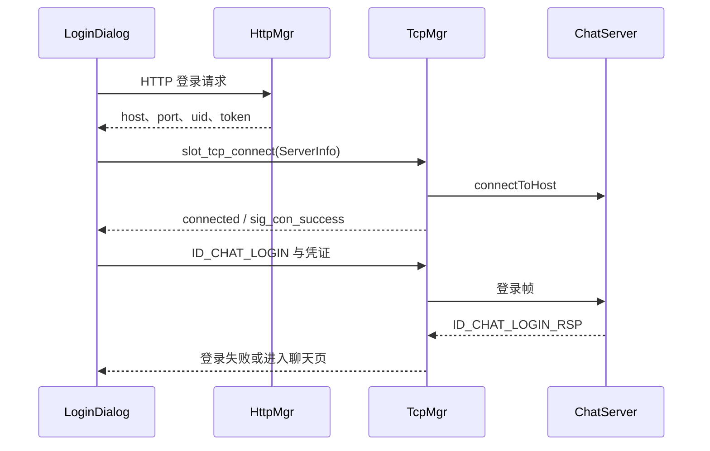
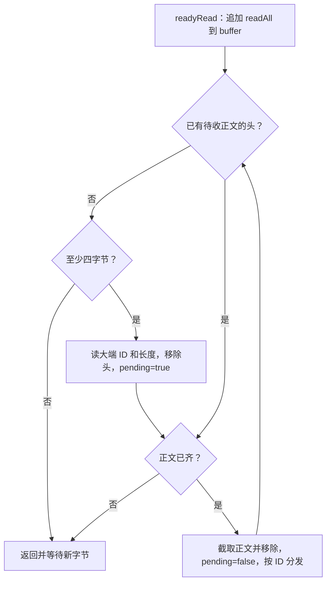

# Qt 网络编程

## 事件循环与网络对象

[Qt Network 文档](https://doc.qt.io/qt-6/qtnetwork-index.html)中的网络对象通过事件循环报告 I/O 进展。GUI 线程调用 `connectToHost()` 或 `post()` 后继续处理窗口事件；结果随后通过 connected、readyRead、finished 等信号交付。槽函数中的 JSON 解析、文件读取和计算仍会占用执行它的线程。

| 类 | 职责 | 项目位置 |
| --- | --- | --- |
| `QNetworkAccessManager` | HTTP 请求、连接复用、代理和 Cookie 等管理 | `HttpMgr::_manager` |
| `QNetworkRequest` | URL、请求头和请求属性 | `HttpMgr::PostHttpReq()` |
| `QNetworkReply` | 一次异步响应的数据、错误和结束通知 | `HttpMgr::PostHttpReq()` 的 finished 回调 |
| `QTcpSocket` | TCP 连接和字节流收发 | `TcpMgr` |
| `QDataStream` | 固定宽度整数的序列化与字节序 | 聊天帧头 |
| `QTcpServer` / `QUdpSocket` | Qt TCP 监听和 UDP 数据报 | 教学扩展，聊天服务端使用 Asio |

[客户端 CMake](../chat_app%20desktop/CMakeLists.txt) 使用 `find_package(Qt6 6.5 REQUIRED COMPONENTS Core Widgets Network Sql WebEngineWidgets WebChannel)`，链接 `Qt::Network` 等目标。Qt 版本下限、编译器和 WebEngine 组件需要一并满足，不能仅安装 Qt Core/Widgets 就构建完整客户端。

网络对象只能在其所属线程中操作。QObject 接收队列槽需要事件循环；直接调用它的方法不会自动转移线程。项目的 HTTP、聊天 TCP 和窗口在 GUI 线程使用，因此应避免 `waitForConnected()`、`waitForReadyRead()` 或循环等待响应占用界面线程。

## HTTP：请求、响应与所有权

### 一次 POST 的数据流

[httpmgr.cpp](../chat_app%20desktop/httpmgr.cpp) 的 `PostHttpReq()` 完成以下步骤：

1. `QJsonDocument(json).toJson()` 生成 UTF-8 JSON 字节。
2. 创建 `QNetworkRequest`，设置 `Content-Type: application/json` 和请求体字节长度。
3. `_manager.post(request, data)` 返回代表本次请求的 QNetworkReply。
4. finished 回调检查 `reply->error()`，成功则读取正文，失败则报告 `ERR_NETWORK`。
5. 发出带 `ReqId`、结果、错误码、`Modules` 的内部信号。
6. `slot_http_finish()` 按注册、登录、重置密码模块转发结果，最后通过 `deleteLater()` 回收 reply。

```cpp
// 教学示例：manager 和接收上下文均应覆盖请求寿命。
QByteArray body = QJsonDocument(payload).toJson(QJsonDocument::Compact);
QNetworkRequest request(url);
request.setHeader(QNetworkRequest::ContentTypeHeader, "application/json");
auto *reply = manager->post(request, body);
QObject::connect(reply, &QNetworkReply::finished, reply, [reply] {
    const auto error = reply->error();
    const QByteArray response = reply->readAll();
    // 在此消费 error 和 response；业务 JSON 还需另行解析和校验。
    reply->deleteLater();
});
```

QNetworkAccessManager 适合跨请求复用，一个实例可以管理多个并行请求及可复用连接。HTTP 请求具有独立的请求/响应语义；HTTP/1.1 等实现可以复用底层 TCP 连接，不能把每个请求等同为一次建连后立即断开。

### 网络完成与业务成功

`QNetworkReply::NoError` 只表示 Qt 没有报告该次网络操作错误。上层仍需解析 JSON，并检查业务 `error`、必填字段及字段类型。成功登录回包中的 ChatServer 地址和 token 是下一个 TCP 阶段的输入。

项目 HttpMgr 用 `ReqId` 标识操作类型、`Modules` 标识接收模块；它没有为每个同类型 HTTP 请求提供独立 UUID。页面并发提交相同请求时，不能单靠操作枚举区分新旧回包。

HttpMgr 当前没有设置应用级请求超时、显式重试或统一取消接口。网络库的底层超时不能替代界面对等待时间的业务约定。页面展示错误时可区分网络层失败、JSON 格式失败和服务端业务拒绝。

### reply 的生命周期

reply 通常以 manager 为父对象，但每次请求完成后仍应及时回收，避免长期存活的 manager 累积响应对象。finished 槽内使用 `deleteLater()` 安排安全删除；删除后不能继续读取它的属性或正文。

项目闭包捕获 `shared_from_this()` 取得的 `self`，保持 HttpMgr 存活。它只控制对象所有权，不能保证回包仍属于当前用户或仍显示同一页面。页面使用 QObject 上下文连接接收结果，销毁时自动断开；需要跨登录关联的操作还应检查账号或代次。

## TCP：从连接到业务登录



[tcpmgr.cpp](../chat_app%20desktop/tcpmgr.cpp) 在 `initSigAndSlot()` 中连接 connected、disconnected、readyRead、errorOccurred。`connectToHost()` 的返回不能代表握手成功；connected 也不代表 token 已验证。`_logged_in` 由业务回包推进，用于限制心跳和通话请求。

断线、主动退出与重复登录会触发连接重置、用户数据清理及媒体控制器清理。`LoginGeneration()` 标识登录连接代次，资源和媒体回包可据此拒绝旧账号会话的异步结果。

## 聊天 TCP 帧的数据模型

TCP 可靠、有序地传输字节流；一次 write 可以被拆成多次读取，多次 write 也可能合并到一次 readyRead。应用自己定义消息边界。

| 字段 | 长度 | 编码与含义 |
| --- | --- | --- |
| message_id | 2 字节 | 大端无符号 16 位整数，映射 `ReqId` |
| body_length | 2 字节 | 大端无符号 16 位整数，表示后续消息体字节数 |
| body | body_length 字节 | 通常为 UTF-8 JSON |

例如消息 ID 为 `0x03ED`、正文为两个字节 `{}`，帧头依次为十六进制 `03 ED 00 02`，随后为正文 `7B 7D`。整数宽度与字节序是跨语言协议的一部分。

聊天正文最大可由 16 位长度表示为 65535 字节。服务端和特定业务还可以有更严格的限制，不能用最大帧长推导文本、历史分页或资源分片的业务上限。ResourceServer 使用独立 TCP 通道及 2+4 字节头，不能套用聊天头解析。

### 发送端

当前 `slot_send_data(ReqId, QByteArray)` 直接接收已编码字节。它检查连接状态和 `quint16` 上限，以 `dataByte.size()` 写入长度，然后把正文追加在头部之后。

```cpp
// 教学示例：先检查正文上限，再进行窄化转换。
if (body.size() > std::numeric_limits<quint16>::max())
    return;
QByteArray frame;
QDataStream out(&frame, QIODevice::WriteOnly);
out.setByteOrder(QDataStream::BigEndian);
out << quint16(messageId) << quint16(body.size());
frame.append(body);
socket->write(frame);
```

`QString::size()` 计 UTF-16 代码单元，UTF-8 传输长度应取 `toUtf8()` 后的 QByteArray 大小。`QDataStream << QByteArray` 会加入自己的序列化长度信息；当前协议用 `append()` 放入原始 JSON 字节，不能随意替换为该运算符。

write 返回表示 Qt 接受的写入情况，数据通常先进入发送缓冲区。它不证明服务器已经解析、持久化或把消息展示给好友。应用回执和已读语义需要由协议另行定义。当前发送函数对负返回值记录警告，未实现发送队列总量的背压控制。

### 接收端的两阶段状态机

`_buffer` 保存尚未消费的数据；`_message_id`、`_message_len` 保存已经读出的头；`_b_recy_pending` 表示当前是否正在等待已解析头对应的正文。



源码通过 while 循环持续消费完整帧，直到头或正文不够。半包返回时保留成员状态；未知 ID 在消费对应完整正文后跳过，再继续处理后续帧。

读取头部时设置 `QDataStream::Qt_6_0` 和 BigEndian。当前头部只有固定宽度整数，Asio 服务端按相同字节协议解码，不依赖 Qt；若以后使用 QString、容器等 QDataStream 格式，则必须把其序列化版本纳入双方协议。

JSON 解析在帧完整后进行。长度正确仅保证帧边界正确，正文仍可能非法，handler 需要检查 JSON、参与者和资源字段。文件、图片的真实内容通过资源通道传输，聊天 TCP 主要携带资源元数据。

## 心跳、断线与进程退出

当前心跳参数由 `tcpmgr.cpp` 常量定义：登录后立即发送第一条 1023，此后每 20 秒发送；使用 QElapsedTimer 检查连续 60 秒没有有效 1024 回包的情况。socket 即使仍显示 ConnectedState，也可因心跳超时被 abort。

超时路径先标记断线已通知，避免 abort 触发 disconnected 后重复显示提示。普通断线、心跳超时和互踢由 MainWindow 分别提示，清理连接后返回登录页。代码不在这些路径自动重连，用户重新登录恢复会话。

`PrepareForShutdown()` 在 QApplication 仍存活时停止网络和媒体回调。事件循环退出后才安排 `deleteLater()` 无法保证执行，因此 socket、timer、数据库连接的最终销毁应按 [Qt知识点](Qt知识点.md) 所述退出顺序处理。

## TCP 监听与 UDP 教学扩展

Qt 中 TCP 服务端采用一个 QTcpServer 监听，每次 `nextPendingConnection()` 取得一个独立 QTcpSocket。监听对象和已接入连接有各自的寿命，关闭监听不等于关闭所有已接入连接。

```cpp
// 教学示例：owner 拥有监听对象和连接回调的上下文。
auto *server = new QTcpServer(owner);
QObject::connect(server, &QTcpServer::newConnection, owner, [server, owner] {
    while (server->hasPendingConnections()) {
        auto *socket = server->nextPendingConnection();
        QObject::connect(socket, &QTcpSocket::disconnected,
                         socket, &QObject::deleteLater);
        QObject::connect(socket, &QTcpSocket::readyRead, owner, [socket] {
            const QByteArray bytes = socket->readAll();
            // 实际业务须按每个连接独立缓存并解析应用帧。
        });
    }
});
const bool listening = server->listen(QHostAddress::LocalHost, 9999);
```

UDP 保留数据报边界，但不保证送达、顺序或唯一性，接收时还需处理数据报大小、截断、身份和频率限制。音视频的 WebRTC 包括 RTP/RTCP、拥塞控制、抖动缓冲和 DTLS-SRTP 等层，不能用裸 UDP 的一次 writeDatagram 替代其媒体协议。

## 使用与诊断边界

- 在可执行文件旁的 `config.ini` 配置 GateServer；HTTP 登录返回的地址决定后续 ChatServer TCP 目标。
- 连接失败时区分 DNS/端口不可达、TCP 握手失败和业务凭证拒绝，分别沿 HttpMgr、socket 信号、登录 handler 定位。
- 内容乱码时检查 UTF-8 字节与 JSON 解析；后续消息全部错位时检查帧头长度、字节序和半包状态。
- 界面卡顿时检查槽中耗时工作以及阻塞等待；异步网络不能消除槽函数自己的 CPU 开销。
- 当前入口构造网关 HTTP URL，聊天使用 QTcpSocket；这些通道没有由此获得 TLS 保护。密码异或混淆、token 和登录鉴权都不能替代传输加密。

相关实现：[httpmgr.cpp](../chat_app%20desktop/httpmgr.cpp)、[tcpmgr.cpp](../chat_app%20desktop/tcpmgr.cpp)、[logindialog.cpp](../chat_app%20desktop/logindialog.cpp)、[main.cpp](../chat_app%20desktop/main.cpp)。业务登录见 [login](login.md)，音视频媒体通道见 [WebRTC视频通信](WebRTC视频通信.md)。
