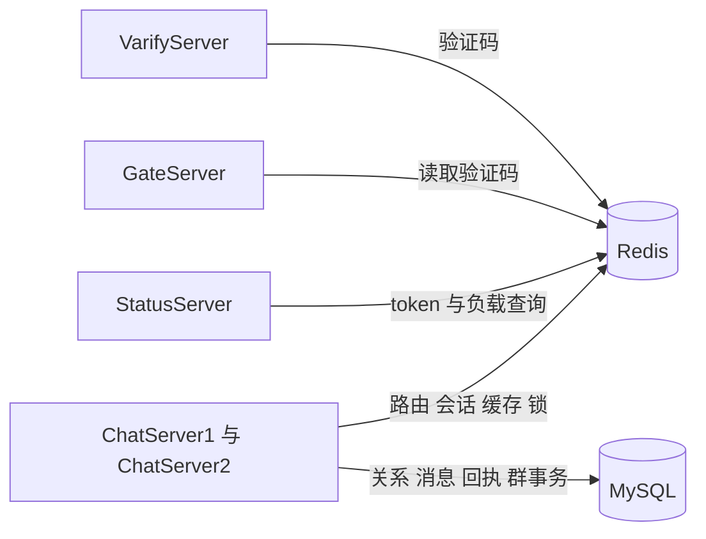

# Redis 数据模型与业务生命周期

## key 与使用者

| key | 类型和值 | 写入与读取 | 生命周期 |
| --- | --- | --- | --- |
| `code_<email>` | String，UUID 前四个字符 | VarifyServer 写，GateServer 读 | `SETEX`，180 秒 |
| `utoken_<uid>` | String，登录 token | StatusServer 写，ChatServer 登录读 | 普通 `SET`，无 TTL，后续签发覆盖 |
| `login_count` | Hash，服务名到在线数量 | ChatServer 更新，StatusServer 调度读 | 启动设 0，正常退出删除 field |
| `uip_<uid>` | String，ChatServer 名称 | ChatServer 登录写，各业务路由读 | 当前会话退出清理，无 TTL |
| `usession_<uid>` | String，当前会话 UUID | ChatServer 登录写，断开及信令校验读 | 新登录覆盖，当前会话退出清理 |
| `ubaseinfo_<uid>` | String，用户资料 JSON | ChatServer 查询缓存 | 普通 `SET`，当前无自动过期 |
| `unameinfo_<name>` | String，按用户名查找的资料 JSON | ChatServer 查询缓存 | 普通 `SET`，当前无自动过期 |
| `lock:login_lock_<uid>` | String，锁持有者 token | RedisMgr / DistLock | 有限租约，持有者续租和释放 |

键前缀见 [ChatServer1 const.h](../ChatServer1/include/const.h)、[ChatServer2 const.h](../ChatServer2/include/const.h)，验证码常量见 [VarifyServer const.js](../VarifyServer/const.js)。锁外的业务状态主要由各进程的 RedisMgr 操作；连接资源与响应内存见 [Redis连接库](Redis连接库.md)。



Redis 中的在线路由是进程运行状态；用户、好友、会话、消息、回执和群管理事实存储在 MySQL。缓存丢失可以回源，登录 token 或验证码丢失则需要重新获取相应凭证，持久化消息仍可通过历史同步读取。

## 验证码与过期

[VarifyServer/server.js](../VarifyServer/server.js) 先读取 `code_<email>`，存在时返回重复请求错误；不存在时截取 UUID 的前四个字符，再用 `setex(key, 180, value)` 保存并发送邮件。验证码包含十六进制字符，不应在输入框限定为六位数字。

`SETEX` 将值和过期时间一次提交，避免“写值成功、设置 TTL 失败”留下永久验证码。GateServer 的注册和重置密码路由读取同一个 key，比较字符串。当前路径没有成功后删除验证码，也没有失败次数限制；180 秒内仍可再次比较同一码。

读取失败与不存在在现有封装中常被合并：Node `GetRedis()` 异常也返回 `null`，C++ `Get()` 返回 `false` 同时覆盖网络失败和 key 不存在。运维排查需要结合 Redis 连通性，不能只依据业务“验证码过期”提示。

## token 与调度

[StatusServiceImpl](../StatusServer/src/StatusServiceImpl.cpp) 的 `GetChatServer` 读取配置中的 ChatServer 列表，从 `login_count` 取在线数，选择最小计数，并列时轮询。缺失或无效计数按最大值处理；全部计数无效时仍从并列实例中选择。这里没有带租约的服务注册或健康摘除，进程异常退出后可能留下过期计数。

token 由时间戳与 `mt19937_64` 随机值异或后转十六进制字符串，写入 `utoken_<uid>`。ChatServer 的 TCP 登录处理直接读取 Redis 比较 token；`StatusService.Login` 也提供校验接口，但当前该登录路径不调用它。

当前 token 无 TTL、无一次性消费，同一 uid 再次 HTTP 登录会覆盖值。它是服务器保存的字符串凭证，不能按 JWT 或密码学随机令牌推导安全属性。`insertToken()` 没有将 `Set()` 的失败传回调度响应，因此“拿到 token”不保证 Redis 写入成功。

## 在线路由、重复登录与会话清理

`uip_<uid>` 的值是服务实例名，例如 `ChatServer1`。发送业务读取该值后，本服用 `UserMgr` 查 `CSession`，异服调用对应 ChatService。PeerServer 配置中的 `name` 必须与 Redis 中的实例名一致。

`usession_<uid>` 用于区分同一用户的新旧 TCP 会话。[登录处理](../ChatServer1/src/LogicSystem.cpp) 在登录锁保护下处理旧会话、绑定 uid、写入路由和会话 UUID，再维护本机映射。[断开处理](../ChatServer1/src/CSession.cpp) 比较 Redis session UUID，仅匹配时清理在线 key，防止旧连接回调删除新连接的状态。两台 ChatServer 都维护该约定。

多条 `GET/SET/DEL` 独立执行并不构成原子事务。登录锁和会话身份检查共同约束操作顺序；任何新增清理路径仍需遵守同一约定。相关操作中的 Redis 失败也需要单独处理，不能把“未读到状态”等同于状态真实不存在。

路由缺失时跳过实时推送。私聊文本、图片、文件等持久化消息可由客户端通过历史增量同步获取，Redis 路由本身不承担离线消息存储。

## 资料缓存

ChatServer 的 `GetBaseInfo`、用户名查询使用先缓存后 MySQL 的流程：

1. 从对应 key 读取 JSON。
2. 命中且能解析时使用缓存资料。
3. 未命中或无法解析时查询 MySQL。
4. 将资料序列化后写回 Redis。

同一用户存在 uid 与用户名两种缓存入口。修改资料、用户名或删除用户时需要使相关缓存失效，普通 `SET` 不会自动实现这一规则。当前无统一 TTL；缓存可长期保留旧值。资料缓存不能作为好友关系、群角色或资源下载权限的授权依据。

## 原子命令与租约锁

`HINCRBY login_count <服务名> <增量>` 原子累加在线数，避免并发读改写丢失增量。它不保证进程崩溃后计数准确，计数正确性还依赖每个会话只增加和减少一次。

登录锁采用 `SET key token NX PX ttl`；解锁和续租用 Lua 比较 token 后执行 `DEL` 或 `PEXPIRE`，避免过期持有者删掉新锁。租约时间不是业务永不重入的保证，业务操作超出租期后需要按锁实现处理续租失败。详细资源粒度和异常策略见 [分布式锁设计](分布式锁设计.md)。

ChatServer 的锁接口区分 `Busy` 与 `RedisError`：前者表示正常竞争，后者表示依赖或连接池不可用。跨进程 Node 回调即使运行在同一事件循环，`GET` 后 `SETEX` 之间也能穿插其他请求；当前验证码的重复请求检查不具备 `SET NX` 那样的原子防重能力。

## 配置与操作

C++ 服务读取各自 `config.ini` 的 `[Redis] host/port/passwd`；Node 读取 `config.json` 的 `redis.host/port/passwd`。参与同一聊天室的服务必须指向同一 Redis 数据集，并保持 key 命名一致。生产实例应配置认证、网络访问限制及所需持久化策略，文档和日志不能保存密码、token、验证码。

排查时可在经过认证的 redis-cli 会话中查询限定 key：

```redis
TTL code_example@example.com
HGETALL login_count
GET uip_1001
GET usession_1001
```

`TTL` 返回 `-2` 表示 key 不存在，`-1` 表示未设置过期。生产排查应避免全库 `KEYS *` 和无差别打印敏感值；需要枚举时使用带前缀的 `SCAN`，并了解它在并发修改期间可能重复返回条目。
