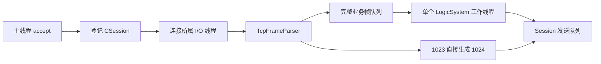
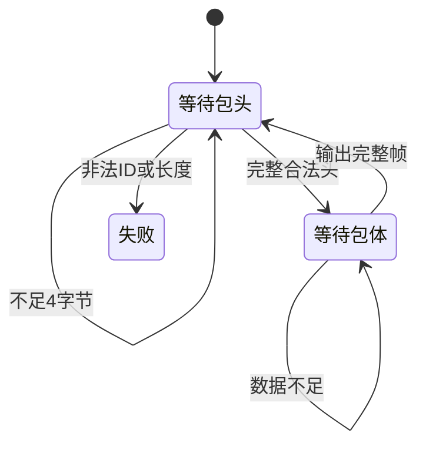

# TCP 服务器

## 线程与组件

| 组件 | 数据与职责 |
| --- | --- |
| `ChatServer.cpp` | 主 `io_context` 驱动监听器、心跳扫描及退出信号；另启动 gRPC 服务 |
| `CServer` | 以 `session_id` 为键保存 `shared_ptr<CSession>`，登记连接、移除连接、扫描超时 |
| `AsioIOServicePool` | 多个 `io_context` 各有一个线程与 work guard，新连接轮询分配执行器 |
| `CSession` | 单连接字节流解析、发送队列、UID 绑定、活跃时间与断线清理 |
| `LogicSystem` | 一个工作线程消费完整业务帧，按消息 ID 查回调；执行数据库和跨服调用 |
| `ChatServiceImpl` | gRPC 工作线程接收跨服通知，与 TCP 业务共享本机 `UserMgr` 和真实 `CServer` |

work guard 让没有任务的 `run()` 保持等待。它不执行业务；`GetIOService()` 用原子索引轮询分配连接。队列锁只保护入队、出队，`DealMsg()` 取出节点后释放锁，再执行数据库/RPC，避免耗时业务阻塞 I/O 入队。单业务线程仍可能使其他业务请求排队；心跳绕过此队列。

## 帧的数据模型

| 偏移 | 长度 | 内容 |
| ---: | ---: | --- |
| 0 | 2 字节 | 无符号消息类型，大端序 |
| 2 | 2 字节 | UTF-8 JSON 包体字节数，大端序 |
| 4 | 包体长度 | JSON 原始字节，不附加线上字符串终止符 |

服务端 `TcpFrameParser` 实际校验消息 ID 和包体长度均为 `1..2048`。输入包体最大为 **2048 字节**，整帧最大为 **2052 字节**；读取数组大小不决定一帧大小，因为解析器会保存跨读取状态。ID 在范围内仅表示头部合法，是否注册处理器、JSON 是否有效和业务权限由后续逻辑决定。

例如 1023 携带 `{}`，线上十六进制字节为 `03 FF 00 02 7B 7D`。长度按 UTF-8 字节计算，中文字符不能按 `QString::length()` 计数。发送端 `SendNode` 预先组装头和包体，异步写期间节点必须持续存活。

### 半包与多帧

`Feed(data, length, frames)` 依次填满四字节头部、校验头部、调整包体缓冲区、填满包体并输出帧。剩余字节继续解析下一帧。只到达部分头或部分包体时保留状态，等待下次读取。

解析失败后解析器持续返回失败，`CSession` 关闭连接。同一批输入中若前面已有完整帧、后面才出现非法头，前面的帧先处理，随后断线。半包本身不会更新活跃时间。

Qt 的 `TcpMgr::readyRead` 将 `readAll()` 追加到 `_buffer`，循环消费所有完整帧。`_b_recy_pending=true` 表示已经消费头部，接下来只等待该包体；不足包体时直接返回，下一次不能重新解析头部。消费完整包体后复位，再继续读下一个头。断线清空缓冲区和状态。Qt 接收路径没有服务端相同的 2048 字节头校验，通用发送函数仅检查两字节长度可表示范围；群请求另有 2048 字节限制。

### 输入和输出上限

历史 `1030` 的服务端紧凑 JSON 预算为 4096 字节；Qt 可以接收这类响应。输入 2048、历史输出 4096 和两字节字段可表示范围属于不同限制。普通 `TrySend` 仅拒绝正文超过 32767 字节，未统一执行历史/群业务预算；不能据此推断所有业务发送都满足接收端上限。

## 串行发送与背压

每个 Session 有互斥锁保护的 `queue<shared_ptr<SendNode>>`。入队前队列为空时启动一次 `async_write`；写成功弹出队首，非空则启动下一次。异步写组合操作会处理底层部分写，同一 socket 的多个组合写需要这样串行化。

`TrySend` 在连接已进入断线清理、等待发完关闭、正文超过 32767 字节或当前队列长度大于 `MAX_SENDQUE=1000` 时返回 false。判断使用 `>`，因此当前长度为1000时仍可追加一个节点。`Send(std::string, id)` 丢弃这个布尔结果；私聊的实时成功标志无法精确证明队列已接纳。群授权和音视频信令采用 `TrySend` 检查接纳结果。`MAX_RECVQUE=10000` 有常量定义，`PostMsgToQue` 没有据此限制队列长度。

`NotifyOffline()` 将1021追加到现有队列并设置 `_close_after_send`，普通发送随后被拒绝。已有消息与1021写完后，`HandleWrite()` 才调用 `HandleDisconnect()`。该流程没有发送排空期限或客户端确认，慢对端可延迟关闭。

## 会话所有权与停止

accept 成功后先在 `_sessions` 登记，再调用 `Start()`，避免首次读错误清理后又把失效会话登记回去。Session 读写回调持有自身强引用；逻辑队列也持有 Session。移出容器只取消登记，实际析构要等最后一个强引用释放。

CServer 回调捕获弱引用，Session 也弱引用所属服务器。`make_shared<CServer>` 后调用 `Start()`，使 `weak_from_this()` 有效。`Stop()` 设置停止标记并取消 timer、acceptor，禁止取消回调重新注册监听。

进程退出按监听停止、主循环停止、I/O 池停止、gRPC关闭与等待、逻辑队列排空、解除服务器强引用的顺序执行。`io_context::stop()` 不承诺执行全部待完成回调，也不承诺把所有发送队列写完。具体顺序和 Qt 退出规则见[异常处理](异常处理.md)。

## 配置与操作

1. 在实例 `config.ini` 的 `[SelfChatServer]` 配置唯一 `name`、对外返回地址 `host`、客户端TCP `port` 和服务间 `rpcport`。监听器使用 `tcp::v4()`，绑定所有 IPv4 接口，`host` 不限制 TCP 监听网卡。
2. 保持 StatusServer 的 ChatServer 名称/地址、Redis `uip_<uid>` 值与 `[PeerServer]` 连接池名称一致。客户端连接8090/8091，跨服调用使用50055/50056，部署可自行修改。
3. 服务依赖 MySQL、Redis；图片/文件发送还依赖 ResourceServer核验。配置被 CMake 复制到二进制 `Debug` 目录，运行目录中的配置必须与部署一致。
4. 诊断拆分为TCP建立、1005/1006认证、完整帧解析、业务队列与数据库、实时转发五段。socket 已连接不代表登录成功，写成功不代表界面已展示。

## 代码与交叉阅读

- [监听和心跳扫描](../ChatServer1/src/CServer.cpp)、[会话收发](../ChatServer1/src/CSession.cpp)、[增量解析器](../ChatServer1/include/TcpFrameParser.h)。
- [发送节点](../ChatServer1/include/MsgNode.h)、[线程池](../ChatServer1/src/AsioIOServicePool.cpp)、[逻辑队列](../ChatServer1/src/LogicSystem.cpp)。
- [Qt TCP管理器](../chat_app%20desktop/tcpmgr.cpp)、[实例配置](../ChatServer1/config.ini)、[进程入口](../ChatServer1/ChatServer.cpp)。
- [消息ID全链路](消息ID全链路.md)、[聊天信息收发](聊天信息收发.md)、[心跳检测](心跳检测.md)。
