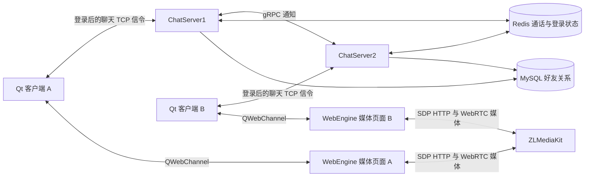
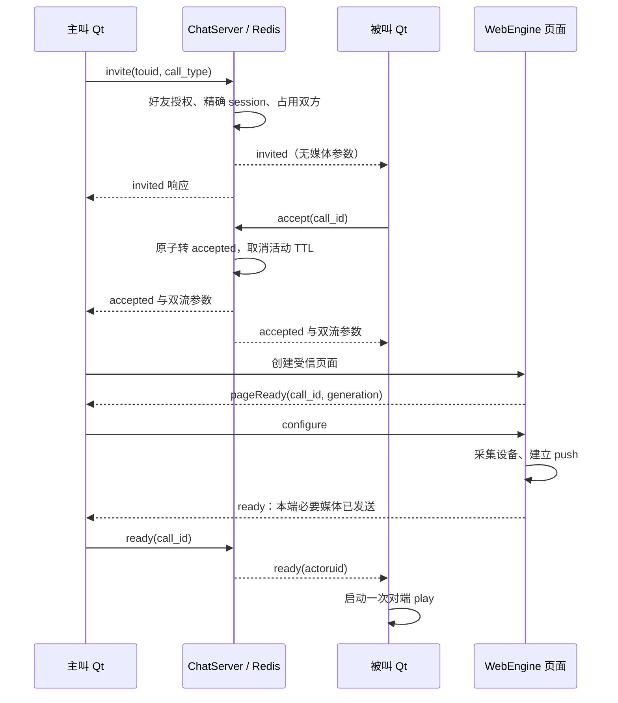
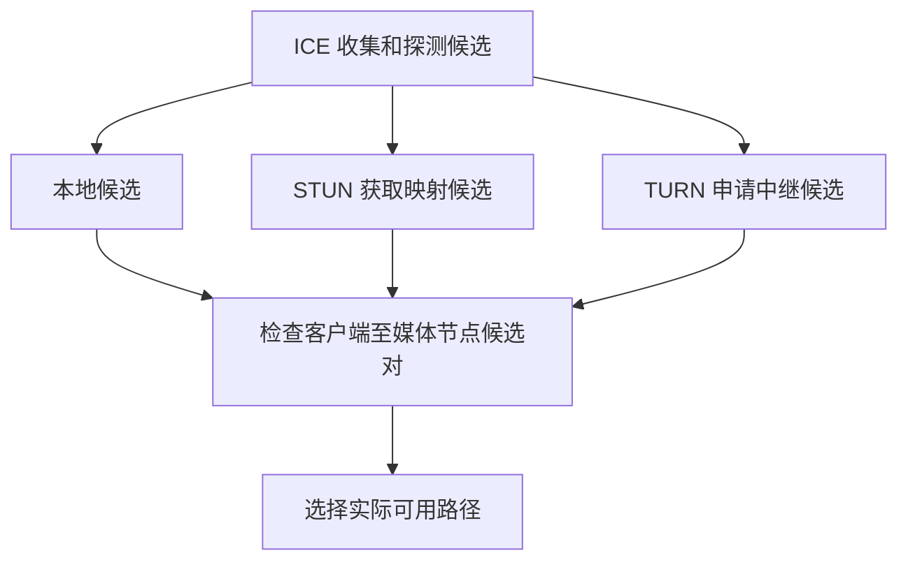

# WebRTC 视频通信

## 当前实现：控制通道与媒体通道



聊天控制通道处理邀请、接听、拒绝、发布就绪和结束。媒体页面负责设备采集、编码、WebRTC、解码与播放；SDP 由页面直接提交 ZLMediaKit，以下称 ZLM。媒体数据不经过聊天 TCP 或 ChatServer gRPC。

当前好友通话每端创建两个 `RTCPeerConnection`：push 发布本端流，play 订阅对端流。两个 PC 的对端都是 ZLM。一场双向通话共四条客户端至媒体节点的 WebRTC 连接，ZLM 可以访问并转发媒体内容，这个结构没有提供端到端加密的隐私保证。

| 入口 | 设备与用途 | 控制器 / 页面 |
| --- | --- | --- |
| 好友页语音按钮 | 真实麦克风，双向语音 | VoiceCallController / `voice_call` |
| 好友页视频按钮 | 真实麦克风与摄像头，双向音画 | 同一个 VoiceCallController / `voice_call` |
| 好友页 `test` 按钮 | 固定文件单向发送，不申请设备 | VideoTestController / `video_test` |

`VoiceCall`、`voiceCall` 和 `voice_call` 是语音与视频共用的代码名称。固定文件功能有独立的 `video_test` 应用和状态，不能据其单向播放行为推断好友视频通话的设备或接听语义。

## 当前实现：构建依赖与资源部署

[客户端 CMake](../chat_app%20desktop/CMakeLists.txt) 声明：

```cmake
find_package(Qt6 6.5 REQUIRED COMPONENTS
    Core Widgets Network Sql WebEngineWidgets WebChannel)
```

目标链接六个 Qt 模块，MSVC 下启用 `/utf-8`。CMake 最低 Qt 版本写作 6.5，源码权限处理使用 `QWebEnginePage::featurePermissionRequested` 与 `setFeaturePermission()`；没有使用 Qt 6.8 新增的 `permissionRequested` API。不能根据文档中的旧运行记录断言本机已经安装或验证过某个 kit。

kit 将编译器、Qt 二进制库、架构和调试器组合起来。Windows 需要选择受对应 Qt WebEngine 版本支持、ABI 与位数一致的 kit，并安装同版本 WebEngine、WebChannel、Sql 等组件；MSVC kit 还需相应 Visual Studio C++ 工具链。更换编译器时使用独立构建目录，避免复用旧 CMake 缓存。

[main.cpp](../chat_app%20desktop/main.cpp) 在 QApplication 构造前注册 `chatvideo` scheme。页面和脚本经 [videotest.qrc](../chat_app%20desktop/videotest.qrc) 嵌入程序，固定文件仍是外部素材。

| 文件 | 复制或安装行为 |
| --- | --- |
| `config.ini` | 配置阶段复制到构建根，post-build 再复制到实际目标目录 |
| `static` | 配置阶段复制到构建根 |
| `media` | post-build 复制到可执行文件旁；install 规则安装到运行目录 |
| Qt 运行时 | `qt_generate_deploy_app_script()` 生成部署脚本，由 install 执行 |

发布时还应明确准备 exe 旁的 config.ini，检查 WebEngine 子进程、资源、语言包和 Qt 插件是否随部署脚本正确部署。CMake 的 config 复制规则不等于安装规则覆盖了全部运行配置。

## 当前实现：通话标识与服务端数据

### 协议标识

控制消息复用聊天的 2 字节 ID、2 字节正文长度和 JSON 帧，定义见 [global.h](../chat_app%20desktop/global.h)。

| 消息 | ID |
| --- | --- |
| 固定文件请求 / 响应 / 通知 | 1082 / 1083 / 1084 |
| 好友音视频请求 / 响应 / 通知 | 1085 / 1086 / 1087 |

`TcpMgr::SendVoiceCall()` 为每次操作生成标准 UUID `request_id`。invite 发送 `touid` 和必填 `call_type`，只允许 `audio`、`video`；后续操作仅传 `call_id`，服务端拒绝再次附带 `call_type`。类型在创建时保存，后续公开活动消息均来自该服务端值。

```json
{
  "op": "invite",
  "request_id": "8c97cfed-cd60-4714-86b1-78ef81980886",
  "touid": 2002,
  "call_type": "video"
}
```

| 标识 | 生存范围与作用 |
| --- | --- |
| `request_id` | 单次操作关联，响应回显 |
| `invite_request_id` | 固定为最初邀请 UUID，跨后续动作保持不变 |
| `call_id` | 服务端创建的一场通话 UUID |
| `caller_stream`、`callee_stream` | ZLM 两个随机媒体流名，仅 accepted 公开 |
| `from_session`、`to_session` | 服务端内部精确登录身份，不向页面公开 |
| login generation | Qt 判断响应属于哪次 TCP 登录 |
| page generation | Qt 与 JS 判断响应属于哪次媒体页面 |

流名是媒体路由标识，随机性不能替代发布或订阅授权。浏览器 `MediaStream.id` 与 ZLM 流名没有相等要求。业务中涉及 uint64 标识进入 JavaScript 时宜使用十进制字符串，避免超过 Number 的安全整数范围。

### Redis 状态与好友授权

[VoiceCall.cpp](../ChatServer1/src/VoiceCall.cpp) 的 Lua 脚本原子管理：

- `voice:meta:<call_id>`：双方 UID、精确 session、类型、初始邀请 UUID、媒体地址和双流名、状态与 ready 标记。
- `voice:slot:<uid>`：当前用户占用的 call_id，用于阻止同时参与多个好友音视频通话。

新邀请同时校验双方 `usession_` 仍等于捕获的 session，并原子占用双方 slot。邀请和 slot 设置 120 秒 TTL。accepted 后元数据重新 SET 为无 TTL，双方 slot 执行 PERSIST，长通话没有固定到期时长。

挂断、拒绝、内部失败或精确 session 断线时删除元数据，仅删除仍指向该 call_id 的 slot。创建新邀请时，脚本还会检查旧占位对应 session 是否失效，回收旧登录遗留状态。

当前没有后台租约调度。服务进程异常退出且 Redis 旧 session 仍保留时，accepted 通话占位可能持续存在，直到登录身份变更或其他清理路径生效。不能将邀请 TTL 描述为活跃通话的统一过期保障。

[MysqlMgr::AuthorizeVideoTest()](../ChatServer1/src/MysqlMgr.cpp) 被两类媒体功能复用，执行 `friend` 表的双向关系 COUNT 查询，要求两行关系同时存在；连接或 SQL 故障返回 `rpc_failed`，与非好友 `forbidden` 分开。它只读好友关系，不创建聊天会话或持久通话消息。

### 同服与跨服投递

服务端身份来自认证 session，先检查本机 UserMgr 当前 session，再检查 Redis 当前 session。通知读取目标路由；同服调用精确投递，跨服使用 proto 的专用媒体 RPC。跨服连接池等待与 RPC 共用三秒绝对 deadline，不额外重试。

好友通话的 `Deliver()` 在本机投递锁内重新检查 Redis 活动阶段，再执行目标 TCP `TrySend`；成功只表示通知进入发送队列。结束状态先撤销，迟到的 accepted/ready 不能恢复通话。转发失败会撤销状态并向双方尽力发送终态，即使一次 RPC 超时而对端可能已经入队，也不把它当作成功。

`offline` 表示找不到目标路由，`unreachable` 表示精确连接或投递不可达，`rpc_failed` 涵盖 Redis、MySQL 依赖和跨服 RPC 故障。客户端把 offline/unreachable 都显示为“对方不在线”，其他状态包括 busy、forbidden、invalid、media_unavailable。

## 当前实现：邀请、接听与页面启动



被叫点击接听仅提交 accept。双方收到有效 accepted 后才创建媒体页面、申请设备，因此响铃和主叫等待期间不占用麦克风或摄像头。invited 表示来电入队，accepted 表示接听业务成立，二者都不表示媒体已经播放。

[VoiceCallController::Handle()](../chat_app%20desktop/voicecallcontroller.cpp) 检查账号、登录代次、call_id、初始邀请 UUID、双方 UID 和类型。主叫尚未收到 invite 响应时，accepted、ready 或终态也可能先到；控制器通过 `invite_request_id` 精确关联，不能按“同一个好友”猜测新旧通话。

取消尚未回包的邀请时记录原请求，若迟到成功分配了 call_id，会补发 end。已结束 call_id 进入 retired 集合，迟到 accepted 不再打开设备。同一活动通话重复点击入口只激活现有窗口。

页面先订阅 QWebChannel 的 command，再调用 pageReady；Qt 校验 call_id/generation 后下发 configure。对端 ready 若早于握手或本端设备授权，会被锁存，在配置到达后启动一次订阅。`playStarted` 在任何异步等待前置位，防止重复 ready 创建多个 PC。

## 当前实现：设备与轨道

[voice_call/media.js](../chat_app%20desktop/voice_call/media.js) 的设备约束为：

```js
// audio/video 取服务端确认的通话类型。
const stream = await navigator.mediaDevices.getUserMedia({
    audio: {echoCancellation: true, noiseSuppression: true, autoGainControl: true},
    video: config.call_type === 'video'
        ? {width: {ideal: 640}, height: {ideal: 480}, frameRate: {ideal: 24}}
        : false
});
```

语音只申请麦克风。视频要求音轨和视频轨均存在、live 且 enabled，任一必要设备失败结束整场通话，不自动改成语音。ideal 表达偏好，实际尺寸与帧率由设备和浏览器决定。

MediaStreamTrack 表示单一媒体源，MediaStream 把相关轨道组合，RTCPeerConnection 负责协商与网络传输。发布端遍历真实采集流，把每个 track 加入同一个 push PC，并把对应 transceiver 设为 sendonly；音轨和视频轨共享 stream 关联。

```js
// 同一 stream 中的音画分别拥有 sender，并共享发布连接。
const sender = push.addTrack(track, stream);
const transceiver = push.getTransceivers().find(item => item.sender === sender);
transceiver.direction = 'sendonly';
transceiver.setCodecPreferences(ChatWebRTC.codecs(track.kind, true));
```

订阅端按类型创建 recvonly transceiver，语音只需 audio，视频需 audio/video。编码能力从发送者和接收者各自的 `getCapabilities()` 查询，当前明确选择 Opus 音频和 VP8 视频，能力缺失直接失败。

本地视频预览绑定采集流并设置元素 muted；这只关闭本地播放声音，发送轨道继续 enabled。远端只有一个 video 元素同时输出音画，避免重复播放同一音轨。页面用 `object-fit:contain` 保持画面比例。

当前通话窗口提供接听、拒绝/取消/挂断，没有设备选择、麦克风静音或摄像头暂停/恢复操作。代码未实现 replaceTrack 设备切换；这些能力属于下文生产设计，不能按已有按钮使用。

## 当前实现：SDP 与 ICE 协商

共享 [video_test/webrtc.js](../chat_app%20desktop/video_test/webrtc.js) 不持有页面媒体资源，负责能力筛选和一次协商：

1. 创建 Offer，期限 8 秒。
2. 设置本地描述，期限 8 秒；此步骤推动 ICE 收集。
3. 等待 `iceGatheringState === 'complete'`，期限 8 秒。
4. 读取带完整候选的 `pc.localDescription.sdp`，向 ZLM POST。
5. 检查 HTTP 状态、JSON 业务 code、SDP 基本格式及所需 Opus/VP8 编码。
6. 设置 Answer，期限 8 秒；之后继续观察连接与实际媒体。

```js
// 当前协商只向已校验媒体源的固定 API 路径发请求。
const url = new URL('/index/api/webrtc', mediaUrl);
url.searchParams.set('app', app);
url.searchParams.set('stream', stream);
url.searchParams.set('type', sender ? 'push' : 'play');
const response = await fetch(url, {
    method: 'POST', headers: {'Content-Type': 'text/plain'},
    body: pc.localDescription.sdp, signal: request.signal,
    credentials: 'omit', redirect: 'error'
});
```

HTTP 期限为 20 秒，覆盖配置中的 ZLM 15 秒等流时间。每次 push/play 只发一次协商请求，无自动重试或 trickle ICE 通道。AbortSignal 连接页面生命周期与 ICE/HTTP 等待；每个异步边界还检查页面是否终结，防止迟到 Answer 操作旧连接。

当前 PC 配置为 `iceServers:[]`，没有注入 STUN/TURN 服务。候选收集 complete 仅说明候选集形成，不保证网络可达。ZLM 的候选地址、监听端口和防火墙映射必须与部署网络相符。

## 当前实现：媒体就绪与播放判据

每 500ms 的统计轮询串行执行 `getStats()`，分别保存 push/play、audio/video 的字节和解码进展。各方向各媒体具有独立的停滞时间，音频增长不能掩盖视频中断。

| 事件 | 页面要求 | 业务含义 |
| --- | --- | --- |
| ready | push connected，全部必要媒体的 outbound RTP 字节有增长 | 本端已发布，可通知对端订阅 |
| playing（音频） | 接收字节与有效音频样本增长，play() 兑现、未暂停、readyState≥2、播放时钟推进 | 页面已运行远端音频播放 |
| playing（视频） | 音频条件加视频收包/解码帧增长、非零画面尺寸和实际呈现帧 | 页面已运行必要音画播放 |
| Qt 双向通话显示 | 本端 ready 与远端 playing 同时成立 | 两个本地媒体方向满足判据 |

音频样本计数使用 totalSamplesReceived 或 jitterBufferEmittedCount，并扣除 concealedSamples。视频呈现通过 `requestVideoFrameCallback()` 计数，当前视频功能要求该 API 可用。ontrack、非零宽高或 connected 单项都不足以代表双向通话。

`ontrack` 可能按音轨、视频轨分别触发，也可能没有 event.streams。页面优先使用关联流，否则创建一个聚合 MediaStream，按 track id 去重，把后到轨道加入同一对象。播放器只在首次绑定时设置 srcObject 并调用 play，避免第二条轨道重置已开始的播放。

Qt 为受信页面关闭 `PlaybackRequiresUserGesture`，让 ready 驱动订阅与播放，页面仍处理 play() Promise 拒绝。自动播放策略、设备权限、收到 RTP 和真正播放属于不同环节。

这些指标不判断扬声器硬件音量、用户听感或画面内容。当前连续监测主要跟踪 RTP 字节及解码进展；播放时钟和呈现帧用于初次 playing 判定，没有完整的持续播放器冻结监测。

## 当前实现：权限与页面安全边界

[VideoTestController::RegisterScheme()](../chat_app%20desktop/videotestcontroller.cpp) 为 chatvideo 声明 HostAndPort、默认端口 443、SecureScheme、CorsEnabled，内置 origin 为 `chatvideo://test`。

- TestFiles 仅处理固定 host 的 GET，映射内置 HTML、JS、QWebChannel 脚本和配置的唯一 fixed.webm，不提供任意本地文件浏览。
- TestPage 只允许导航到自身固定入口，createWindow 返回空，拒绝新窗口。
- TestRequests 只放行内置资源及当前 media_url 同协议、主机、端口的 `/index/api/webrtc`。WebRTC 实际媒体传输使用协商出的路径，不由 HTTP 请求拦截器承担媒体防火墙功能。
- 每次通话创建独立 off-the-record QWebEngineProfile，页面销毁后再回收 profile。
- media_url 必须是无用户信息、无 query/fragment、无额外路径的 HTTP(S) 源地址；app、流名、双方 UID 也经 Qt 检查。
- 设备授权绑定 accepted 状态、call_id、generation、当前 page 和受信 origin。audio 只授音频；video 可授音频、视频或组合采集。固定文件页统一拒绝设备权限。

Windows 麦克风/摄像头隐私开关、设备独占和实际 WebEngine 能力仍影响采集。页面自动授权以用户已确认的呼叫类型为前提；它不绕过操作系统设备权限。

当前 ZLM 配置关闭 hook，媒体接口没有短时发布/订阅凭证。页面请求白名单和聊天好友鉴权不能阻止能访问媒体接口的第三方自行调用该接口。仓库回环配置仅适用于可信本机环境，不能直接公开到公网。

## 当前实现：期限、结束与资源释放

| 阶段 | 当前期限或动作 |
| --- | --- |
| Qt 邀请等待 | 60 秒 |
| 被叫提交 accept 后等待确认 | 15 秒 |
| accepted 后 Qt 等待双向媒体 | 45 秒 |
| 设备授权/启动 | 30 秒 |
| 发布或订阅协商后等待必要媒体 | 25 秒 |
| 必要媒体字节/已出现的解码进展持续停滞 | 25 秒 |
| PC failed、closed、disconnected | 立即按媒体失败结束，无自动恢复 |

关闭未接听来电走 reject；主叫取消、提交接听后关闭或已接听挂断走 end。最小化窗口不结束。TCP 连接重置、退出登录、互踢和媒体失败会停止当前页面。控制器没有单独监听 renderProcessTerminated 的恢复流程，运行时异常仍依赖现有失败与超时路径收敛。

清理按以下顺序执行：

1. Qt 先设置非活动，增加 generation，停期限计时，标记已结束 call_id。
2. 按当前角色和阶段发送 reject/end，向旧页面发送携带原代次的 stop，然后删除 view/page。
3. JS 先设置 dead，再 abort 生命周期、取消统计与呈现帧回调、断开 QWebChannel。
4. 关闭 push/play，停止本地、远端聚合流及 receiver 中的全部轨道。
5. 暂停本地和远端播放器，清空 srcObject、移除 src 并 load 重置媒体状态。

getUserMedia 本身不受这里的 AbortSignal 取消。采集结果在结束后才返回时，页面立即停止返回流的全部轨道。关闭 PC、停止 track、解除播放器引用分别释放传输、设备和播放资源，隐藏窗口不能代替停采。

## 当前实现：固定文件 test

[FriendInfoPage](../chat_app%20desktop/friendinfopage.cpp) 的 test 入口让点击者发布固定文件，对端自动打开接收窗口；此功能没有好友通话的接听步骤。每个客户端控制器维护一个测试窗口，重复点击激活原窗口。

| 操作 | 主要字段与行为 |
| --- | --- |
| start | request_id、touid；分配 test_id、stream_id、app=video_test，精确通知好友 |
| ready | request_id、test_id；仅发布端实际视频发出后提交，驱动对端开始 play |
| stop | request_id、test_id、可选 reason；先撤销状态再尽力通知，delivery_status 单独表示通知结果 |

[VideoTest.cpp](../ChatServer1/src/VideoTest.cpp) 使用 `vtest:meta:<test_id>` 与按 UID/session 组成的 slot，固定 120 秒有效，不续租。该占用与好友通话的 voice slot 是不同命名空间，未形成两类功能的统一忙线限制。

固定素材由 exe 旁 config.ini 指定：

```ini
[VideoTest]
file=media/video-test.webm
```

相对路径按 exe 目录解析，也可使用绝对路径。文件只通过 `chatvideo://test/fixed.webm` 暴露给内置页面，WebM 文件应具有 WebEngine 能解码的真实视频和音频轨道；协商发送采用 VP8/Opus。

[video_test/media.js](../chat_app%20desktop/video_test/media.js) 从文件元素 captureStream 提取视频，移除捕获的原音轨，再通过同一元素的 `MediaElementSource → MediaStreamDestination` 生成发送音轨。音频图只连接 destination，不连接本地扬声器输出；source 保持 muted=false、volume=1。文件的解码、AudioContext 启动、play 分别有 10/5/8 秒期限。

test 发布 ready 要求 connected 与视频字节非零；接收 playing 要求视频字节、音频字节、呈现或解码帧和播放器运行状态。该判据与好友音视频的逐媒体增长/音频样本检查不同。视频字节 25 秒无进展、文件结束、关窗、连接重置或失败会结束测试，清理 PC、捕获轨道、播放器和 WebAudio 节点。

## 当前部署：可信回环操作

[deploy/zlmediakit-video-test.ini](../deploy/zlmediakit-video-test.ini) 的配置值为：

| 配置 | 值与作用 |
| --- | --- |
| general.listen_ip | 127.0.0.1，只绑定回环 |
| HTTP | 18080；sslport=0，未启用 HTTPS |
| http.allow_ip_range | 127.0.0.1、::1 |
| http.allow_origins | `*`，宽松跨域，仅可在上述可信边界内使用 |
| RTC | UDP/TCP 18000，externIP=127.0.0.1 |
| 编码偏好 | VP8、Opus |
| maxStreamWaitMS | 15000 |
| hook.enable | 0，无媒体鉴权回调 |
| 其他服务入口 | RTSP/RTMP/RTP proxy/SRT/shell/ONVIF 监听关闭 |

两个 ChatServer 的仓库 config.ini 都设置 `[VideoTest] enabled=true`、`media_url=http://127.0.0.1:18080`。文件 test 与好友音视频共用这组开关和地址，修改时应覆盖实际运行实例的配置。回环地址要求客户端和媒体服务处于可互访的本机网络环境；远端机器的 127.0.0.1 指向其自身。

### 准备与启动

1. 安装满足工程依赖的 Qt kit，用独立构建目录配置客户端。常规构建命令形如 `cmake --build <构建目录> --config Release --target chat_app`，构建目录由所选 kit 先行配置。
2. 准备 ZLM 可执行文件和专用配置，将仓库回环配置复制到部署目录。后端管理 API 若需 secret，在后端配置中生成随机值并限制读取权限，不放入客户端 config 或页面。
3. 确保 18080 与 18000 对应协议端口未被其他实例占用；Windows/WSL 之间的回环访问取决于实际网络模式与转发设置。
4. 显式向启动脚本传入本机分发版、MediaServer、配置和日志目录，避免使用脚本中的机器相关默认路径。

以下路径为部署变量示例，需替换为已准备的实际位置：

```powershell
.\deploy\start_zlmediakit.ps1 `
  -Distribution 'Ubuntu-22.04' `
  -MediaServer '/opt/zlmediakit/MediaServer' `
  -Config '/etc/chat-app/zlm.ini' `
  -LogDirectory '/var/log/chat-app/zlm'
```

PowerShell 脚本把仓库的 [start_zlmediakit.sh](../deploy/start_zlmediakit.sh) 路径转换为 WSL 路径，再启动 Linux 监督进程，每秒向 stdin 写 heartbeat。Linux 按配置文件使用 flock 防重复启动，EOF 或五秒没有心跳时只终止本次持有的媒体子进程。配置及程序必须存在，程序须有执行权限，日志目录须可写。Linux 脚本需要 bash/flock，不适合直接作为无 stdin 心跳的长期后台服务启动。

### 用户操作与故障定位

1. 启动所需 MySQL、Redis、网关、状态服务和 ChatServer；两端使用互为好友的账号登录。跨服操作还需双方 gRPC 路由可达。
2. 在好友页点击语音或视频，被叫确认接听。设备授权失败时检查系统隐私、设备占用、轨道错误与当前页面类型。
3. 接听后长期等待时分别检查业务 accepted、页面握手、push SDP、ready 通知、play SDP，以及每种媒体的 RTP/解码/播放进展。
4. 固定文件操作使用 test，确认 exe 旁配置和素材存在；其自动接收行为与真实设备通话分别检查。
5. 结束时观察设备指示灯、窗口状态与服务日志，确认本地停采、Redis 占用释放和对端结束提示。异常退出的持久占位按前述 session 边界排查。

SDP HTTP 正常而媒体失败时，重点检查 ICE 候选、UDP/TCP 18000、防火墙和 ZLM externIP；不要只检查 HTTP 18080。诊断记录应避免暴露账号 token、管理 secret、完整 SDP 和网络地址。

## 生产设计：身份、媒体授权与公网传输

本节描述生产接入要求，仓库当前回环实现没有提供这些完整能力。

### 短时发布与订阅授权

业务服务生成绑定 UID、登录 session、call_id、app、stream、操作和有效期的短时媒体凭证。发布与播放分别授权，ZLM 的发布/播放回调经受控后端核验当前通话及参与者。管理 secret 留在后端，回调失败应拒绝媒体操作。

结束通话、账号失效或权限撤销时，后端既撤销新连接授权，也主动关闭已有媒体会话。短时凭证到期主要限制新建连接，不能自动证明既有传输已经停止。部署还需要活跃通话租约、崩溃恢复和媒体节点重启后的状态收敛策略。

登录、信令与 SDP 使用可信 TLS 通道。WebRTC 的 DTLS-SRTP 保护客户端至 ZLM 的媒体链路，ZLM 仍是媒体终点；隐私要求更高时需另行设计应用层端到端媒体加密及其与转发服务的兼容方式。

页面安全策略可以继续沿用固定内置页面、最小桥接接口、导航和请求白名单，并按发布环境设置 CSP、允许 origin、证书信任与日志访问权限。开发回环的 `allow_origins=*` 不应直接复制到公网服务。

### STUN、TURN 与 coturn

STUN 返回服务器观察到的 NAT 映射地址，供 ICE 形成候选；它本身不转发媒体。TURN 为客户端分配中继地址，在直达候选不可用时转发数据。coturn 同时实现 STUN 和 TURN。



候选检查依据网络可达性和 ICE 优先级进行，不能简化为固定的“先成功 STUN，再失败才运行 TURN”调用顺序。此项目媒体经过 ZLM，公网适配检查的是客户端到媒体节点的路径。

coturn 部署需配置可达的监听地址、外部映射、realm、认证和有限中继端口范围，并开放相应防火墙与 NAT 映射。TURN 凭证由后端短时签发，设置有效期、配额和带宽限制，避免把长期账号密钥嵌入页面。受限网络还应按部署选择 TCP/TLS TURN 入口；实际可用性需要覆盖同网、异网、受限 UDP 和企业出口。

当前页面使用空 iceServers 数组。接入 coturn 还需实现凭证下发和客户端 PC 配置，单独启动 TURN 服务不会改变现有页面的 ICE 行为。

### 设备控制与故障策略

生产界面可提供音轨 enabled 切换实现静音，并同步真实状态。摄像头停采需要停止原 track、调整发送器；恢复和设备切换要先获得新轨道、成功 replaceTrack 后释放旧轨道，失败应保留明确错误。设备列表、热插拔和用户选择均需要实际 UI 与权限流程。

播放受手势限制时可提供明确点击入口，处理 play() 结果。媒体重建或订阅重试应有次数和总期限，并按 call_id/generation 取消旧任务；当前实现选择失败后结束，没有这些恢复机制。

容量按每端发送总码率 b、并发通话数 C 粗估，ZLM 入站和出站各约 `2 × C × b`，还需计协议开销、TURN 流量、余量及实际转码成本。质量观测可采集候选对、码率、丢包、抖动、帧率和往返时延；当前页面只读取其就绪/停滞判断所需统计，没有完整质量遥测系统。

## 代码定位

| 源码 | 主要职责 |
| --- | --- |
| [friendinfopage.cpp](../chat_app%20desktop/friendinfopage.cpp) | 语音、视频和 test 入口 |
| [tcpmgr.cpp](../chat_app%20desktop/tcpmgr.cpp) | 请求 UUID、1082–1087 分发、登录代次与重置 |
| [voicecallcontroller.cpp](../chat_app%20desktop/voicecallcontroller.cpp) | 邀请窗口、业务关联、设备权限、页面和结束 |
| [voice_call/media.js](../chat_app%20desktop/voice_call/media.js) | 双 PC、设备、音画聚合、实际媒体判断与清理 |
| [voice_call/index.html](../chat_app%20desktop/voice_call/index.html) | 本地静音预览和唯一远端播放器 |
| [videotestcontroller.cpp](../chat_app%20desktop/videotestcontroller.cpp) | scheme、安全页面工厂、固定文件控制器 |
| [video_test/media.js](../chat_app%20desktop/video_test/media.js) | 文件捕获、WebAudio、单向媒体与结束 |
| [video_test/webrtc.js](../chat_app%20desktop/video_test/webrtc.js) | Opus/VP8、完整 ICE、一次 SDP 交换与取消 |
| [VoiceCall.cpp](../ChatServer1/src/VoiceCall.cpp) | Redis Lua 状态、权威类型、精确投递和跨服 RPC |
| [VideoTest.cpp](../ChatServer1/src/VideoTest.cpp) | 固定文件状态、120 秒占位和路由 |
| [message.proto](../proto/message.proto) | 媒体通知的 gRPC 信封与 RPC |
| [部署配置](../deploy/zlmediakit-video-test.ini) | 回环端口、编码偏好、等流与关闭的鉴权 hook |

聊天字节帧与 socket 生命周期见 [Qt网络编程](Qt网络编程.md)，QObject 和事件循环见 [Qt知识点](Qt知识点.md)。
