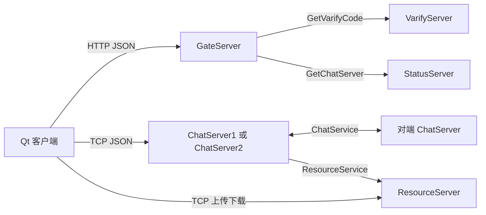

# gRPC 契约、调用与生命周期

## 协议与服务职责

[proto/message.proto](../proto/message.proto) 使用 `proto3` 和 `package message` 定义请求、响应及服务。Protobuf 用字段编号编码数据，gRPC 以 HTTP/2 承载远程调用。客户端与 ChatServer 的长连接仍使用自定义包头和 JSON，客户端资源传输也走 ResourceServer TCP；服务间 RPC 与这些客户端协议分别演进。

| 服务 | 服务端进程 | 主要调用者 | 接口职责 |
| --- | --- | --- | --- |
| `VarifyService` | VarifyServer，Node.js | GateServer | `GetVarifyCode` 保存验证码并发送邮件 |
| `StatusService` | StatusServer | GateServer；另保留 Login 客户端封装 | `GetChatServer` 选择实例并签发 token；`Login` 校验 token |
| `ChatService` | ChatServer1/2 | 对端 ChatServer | 好友通知、消息与回执转发、重复登录踢人、群通知、音视频信令 |
| `ResourceService` | ResourceServer | ChatServer1/2 | `VerifyImages`、`VerifyFiles`、`VerifyGroupAvatar` 获取核验结果 |



当前 ChatServer TCP 登录直接查 Redis 的 `utoken_<uid>`，不调用 `StatusService.Login`。token 没有一次性消费和 TTL，其具体生成方式见 [Redis](Redis.md)。

## Protobuf 数据模型与演进

```protobuf
// 接口节选；字段编号是编码契约。
message GetVarifyReq {
    string email = 1;
}
service VarifyService {
    rpc GetVarifyCode (GetVarifyReq) returns (GetVarifyRsp) {}
}
```

已发布字段的编号、类型及语义需要保持兼容。新增字段通常可由旧端忽略，删除字段应保留编号并使用 `reserved` 防止复用。proto3 普通标量缺失时有默认值，仅有类型定义不能保证 uid 为正数、字符串非空或调用者有权限；这些仍由业务校验。

跨服消息包括 MySQL 提交后的 `message_id`、`thread_id`、发送接收 uid、时间与状态等字段。资源核验响应提供可信文件名、MIME、字节数和图片尺寸；聊天服务不直接信任客户端提交的这些属性。`GroupNotifyReq` 用 `event_type` 区分消息、管理结果、成员变化和失效通知，`payload_json` 是 Protobuf 内的一段 JSON 文本，接收端仍需解析和校验。

`ChatService.SendChatMsg` 在 proto 中存在，当前 ChatServiceImpl 未重写，实际文本转发使用 `NotifyTextChatMsg`。接口声明与已提供的服务实现需分别确认，未实现方法可能返回 `UNIMPLEMENTED`。

## 代码生成与构建

[根 CMakeLists.txt](../CMakeLists.txt) 统一调用 `protobuf::protoc` 和 `gRPC::grpc_cpp_plugin`，在构建目录的 `proto_gen` 生成：

- `message.pb.h/.cc`：Protobuf 消息类与序列化。
- `message.grpc.pb.h/.cc`：服务端 `Service` 基类、客户端 `Stub`。

生成源码编译成公共静态库 `chat_proto`，通过 `PUBLIC` 传播生成头文件目录，五个 C++ 服务链接该库。修改协议应修改根 proto 并重新构建所有受影响服务，生成文件不作为手工维护入口。依赖查找与编译器配置应从根构建执行，子服务依赖父工程提供的 `chat_proto`。

[VarifyServer/proto.js](../VarifyServer/proto.js) 在运行时从服务目录的上级 `proto/message.proto` 加载同一契约，`keepCase: true` 保持字段名，`longs: String` 将 64 位整数字段映射为字符串，避免 JavaScript Number 精度损失。

## Channel、Stub 与单次调用

| 对象 | 责任 | 使用规则 |
| --- | --- | --- |
| `Channel` | 目标地址、传输状态、连接与重连 | 长期复用，创建成功不表示远端已就绪 |
| `Stub` | 某个 service 的类型化代理 | 可复用，支持并发 RPC |
| `ClientContext` | deadline、metadata、取消等单次调用状态 | 每次调用新建，不跨调用复用 |
| Request / Response | 本次业务数据 | 同步调用返回前保持有效 |
| `grpc::Status` | RPC 传输及框架结果 | 与响应中的业务 error 分别判断 |

同步一元调用片段：

```cpp
// 已有 ResourceService 的 stub；每次操作使用新的 context。
grpc::ClientContext context;
context.set_deadline(std::chrono::system_clock::now() + std::chrono::seconds(3));
message::ResourceFileVerifyRsp response;
const grpc::Status status = stub->VerifyFiles(&context, request, &response);
if (status.ok()) {
    const int business_error = response.error();
}
```

`status.ok()` 只表示 RPC 成功结束。响应仍可能带资源不存在、凭证无效或重复请求等业务错误。远端已执行但响应丢失时，调用者可能收到非 OK，不能据此认定业务未执行；deadline 到期也不等同于远端事务已回滚。

项目的同步调用阻塞发起它的线程。ChatServer 的普通 LogicSystem 使用业务队列线程，等待 RPC 会延迟后续业务；GateServer 路由从 HTTP 处理路径调用 RPC，不能笼统宣称所有同步 RPC 都不会影响 I/O 线程。

## Stub 池与等待上限

GateServer 的 [VarifyGrpcClient](../GateServer/src/VarifyGrpcClient.cpp) 建立容量 5 的 `RPConPool`，[StatusGrpcClient](../GateServer/src/StatusGrpcClient.cpp) 建立容量 10 的状态 Stub 池。ChatServer 按 `[PeerServer] servers` 枚举对端，为每个 `name` 创建容量 5 的 [ChatConPool](../ChatServer1/include/ChatGrpcClient.h)。

池独占借用限制应用并发，不是 gRPC 线程安全的必要条件。每条 Stub 创建时关联 Channel，底层 HTTP/2 连接可多路复用，多个 Channel 也可能共享底层传输资源；不能将池大小当作已建立 socket 数量。

`getConnectionUntil(deadline)` 使用绝对时刻等待。文件、显示确认、已读、群及音视频信令等路径将同一时刻交给 context，排队消耗 RPC 可用时间。图片路径也设置约三秒等待及调用 deadline，但使用分别取得的时刻。好友和文本等部分旧路径仍是无界借用、没有显式 RPC deadline。资源核验客户端直接复用单个 Stub，各次 context 设置三秒 deadline。

借用后的所有退出路径都需归还，池关闭返回空时需判空。GateServer 部分调用缺少该检查，部分 Defer 在同步调用后才建立，关闭与异常处理并不完全一致。具体差异见 [连接池](连接池.md)。

## 服务端生命周期

C++ 服务通过 `ServerBuilder` 添加监听地址、注册服务对象，再 `BuildAndStart()`。注册的 service 对象必须活到 server 完成停止；`Wait()` 等待 server 结束，不是启动调用。正常退出需调用 `Shutdown()`，等待 `Wait()` 返回并 join 等待线程，再销毁 service 及其依赖资源。

[ChatServer1 启动代码](../ChatServer1/ChatServer.cpp) 创建一个 CServer，交给 LogicSystem 和 ChatServiceImpl 共用；`BuildAndStart()` 返回空时走失败退出。gRPC 的 `Wait()` 在独立线程运行，主线程运行 Asio。退出时停止 TCP 接收与上下文、关闭 gRPC、join 等待线程、停止业务队列，再解除 CServer 所有者。

[ResourceServer](../ResourceServer/ResourceServer.cpp) 同时监听资源 TCP 和资源核验 RPC，也检查构建失败并维护等待线程。[StatusServer](../StatusServer/StatusServer.cpp) 使用信号调用 `Shutdown()`，当前没有对 `BuildAndStart()` 返回值判空，并使用 detached Asio 线程；不能把其他服务的检查推广为所有进程的共同保证。

Node 服务用 `addService()` 注册实现，再 `bindAsync()` 监听 `0.0.0.0:50051`。当前回调未处理 bind 错误，也没有统一信号关闭与等待清理，运行边界见 [邮箱认证服务](../VarifyServer/nodejs搭建邮箱认证服务.md)。

## 地址、安全与失败排查

ChatServer 的 `port` 为 Qt TCP 端口，`rpcport` 为服务间端口，二者不可互换。常见配置的状态 RPC 为 `50052`，聊天 RPC 为 `50055/50056`，资源 RPC 为 `50057`；实际监听以各服务配置及验证码源码为准。

当前 Channel 和 Server 使用 `Insecure*Credentials()`，未提供 TLS 加密或 mTLS 身份认证。群头像核验额外使用 `x-resource-service-key` metadata 和 uid/token，不能将该单个接口的验证推广到全部 RPC。部署需限制 RPC 网络可达范围，服务密钥不得发到客户端。

调用失败时分别排查：

1. 配置名与 Redis 路由名是否一致，目标 `rpcport` 是否正确。
2. `UNAVAILABLE`：进程、监听、网络可达性及传输状态。
3. `DEADLINE_EXCEEDED`：借用等待及远端处理是否耗尽时限。
4. `UNIMPLEMENTED`：两端 proto、服务注册和二进制是否包含同一方法。
5. `Status::OK` 下的业务错误：按响应 error 检查授权、数据与目标会话。

项目未显式配置 gRPC keepalive 或统一业务重试策略；Channel 的库内退避重连不保证失败业务已再次执行。对有副作用的通知和写入，重试需依赖业务操作 ID、幂等约束或明确的重复处理语义。端到端显示与已读以聊天回执协议为准，RPC 成功不能证明用户已经看到消息。
