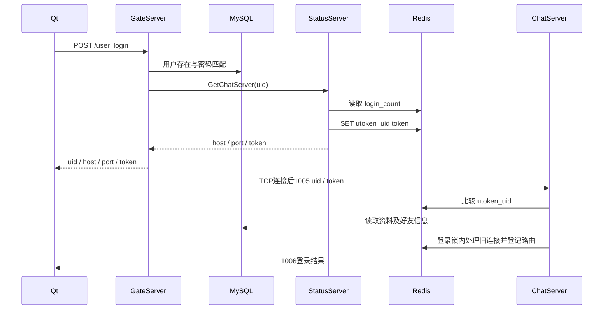

# 登录

## HTTP 身份校验

`LoginDialog::on_login_btn_clicked()` 要求用户名和密码非空，密码长6～15且匹配 `[a-zA-Z0-9!@#$%^&*]`。客户端发送的字段为 `user`、`passwd`：

```json
{"user":"alice","passwd":"客户端xorString处理后的值"}
```

请求地址为 `gate_url_prefix + "/user_login"`，客户端回调标识实际使用 `ID_CHAT_LOGIN=1005`、模块使用 `LOGINMOD`。`ID_LOGIN_USER=1004` 有枚举定义，这条路径没有使用它。HTTP 的回调标识保存在客户端上下文，不放入TCP包头或请求JSON。

GateServer 的 `/user_login` 先 `Checkuser(user)` 检查用户名，再 `CheckPwd(user, passwd, user_info)` 比较密码，成功后调用 StatusServer 的 `GetChatServer(uid)`。返回JSON包含 `error/uid/email/token/host/port`，`port` 是字符串。用户名不存在返回1009，密码不符返回1008，路由RPC失败返回1002。

`xorString` 是可逆混淆，不能提供密码学保护。当前部署的 HTTP、聊天TCP和内部gRPC未提供TLS保护，登录正文和token不应暴露在不可信网络或共享日志中。Qt通用收包日志和Gate请求体日志也需要按凭据处理。

## 路由选择与 token



StatusServer 从配置的 `[ChatServers] name` 读取候选实例。它读取 Redis `login_count` 哈希，选在线数最小的实例，同值时轮询。计数缺失或无法转换时按 `LLONG_MAX` 处理；全部计数缺失时仍在这些候选中轮询。该选择没有TCP/gRPC健康探测，也没有为尚未完成TCP登录的请求预占人数。

token由纳秒时间戳与 `mt19937_64` 随机值异或后转十六进制字符串生成，保存在 `utoken_<uid>`。此处没有TTL、一次性消费或绑定指定ChatServer。再次HTTP登录会覆盖同UID的token；已经绑定UID的既有TCP连接不会因此自动退出，旧连接替换在随后TCP登录阶段发生。token生成器不构成密码学安全凭据方案。

`StatusService.Login(uid, token)` 也定义了比较Redis凭据的RPC。当前 `LogicSystem::LoginHandler()` 直接读取Redis，没有调用这个RPC。

## TCP 认证和在线登记

Qt拿到路由后发出 `sig_connect_tcp(ServerInfo)`，`TcpMgr` 调用 `connectToHost()`。收到 `connected` 信号时，登录页发送：

```json
{"uid":1001,"token":"HTTP返回的token"}
```

此JSON使用1005帧，响应为1006。ChatServer依次执行：

1. 查 `utoken_<uid>`，缺失返回 `UidInvalid=1011`，不匹配返回 `TokenInvalid=1012`。
2. 用 `GetBaseInfo()` 先查 `ubaseinfo_<uid>`，缺失时查询MySQL并回填，取得用户资料。
3. 查询待处理好友申请及好友列表，将资料、`apply_list`、`friend_list`放入1006。
4. 获取 `login_lock_<uid>`：等待最多5秒，租约10秒。读 `uip_<uid>` 和 `usession_<uid>`，按精确旧session处理重复登录。跨服踢人失败即返回，不覆盖路由。
5. `HINCRBY login_count <本服名> 1`，将当前Session绑定UID，写入 `uip_<uid>=本服名`、`usession_<uid>=本连接ID`，最后更新本机 `UserMgr`。
6. 作用域退出时由 `Defer` 将1006排入发送队列；登录锁先释放，随后发送回包。

成功资料使用字段 `user`，还包括 `uid/token/email/nick/desc/sex/icon`。JSON中无密码字段。Qt成功处理1006后更新UserMgr、启动心跳、切换聊天页并启动缓存/历史同步。TCP连接建立和1006成功是不同阶段；未完成认证的连接不能据此取得聊天权限。

### 在线状态的数据模型

| 数据 | 存放位置 | 生命周期 |
| --- | --- | --- |
| 连接ID、socket、用户UID | `CSession` | accept后创建，断线后注销，引用释放后析构 |
| `session_id -> Session` | `CServer::_sessions` | 包含未登录连接 |
| `uid -> Session` | 本机 `UserMgr` | 登录登记后可用于实时推送 |
| `uip_<uid>` | Redis | 服务名，用于跨服路由 |
| `usession_<uid>` | Redis | 当前连接代号，用于防止旧连接删除新路由 |
| `login_count` | Redis哈希 | 进程启动置0、登录加1、本机注销减1、正常退出删除本服字段 |
| 账号、好友、会话和历史 | MySQL | 独立于TCP连接长期保存 |

在线登记由多条Redis命令组成，没有事务性提交及逐项成功检查。登录锁没有自动续租；路由没有TTL。进程崩溃、Redis故障或锁超时可能留下陈旧路由和失真人数。单次登录成功不保证后续跨服路由永远可用。

1006包含完整好友列表，当前登录没有按好友数分页，也没有统一的回包字节预算。普通发送路径的32767字节检查可能拒绝超大登录响应；两字节协议上限不能替代应用层分页设计。

## 操作与故障定位

1. 先配置并启动MySQL、Redis、StatusServer，再启动ChatServer和GateServer。资源与音视频的额外服务按相关功能启动。
2. StatusServer候选的 `name/host/port` 要与ChatServer实例一致；跨服连接池的 `rpcport` 单独配置，勿将TCP端口用作RPC端口。
3. HTTP失败时检查用户名、混淆后的密码比较和 `GetChatServer`；HTTP成功而TCP失败时检查返回地址是否可达。
4. 收到1011/1012时核对同UID最新token，不在终端或文档中公开凭据。收到1014时检查登录锁和旧session匹配；跨服1002时检查旧节点RPC地址及可达性。
5. 断线后由用户重新登录；当前没有自动重新领取路由和自动重连。消息恢复依赖会话/历史查询，登录回包不携带全部聊天历史。

## 代码与交叉阅读

- [Qt登录页](../chat_app%20desktop/logindialog.cpp)：HTTP请求、回调标识、连接后1005。
- [Gate登录处理](../GateServer/src/LogicSystem.cpp)、[网关数据库校验](../GateServer/src/MysqlMgr.cpp)。
- [Status路由与token](../StatusServer/src/StatusServiceImpl.cpp)、[Status配置](../StatusServer/config.ini)。
- [Chat登录处理](../ChatServer1/src/LogicSystem.cpp)的 `LoginHandler/GetBaseInfo`、[Qt回包处理](../chat_app%20desktop/tcpmgr.cpp)。
- [服务器踢人](服务器踢人.md)、[心跳检测](心跳检测.md)、[聊天信息收发](聊天信息收发.md)。
