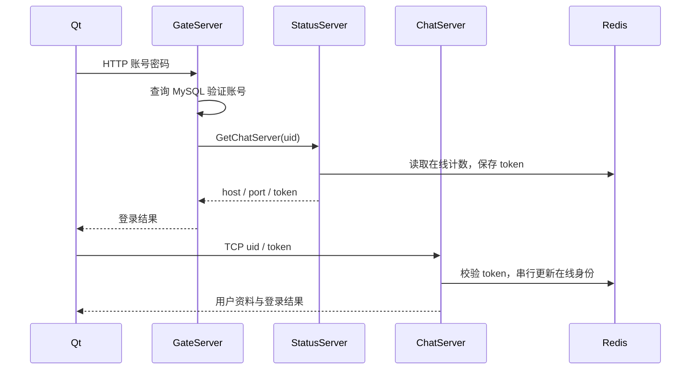

# 全栈聊天室

## 通信通道与职责

| 通道 | 参与方 | 承载内容 |
| --- | --- | --- |
| HTTP + JSON | Qt、GateServer | 注册、登录、验证码、重置密码 |
| 自定义 TCP 帧 | Qt、ChatServer | 登录绑定、好友与群管理、聊天、回执、心跳、通话信令 |
| gRPC + protobuf | 各后端服务 | 验证码、选服、跨服通知、资源核验与认证 |
| 资源 TCP | Qt、ResourceServer | 上传任务、分片、续传、鉴权下载 |
| WebRTC | WebEngine 页面、ZLMediaKit | 音视频采集、SDP 协商与媒体传输 |

网关返回聊天服务地址后，客户端直接连接所选 ChatServer。资源和媒体也有独立地址，部署时需要分别配置可达性、访问权限和端口。

## 数据分别由谁管理

MySQL 保存账号、好友、正式会话与消息、群资料与成员、准入记录和管理操作结果。它负责需要事务、唯一约束与历史查询的业务事实。

Redis 保存验证码、登录 token、在线实例与会话标识、在线计数、资料缓存、分布式锁和通话临时状态。在线路由只表达实时投递位置，消息持久化仍由 MySQL 完成。

客户端每个账号使用独立 SQLite 缓存。正式消息、会话摘要、未读与同步游标在本地事务中更新；断线后的增量同步把服务端历史恢复到缓存和界面。

ResourceServer 保存文件内容和资源任务信息，聊天表保存资源 ID 与可信元数据。下载时还需验证用户、会话成员关系和资源归属；群头像使用独立的成员鉴权流程。

## 一条消息的处理边界

1. 客户端生成 `msgid`，创建待确认气泡，并发送结构化请求。
2. ChatServer 从已认证 session 取得操作者，检查私聊关系或群成员权限。
3. MySQL 分配正式 `message_id` 并提交消息。图片、文件须先完成资源上传和服务端核验。
4. 在线接收者由本机 TCP 或跨服 gRPC 收到通知；离线接收者以后拉取历史。
5. 客户端按正式 ID 写入缓存，更新消息状态。私聊展示 ACK 与已读游标分别反映展示和阅读进度。

保存、实时投递、展示、已读是不同状态。一次网络发送成功不能证明对端已经看到消息。客户端 UUID 关联待确认消息；当前服务端文本保存没有按该 UUID 去重的唯一约束。

## 群管理与音视频

群号复用 `thread_id`。群事务同时校验群状态、操作者角色、目标成员身份版本及业务操作 ID。成员离开保留失效关系，重新加入继续递增版本，用于识别迟到请求和通知。

好友通话由 ChatServer 管理邀请、忙线与通话类型，Redis 保存跨实例状态；Qt 控制器通过 QWebChannel 驱动 WebEngine 页面，页面向 ZLMediaKit 推拉媒体。当前可信回环接入未启用生产方案中的短时媒体授权与网关媒体鉴权回调。

## 源码阅读顺序

| 目标 | 入口 |
| --- | --- |
| HTTP 账号处理 | `GateServer/src/LogicSystem.cpp` |
| 选服与 token | `StatusServer/src/StatusServiceImpl.cpp` |
| 帧与会话 | `ChatServer1/src/CSession.cpp`、`include/TcpFrameParser.h` |
| 聊天业务与跨服 | `ChatServer1/src/LogicSystem.cpp`、`src/ChatServiceImpl.cpp` |
| 数据约束 | `sql/create_tables.sql` |
| 本地缓存 | `chat_app desktop/localchatstoragemgr.cpp` |
| 服务契约 | `proto/message.proto` |

进一步阅读：[分布式聊天服务设计](分布式聊天服务设计.md)、[聊天信息存储方案](聊天信息存储方案.md)、[群聊](群聊.md)、[WebRTC 视频通信](WebRTC视频通信.md)。
