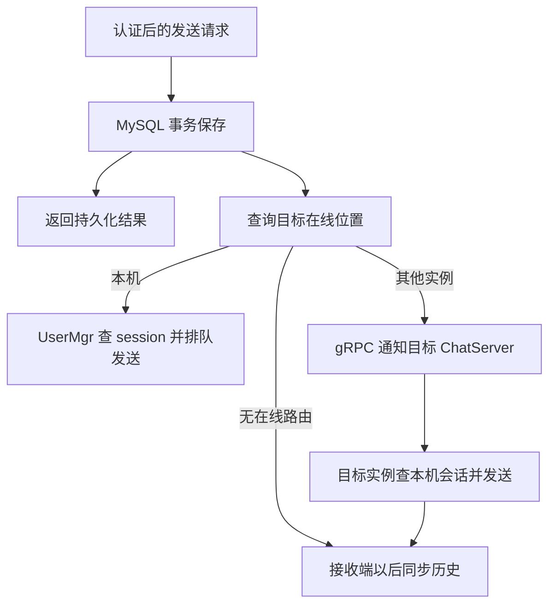

# 分布式聊天服务设计

## 服务拆分的依据

| 服务 | 管理的资源 | 拆分后的约束 |
| --- | --- | --- |
| GateServer | HTTP 请求、账号验证 | 返回的聊天地址必须对客户端可达 |
| VarifyServer | SMTP 与验证码 | 邮件发送和验证码有效期需要协调 |
| StatusServer | 选服、token | 依赖 Redis 在线计数，配置必须包含聊天实例 |
| ChatServer | TCP 会话、业务队列、通知 | 本机会话只在所属进程内有效 |
| ResourceServer | 文件、任务、分片 | 消息只引用核验后的资源，下载单独鉴权 |

按职责拆分让不同类型资源可以独立管理；聊天实例横向增加后，还需要全局在线定位、跨服转发和并发身份变更控制。仓库中 ChatServer1 与 ChatServer2 是同一类业务的两个实例。

## 登录建立了哪些信任关系

HTTP 登录在 GateServer 校验账号密码，随后调用 StatusServer 的 `GetChatServer(uid)`。状态服务返回聊天地址与 token，把 token 保存到 Redis 的 `utoken_<uid>`。客户端连接返回的 TCP 地址，在聊天登录请求中提交 `uid/token`；ChatServer 读取 Redis 校验后绑定身份。

| 字段 | 含义 | 可以证明的事实 |
| --- | --- | --- |
| `uid` | 业务身份 | 单独提交无法证明身份 |
| `token` | 账号验证后签发的凭据 | 与 Redis 当前值相同才通过相应校验 |
| `host/port` | 选服结果 | 指定本次聊天连接目标 |
| `session_id` | 一条连接的标识 | 区分同账号前后两条连接 |

`StatusServiceImpl.cpp` 使用纳秒时间戳与 `mt19937_64` 输出异或生成 token，写入未设置 TTL，登录校验未消费该值。后续资源认证也使用此 token。它的有效性由当前存储值决定；生成方式、期限和传输安全需结合部署要求评估。

## 在线路由与本地会话

| 状态 | 保存位置 | 访问目的 |
| --- | --- | --- |
| `session_id → CSession` | `CServer::_sessions` | 管理全部连接、扫描心跳、关闭连接 |
| `uid → CSession` | `UserMgr` | 按用户发送本机通知 |
| `uip_<uid> → 服务名` | Redis | 找到目标聊天实例 |
| `usession_<uid> → session_id` | Redis | 识别当前在线连接，避免旧连接清理新身份 |
| `login_count[服务名]` | Redis 哈希 | 选服参考 |

TCP 连接建立时尚未绑定 UID，因此 `_sessions` 与 `UserMgr` 的对象集合可以不同。本机对象指针不能直接跨进程共享；跨服请求携带用户、会话或业务 ID，由目标实例查询自己的映射。

## 在线数选服的算法与限制

`StatusServiceImpl::getChatServer()` 读取配置中每个实例的 `login_count`，收集最小计数的候选，再通过 `_round_index` 在同值候选中轮询。计数缺失或无法转换时取最大整数；如果全部实例都处于该状态，仍会从配置候选中选择。

ChatServer 登录后用 `HINCRBY` 增加本机计数，已登录会话注销时减一。原子增量避免并发读改写覆盖，但计数仍依赖进程正常维护。它不包含 CPU、业务队列、数据库等待、网络可达性或实时健康探测。

配置中的实例身份要保持一致：StatusServer `[ChatServers]` 列表、各实例 `[SelfChatServer]`、其他实例的 `[PeerServer]`。增加实例需要补齐选服与跨服端点；状态服务读取的是启动配置。

## 消息的同服与跨服投递

实时投递只是在持久化后的快速路径。源实例把消息正式 ID、会话 ID、发送者和可信内容交给目标实例；目标实例将通知投给自己的连接。私聊文本、图片、文件以及好友和群通知在 `proto/message.proto` 中有各自的 RPC 契约。

群消息每条只保存一份，`recv_id=0`，提交后按成员 UID 扇出。群失效通知与账号下线分别处理，失去某个群的成员资格只影响对应群。

## 重复登录与断线清理

同一 UID 的身份更新使用 `login_lock_<uid>` 串行化：

1. 读取旧 `uip_` 与 `usession_`。
2. 同服时核对本机会话 ID，排入下线通知并注销旧映射；发送完成后关闭旧连接。
3. 跨服时向旧实例发送带旧 `session_id` 的 `NotifyKickUser`，RPC 成功才继续新绑定。
4. 写入新的路由、会话标识、本机 UID 映射和在线计数。

旧连接断线先释放 socket 和本机会话，再取同一登录锁，只有 Redis 的 session ID 仍等于自己时才删除远端路由。本机 `RmvUserSession` 也比较 session ID。这样，迟到的旧连接回调不会按 UID 擦掉新绑定。

Redis 锁有 TTL；临界区超过租约、进程在多条 Redis 命令之间退出，以及 Redis 网络故障，都可能留下不完整状态。数据库事务只覆盖其自身数据，无法把 TCP、Redis 与跨服 RPC 合并为一个原子提交。

## 一致性边界

| 机制 | 保护范围 | 恢复依据 |
| --- | --- | --- |
| MySQL 事务与唯一索引 | 好友、会话、消息、群管理的持久状态 | 已提交数据 |
| Redis 登录锁 | 遵守同一 key 的并发身份操作 | token 比较、租约、会话标识 |
| 客户端 SQLite 去重 | 同一正式消息被重复接收或同步 | `message_id` 与本地事务 |
| 群管理操作记录 | 同一 `operation_id` 的业务重放 | 原始输入与持久化结果 |
| 历史游标 | 实时通知遗漏后的消息恢复 | 会话内正式消息序列 |

当前没有将所有通知写入可靠消息队列。跨服错误可能影响实时可见性，不能据此撤销已经提交的消息。文本 UUID 也不构成服务端重发去重保证。

## 配置与排查

- 登录能通过 HTTP、TCP 连接失败：检查返回的聊天主机与端口、防火墙及对应实例进程。
- 同服正常、跨服失败：检查 `uip_` 中的服务名、`[PeerServer]` 和 gRPC 端口。
- 选服倾斜：检查 `login_count`、实例配置和异常退出留下的计数，结合真实连接数量判断。
- 新登录失败：检查旧路由、旧 session ID 和踢人 RPC，保留失败上下文，避免按 UID 无条件删除在线键。
- 收不到实时消息：先查看正式历史是否存在，再检查路由、目标本机会话与客户端同步游标。

源码入口：`StatusServer/src/StatusServiceImpl.cpp`、`ChatServer1/src/LogicSystem.cpp`、`CSession.cpp`、`CServer.cpp`、`ChatServiceImpl.cpp`、`UserMgr.cpp`。相关知识：[登录](login.md)、[服务器踢人](服务器踢人.md)、[分布式锁](分布式锁设计.md)、[聊天可靠性](聊天可靠性与资源安全提升.md)。
