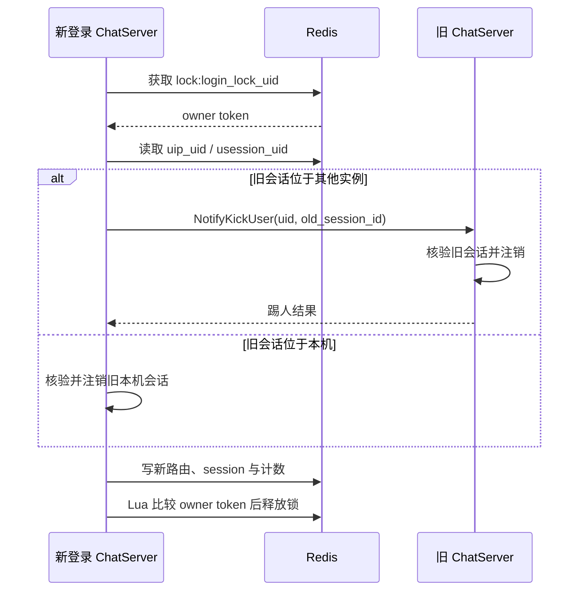

# Redis 分布式锁设计

## 业务锁与连接池

多个 ChatServer 可以同时处理同一 UID 的登录或断线。Redis 把单条命令原子执行，多条命令组成的“读取旧状态、关闭旧连接、写入新状态”仍可能相互穿插。连接池只管理 TCP 连接的借还，业务互斥需要所有参与者使用同一个资源 key。

| 实现 | 代码位置 | 使用方式 |
| --- | --- | --- |
| ChatServer 集成封装 | `ChatServer1/2` 的 `DistLock`、`RedisMgr` | 复用现有 hiredis 池，登录和断线实际调用 |
| 独立组件 | `DistributeLock/` 的 `RedisDistributedLock` | 自带连接池和 RAII 锁对象，可单独构建 |

集成封装使用 `lock:` 前缀；调用方的逻辑名 `login_lock_<uid>` 最终存为 `lock:login_lock_<uid>`。独立组件直接使用调用方传入的完整 key。

## key、token 与租约

| 元素 | 作用 | 设计要求 |
| --- | --- | --- |
| key | 定义竞争同一资源的请求集合 | 按 UID、申请或其他业务对象区分 |
| owner token | 区分本次持有者与先前持有者 | 加锁成功后原样传给续期和释放 |
| TTL | 限制锁 key 生存时间 | 业务必须在租约有效期内完成或主动续期 |
| 本地持锁标记 | 减少对象内重复操作 | 不能证明 Redis 当前租约仍有效 |

登录 token 与锁 owner token 作用不同。前者证明账号凭据，后者只用于比较这次锁的所有权。

## 获取锁的原子命令

```redis
SET lock:login_lock_1001 <owner-token> NX PX 10000
```

`NX` 要求 key 不存在，`PX` 同时设置毫秒有效期。把设置与过期拆成两条命令，会留下进程在中间退出后没有 TTL 的 key。

| 返回结果 | 含义 | 业务行为 |
| --- | --- | --- |
| `Acquired` | 本次取得锁 | 在有效租约内进入临界区 |
| `Busy` | 其他持有者仍占用 | 按业务允许的时间等待或返回忙 |
| `RedisError` | 连接池、网络、认证或命令异常 | 返回依赖错误，停止临界区写入 |
| `InvalidArgument` | key、TTL 或等待参数错误 | 修正调用参数 |

`RedisMgr::acquireLock()` 用 `steady_clock` 计算等待期限，每轮借连接执行一次 `SET`，归还后再睡眠，重试间隔带随机抖动。只有 `Busy` 会重试。连接池无可用连接返回依赖错误。

等待期限约束客户端循环和借用时间，已发出的同步网络命令仍受底层 socket 行为影响，不能视为整个调用绝对耗时上限。

## 释放与续期必须核对所有者

假设 A 的租约到期，B 已经取得相同 key；A 恢复后直接执行 `DEL` 会删除 B 的锁。客户端先 `GET` 再 `DEL` 也存在中间状态变化的窗口。

释放把比较和删除合成一个 Lua 脚本：

```lua
if redis.call('GET', KEYS[1]) == ARGV[1] then
    return redis.call('DEL', KEYS[1])
end
return 0
```

续期同样比较 token：

```lua
if redis.call('GET', KEYS[1]) == ARGV[1] then
    return redis.call('PEXPIRE', KEYS[1], ARGV[2])
end
return 0
```

返回 `1` 表示本次操作成功，返回 `0` 表示已过期或所有者不同。`redisCommandArgv` 以参数数组和长度发送命令，key 与 token 中的空格不会被重新分词。

## 登录临界区的实际流程



跨服踢人成功后才继续新绑定。断线流程先释放本地连接，再取得相同逻辑锁，比较 `usession_` 是否仍属于自己，匹配后删除在线键。

`LogicSystem::LoginHandler()` 和 `CSession::HandleDisconnect()` 使用 `Defer` 释放锁，没有在这些入口中自动续期。同步 RPC 和依赖等待若超过租约，互斥保护可能失效。

## 集成接口的状态管理

`acquireLock(lockName, leaseTime, acquireTimeout, retryInterval)` 返回 `RedisLockAcquireResult`。`identifier` 属于这一次加锁调用，应保存在局部作用域；`renewLock()` 与 `releaseLock()` 必须使用相同逻辑名和原 token。

| 调用 | 重要参数 | 成功结果 |
| --- | --- | --- |
| `acquireLock` | 逻辑名、租约、最长抢锁等待、重试间隔 | `Acquired` 与 `identifier` |
| `renewLock` | 原逻辑名、原 identifier、新租约 | `Acquired` |
| `releaseLock` | 原逻辑名、原 identifier | `Acquired` |

解锁或续期的网络错误可能代表命令执行结果未知。调用方不能继续依赖本地 token 进行后续共享写入。

## 独立组件的 RAII 与连接归还

`RedisDistributedLock` 构造时保存共享池、完整 key、固定 owner token 和租约；获取锁后记录 `owns_lock_`。析构尽力解锁，显式 `Unlock()` 可以让调用方观察返回值。

`ConnectionLease` 是可移动、不可复制的连接借用对象，离开作用域归还连接；命令返回空 reply 时标记损坏，归还时释放。关闭池后不再接受借用，已借出的连接归还时销毁。共享 `State` 保证租约对象可以安全晚于池对象销毁。

独立组件的 `TryLockFor()` 只对竞争重试，`Renew()` 失败会清除本地持锁标记，`Unlock()` 调用后也放弃本地所有者状态。`OwnsLock()` 返回本地布尔值；同一对象已经持锁时再次 `TryLock()` 不查询 Redis，也不延长 TTL。

组件不自动续租、不在运行时补建损坏连接，未生成供数据库检查的单调 fencing token。

## 租约能保证什么

- TTL 防止持有进程退出后 key 永久占用；它不会中止已经开始的 SQL 或恢复中的旧线程。
- 比较 token 防止旧持有者删除新锁；它无法单独阻止过期持有者继续写数据库。
- 只有遵守同一 key 的参与者受互斥协议约束。
- Redis 多键更新、MySQL 事务和远端 RPC 属于不同提交边界。
- 单 Redis 节点的故障、持久化和主从切换策略影响锁的可用性及排他性。

持久数据仍需事务、唯一索引、版本比较或条件更新。群管理使用数据库行锁和版本检查，私聊唯一性由用户对唯一约束维护，不能仅由 Redis 锁推出这些不变量。

源码：`ChatServer1/src/DistLock.cpp`、`RedisMgr.cpp`、`LogicSystem.cpp`、`CSession.cpp`；独立使用见 [DistributeLock/README.md](../DistributeLock/README.md)。相关知识：[锁粒度](锁的精度控制.md)、[Redis](Redis.md)、[数据库设计](数据库设计.md)。
