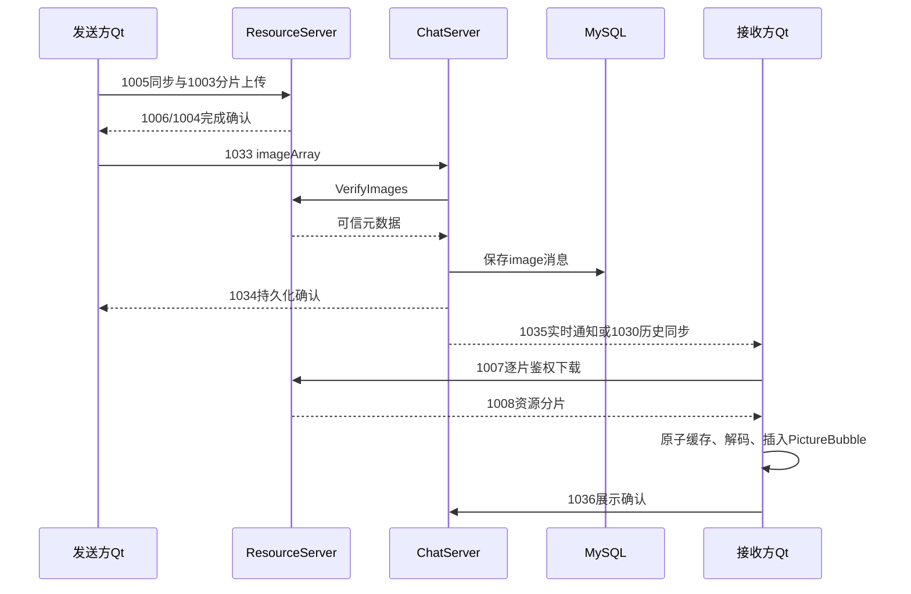

# 图片传输

## 字节通道与消息通道

图片字节通过 Qt 的 ResourceClient 与 ResourceServer 独立 TCP 连接传输。ChatServer 接收资源引用和元数据，负责身份检查、MySQL 持久化、在线路由与历史同步。这样聊天帧和跨服 RPC 中只携带小型业务数据。



跨 ChatServer 的实时投递使用 `NotifyImageChatMsg`，目标服再向本机 Qt 发 1035；RPC 不传图片字节。接收方离线时，已保存消息通过 `1029/1030` 恢复元数据，再走相同下载流程。

## 选择图片与上传状态

用户在私聊选择、粘贴或拖入图片，客户端建立带 UUID `msgid` 的待发送项。群聊当前只发送文本，图片和文件附件不进入群消息链路。私聊附件上传任务保存自己的目标信息；上传完成时使用该任务关联的会话，不能改用用户此时正在浏览的群。

`ChatImageTransferTask` 先检查源文件存在、非空且不超过 100 MiB，通过 QImageReader 读取尺寸，并限制 MIME 为 PNG、JPEG、GIF、WebP。客户端声明的属性只是候选值，服务端还会独立核验。

上传前计算 MD5，生成 `MD5_文件长度_分片长度` 形式的稳定任务 ID。1005 取回服务端 `confirmed_offset`，1003 从该偏移发送分片，收到确认后再发下一片。当前 Qt 上传原始分片为 1024 字节。断线重试以相同任务属性重新同步，能够利用服务端已写入的 `.part`；相同内容换文件名会与既有任务属性冲突，不能认为内容哈希相同就可以改名复用。

任务队列串行处理图片和文件上传、下载，回包还检查资源 ID、状态、总大小与偏移。旧个人头像上传响应中的 `resource_url` 不作为聊天图片地址；消息只保存 `upload_id` 对应的 `resource_id`。底层任务结构和分片字段见 [资源服务](资源服务.md)。

## 1033、1034 与 1035

| 消息 | 方向 | 作用 |
| --- | --- | --- |
| 1033 | Qt → ChatServer | 提交已上传图片的消息请求 |
| 1034 | ChatServer → 发送方 | 核验、持久化结果及正式消息身份 |
| 1035 | ChatServer → 接收方 | 在线图片元数据通知 |

1033 使用 `fromuid/touid/imageArray`：

```json
{
  "fromuid": 10001,
  "touid": 10002,
  "imageArray": [{
    "msgid": "<client-uuid>",
    "resource_id": "<upload-id>",
    "name": "photo.png",
    "mime_type": "image/png",
    "file_size": 12345,
    "width": 640,
    "height": 480
  }]
}
```

ChatServer 要求 `fromuid` 与当前登录 TCP session 一致，接收者为不同的有效 UID，数组非空且最多 50 项。每项的名称、MIME、大小和宽高字段有 JSON 类型检查；入库值全部来自 ResourceServer 的 `VerifyImages` 返回。RPC 回包还须保持输入 ID 和顺序，任一核验错误则整批不写入聊天表。

`VerifyImages` 检查任务完成、最终文件实际大小与元数据一致，并根据 PNG/JPEG/GIF/WebP 文件头识别 MIME 和尺寸。它没有执行完整像素解码；群头像专用核验具有更严格的完整解码规则。

1034 成功包含正式 `message_id/thread_id/sender_id/recv_id/created_at_ms/status` 和可信图片属性，`persisted=true` 表示 MySQL 已提交。`realtime_delivered` 独立表达在线投递路径结果。离线或跨服推送失败仍保留持久化成功，避免把已存消息误判为必须重发。失败回包保留原始 `msgid`，便于定位对应气泡。

## 下载授权与本地缓存

每个 1007 请求携带 `resource_id/thread_id/uid/token/offset/chunk_size`，示例凭据形式为 `"token":"<login-token>"`。ResourceServer 先调用 StatusServer，再查私聊成员与同会话下 `image/file` 消息引用。资源 ID 不授予读取权，上传完成但未被聊天消息引用的资源也不能直接经私聊接口读取。

Qt 每次拉取最多 2048 原始字节，严格检查偏移连续、总大小等于消息元数据、Base64 合法和末片长度。数据写入关闭直接写入回退的 `QSaveFile`，长度正确后原子提交；随后用 QImageReader 实际解码，核对尺寸和字节数。解码不通过时删除该任务的缓存，不插入有效图片气泡。因此缓存原子提交早于最终解码检查，不能把提交时刻称为已完成全部图片校验。

缓存路径位于 `AppLocalDataLocation/chat_images/<uid>/`，文件名取资源 ID 的 SHA256，并限制后缀字符。账号目录防止本机缓存串号，SHA256 用于安全命名，不是下载内容校验和。已有缓存也会重新核对大小、宽高和可解码性。

| 失败阶段 | 用户处理与状态 |
| --- | --- |
| 源文件读取或格式检查 | 修正选择，不提交1033 |
| 上传或续传 | 标记对应发送项失败；重试重新同步上传任务 |
| RPC核验或MySQL保存 | 1034报错，不能显示为已保存 |
| 在线推送 | 以持久化确认保留发送成功，接收方通过历史补拉 |
| 下载、缓存写入或解码 | 保留失败提示，可选择重试/取消 |
| 1020授权拒绝 | 检查登录身份和会话归属 |
| 1021依赖不可用 | 恢复服务或网络后重试 |

当前下载失败会取消临时文件并清零偏移，重试从 0 拉取。协议支持任意合法偏移，客户端尚未实现跨失败任务持久保存下载断点。

## 持久化与展示确认

MySQL 的 `chat_message.message_type='image'`，保存 `client_msg_id/resource_id/resource_name/mime_type/file_size/width/height`，不保存二进制或资源服务绝对路径。客户端 SQLite 以正式消息 ID 去重并保存紧凑元数据，图片缓存独立管理。

图片元数据入库、排队下载、下载成功和图片显示是不同状态。1036 在 `PictureBubble` 插入当前聊天视图后发送；仅排队或显示占位符不确认图片展示。已读使用独立 `1038/1039` 会话游标，含义见 [聊天可靠性与资源安全](聊天可靠性与资源安全提升.md)。

新库使用 [完整DDL](../sql/create_tables.sql)；已有聊天表按 [资源字段迁移](../sql/chat_image_message_migration.sql) 和 [回执字段迁移](../sql/chat_message_receipt_migration.sql) 补齐字段。`CREATE TABLE IF NOT EXISTS` 不升级现有表。

## 实现定位

- [ChatServer LogicSystem](../ChatServer1/src/LogicSystem.cpp)：`HandleImageMsg`、可信元数据替换、持久化确认与路由。
- [MysqlMgr](../ChatServer1/src/MysqlMgr.cpp)：`SavePrivateImageMessages` 与历史查询。
- [ChatImageTransferTask](../chat_app%20desktop/chatimagetransfer.cpp)：源文件检查、分片队列、缓存和解码。
- [ResourceClient](../chat_app%20desktop/resourceclient.cpp)：6字节帧、当前身份下载请求与分片解析。
- [ChatDialog](../chat_app%20desktop/chatdialog.cpp)：草稿、上传完成发送、失败提示与展示ACK。
- [ResourceVerifier](../ResourceServer/src/ResourceVerifier.cpp)：私聊图片文件头核验边界。
