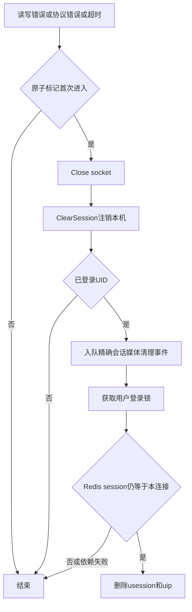
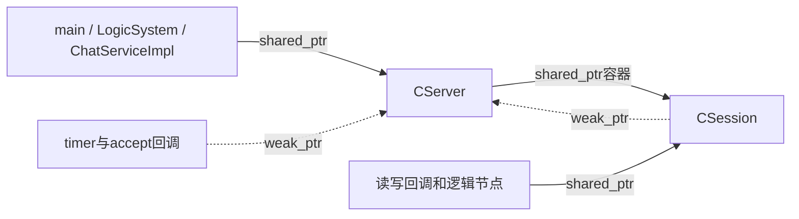
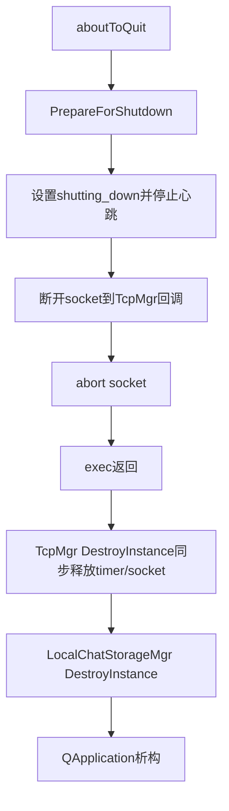

# 异常处理

## 网络错误与业务失败

| 事件 | 处理入口 | 影响 |
| --- | --- | --- |
| TCP读/写错误 | `CSession::HandleDisconnect` | 关闭连接并注销在线状态 |
| 非法帧头、非法心跳JSON | `HandleDisconnect` | 协议错误断线 |
| 服务端心跳超时 | post到Session执行器后 `HandleDisconnect` | 主动清理失联连接 |
| 1021队列排空 | `HandleWrite`调用 `HandleDisconnect` | 完成旧账号连接关闭 |
| MySQL保存失败 | 业务handler错误回包 | 不产生成功持久化确认 |
| 提交后实时转发失败 | 成功保存结果附实时失败状态 | 已提交历史保留 |
| 普通业务handler抛异常 | `LogicSystem::DealMsg`记录并继续消费 | worker存活，但未保证该请求一定收到错误回包 |

读回调内异常会调用断线入口；写回调外层捕获 `std::exception`后记录日志，未保证该异常分支进一步清理。不同入口的捕获范围需要按源码理解，不能推断所有异常均有统一回包或事务补偿。

## 统一断线入口

关闭socket会让待完成读写收到错误，因此同一连接可能多次进入清理。`_disconnect_handled.exchange(true)`只允许一次完整执行；CServer仅对容器内实际存在的连接减人数；UserMgr和Redis均比较精确连接ID，防止旧回调清除新登录。

本机注销先于远端Redis清理，锁获取失败不会保留本机会话。锁和Redis操作仍为同步调用，会阻塞会话I/O线程；远端条件删除由多条命令组成，没有单条事务性保证。账号路由没有TTL，进程崩溃不能依赖此清理入口自动恢复。

## Asio对象所有权

异步操作注册后，回调可能在很久以后才执行。捕获裸 `this`只保存地址；若对象已析构，回调调用成员函数便会访问已释放内存，形成use-after-free。即使回调准备先检查 `operation_aborted`，调用成员函数本身也要求对象存活。

CServer由 `make_shared`创建后再 `Start()`，构造函数期间尚不能取得有效 `weak_from_this()`。timer与accept回调捕获弱引用，执行时 `lock()`成功才访问服务器。Session弱引用所属CServer，避免服务器容器与Session相互强持有形成引用环。

Session的读写回调强持有自身，保证缓冲区和成员直到回调结束仍有效；逻辑节点也强持有Session。清空 `_sessions`只移除登记，不能据此假定所有Session立刻析构。`cancel()`或析构timer/acceptor会取消操作，取消回调仍可能排队；弱引用保护和停止标记需要同时存在。

`CServer::HandleAccept()`先登记Session再启动读取，保证首次读失败可以查到并移除连接。心跳扫描锁内复制会话引用，锁外post任务并二次检查，不能持容器锁调用内部会再次加锁的清理。

## 服务端停止顺序

[ChatServer.cpp](../ChatServer1/ChatServer.cpp)的正常SIGINT/SIGTERM路径为：

1. `CServer::Stop()`设置停止标记，取消timer及acceptor，并关闭监听器。
2. 停主 `io_context`，再 `AsioIOServicePool::Stop()`：释放work guard、停止各I/O context、join各线程。
3. `grpc_server->Shutdown()`关闭RPC；主循环返回后删除本服 `login_count`字段，等待gRPC线程退出。
4. `LogicSystem::Stop()`置停止标记、唤醒worker，排空已入队消息后join。
5. `ChatServiceImpl::RegisterServer(nullptr)`、`LogicSystem::SetServer(nullptr)`解除服务器强引用，再 `server.reset()`。
6. 栈上 `io_context`最后离开作用域，保证服务器timer/acceptor析构时执行器仍有效。

`CServer::Stop()`可重复调用，负责取消接入和扫描，不遍历每个Session做完整路由清理。`io_context::stop()`不承诺执行所有待完成回调，逻辑队列排空也不承诺已停I/O上的回复能发出。正常进程停止没有逐连接可靠通知与发送排空协议，退出后的Redis用户路由可能残留。

gRPC `BuildAndStart()`失败路径同样先Stop、解除服务引用、停止逻辑worker并释放服务器，避免服务器被单例持有到其io_context销毁之后。该路径没有执行正常运行结束位置的在线人数删除。停止路径内遇到同步依赖阻塞，也可能拖延退出。

## Qt运行中断线

socket的 `connected/disconnected/readyRead/errorOccurred` lambda均把TcpMgr作为QObject context，便于对象销毁和主动停止时自动断开。`abort()`可能同步发信号，关闭前要先写入断线通知标记和登录状态。

- 普通断线：仅已登录且尚未通知时发 `sig_connection_lost`。
- 1021：停止心跳并发 `sig_off_line`，之后socket断开不重复提示。
- 心跳超时：先标记已通知、取消登录、停止心跳，再abort并发独立 `sig_heartbeat_timeout`。

`CloseConnection()`可在socket信号回调栈内被界面调用，因此运行期使用 `deleteLater()`避免删除正在发信号的QObject。事件循环继续运行时处理延迟删除，随后登录可新建socket并重新绑定回调。

## Qt进程退出

`TcpMgr`为静态单例，其socket和timer必须在QApplication仍存活时释放。应用退出路径为：

事件循环结束后，`deleteLater()`未必得到处理机会。退出采用先停回调再同步销毁，运行期断线采用延迟删除，各自遵守事件循环与当前信号栈的约束。不要只依赖C++静态对象析构顺序释放Qt对象。

## 操作与诊断

1. 明确断线发生在登录前还是登录后，记录消息类型、连接ID、错误码和依赖端点；诊断材料不应携带token或聊天正文。
2. 使用正常关闭服务观察普通断线，用受控暂停或静默丢包观察心跳超时；两者触发机制不同。
3. 重复登录重点检查旧1021是否排队、映射是否切换，以及迟到回调是否保留新session路由。
4. 排查退出问题时核对最后一个服务器强引用释放位置、I/O线程join位置和QApplication存活范围，避免把悬空访问当成单纯socket错误。
5. MySQL提交后的实时失败应检查历史恢复；当前没有可靠RPC重投递队列、路由租约或自动重连。

## 代码与交叉阅读

- [会话清理](../ChatServer1/src/CSession.cpp)、[监听器与扫描](../ChatServer1/src/CServer.cpp)、[逻辑队列](../ChatServer1/src/LogicSystem.cpp)。
- [I/O池停止](../ChatServer1/src/AsioIOServicePool.cpp)、[服务器入口](../ChatServer1/ChatServer.cpp)。
- [Qt管理器](../chat_app%20desktop/tcpmgr.cpp)的 `CloseConnection/PrepareForShutdown`及析构函数、[Qt入口](../chat_app%20desktop/main.cpp)。
- [心跳检测](心跳检测.md)、[TCP服务器](TCP服务器.md)、[服务器踢人](服务器踢人.md)。
