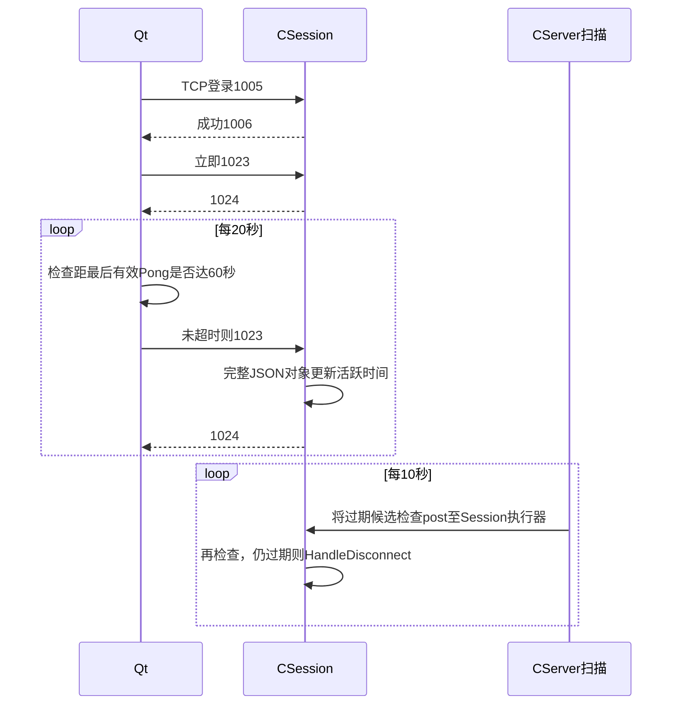

# 心跳检测

## 检测对象与时间模型

TCP读写错误能报告FIN、RST和部分网络故障；断电、网络分区或NAT静默回收可能让socket长时间保留连接态。应用层心跳以周期请求和超时判断连接收发是否仍可用，同时为中间网络设备提供活动流量。

| 参数 | 实际值 | 代码位置 |
| --- | ---: | --- |
| Qt发送间隔 | 20秒 | `tcpmgr.cpp`的 `kHeartbeatIntervalMs` |
| Qt无有效Pong期限 | 60秒 | `kHeartbeatResponseTimeoutMs` |
| 服务端无完整收包期限 | 60秒 | `const.h`的 `HEARTBEAT_TIMEOUT` |
| 服务端扫描间隔 | 10秒 | `HEARTBEAT_CHECK_INTERVAL` |

Qt用 `QElapsedTimer`记录最后一次有效响应后的经过时间；服务端用 `steady_clock`原子毫秒值记录最后收包时间。两者均为单调时钟，不受墙上时间修改影响。包内时间只供诊断，不能将客户端毫秒与服务端秒相减计算超时。

## 请求与响应

| 方向 | ID | JSON |
| --- | ---: | --- |
| Qt到ChatServer | 1023 | `{"client_time":"Unix毫秒字符串"}` |
| ChatServer到Qt | 1024 | `{"error":0,"server_time":Unix秒整数}` |

两条消息共用聊天TCP的四字节包头。服务端要求1023包体为合法JSON对象，允许 `{}`；数组、字符串和畸形JSON触发断线，不续期。服务端允许未登录连接发送1023，这只证明传输路径活动，不赋予业务身份。

## Qt状态与提示

成功处理1006后，`StartHeartbeat()`建立本地计时起点、启动定时器并立即发送首个Ping。每次定时器触发先检查最后有效Pong时间，达到60秒便标记已通知断线、取消登录态、停止心跳、`abort()`并发 `sig_heartbeat_timeout`。标记必须早于abort，以避免同步 `disconnected`再发普通断线提示。

合法JSON对象且 `error=0`的1024刷新最后响应时间。普通聊天回包不会替代Pong续期，当前没有心跳序号或逐次请求关联。1021、断线、主动关闭连接和准备新连接时均停止心跳，避免跨连接沿用定时器与计时起点。

定时器每20秒检查，正常调度下约在最后有效Pong后60～80秒发现超时。系统休眠、UI阻塞、事件队列积压会延长检测时间，不能视为硬实时承诺。

## 服务端活动与扫描

`CSession::Start()`在accept成功后更新起点；构造但尚未被接入的等待时间不计入空闲。完整业务帧和合法心跳对象刷新活跃时间；零散字节、半包不续期。业务帧此时仅通过头部/长度校验，JSON和业务权限随后由LogicSystem检查，所以活动不代表请求合法或已认证。

1023由Session直接应答，不进入单工作线程的业务队列。Pong能反映I/O收发路径可用，不能证明MySQL、Redis或业务worker健康。Pong仍需进入普通发送队列，拥堵时客户端可超时。

`CServer::on_timer()`在锁内复制会话容器，锁外筛选过期Session，再post至会话socket执行器。执行时再次检查活跃时间，避免扫描后刚收到数据却仍关闭。扫描线程不持有容器锁调用 `HandleDisconnect()`，防止内部 `ClearSession()`再次取得同锁造成死锁。

正常调度下服务端在最后完整收包后约60～70秒发现超时；I/O阻塞会推迟执行。清理先关闭socket、注销本机和修正人数，再用登录锁及精确session比较清理Redis。Redis同步访问仍会阻塞会话所属I/O线程；主扫描线程post任务不消除此依赖延迟。

## 幂等与持久化边界

一次超时关闭可同时引发待完成读、写回调报错。`_disconnect_handled.exchange(true)`确保只有首次进入完整清理；CServer只对实际存在的连接减人数；UserMgr与Redis都按session比较，保护新登录。

心跳不会写聊天历史、不会标记消息显示/已读，也不会续期Redis在线路由。ChatServer崩溃后的 `uip/usession`没有TTL自动回收。客户端没有自动重连或自动重新领取路由，失联后需要用户重新登录。消息恢复依赖1025/1026与1029/1030查询。

## 操作指南

| 场景 | 操作与应观察的行为 |
| --- | --- |
| 正常空闲 | 登录后保持空闲，1023/1024持续往返，空闲会话应保留 |
| 无数据连接 | TCP接入后不发数据，服务端按60秒期限加扫描延迟关闭 |
| 半包停止 | 发部分头或部分体后停止，不能靠零散字节刷新活跃时间 |
| 多帧 | 一次写多条完整1023，每条各产生一条1024 |
| 非法心跳 | 发数组或畸形JSON，服务端断线 |
| 客户端超时 | 在受控环境静默丢弃回包，观察独立心跳超时提示；FIN/RST会先走普通断线 |
| 重复登录 | 旧端1021后停止定时器，新端独立开始计时 |
| 手动再登录 | 重新获取路由并认证，不能沿用旧连接超时起点 |

部署修改需同时考虑发送周期、双端期限和扫描间隔。期限过短会把调度抖动与拥塞判为失联；周期过长会延迟发现故障。生产参数在当前代码中为编译期常量，没有运行时配置项。

## 代码与交叉阅读

- [服务端常量](../ChatServer1/include/const.h)、[会话收包和计时](../ChatServer1/src/CSession.cpp)、[定时扫描](../ChatServer1/src/CServer.cpp)。
- [Qt定时器与响应](../chat_app%20desktop/tcpmgr.cpp)：`StartHeartbeat/StopHeartbeat/SendHeartbeat`及1024handler。
- [主窗口提示](../chat_app%20desktop/mainwindow.cpp)、[客户端退出入口](../chat_app%20desktop/main.cpp)。
- [TCP服务器](TCP服务器.md)、[服务器踢人](服务器踢人.md)、[异常处理](异常处理.md)。
