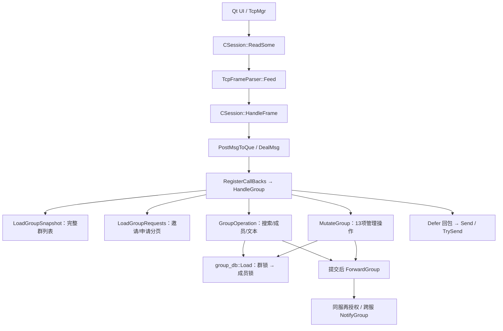

# 群聊

这篇笔记沿着“创建群 → 邀请/申请与审批 → 角色/转让/离群 → 发送文本 → 跨服投递 → 离线补拉”阅读当前实现。群身份、数据库授权、实时投递和本地缓存必须接成一条链路。

源码链接用于理解业务边界；数据库回归、真实双服、资源安全和实际 Qt UI 的运行证据分别记录，不能相互代替。

## 一、先看全链路

```text
Qt ChatDialog：选择群、输入纯文本
  → TcpMgr：ID_GROUP_TEXT_MSG_REQ
  → LogicSystem::HandleGroup：从已登录 session 取得操作者 UID
  → MysqlMgr::GroupOperation：锁群、查成员、写 MySQL、提交
      ├─ ID_GROUP_TEXT_MSG_RSP：发送者取得正式消息 ID
      └─ LogicSystem::ForwardGroup：按成员 UID 查 Redis 在线路由
           ├─ 同服：再次授权，在锁内进入目标 TCP 发送队列
           └─ 跨服：NotifyGroup → ChatServiceImpl → 再次授权、TCP 入队
  → 接收方 Qt：校验群和目标成员，SQLite 写入，再刷新视图

离线恢复：登录 → 完整有效群列表 → 每个有效群按 message_id 拉历史
撤权恢复：在线群失效通知，或下一次完整群列表对账 → 本地只读
```

这里有三种不同职责：

| 层 | 管什么 | 不管什么 |
| --- | --- | --- |
| MySQL | 群是否有效、谁是成员/群主、正式历史 | 不保证实时消息一定被客户端看到 |
| Redis + TCP/gRPC | 在线用户在哪台服务、怎样及时投递 | 不作为群成员权限或离线历史的事实来源 |
| Qt + SQLite | 本账号的身份缓存、历史、未读、发送结果和只读状态 | 本地 `active/ownerUid` 不能授予服务端权限 |

为什么采用这个分工？在线投递可以失败，数据库中的消息不能因此消失；客户端可以缓存旧资料，服务端不能因此接受旧权限。

## 二、最容易混淆的几种 ID

| 字段 | 含义 | 群聊中的取值/用途 |
| --- | --- | --- |
| `thread_id` | 正式会话 ID，也是群号 | `chat_thread.id = group_chat.thread_id` |
| `message_id` | 服务端正式消息 ID | MySQL 自增；SQLite 去重和历史分页主键 |
| `sender_id / sender_uid` | 实际发送者 UID | 必须来自已登录 session；不是群号 |
| `target_member_uid` | 一次在线投递的目标成员 UID | TCP 群通知和 gRPC 信封中指定接收账号 |
| `recv_id` | 消息表的接收者字段 | 群文本固定为 `0`，不随目标成员改变 |
| `msgid` | 文本的客户端 UUID | 关联待确认气泡与发送结果，不是正式历史主键 |
| `request_id` | 群管理/列表请求的关联标识 | 匹配响应、账号、群及分页请求，不是业务幂等键 |

例如一个群有 A、B、C，A 发一条文本：MySQL 只有一行消息，`sender_id=A、recv_id=0`；发给 B 的通知是 `target_member_uid=B`，发给 C 的通知是 `target_member_uid=C`，两份通知的 `message_id/thread_id` 相同。

会话与消息 ID 使用 64 位类型。服务端用 `std::uint64_t / Json::UInt64`，gRPC 用 `uint64`；Qt 和 SQLite 用 `qint64 / INTEGER`。桌面请求使用 `QString::number()` 发送十进制字符串，避免经过 `int/double`。Qt 群号输入限制在正 `qint64` 范围内，不能把 MySQL 无符号 64 位范围全部视为客户端可表示范围。旧用户 UID 接口另有 `int32/int` 边界，不要与群号混为一谈。

> UUID 不等于跨请求重试去重。当前群文本保存是普通 INSERT；重复发送同一个 UUID 仍可能产生新的正式消息。本次也没有桌面文本点击重发机制。

## 三、MySQL：一个群、一份历史、一套权限

### 1. 表之间怎样关联

完整结构见 [create_tables.sql](../sql/create_tables.sql)，测试库结构见 [chat_app_test_local.sql](../sql/chat_app_test_local.sql)。

| 表 | 群聊相关字段 | 作用 |
| --- | --- | --- |
| `chat_thread` | `id、type='group'` | 与私聊共用正式会话命名空间 |
| `group_chat` | `thread_id、name、owner_uid、active` | 群名、唯一群主、逻辑解散状态 |
| `group_chat_member` | `(thread_id,user_id)`、role、active、membership_version | 角色0成员/1管理员/2群主；离群后保留版本化tombstone |
| `chat_message` | `message_id、thread_id、sender_id、recv_id=0` | 与私聊共用消息历史，不按成员复制 |

群成员联合主键避免重复成员关系。`owner_uid` 是管理权限依据，客户端传入的角色/群主信息不能替代它。表中保留的 `muted_until` 等字段不代表已经实现禁言。

### 2. 创建必须把三张表一起提交

后端统一入口是 [LogicSystem::HandleGroup](../ChatServer1/src/LogicSystem.cpp)，操作者取 `session->GetUserId()`。创建只输入群名，不传成员清单，也不自动拉好友。管理事务见 [MysqlMgr::MutateGroup](../ChatServer1/src/GroupManagement.cpp)：

```cpp
        if(action==ID_CREATE_GROUP_REQ&&!replay) {
            thread=con->sql("INSERT INTO chat_thread(type) VALUES('group')").execute().getAutoIncrementValue();
            con->sql("INSERT INTO group_chat(thread_id,name,owner_uid,active) VALUES(?,?,?,1)").bind(thread).bind(request["name"].asString()).bind(uid).execute();
            con->sql("INSERT INTO group_chat_member(thread_id,user_id,role,active,membership_version) VALUES(?,?,2,1,1)").bind(thread).bind(uid).execute();
        }
```

这里的 `uid` 是 TCP session 身份。任何一步失败，都由 `Defer` 回滚；不能只建 `chat_thread` 就对客户端报告成功。自增 ID 可以出现空洞，拿到一个 ID 不等于事务已提交。SQL 参数全部通过 X DevAPI `bind()` 绑定。

### 3. 为什么所有群操作先锁同一行

管理走 `MutateGroup`，搜索/成员/文本/历史/投递授权走 `GroupOperation`；二者复用 `group_db::Load`。锁顺序是群行 → 当前成员 → 邀请/申请，所有权限使用当前锁定读。管理入口检查有效群恰好一个 owner_uid 对应 role2；角色变更和加入/撤权都增加相关 membership_version。

```cpp
        if (!group_db::Load(*con,threadId,uid,group) || !group.active) return GroupUnavailable;
        if (action != GroupAction::Search && !group.member) return GroupNotMember;
```

搜索/加入不要求既有成员，但都检查群有效。approval_required=true时JOIN仅产生pending application，没有聊天、成员或历史权限；关闭审批不自动处理旧申请，后续JOIN也不绕过。搜索加入遇到待邀请是用户明确同意，邀请终态accepted后同事务创建实际申请。发邀请要求目标user存在且friend两方向都存在，残留单向边不成立；群主邀请也不跳过同意或审批。

所有mutation的operation_id持久保存精确输入与正式结果；request_id仅匹配回包。重放先锁群检查当前权限，撤权管理员旧审批/踢人/公告拒绝。旧leave重放不修改重入后的新成员行。终态决策新键返回already_processed=true、当前entry.status；相反决定或invalid带status_conflict=true，不覆盖终态、不重新入群。

`membership_proof`表示当前身份资料，不使任意metadata通知激活墓碑。只有实际新增/重入收件人的members事件带`membership_granted=true`，其他已有成员的metadata/members无grant。self显式create/directJOIN/接受邀请实际入群响应有grant，且服务端须在锁定后确认当前group.member=true；因此self CREATE/JOIN重放仅在该确认仍为true时是显式成员证明，被踢后重放JOIN返回member=false、不授grant。pending和其他业务重放无grant；非成员result本身不授予身份。离线快照必须完整成功轮且账号/epoch吻合后才应用。

公告和申请解释使用显式UTF8长度，包括合法NUL。真实回归发现连接库默认string转换会在正文NUL处截断；group_db::Text使用Row.getBytes长度，仅剥离X Protocol额外结尾0x00，保留原文。最初10项事务阶段证据保留；当前公告权限纠正后全部受影响数据用例16/16、无跳过、5224ms，真实TCP与资源证据分别记录，不把数据结果混算Qt UI。

公告仅当前有效成员查看。public exact search/pending/踢后旧JOIN重放/本人失效事件保留公开群名/号/owner/active/审批，公告body为空，announcement_version/editor/time为0，announcement_visible=false；当前成员visible=true且完整。广播按接收者成员身份而不是操作人决定可见性。空/0是非成员占位，不能合并缓存元数据或在失效事件中被解释为清空公告；membership_proof/source/成员版本不弱化。实际同/跨服TCP隐私用例已退出0。

假设 B 正在发消息，A 同时踢 B：双方竞争同一群行锁。踢人先提交后，等待锁的发送/历史/投递授权读到 B 已不是成员，必须拒绝。这个锁不能撤回撤权前已经进入 TCP 队列的帧；客户端还需要自己的只读状态防线。

## 四、发送与跨服：保存一次，投递多次

### 1. 文本先落库，再扇出

群文本请求示例：

```json
{
  "thread_id": "501",
  "textArray": [
    {"msgid": "f6d15415-0819-4a09-b989-79b0aee335a0", "content": "大家好"}
  ]
}
```

没有 `touid=群号`，也没有客户端操作者/角色字段。后端在同一事务内读取成员 UID 集合，逐条写入文本，并取得正式 ID、时间及昵称。

源码节选：[群文本单份写入和正式元数据](../ChatServer1/src/MysqlMgr.cpp#L1551-L1562)。

```cpp
            for (const auto& text : texts) {
                con->sql("INSERT INTO chat_message(thread_id,sender_id,recv_id,client_msg_id,message_type,content) "
                    "VALUES (?,?,0,?,'text',?)").bind(threadId).bind(uid).bind(text.first).bind(text.second).execute();
                auto saved = con->sql("SELECT message_id,CAST(UNIX_TIMESTAMP(created_at)*1000 AS UNSIGNED), "
                    "COALESCE((SELECT NULLIF(nick,'') FROM user WHERE uid=?),CAST(? AS CHAR)) "
                    "FROM chat_message WHERE message_id=LAST_INSERT_ID()").bind(uid).bind(uid).execute().fetchOne();
                StoredTextMessage message;
                message.messageId = saved[0].get<std::uint64_t>(); message.threadId = threadId;
                message.senderId = uid; message.uniqueId = text.first; message.content = text.second;
                message.createdAtMs = saved[1].get<std::uint64_t>(); message.senderNick = saved[2].get<std::string>();
                messages.push_back(std::move(message));
            }
```

正式响应/通知含 `message_id、thread_id、sender_id、recv_id、created_at_ms、status、sender_nick` 等元数据。昵称缺失时由 SQL 回退 UID，不因发送者不是好友或资料缺失丢消息。提交前还会测量正式确认/通知的 JSON 预算，帧门限不满足时整批回滚。

提交之后，[HandleGroup 的发送分支](../ChatServer1/src/LogicSystem.cpp#L1761-L1774)才遍历成员并跳过发送者；发送者通过正式响应确认自己的消息。禁止循环调用私聊保存函数为每人再写一份。

### 2. 保存成功不是所有人都看到了

| 状态 | 能证明什么 |
| --- | --- |
| `persisted=true` | MySQL 消息事务已经提交 |
| `realtime_delivered / delivered` | 本次非发送者目标的实时路径返回成功；不是实际显示/已读 |
| SQLite 写入成功 | 这个客户端已缓存正式消息 |
| 群本地已读 | 本账号已进入该群并清除本地未读 |

某成员离线、Redis 无路由或跨服超时，实时标志可以为 `false`，但不能把已经提交的消息改成保存失败。实时失败没有独立群离线队列，恢复依靠有效成员按游标拉历史。

### 3. 跨服信封要把三种身份分开

源码节选：[群专用 gRPC 信封](../proto/message.proto#L281-L287)。

```protobuf
message GroupNotifyReq {
    uint64 thread_id = 1;
    int32 sender_uid = 2;
    int32 target_member_uid = 3;
    GroupEventType event_type = 4;
    string payload_json = 5;
}
```

[LogicSystem::ForwardGroup](../ChatServer1/src/LogicSystem.cpp)用 Redis `uip_<目标UID>` 找所在服务器。文本、metadata/members 事件在目标当前成员锁内 `TrySend`；目标 [ChatServiceImpl::NotifyGroup](../ChatServer1/src/ChatServiceImpl.cpp)不执行消息 INSERT。inbox/result 可发给非成员，不授予身份；invalidated 发给已撤权者，不要求仍是成员，不关闭账号连接。

proto 的字段4从 bool 切换为 GroupEventType，是双ChatServer同时部署的干净切换；旧true会解释为INBOX，不能混用旧服务器。

源码节选：[群 RPC 的限时连接与调用](../ChatServer1/src/ChatGrpcClient.cpp#L286-L297)。

```cpp
    message::GroupNotifyRsp response;
    response.set_error(RPCFaild);
    auto found = _pools.find(server);
    if (found == _pools.end()) return response;
    const auto deadline = std::chrono::system_clock::now() + std::chrono::seconds(3);
    auto stub = found->second->getConnectionUntil(deadline);
    if (!stub) return response;
    Defer release([&]() { found->second->returnConnection(std::move(stub)); });
    ClientContext context;
    context.set_deadline(deadline);
    if (!stub->NotifyGroup(&context, request, &response).ok()) response.set_error(RPCFaild);
    return response;
```

连接池等待和 RPC 共用同一个三秒绝对 deadline，不是各等三秒。但扇出是逐目标同步执行，三秒不是整个群广播的总期限，也不覆盖 MySQL 连接/行锁等待。RPC 超时不证明目标绝对没有入队；正式 `message_id` 去重仍不可少。当前内部 gRPC 使用 insecure channel，不能当成公网认证方案。

## 五、Qt：群不是一个特殊好友

### 1. 资料、列表和消息模型分开

群资料是 [userdata.h 中的 GroupInfo / GroupMemberInfo](../chat_app%20desktop/userdata.h#L20-L34)。`UserMgr` 继续管理当前用户、token 和好友，不能塞入“UID 等于群号”的伪好友。

`ChatUserWid::SetGroupInfo()` 保存独立群资料，清好友指针，绘制默认群图标；`ChatDialog::addGroupChatWid()` 按 `threadId` 找群列表项。多个群的 `peerUid` 都是 `0`，不是用 `peerUid` 当唯一键。

源码节选：[TextChatData 的正式文本构造](../chat_app%20desktop/userdata.cpp#L96-L109)。

```cpp
TextChatData::TextChatData(qint64 messageId, QString uniqueId, qint64 threadId,
                           QString content, qint64 senderId, qint64 recvId, int status,
                           qint64 createdAtMs, ChatFormType formType)
    : ChatDataBase(std::move(uniqueId), threadId, formType, ChatMsgType::Text, content, senderId)
    , _msg_id(GetUniqueId())
    , _msg_content(std::move(content))
    , _from_uid(static_cast<int>(senderId))
    , _to_uid(static_cast<int>(recvId))
{
    SetMessageId(messageId);
    SetThreadId(threadId);
    SetStatus(status);
    SetCreatedAtMs(createdAtMs);
}
```

不能只去掉一处 `private` 判断：构造参数、TCP handler、SQLite 会话类型、当前会话选择、消息渲染都必须保留 `ChatFormType::Group`，并接受 `recv_id=0`。

### 2. 用户操作对应哪些源码

| 操作 | Qt 入口与后续调用 |
| --- | --- |
| 创建群 | `ChatDialog` 群聊菜单 → `TcpMgr::CreateGroup()` → 匹配成功确认 → 缓存 → 打开群 |
| 精确搜索加入 | 群号输入 → `SearchGroup()` → 展示群名/群号和“加入群” → `JoinGroup()` |
| 选择群 | 列表先判断 `ChatUserWid::IsGroup()` → `SetCurrentGroup()`；私聊仍走好友入口 |
| 查看成员 | `ShowGroupInfo()` → `LoadGroupMembers()` → 对话框按 request/thread 匹配分页 |
| 踢人/解散 | 群主入口和确认框 → `KickGroupMember()/DissolveGroup()`；最终由后端授权 |

入口见 [ChatDialog](../chat_app%20desktop/chatdialog.cpp#L240-L292)，管理窗见 [ShowGroupInfo](../chat_app%20desktop/chatdialog.cpp#L682-L761)，请求组装见 [TcpMgr](../chat_app%20desktop/tcpmgr.cpp#L125-L198)。原 [SearchList](../chat_app%20desktop/searchlist.cpp)仍承担好友搜索，不把群号塞进用户搜索协议。

### 3. 确认、通知、历史走的路径不完全相同

| 入口 | 实际处理 | 必要的群检查 |
| --- | --- | --- |
| 群发送 UI | UUID 关联乐观气泡，发送群文本协议 | 当前有效群、连接、纯文本、包体字节数 |
| 群确认 | 直接构造 `LocalChatMessage` 写 SQLite，再更新 UUID 气泡 | `persisted=true`、同 thread、发送者为自己、`recv_id=0` |
| 实时通知 | 构造 `TextChatData(..., ChatFormType::Group)` 后发信号 | 目标成员为自己、已知有效群、非自己发送、正式元数据完整 |
| 群历史 | 整页构造 `LocalChatMessage`，提交缓存后重绘 | 已知同 type/thread 的有效群、只接受 text、消息游标严格递增 |

对应实现见 [群 ACK/通知](../chat_app%20desktop/tcpmgr.cpp#L1076-L1185)与 [历史 handler](../chat_app%20desktop/tcpmgr.cpp#L720-L876)。不要把所有路径画成都会先构造 `TextChatData`：当前群 pending 气泡和群 ACK/历史并不是这样实现。

[CreateStoredTextChatItem](../chat_app%20desktop/chatdialog.cpp#L2018-L2048)允许群发送者没有好友资料。消息显示优先用 `senderNick`，缺失时显示真实发送者 UID；不能因为 `FriendInfo` 为空而返回、不渲染。

## 六、SQLite：去重和补拉是两件事

### 1. 三张表分别保存什么

运行时管理器是 [LocalChatStorageMgr](../chat_app%20desktop/localchatstoragemgr.h)，新库参考 DDL 是 [client_chat_cache.sql](../sql/client_chat_cache.sql)。

| 表 | 主键 | 职责 |
| --- | --- | --- |
| `local_chat_thread` | `thread_id` | `thread_type、owner_uid、active` 及最后消息/未读摘要 |
| `local_chat_message` | `message_id` | 正式消息、`sender_nick`、本账号阅读及发送状态 |
| `local_sync_cursor` | `thread_id` | 该会话历史已经连续补拉到的服务端消息游标 |

每个 UID 使用 `AppLocalDataLocation/chat_cache/chat_cache_<uid>.db`，不是所有账号共享一个文件。消息去重使用正式 `message_id`；重复 upsert 不等于重复计未读。历史页和实时通知都会检查已有消息，只有新的入站未读消息才累加摘要。

### 2. 为什么不能把实时最大 ID 当补拉游标

假设已经连续同步到消息 `100`，离线期间本群产生 `105、109`，重新在线先收到实时通知 `120`。如果通知把 cursor 改成 `120`，随后 `after_message_id=120` 就永远跳过了 `105、109`。

正确含义不是 ID 数字连续，而是“本群 cursor 以前的历史已完整取得”。消息 ID 是全局分配，本群当然可以有数字空洞。

源码节选：[群实时消息保存时传入旧历史游标](../chat_app%20desktop/chatdialog.cpp#L1758-L1765)。

```cpp
        local.updatedAtMs = message->GetCreatedAtMs();
        local.serverStatus = message->GetStatus();
        local.sendState = 3;
        local.isRead = message->_from_uid == self->_uid || viewing;
        if (!storage->SaveReceivedMessages(thread, {local},
                                            storage->SyncCursors().value(thread.threadId, 0))) return;
        emit TcpMgr::GetInstance()->sig_local_chat_synced(thread.threadId);
        return;
```

群 ACK 同样传旧 cursor。只有完整校验通过的历史页才能带新 `next_message_id` 调用 [SaveReceivedMessages](../chat_app%20desktop/localchatstoragemgr.cpp#L331-L424)。该函数把会话摘要、消息和 cursor 放在同一 SQLite 事务，失败整笔回滚，避免“游标已经前进、消息没写全”。

历史复用 `ID_LOAD_CHAT_MSG_REQ/RSP`，请求 ID 使用十进制字符串。服务端按 `message_id > after_message_id` 正序查询，返回 `next_message_id/load_more`，客户端继续下一次请求。有效成员可以读取加入前历史；被踢或群解散后，服务端拒绝继续拉取。本地翻旧记录则用 `message_id < beforeMessageId` 反向分页，与服务端增量补拉不同。

## 七、完整群列表与失效状态：不能靠“最大群号”

### 1. 群列表为什么每次从 0 开始

私聊仍有自己的增量发现流程。群不可以只查 `after_thread_id > 本地最大值`：用户今天可能加入一个很早创建的群，而踢人/解散也不会产生新的 thread ID。

服务端 [LoadGroupSnapshot](../ChatServer1/src/MysqlMgr.cpp#L1461-L1476)查询当前 UID 的全部有效群；`HandleGroup` 将快照绑定到 session。客户端 [RequestGroupList](../chat_app%20desktop/tcpmgr.cpp#L199-L232)从 `after_thread_id=0` 开始，后续必须使用同轮的准确游标；每页还匹配请求 UUID 和当前账号。

只有最后一页成功，才能依据缺失项失效本地群。网络错误、超时、半轮结果都不是被踢证据；成功页可以更新元数据，但不能用半轮缺失集合撤权。

源码节选：[完整成功快照才对账](../chat_app%20desktop/tcpmgr.cpp#L238-L243)。

```cpp
    if (successful && storage->ReconcileGroupSnapshot(_groupSnapshotIds | _groupSnapshotConfirmedIds)) {
        // 失效对账发生在整轮成功之后，连未出现在本轮的缓存群也刷新为只读。
        for (const LocalChatThread &thread : storage->LoadAllThreads())
            if (thread.threadType == QStringLiteral("group"))
                emit sig_local_chat_synced(thread.threadId);
    }
```

`_groupSnapshotConfirmedIds` 保护本轮期间刚刚确认创建/加入的群，避免旧快照把它判为缺失。身份与对账使用 `LoadAllThreads()`，不能用默认最近 100 条的 `CachedThreads()/LoadThreads()`；展示摘要限制不是身份集合限制。

### 2. active=0 是持久化的失效标记

在线用独立 `ID_NOTIFY_GROUP_STATE` 通知指定群失效；离线漏通知则靠下一轮完整对账。[SetGroupState(threadId,false)](../chat_app%20desktop/localchatstoragemgr.cpp#L272-L289)即使还不知道该群，也会保存空摘要的失效记录，即 tombstone。

源码节选：[普通会话 upsert 不复活失效群](../chat_app%20desktop/localchatstoragemgr.cpp#L701-L712)。

```cpp
        "title = CASE WHEN excluded.thread_type = 'group' AND excluded.title = '' "
        "THEN local_chat_thread.title ELSE excluded.title END, "
        "peer_uid = excluded.peer_uid, "
        "owner_uid = CASE WHEN excluded.owner_uid > 0 THEN excluded.owner_uid "
        "ELSE local_chat_thread.owner_uid END, "
        "active = CASE WHEN ? = 1 OR local_chat_thread.active = 1 THEN excluded.active ELSE 0 END, "
        "last_message_id = MAX(local_chat_thread.last_message_id, excluded.last_message_id), "
        "last_message_preview = CASE WHEN excluded.last_message_id >= local_chat_thread.last_message_id "
        "THEN excluded.last_message_preview ELSE local_chat_thread.last_message_preview END, "
        "last_message_at_ms = MAX(local_chat_thread.last_message_at_ms, excluded.last_message_at_ms), "
        "unread_count = excluded.unread_count, updated_at_ms = excluded.updated_at_ms "
        "WHERE local_chat_thread.thread_type = excluded.thread_type"));
```

`?` 由 `authoritativeActivation` 绑定。默认 upsert、普通列表、消息保存不能把旧 `active=0` 变回 `1`，类型不同也不能覆盖同一正式会话。只有匹配当前请求/账号/群的服务端创建或加入成功确认，才走 `UpsertThread(...,true)`；对被踢用户而言，恢复渠道是有效群的重新加入。

加入还记录客户端 `_groupStateEpochs`：失效通知或成功解散响应递增状态序号、撤销旧 join 请求，防止撤权前发出的迟到加入确认复活身份。它不是服务端版本号，也不是每条消息统一携带的 epoch。

迟到包分路径处理：实时通知和历史要求群仍有效；群 ACK 可以把已知失效群的旧成功发送结果写入历史，但不能恢复权限。不要把“失效后不可发送”误写成“所有迟到数据都必须删除”。

## 八、踢人、解散、只读和附件防线

### 1. 撤销群权限不等于注销账号

群主可管理管理员、转让、解散、设置审批；管理员可审批、踢role0和编辑公告，不能踢管理员或群主。当前成员可邀请好友和自愿离群，群主必须先转让才能离群。转让同事务修改 owner_uid 与新旧两条角色，旧群主变role0，双方成员版本递增。

踢出/离群将目标成员 active=0并保留递增版本，解散把有效成员也置inactive；历史不删除。own invalidated携带目标新成员版本，其他有效成员收到members事件更新列表。迟到旧踢人通知不能取消更高版本的重入；不使用任何封禁名单。

这条链路不调用 `NotifyKickUser`，不复用 `ID_NOTIFY_OFF_LINE_REQ`，不关闭目标登录连接；私聊和其他群不受影响。状态实时投递可能失败，已经提交的踢人/解散不因此回滚。

源码节选：[SetCurrentGroup 从缓存应用只读与群标题](../chat_app%20desktop/chatdialog.cpp#L568-L577)。

```cpp
    _current_is_group = true;
    _current_chatuser.reset();
    _current_thread_id = thread.threadId;
    _current_group = GroupInfo{thread.threadId, thread.title, thread.ownerUid, thread.active};
    ui->input_edit->SetAttachmentsEnabled(false);
    ui->input_edit->setReadOnly(!thread.active);
    ui->send_btn->setEnabled(thread.active);
    if (_group_info_button) _group_info_button->show();
    ui->chat_title_label->setText(tr("%1（群号：%2）%3").arg(thread.title,
        QString::number(thread.threadId), thread.active ? QString() : tr("（已失效，只读）")));
```

UI 按钮和确认框只是预检查，后端锁内当前授权是最终边界。失效群只能看本地历史，不能发消息或拉服务器历史。被踢或自愿离群后可重新搜索并按当前审批规则加入；已解散群不能重新搜索加入。

### 2. 群未读是本账号状态，不是全群回执

进入群调用 `MarkThreadRead()`，清本地消息阅读状态和未读摘要。不发送私聊“对方已显示/已读”回执；相关双重检查见 [SendDisplayAcknowledgement / SendReadReceipt](../chat_app%20desktop/chatdialog.cpp#L1957-L1995)。群主读过消息也不等于所有成员读过。

### 3. 附件不能只隐藏一个按钮

| 防线 | 实际位置与作用 |
| --- | --- |
| 会话切换 | `SetCurrentGroup()` 禁用附件；由允许附件转禁用时清除旧附件草稿 |
| 编辑器输入 | `MessageTextEdit` 拒绝图片/URL MIME 粘贴和拖拽，直接插入附件也检查开关 |
| 发送前 | `slot_send_message()` 群分支只取纯文本，拒绝附件占位字符并检查完整 JSON 字节数 |
| 已开始的私聊上传 | 完成回调沿用任务捕获的私聊 from/to，不把结果改投当前群 |

源码节选：[群输入保留文本、拒绝图片和文件 URL](../chat_app%20desktop/messagetextedit.cpp#L205-L209)。

```cpp
    if (!_attachmentsEnabled) {
        if (source->hasImage() || source->hasUrls()) return;
        QTextEdit::insertFromMimeData(source);
        return;
    }
```

完整输入防线见 [messagetextedit.cpp](../chat_app%20desktop/messagetextedit.cpp)，最终发送防线见 [群发送分支](../chat_app%20desktop/chatdialog.cpp#L812-L860)。从群切回私聊恢复附件能力；不改变私聊图片/文件协议和回执。

## 九、升级与账号隔离

### 1. 服务端 MySQL

新库执行 `sql/create_tables.sql`，隔离库执行 `sql/chat_app_test_local.sql`。已有 owner_uid/active 的旧群库只执行新增 [chat_group_management_migration.sql](../sql/chat_group_management_migration.sql)，保留管理员与历史，新增群/成员/公告/头像版本、准入和重放结果。停写备份后执行一次；不重跑会重写role1的旧 `chat_group_migration.sql`，也不能用 CREATE IF NOT EXISTS 代替增量升级。

只手工维护ChatServer1，使用sync_chatservers.ps1同步业务源码到ChatServer2，各实例配置独立。脚本仅对内容变化目标刷新UTC mtime，避免Copy-Item保留源旧时间导致MSBuild漏编；不触碰未变用户文件。共享proto由构建生成，不手改生成文件。

### 2. 客户端 SQLite v4

[CreateSchema](../chat_app%20desktop/localchatstoragemgr.cpp#L576-L673)沿 `PRAGMA user_version` 检查旧表字段并 ALTER 补齐 `owner_uid、active、sender_nick` 等，最终设为版本 4，不删除旧缓存重建。v3 的历史和连续 cursor 保留；低于 v3 的旧 cursor 清零后重新补拉，消息和摘要仍保留。现行 schema 升级没有统一外层事务，不应描述为所有 ALTER 整体原子提交。

切账号时 `LocalChatStorageMgr::Initialize(uid)` 关闭旧连接、打开该 UID 的文件；登录 handler 清群请求关联和快照状态，[ChatDialog::RefreshLoginData](../chat_app%20desktop/chatdialog.cpp#L403-L448)清当前群、成员窗、pending 气泡、附件草稿等，再从当前账号缓存恢复。缓存身份隔离和 UI 清理缺一不可。

## 十、协议导航、分页边界与回归阅读

### 1. 协议用语义名称查找

定义分别在 [服务端 const.h](../ChatServer1/include/const.h)与 [客户端 global.h](../chat_app%20desktop/global.h)；跨服在 [message.proto](../proto/message.proto)。

| 业务 | TCP 请求/响应或通知 | 主要字段 |
| --- | --- | --- |
| 创建 | `ID_CREATE_GROUP_REQ / ID_CREATE_GROUP_RSP` | `request_id、operation_id、name`；成功返回当前成员证明 |
| 精确搜索 | `ID_SEARCH_GROUP_REQ / ID_SEARCH_GROUP_RSP` | `request_id、thread_id`；搜索不授予成员权限 |
| 加入 | `ID_JOIN_GROUP_REQ / ID_JOIN_GROUP_RSP` | `request_id、operation_id、thread_id、explanation?`；审批开启时形成待审申请，不获得聊天权限 |
| 完整列表 | `ID_LOAD_GROUP_LIST_REQ / ID_LOAD_GROUP_LIST_RSP` | `after_thread_id、groups、next_thread_id、load_more` |
| 成员分页 | `ID_LOAD_GROUP_MEMBERS_REQ / ID_LOAD_GROUP_MEMBERS_RSP` | `thread_id、after_uid、members、next_uid、load_more` |
| 文本 | `ID_GROUP_TEXT_MSG_REQ / ID_GROUP_TEXT_MSG_RSP` | `thread_id、textArray`；正式确认含 `persisted` |
| 文本通知 | `ID_NOTIFY_GROUP_TEXT_MSG` | `target_member_uid` 和同一组正式消息元数据 |
| 踢成员 | `ID_KICK_GROUP_MEMBER_REQ / ID_KICK_GROUP_MEMBER_RSP` | `request_id、operation_id、thread_id、target_member_uid、expected_membership_version`；版本指目标 |
| 解散 | `ID_DISSOLVE_GROUP_REQ / ID_DISSOLVE_GROUP_RSP` | `request_id、operation_id、thread_id`；群主专属 |
| 好友邀请 | `ID_INVITE_GROUP_REQ / ID_INVITE_GROUP_RSP` | `thread_id、target_member_uid`；当前有效成员可邀请，须双向好友 |
| 决定邀请 | `ID_DECIDE_GROUP_INVITE_REQ / ID_DECIDE_GROUP_INVITE_RSP` | `thread_id、invitation_id、accept`；只有邀请目标可决定 |
| 准入分页 | `ID_LOAD_GROUP_REQUESTS_REQ / ID_LOAD_GROUP_REQUESTS_RSP` | `scope、after_id、page_size`；approvals另带thread_id |
| 审批申请 | `ID_DECIDE_GROUP_APPLICATION_REQ / ID_DECIDE_GROUP_APPLICATION_RSP` | `thread_id、application_id、approve`；当前管理者决定 |
| 任免管理员 | `ID_SET_GROUP_ADMIN_REQ / ID_SET_GROUP_ADMIN_RSP` | `target_member_uid、role、expected_membership_version`；群主专属 |
| 转让群主 | `ID_TRANSFER_GROUP_OWNER_REQ / ID_TRANSFER_GROUP_OWNER_RSP` | `target_member_uid、expected_membership_version`；版本指目标 |
| 离群 | `ID_LEAVE_GROUP_REQ / ID_LEAVE_GROUP_RSP` | `expected_membership_version`；版本指自己，群主不能直接退出 |
| 审批开关 | `ID_SET_GROUP_APPROVAL_REQ / ID_SET_GROUP_APPROVAL_RSP` | `approval_required`；群主专属，不自动处理旧申请 |
| 公告 | `ID_UPDATE_GROUP_ANNOUNCEMENT_REQ / ID_UPDATE_GROUP_ANNOUNCEMENT_RSP` | `announcement、expected_announcement_version`；当前管理者，可清空 |
| 头像发布 | `ID_UPDATE_GROUP_AVATAR_REQ / ID_UPDATE_GROUP_AVATAR_RSP` | `resource_id`；当前管理者，先可信核验再写库 |
| 群失效/管理事件 | `ID_NOTIFY_GROUP_STATE`；`ID_NOTIFY_GROUP_EVENT` | 失效通知带目标UID、reason、membership_version；管理事件另含event_type，不授予非成员信箱身份 |
| 历史 | `ID_LOAD_CHAT_MSG_REQ / ID_LOAD_CHAT_MSG_RSP` | `type=group、after_message_id、messages、next_message_id` |

管理、列表、成员请求都带非空request_id并原样回传；mutation另带operation_id。GroupUnavailable表示群不存在/已解散；GroupNotMember表示当前不是有效成员；GroupPermissionDenied表示锁内当前角色不满足该操作（包括管理员不能踢管理员/群主、群主不能离群）。

### 2. 字节预算不是字符数量

输入包体上限是 2048 字节，Qt 群发送测量最终紧凑 JSON 的 UTF-8 字节数，不按中文字数估算。成员分页按 UID，群列表按 thread ID，历史按 message ID；游标只推进到真正放入本页的最后一项，不能截断或静默跳过放不下的项。

当前历史响应在逐项试装之外还有最终 4 KiB 检查，超限返回 `MessageTooLarge`、不推进成功 cursor。

群列表/成员候选页先包含实际uid/request_id等最终信封字段，以更长的`load_more=false`测量预算；发出前再检查4KiB上限。完整快照游标只在成功响应后推进，超限错误不会消耗快照中的下一项。管理mutation同样在事务提交前验证完整响应/通知大小；错误也回传operation_id供客户端关联，不把回传值当作成员证明。

准入分页明确分为inbox（本人全部邀请）、applications（本人全部申请）、results（本人相关终态）、approvals（该群待审申请）。每scope独立使用全局id游标，每轮从0刷新，pending申请不会混入“收到邀请”而被客户端整页拒绝。旧JOIN业务重放刷新原申请的当前终态且不创建新申请；拒绝后只有新的operation_id才表达新的入群意愿。

128ab04准入/事件阶段实跑15项MySQL消费者测试（6005ms，无跳过），并真实双服TCP确认收件人uid/type、grant、applications pending和跨服公告。最终公告权限纠正16/16（5224ms），当前成员完整公告、public/pending/踢后旧JOIN/本人失效不泄露均经真实TCP验证。日志management-scope-event-tests.log、management-actual-tcp-scope-smoke.log、announcement-privacy-management-tests.log、group-announcement-privacy-api-smoke.log位于仓库外隔离目录；不混算Qt UI。

### 3. 用哪些行为测试理解边界

| 源码 | 适合阅读的场景 |
| --- | --- |
| [group_transaction_test.cpp](../tests/group_transaction_test.cpp) | 重复加入、加入前历史、单份消息、普通成员管理拒绝、踢后历史拒绝、有消息逻辑解散、创建/发送回滚、撤权行锁等待 |
| [local_chat_storage_test.cpp](../tests/local_chat_storage_test.cpp) | 多个 peer=0 群的独立消息/cursor、135 群完整对账、未知群 tombstone、迟到 upsert 不复活、旧 v3 迁移、账号隔离 |
| [测试笔记](测试.md) | 隔离 MySQL、Qt kit、真实 TCP/gRPC/Qt 场景与数据层测试的区别 |

MySQL 群事务用例只接受 `CHAT_GROUP_TEST_SCHEMA=chat_app_test_*` 和 `CHAT_GROUP_TEST_CONFIRM_ISOLATED=YES`，并核对工作目录的 `config.ini`，不能操作开发库。SQLite 用例使用 `QTemporaryDir`，不读写真实账号缓存。

学习或复验时分三层观察：先检查数据库事务与权限，再让A/B分别连两个ChatServer核对同一正式消息ID与收件人信封，最后在实际Qt页面走邀请/审批、角色/转让/离群、公告、头像及重登录恢复。当前管理数据层与真实TCP证据见上；资源安全与Qt UI按独立报告记录，不互相替代。

## 十一、当前功能边界与阅读顺序

群业务包括纯文本、精确群号、好友邀请明确同意、审批、角色0/1/2、原子转让、自愿离群、公告、成员分页、离线历史、本账号未读和逻辑解散。群头像以可信资源ID及独立avatar_version发布；资源核验/每片下载的运行证据与上述管理事务分开记录。

群聊天正文不支持图片/文件/音视频，群头像不是聊天附件。不扩展模糊目录、二维码/链接、禁言、群已读人数或文本跨请求去重。

群头像资源小任务08120a1已构建并实跑完整HTTP/TCP/gRPC安全消费者：认证上传/续传及每片下载；匿名/private/crossUID/crossgroup降级拒绝；有效token不能代替服务凭据，真实空配置第二Resource默认拒绝；待审/非成员读取及role0上传拒绝；撤权后发布/own-task续传写入拒绝；离群下一片、替换旧资源及解散下载拒绝。独立avatar_version保护异步回调，不广播本机路径。真实PNG/JPEG codec5项与独立负向服务输入都已实跑，不能混算Qt视觉验收。

同一次生产网络脚本还确认直接邀请在审批关闭时必须同意，离群后同accept业务键重放及新键决定同终态邀请都不重新入群；原个人匿名资源URL/私聊IMAGE和FILE跨服发送、原认证逐片下载、真实展示/已读receipt及离线重登录历史保持有效。实际诊断发现LoginHandler旧token输出，修复双服后完整脚本四类PASS；历史失败诊断已脱敏、失败标签保留。证据见仓库外group-service-security-smoke.log及resource-decoder-final-tests.log，不宣称Qt视觉验收。

最终负向API额外5类PASS：完整CRC/IEND坏像素PNG66B、GIF68B、有效PNG1025×1/88B在final chunk拒1019，RPC/publish1017；真实有效PNG1024×1024/3,151,225B在sync按2MiB=2,097,152拒1022（未传完大文件），RPC/publish1016。每次avatar RID/version/MIME/size/dims保持当前原值。普通成员、撤权后的新发布及旧成功operation_id重放拒绝不清空头像，其他当前成员仍可下载。日志group-avatar-negative-api-smoke.log；生产源码无需针对假数据特殊处理。

建议按下面顺序阅读源码：

1. `userdata.h`、`localchatstoragemgr.h`：先建立群、用户、正式消息与连续 cursor 的概念。
2. `SearchList` 的群搜索/创建表单、`ChatDialog` 的侧栏群通知与 `SetCurrentGroup/slot_send_message`：看到真实用户入口与私聊分支隔离。
3. `TcpMgr` 的群管理、ACK/通知、历史及完整快照 handler：理解每条路径的校验和落库顺序。
4. `LogicSystem::HandleGroup/ForwardGroup`：理解 session 身份、分页、确认与提交后扇出。
5. `MysqlMgr::MutateGroup/GroupOperation`：理解管理重放、群行锁、成员当前读和单份消息。
6. `ChatGrpcClient::NotifyGroup/ChatServiceImpl::NotifyGroup`：理解限时跨服和不二次落库。
7. `LocalChatStorageMgr` 与两个行为测试文件：理解离线恢复、失效不可复活及账号隔离。

进一步阅读：[数据库设计](数据库设计.md)、[聊天信息存储方案](聊天信息存储方案.md)、[聊天信息收发](聊天信息收发.md)、[聊天服务器服务](聊天服务器服务.md)、[消息ID全链路](消息ID全链路.md)。

## 十二、逐接口函数调用链与检查

这一节按当前源码拆函数：18个群专属 TCP 请求、复用的群历史接口、三个群头像资源请求，以及下行/跨服通知。前端禁用按钮不是服务端鉴权，事务提交也不等于所有成员已收到。

源码定位以 ChatServer1 为准。梳理时双服的 `LogicSystem.cpp、GroupManagement.cpp、MysqlMgr.cpp、ChatServiceImpl.cpp、GroupDatabase.h` 五组文件分别做了 SHA256 比对，内容一致；下面这些业务链同时适用于 ChatServer2，不代表配置和其他文件也完全相同。

### 1. 公共传输与分发链



| 函数及源码 | 函数里面的检查与职责 |
| --- | --- |
| [`TcpFrameParser::Feed`](../ChatServer1/include/TcpFrameParser.h#L48) | 处理半包/粘包；非零输入长度不能配空指针；协议值、包体长度必须在 `1..MAX_LENGTH`；失败后不再继续解析。当前限制是2048字节包体，不是含4字节头的总长 |
| [`CSession::ReadSome`](../ChatServer1/src/CSession.cpp#L215) | 读失败、解析失败、异常进入断线清理；先消费此前完整帧，再处理同批后续非法头。不在 I/O 线程执行群 SQL |
| [`CSession::HandleFrame`](../ChatServer1/src/CSession.cpp#L253) | 完整业务帧续心跳，封装 LogicNode；心跳单独检查 JSON 对象。这里不检查群身份 |
| [`PostMsgToQue / DealMsg`](../ChatServer1/src/LogicSystem.cpp#L165) | 队列加锁；取消息后释放队列锁，按协议回调；未知协议跳过，处理器异常兜底捕获。业务仍由单 worker 顺序处理 |
| [`RegisterCallBacks`](../ChatServer1/src/LogicSystem.cpp#L284) | 将18个群请求统一交给 HandleGroup；后端不是18个与协议同名的独立函数 |
| [`CSession::TrySend`](../ChatServer1/src/CSession.cpp#L70) | 拒绝关闭中/已断开的会话、超过32767字节的消息、队列长度已大于 MAX_SENDQUE 的情况；串行异步写。true只表示已入队，不是已展示 |

登录先经过 [`LoginHandler`](../ChatServer1/src/LogicSystem.cpp#L351)：Redis中该 UID 的 token 匹配、用户资料有效后，通过 `SetUserId` 绑定 session。群操作取 `session->GetUserId()`，不信任 JSON 的 uid/owner/role；普通群请求不逐次重验 token，头像资源另有认证。

### 2. `HandleGroup` 每次先检查什么

源码：[`LogicSystem::HandleGroup`](../ChatServer1/src/LogicSystem.cpp#L1657)。

1. session 为空直接结束；正常请求预设 Error_Json，建立 Defer 最终发送对应响应。
2. JSON解析成功且必须是对象。
3. 除群文本外，request_id必须是非空字符串，最长128字节。
4. session UID必须大于0。未登录返回默认 Error_Json，不是 GroupNotMember。
5. 除创建、完整列表、准入信箱外，thread_id必须可解析且大于0。`GroupId`接受 JsonCpp UInt64，或由 `ParseUint64StringField` 完整解析的十进制 uint64 字符串；拒绝负数字符串、溢出、尾随字符。
6. 提供page_size时必须是int且在 `1..100`，默认50；历史接口不走这里，范围不同。
7. mutation的operation_id在这里回显，合法性和业务重放留给MutateGroup。文本不走operation_id重放。
8. 最终补认证UID和关联字段，用紧凑JSON检查4096字节预算；超限返回MessageTooLarge，不截断正文。

`GroupId/ParseUint64StringField`只解析字段，`SerializeCompactJson`只序列化，都不授予权限。

### 3. 数据库公共函数检查

| 函数及源码 | 检查、变更与边界 |
| --- | --- |
| [`group_db::Text`](../ChatServer1/include/GroupDatabase.h#L15) | 按原始字节长度读取，去掉X Protocol附加尾零，保留正文NUL；不校验UTF8或权限 |
| [`group_db::FromRow`](../ChatServer1/include/GroupDatabase.h#L24) | 按固定列序映射群/公告/头像元数据；不加锁，不产生成员身份 |
| [`group_db::Load`](../ChatServer1/include/GroupDatabase.h#L48) | 调用者须已开启事务；先锁group_chat，再锁当前UID成员行。无群返回false；墓碑仍返回membership_version，但只有群active且成员active才置member=true并读取有效role。true不等于授权成功 |
| [`GroupOperation`](../ChatServer1/src/MysqlMgr.cpp#L1482) | 正UID/群号；action只能Search/Members/Send/History/Authorize；Members/History的limit在 `1..1001`；Send要求非空列表、msgid非空且≤128字节、content非空。连接不可用→ServerBusy；事务锁后检查群有效，除Search外要求当前有效成员 |
| `GroupOperation`的authorizedDelivery回调 | Send用它检查正式回包/通知字节预算，失败MessageTooLarge并回滚；Authorize用它在群锁内给目标TCP入队，失败ServerBusy。Send的回调不是网络扇出 |
| `GroupOperation`的收尾 | commit后才供上层使用正式消息；提前返回由Defer rollback；SQL异常清空输出、返回ServerBusy |
| [`BuildGroupJson`](../ChatServer1/src/GroupManagement.cpp#L111) | 输出群资料、自身份和source；由调用者传入公告是否可见。不可见时正文为空、公告版本/作者/时间为0，visibility=false；函数自身不鉴权 |

### 4. Qt发送与回包公共函数

源码：[`TcpMgr群API`](../chat_app%20desktop/tcpmgr.cpp#L196)、[`群管理响应lambda`](../chat_app%20desktop/tcpmgr.cpp#L1698)。

- `SendGroupMutation`：要求连接、已登录、当前正UID；每次生成新的request_id和operation_id，正群号编码为十进制字符串；检查完整紧凑JSON≤2048字节，记录账号、登录代次、协议、操作键、群号和state epoch，再发信号。公开API失败返回空字符串。重复点击是新operation，不是自动复用旧业务键。
- `slot_send_data`：最后检查连接和quint16正文长度，写大端2字节协议+2字节长度；2048字节是群上层限制，不是它的全局限制。
- `initHandlers`里的`handle_group_management`是lambda，不是独立成员函数：检查JSON、pending request_id、响应协议匹配、已登录、响应UID与当前账号/pending账号一致、登录代次一致；mutation还匹配operation_id，再消费pending。具体分支另外校验group/thread，不存在“所有响应顶层type/thread统一校验”。
- `parseGroup`：正群号/owner、正群版本、非负公告/头像版本、type=group、非空name、公告≤1024 UTF8字节；member/proof要求正成员版本；proof要求active/member、role在0/1/2、source为mutation/snapshot/event。有头像则PNG/JPEG、非空≤2MiB、宽高各≤1024、正头像版本。
- [`GroupManagementDialog::ReadCurrentGroup/CanUseCurrentGroup`](../chat_app%20desktop/groupmanagementdialog.cpp#L237)：账号相同、SQLite同群且active、群/成员版本与窗口相等；群主功能role2，公告/审批等管理功能role≥1。这组函数自身不额外检查登录代次，TcpMgr pending和头像任务另有检查。
- [`GroupRequestsPage::CanManageApprovals`](../chat_app%20desktop/grouprequestsdlg.cpp)：审批组件未撤权、当前账号及登录代次相同、缓存同群active、群/成员版本匹配、role≥1；账号群通知与管理审批复用同一分页/决策实现，不靠信箱条目授予群权限。

### 5. `MutateGroup`共享参数、事务和重放

源码：[`MysqlMgr::MutateGroup`](../ChatServer1/src/GroupManagement.cpp#L145)。下面13个管理接口都继承这套检查，再进入各自分支。

#### 5.1 取连接前的参数检查

- UID必须正、request必须对象、operation_id必须字符串；整个重新序列化的请求≤2048字节。
- operation_id长1..128字节，只允许ASCII字母、数字、`-`。
- 创建name必须非空、合法UTF8、≤255字节；数据库入口不trim，不拒绝纯空白。Qt入口会trim。
- INVITE/KICK/SET_ADMIN/TRANSFER的target_member_uid必须是正JSON int，不接受字符串UID。
- KICK/SET_ADMIN/TRANSFER/LEAVE要求正expected_membership_version；LEAVE指自己的版本，其他三项指目标版本。
- 任一请求只要含explanation，都要求字符串、合法UTF8、≤256字节，可空。
- SET_ADMIN的role仅整数0/1；SET_APPROVAL的approval_required必须bool。
- 公告必须合法UTF8字符串、≤1024字节，可清空；expected_announcement_version可为0。
- 决定邀请/申请分别要求可解析invitation_id/application_id和bool accept/approve；数据库参数检查不单独禁止决策ID为0，之后查无记录返回Error_Json，Qt API则预先拒绝0。
- 内部`Id`接受UInt64或纯数字uint64字符串并检查溢出；是否允许0由调用点决定。`Utf8`拒绝非法首/续字节、截断、过长编码、代理码点和超过U+10FFFF；允许NUL、换行、控制字符，不做trim或Unicode规范化。

#### 5.2 加锁后的当前授权

1. 以`(认证UID,operation_id)`查group_operation；同键action或精确输入不一致返回Error_Json，保存结果解析失败返回ServerBusy。输入只删除request_id/token后紧凑序列化；额外字段、数字/字符串ID表示仍参与比较，不做业务归一化。
2. 开事务，建立未commit自动rollback；首次创建先插入三张表。
3. `group_db::Load`锁群/自己成员；再按UID顺序锁本群全部成员，包括inactive墓碑；`lookup`只在这份内存成员数组中查找。
4. 群锁内再次锁读操作记录，重查同键输入；要求群active，owner_uid对应有效role2，且全群有效role2恰好一人，否则GroupUnavailable。
5. JOIN和DECIDE_INVITE允许非成员；其他操作要求有效成员，只有已存在业务重放记录的LEAVE例外。
6. SET_ADMIN/TRANSFER/DISSOLVE/SET_APPROVAL要求当前群主；DECIDE_APPLICATION/ANNOUNCEMENT/AVATAR/KICK要求当前role1或2。INVITE只要求当前有效成员，不限管理员。

#### 5.3 重放不是无条件返回旧成功

相同业务键先通过上述当前授权，才解析旧结果并标记replayed；group替换成当前真实身份。它不再次写业务表、不重复广播，也不重新执行目标版本、好友关系、决策状态、公告版本等专用分支条件。

- CREATE/JOIN只在当前仍是成员时给membership_granted；DECIDE_INVITE重放不再次给grant。
- JOIN若旧结果含application，会读该记录的当前终态；已终态且仍非成员时给already_processed/status_conflict，不重建申请。
- LEAVE重入后重放返回当前成员资料并删除旧reason，不再次退出新身份。
- 转让后原群主重放因已非当前群主被拒绝；解散后重放因群inactive被拒绝。不能笼统写“所有管理接口重复调用都成功”。
- 头像TCP请求即使同operation，也会先经过Redis/RPC核验，再到数据库重放。
- 重放提前返回、不走首次操作的事件预算与commit收尾；只读事务由rollback结束，TCP仍有最终4096字节回复兜底。

#### 5.4 内部lambda分别做什么

| 实际名称及源码 | 工作与检查 |
| --- | --- |
| [`addMember`](../ChatServer1/src/GroupManagement.cpp#L368) | 已active不操作；否则INSERT普通成员或激活墓碑、role归0、membership_version+1；标记changed/grantedUid。没有额外目标账号或容量查询 |
| [`pending`](../ChatServer1/src/GroupManagement.cpp#L391) | 锁读本群该用户任意kind的pending；唯一待处理约束跨invitation/application，不是两类各一条 |
| [`apply`](../ChatServer1/src/GroupManagement.cpp#L400) | 有pending则复用；无则插application和解释，记录准入变化；返回pending/application，不给成员身份，不因申请本身增加群版本 |
| [`invalidateInvitations`](../ChatServer1/src/GroupManagement.cpp#L419) | 锁定并使该用户“发出的”pending邀请invalid；不是使发给该用户的全部邀请或本人申请失效 |
| [`Admission / ReadAdmission`](../ChatServer1/src/GroupManagement.cpp#L78) | 映射准入资料/按ID读条目。ReadAdmission无UID/群/状态授权条件，也无FOR UPDATE，依赖上游授权；不要把它写成鉴权函数 |
| [`emit`](../ChatServer1/src/GroupManagement.cpp#L717) | 按真实收件人的当前身份构造事件、屏蔽非成员公告；只有members且目标是grantedUid时给membership_granted。这里只造事件，不发网络 |

当前源码没有名为`Finish、Add、Admit、Invalidate、Bounded`的群管理函数；不要把抽象步骤名写成可定位的真实函数。

#### 5.5 首次成功的统一收尾

源码：[`公共收尾`](../ChatServer1/src/GroupManagement.cpp#L699)。

- changed时递增group.version，创建保留初始版本；重新Load操作者身份、生成正式回包。
- 成员变化向有效成员发members；审批开关、公告、头像变化发metadata；被踢/退出目标发invalidated。解散会遍历全部成员墓碑发invalidated，不仅是解散前active成员。
- 准入变化：目标pending收到inbox，否则result；有不同的inviter还向其发result；application另通知当前管理者。没有统一收件人去重。
- 检查最终响应含真实UID/request_id后的紧凑JSON和每个事件均≤4096字节；超限MessageTooLarge并rollback。
- INSERT group_operation保存正式输入/结果，与业务表一起commit。无状态变化的Success也保存业务键，失败不保存。
- SQL异常清事件/响应、返回ServerBusy；没有死锁或唯一键冲突的透明重试，也没有每条SQL affected-row断言。

### 6. 创建群：`ID_CREATE_GROUP_REQ`

调用链：`SearchList::Submit（内嵌群名表单） → TcpMgr::CreateGroup → SendGroupMutation → HandleGroup → MutateGroup创建分支 → group_db::Load → 公共收尾 → 管理响应lambda → SearchList::HandleMutation → ChatDialog::EnterSearchGroup`。

源码：[`创建表单`](../chat_app%20desktop/searchlist.cpp)、[`CreateGroup`](../chat_app%20desktop/tcpmgr.cpp#L218)、[`创建SQL`](../ChatServer1/src/GroupManagement.cpp#L251)。

- UI在搜索区域输入群名，检查trim后非空及原文UTF8字节≤255，不静默截断；TcpMgr检查原名称长度并发送trim后的name；服务端再做UTF8/字节/非空检查。
- 同一事务建chat_thread(type=group)、group_chat(owner=认证UID,active=1)、群主成员(role2,active=1,membership_version=1)；任何一步失败整体回滚。
- 初始只含创建者，不自动拉好友、不查群名唯一性或群容量。
- 成功回包与给创建者的members事件含真实成员grant；TcpMgr验证proof/source=mutation后以MembershipProof入库，补拉历史/刷新列表。搜索组件只在匹配本次创建响应和已确认缓存身份时请求进入新群，后台确认本身不抢占当前导航页面。
- 同键重放定位原群，不再新建；创建者当前仍是有效成员即可，不要求仍是群主。

### 7. 精确搜索：`ID_SEARCH_GROUP_REQ`

调用链：`SearchList::SearchGroup → TcpMgr::SearchGroup → HandleGroup → GroupOperation(Search) → group_db::Load → BuildGroupJson → 管理响应lambda → sig_group_search_result(requestId,error,group) → SearchList::HandleSearch`。

源码：[`搜索卡片`](../chat_app%20desktop/searchlist.cpp)、[`SearchGroup`](../chat_app%20desktop/tcpmgr.cpp#L225)、[`Search分派`](../ChatServer1/src/LogicSystem.cpp#L1770)。

- UI要求十进制正群号≤qint64上界；TcpMgr要求连接、正群号、当前用户存在，记录request_id/账号/代次/群号，不带operation_id。这个发送函数自身无显式_logged_in检查，服务端仍要求认证UID。
- GroupOperation检查群存在且active；Search是唯一不要求有效成员的分支，不支持名字模糊搜索。
- 非成员回包公告不可见，不授予聊天/成员/历史权限；响应lambda核对group群号、解析字段并附带原request_id与错误交给UI。界面另核对当前查询、账号和登录代次，清空或关闭后不接收旧结果。
- 结果在搜索区域显示头像、群名、完整群号和按钮；已加入显示“进入群聊”，未加入在卡片内填写可选说明并提交，不弹独立群号输入框或连续消息框。搜索不写成员表。

### 8. 加入群：`ID_JOIN_GROUP_REQ`

调用链：`SearchList::Submit（结果卡片） → TcpMgr::JoinGroup → SendGroupMutation → HandleGroup → MutateGroup JOIN → pending → apply或addMember → 公共收尾 → 管理响应lambda → SearchList::HandleMutation / ChatDialog::slot_group_info`。

源码：[`加入卡片`](../chat_app%20desktop/searchlist.cpp)、[`JoinGroup`](../chat_app%20desktop/tcpmgr.cpp#L240)、[`JOIN分支`](../ChatServer1/src/GroupManagement.cpp#L433)。

- UI在卡片中提交加入，解释≤256 UTF8字节，提交期间禁用按钮；TcpMgr检查正群号/解释长度；服务端允许非成员加入，不要求好友、目标成员版本。
- 已是成员返回admission=joined，无成员变更，新operation仍记结果。
- 有pending invitation时，搜索加入代表本人明确同意，先把邀请accepted；此JOIN分支不重查邀请者当前身份。
- 审批开启，或已有pending application，即走apply。即使群主已关闭审批，旧待审申请也不绕过。
- 否则addMember；新加入版本1，墓碑重入版本+1，群版本+1，新成员收到grant。
- pending响应只显示进度，不建立聊天权限；只有明确grant+有效proof才激活本地身份。请求后state epoch已变化的旧JOIN回包不恢复被撤销身份。
- 相同operation对终态申请只返回当前状态，不再次提交；被拒后新的operation才表示新的申请意愿。

### 9. 完整有效群列表：`ID_LOAD_GROUP_LIST_REQ`

调用链：`登录/管理后内部刷新 → RequestGroupList → SendGroupListPage → HandleGroup → LoadGroupSnapshot → session.groupListSnapshot分页 → 列表响应lambda → FinishGroupList → ReconcileGroupSnapshot → slot_local_chat_synced`。

源码：[`Qt列表发起/收尾`](../chat_app%20desktop/tcpmgr.cpp#L383)、[`服务端列表`](../ChatServer1/src/LogicSystem.cpp#L1742)、[`LoadGroupSnapshot`](../ChatServer1/src/MysqlMgr.cpp#L1462)、[`列表响应`](../chat_app%20desktop/tcpmgr.cpp#L1947)。

- 无独立UI按钮；登录成功自动拉，管理/失效后也刷新。每页page_size=50、新request_id，绑定账号/登录代次/快照轮次；有15秒页超时。
- 首请求after_thread_id=0：服务端清旧快照，一次SQL只取本用户m.active=1且g.active=1的有序全量身份，不逐页重查。
- 后续游标必须等session快照记录的next且UID一致；每页受数量和4096字节预算限制，成功才推进到实际最后一项；单项放不下不消耗游标。
- Qt检查关联、账号/代次、数组≤50、snapshot成员proof、群号严格递增无重复、next确实前进。
- 只有完整成功轮才做SQLite事务对账，缺席的active群变not_in_snapshot只读，保留历史；半页失败/超时不能撤权。
- 本轮并发新增成员证明单独计入confirmed集合，避免旧快照结束时误撤刚加入的群；epoch/登录代次不一致丢弃整轮。

### 10. 当前成员分页：`ID_LOAD_GROUP_MEMBERS_REQ`

调用链：`ChatDialog::ShowGroupInfo → GroupManagementDialog::RequestMemberPage → TcpMgr::LoadGroupMembers → HandleGroup → GroupOperation(Members) → group_db::Load → 成员SQL → 管理响应lambda → HandleMembers → ApplyMemberPage`。

源码：[`窗口发起`](../chat_app%20desktop/groupmanagementdialog.cpp#L362)、[`LoadGroupMembers`](../chat_app%20desktop/tcpmgr.cpp#L248)、[`服务端成员SQL`](../ChatServer1/src/MysqlMgr.cpp#L1513)、[`UI页校验`](../chat_app%20desktop/groupmanagementdialog.cpp#L377)。

- UI必须当前已知active群，窗口账号/群版本/成员版本可用；有在途成员页时不再发。TcpMgr要求连接、正群号、非负after_uid、当前用户。
- 服务端after_uid可省略为0，给出时可解析且≤int32上界；锁内要求当前有效成员。
- 查询active成员、UID>游标、升序page_size+1，昵称缺失回退UID；返回role和目标membership_version。
- 回包先核对群身份/snapshot proof；窗口再核对request_id、分页generation、群版本和当前权限，UID递增、role0/1/2、正成员版本、next等最后UID。
- ApplyMemberPage以已知成员版本为地板，防旧页覆盖新角色。后续踢人/任免/转让使用这份目标版本，不使用group.version替代。

### 11. 发送纯文本：`ID_GROUP_TEXT_MSG_REQ`

调用链：`ChatDialog::slot_send_message → sig_send_data → TcpMgr::slot_send_data → HandleGroup → GroupOperation(Send) → group_db::Load → INSERT消息 → 预算回调 → commit → ForwardGroup → handle_group_text_ack → SaveReceivedMessages → slot_text_chat_send_result`。

源码：[`发送UI`](../chat_app%20desktop/chatdialog.cpp#L863)、[`文本分派`](../ChatServer1/src/LogicSystem.cpp#L1777)、[`消息INSERT`](../ChatServer1/src/MysqlMgr.cpp#L1521)、[`Qt ACK`](../chat_app%20desktop/tcpmgr.cpp#L1330)。

- UI查当前用户、active群/CanUseGroup、连接；正文非空，不能带ObjectReplacementCharacter附件；生成msgid，检查完整JSON≤2048字节，失败保留输入。没有专用公开TcpMgr群文本API，UI直接发协议信号。
- HandleGroup检查textArray非空数组、每项msgid/content为字符串；GroupOperation再查msgid非空≤128字节、content非空、锁内当前群/成员有效。这里没有公告同款UTF8校验。
- 事务读取有效收件人集合，每个文本只写一行sender=认证UID、recv_id=0；读正式message_id/时间/昵称。提交前用正式回包元数据和目标UID/投递标志测4096预算，放不下整个事务回滚。
- commit后逐目标ForwardGroup、跳过本人；离线/RPC失败只影响realtime_delivered，不重复INSERT或撤销消息；没有其他成员时遍历不会失败，实时标志也可为true。
- ACK要求success/type=group/persisted=true；每项正式ID/群号/时间正、群号一致、sender为本人、recv=0、正文非空、status0、非peer_displayed、已知本地群，再事务入库并更新气泡。该ACK不要求缓存active，也没有管理请求同款request_id/operation_id/登录代次pending校验。
- 群文本msgid不是服务端跨请求去重键；重发相同UUID仍可能再落新正式消息。实时入库不推进连续历史SyncCursor，避免跳过其他离线消息。

### 12. 踢成员：`ID_KICK_GROUP_MEMBER_REQ`

调用链：`GroupManagementDialog::KickSelectedMember → TcpMgr::KickGroupMember → SendGroupMutation → HandleGroup → MutateGroup KICK → lookup → invalidateInvitations → 公共收尾 → HandleMutationResult`。

源码：[`UI踢人`](../chat_app%20desktop/groupmanagementdialog.cpp#L569)、[`TcpMgr`](../chat_app%20desktop/tcpmgr.cpp#L264)、[`KICK/LEAVE共用分支`](../ChatServer1/src/GroupManagement.cpp#L553)。

- UI要求当前管理权、非本人目标、目标角色可踢、正目标版本、行群版本与窗口一致、known目标成员版本一致；确认后再查当前权限。
- 服务端当前manager；目标有效且不是群主；管理员只能踢role0，群主可踢其他有效非群主；目标membership_version必须等expected，不匹配→GroupPermissionDenied。
- UPDATE目标active=0、role=0、membership_version+1，保留墓碑；群version+1；使目标发出的pending邀请invalid。
- 剩余成员收到members，目标收到kicked失效，相关邀请收到result；本地保留历史，只禁该群。
- 新operation重复踢inactive目标被拒；同operation若操作者仍manager则重放成功，不再踢已重入的新身份、不重比目标版本。

### 13. 解散群：`ID_DISSOLVE_GROUP_REQ`

调用链：`GroupManagementDialog::DissolveGroup → TcpMgr::DissolveGroup → SendGroupMutation → HandleGroup → MutateGroup DISSOLVE → 公共收尾 → 管理响应失效分支 → SetGroupState → slot_group_state/HandleMutationResult`。

源码：[`UI`](../chat_app%20desktop/groupmanagementdialog.cpp#L638)、[`TcpMgr`](../chat_app%20desktop/tcpmgr.cpp#L275)、[`解散SQL`](../ChatServer1/src/GroupManagement.cpp#L626)。

- UI确认保留历史只读，前后都核对群主；服务端要求当前群主，无expected群/成员版本。
- 群active=0，所有active成员active=0、role=0、成员版本+1，全部pending准入invalid，群version+1；不删群/成员/历史。
- 公共收尾向全部成员墓碑发dissolved失效，响应中的本人也非成员、公告不可见。
- Qt要求失效响应无active/member/proof且有正成员版本，写SetGroupState、增加epoch、转只读。
- 已解散群再次请求，包括原成功operation重放，都会先失败GroupUnavailable。

### 14. 好友邀请：`ID_INVITE_GROUP_REQ`

调用链：`GroupManagementDialog::InviteSelectedFriend → TcpMgr::InviteGroupMember → SendGroupMutation → HandleGroup → MutateGroup INVITE → lookup/用户查询/双向好友查询 → pending → ReadAdmission → 公共收尾 → HandleMutationResult`。

源码：[`UI`](../chat_app%20desktop/groupmanagementdialog.cpp#L533)、[`TcpMgr`](../chat_app%20desktop/tcpmgr.cpp#L281)、[`INVITE分支`](../ChatServer1/src/GroupManagement.cpp#L459)。

- UI从UserMgr好友列表选择正UID、非本人；服务端允许任意有效成员邀请，不限管理员。
- 目标不能已active；显式查user存在，缺失→SearchUserNoExist；两方向friend关系都存在才允许，单向残留→GroupPermissionDenied。
- 目标已有任意kind的pending就复用；否则插invitation。返回entry可能是复用的application，不能假设始终是邀请。
- 只新建时发目标inbox/邀请者result；不加成员、不增群版本；解释字段虽通用校验，但新邀请INSERT不保存它。
- 同operation重放只查调用者当前成员权限，不重查好友或目标状态，也不刷新旧entry。

### 15. 接受/拒绝邀请：`ID_DECIDE_GROUP_INVITE_REQ`

调用链：`GroupRequestsPage::Decide → TcpMgr::DecideGroupInvitation → SendGroupMutation → HandleGroup → MutateGroup决策分支 → 锁准入 → apply或addMember → ReadAdmission → 公共收尾 → HandleMutation`。

源码：[`决定UI`](../chat_app%20desktop/grouprequestsdlg.cpp)、[`TcpMgr`](../chat_app%20desktop/tcpmgr.cpp#L310)、[`共用决策分支`](../ChatServer1/src/GroupManagement.cpp#L497)。

- UI仅inbox内pending invitation、同窗无在途决定；TcpMgr要求正邀请ID/群号、accept bool。
- 服务端允许非成员；锁定指定群/ID记录，无记录Error_Json，kind不是invitation或目标不是当前UID→GroupPermissionDenied。
- pending时先看inviter是否当前有效成员；无论接受还是拒绝，邀请者已失效都会改invalid。这里不重查好友、不要求邀请者是管理员。
- 拒绝改rejected；有效接受改accepted，然后审批开启→申请，关闭→实际加成员。
- 已终态不覆盖、不重新入群；返回Success、already_processed=true，决定与终态不一致时status_conflict=true，不是新错误码。
- 实际加成员才给grant；inbox/result本身不授身份。Qt匹配决定request_id，记终态并重拉相关scope；同operation重放不再次给grant。

### 16. 邀请/申请/结果/审批分页：`ID_LOAD_GROUP_REQUESTS_REQ`

调用链：`GroupRequestsPage::RequestPage → TcpMgr::LoadGroupRequests → HandleGroup → MysqlMgr::LoadGroupRequests → 审批时group_db::Load → 准入SQL → Admission → 字节分页 → 请求响应lambda → HandlePage`。

源码：[`RequestPage`](../chat_app%20desktop/grouprequestsdlg.cpp)、[`TcpMgr`](../chat_app%20desktop/tcpmgr.cpp#L288)、[`数据库入口`](../ChatServer1/src/GroupManagement.cpp#L813)、[`Qt响应`](../chat_app%20desktop/tcpmgr.cpp#L2003)。

- 要求scope字符串、必填可解析after_id（允许0）、page_size在1..100；scope只能下表四种。approvals另要求正群号。
- TcpMgr记录scope/账号/登录代次/request_id；没有operation_id。账号群通知首次进入和刷新时读取三个个人scope；群管理审批窗口单独拉approvals。

| scope | SQL范围 | 服务端权限 |
| --- | --- | --- |
| inbox | 本人所有invitation，含pending和终态 | 当前登录账号即可，非成员也可读 |
| applications | 本人所有application，含pending和终态 | 当前登录账号即可 |
| results | 本人是目标或inviter的非pending记录 | 不是管理员全群结果，也不因为审批者身份包含别人所有申请 |
| approvals | 指定群pending application，不含invitation | 锁内群有效、自己是有效role1/2；依次可能GroupUnavailable/GroupNotMember/GroupPermissionDenied |

- 三个个人scope不按请求群号过滤，也不要求群仍active；可以读取解散群的旧准入，不含公告或成员证明。
- 按全局admission.id>after升序多取一条、再测4096字节；next只推进到实际返回项。这里没有列表快照那种“必须等上页next”的会话游标绑定。
- 状态变化不生成新ID，各scope刷新必须从0，不可永远从最大ID补拉。
- Qt响应检查pending账号/代次/scope，审批还核对群snapshot proof；HandlePage再查窗口generation、ID严格递增、kind匹配、next有效前进。
- `RememberAdmissionStatus`记住accepted/approved/rejected/invalid，旧pending不能覆盖终态；`HandleAdmissionEvent`在收到申请事件时刷新审批，即使group.version不变。

### 17. 批准/拒绝申请：`ID_DECIDE_GROUP_APPLICATION_REQ`

调用链：`OpenApprovals → GroupRequestsPage::Decide → TcpMgr::DecideGroupApplication → SendGroupMutation → HandleGroup → MutateGroup决策分支 → 锁准入 → addMember → 公共收尾 → HandleMutation`。

源码：[`审批UI`](../chat_app%20desktop/groupmanagementdialog.cpp#L652)、[`TcpMgr`](../chat_app%20desktop/tcpmgr.cpp#L317)、[`决策SQL`](../ChatServer1/src/GroupManagement.cpp#L497)。

- UI仅approvals下pending application，当前管理权有效且无在途决定；服务端要求当前role1/2，不限群主。
- 指定群/ID必须存在且kind=application；申请目标不要求等于审批者。
- pending批准→approved并addMember，拒绝→rejected；批准不看当前审批开关，目标已经active时addMember不改成员。
- 申请人和当前管理者收到result；确实新增成员才递增群/成员版本，并给申请人members+grant。审批者回包不能冒充申请人的身份。
- 终态新键决定也返回already_processed/status_conflict，不复活成员；同键重放仍要求审批者当前管理权有效。

### 18. 任免管理员：`ID_SET_GROUP_ADMIN_REQ`

调用链：`GroupManagementDialog::ChangeSelectedRole → TcpMgr::SetGroupAdmin → SendGroupMutation → HandleGroup → MutateGroup SET_ADMIN → lookup/目标版本比较 → 公共收尾 → HandleMutationResult`。

源码：[`UI`](../chat_app%20desktop/groupmanagementdialog.cpp#L547)、[`TcpMgr`](../chat_app%20desktop/tcpmgr.cpp#L324)、[`角色/转让分支`](../ChatServer1/src/GroupManagement.cpp#L579)。

- UI当前群主，目标非本人、role0/1、正目标版本、行群版本一致，确认后再次核对群主；TcpMgr要求role严格0/1。
- 服务端当前群主；目标有效、非当前群主、目标版本等expected，否则GroupPermissionDenied。
- role不同才UPDATE role、成员版本+1、群版本+1，向有效成员发members，无新成员grant。
- role相同是无变更Success，仍保存operation；回包含目标当前成员版本。
- 新键携旧版本拒绝；同键重放只重查调用者当前群主，不再任免重入后的目标。

### 19. 转让群主：`ID_TRANSFER_GROUP_OWNER_REQ`

调用链：`GroupManagementDialog::TransferSelectedOwner → TcpMgr::TransferGroupOwner → SendGroupMutation → HandleGroup → MutateGroup TRANSFER → lookup/目标版本比较 → 原子UPDATE角色与owner → 公共收尾 → HandleMutationResult`。

源码：[`UI`](../chat_app%20desktop/groupmanagementdialog.cpp#L596)、[`TcpMgr`](../chat_app%20desktop/tcpmgr.cpp#L335)、[`转让SQL`](../ChatServer1/src/GroupManagement.cpp#L601)。

- UI当前群主、目标非本人且role0/1、正目标版本/行群版本有效，确认后复查；服务端再要求当前群主、目标有效非现群主、版本匹配。
- 同事务目标role2、原群主role0，双方membership_version+1，owner_uid改目标，群version+1。原群主不保留管理员。
- 向有效成员发members，原群主响应显示自己的新普通成员身份；没有expected_owner/group版本，只比较目标成员版本。
- 成功后原调用者同键重放因已非群主被拒，不能写成“转让随时重放仍成功”。

### 20. 自愿离群：`ID_LEAVE_GROUP_REQ`

调用链：`GroupManagementDialog::LeaveGroup → TcpMgr::LeaveGroup → SendGroupMutation → HandleGroup → MutateGroup LEAVE → lookup自己 → invalidateInvitations → 公共收尾 → 管理响应离群分支 → SetGroupState/HandleMutationResult`。

源码：[`UI`](../chat_app%20desktop/groupmanagementdialog.cpp#L616)、[`TcpMgr`](../chat_app%20desktop/tcpmgr.cpp#L346)、[`共用分支`](../ChatServer1/src/GroupManagement.cpp#L553)。

- UI与服务端都禁止当前群主直接离群；须先转让或解散。expected_membership_version指自己，目标固定认证UID，不采用请求伪造target。
- 自己有效且版本匹配才改active=0、role=0、成员版本+1、群版本+1；本人发出的pending邀请invalid。
- 剩余成员members，本人left失效；本地历史保留只读。
- 非重放的非成员→GroupNotMember；同键允许已离群用户成功重放；重入后同键只返回当前身份、不再离群，新键旧expected则拒绝。

### 21. 设置入群审批：`ID_SET_GROUP_APPROVAL_REQ`

调用链：`GroupManagementDialog审批checkbox lambda → TcpMgr::SetGroupApproval → SendGroupMutation → HandleGroup → MutateGroup SET_APPROVAL → 公共收尾 → HandleMutationResult`。

源码：[`UI开关`](../chat_app%20desktop/groupmanagementdialog.cpp#L188)、[`TcpMgr`](../chat_app%20desktop/tcpmgr.cpp#L354)、[`分支`](../ChatServer1/src/GroupManagement.cpp#L654)。

- UI只允许有效群主；服务端当前群主、参数严格bool，不要求expected版本。
- 值不同才写approval_required、群version+1、广播metadata；相同值无变更Success。
- 关闭开关不批量批准、取消或重写旧pending申请；旧申请仍需决定。
- 同键重放返回当前group，不再次设置历史值。

### 22. 编辑/清空公告：`ID_UPDATE_GROUP_ANNOUNCEMENT_REQ`

调用链：`GroupManagementDialog::EditAnnouncement → TcpMgr::UpdateGroupAnnouncement → SendGroupMutation → HandleGroup → MutateGroup ANNOUNCEMENT → 公告版本比较 → 公共收尾 → HandleMutationResult`。

源码：[`UI`](../chat_app%20desktop/groupmanagementdialog.cpp#L662)、[`TcpMgr`](../chat_app%20desktop/tcpmgr.cpp#L361)、[`分支`](../ChatServer1/src/GroupManagement.cpp#L665)。

- UI当前role≥1，完整正文≤1024 UTF8字节、不截断，发送当前公告版本；TcpMgr检查非负版本、正文长度和最终帧预算。
- 服务端当前manager、正文合法UTF8且≤1024，expected_announcement_version必须等当前值；不匹配仍用GroupPermissionDenied，没有单独版本冲突码。
- 写正文（允许空）、公告版本+1、编辑UID/时间，群version+1；即使正文同值也更新版本。
- 只有当前有效成员收到可见公告metadata；非成员资料中的空/0占位不是清空，不能据此覆盖本地公告。
- 同键不重复写且不再比较expected；新键携旧公告版本被拒。

### 23. 发布群头像：`ID_UPDATE_GROUP_AVATAR_REQ`

调用链：`ChooseAndPublishAvatar → GroupAvatarTransfer::StartUpload → 资源上传完成 → PublishUpload → TcpMgr::UpdateGroupAvatar → SendGroupMutation → HandleGroup → ResourceGrpcClient::VerifyGroupAvatar → ResourceServiceImpl::VerifyGroupAvatar → MutateGroup AVATAR → 公共收尾 → HandleMutationResult → HandleAvatarUploadFinished`。

源码：[`头像UI`](../chat_app%20desktop/groupmanagementdialog.cpp#L685)、[`PublishUpload`](../chat_app%20desktop/groupavatartransfer.cpp#L526)、[`TcpMgr`](../chat_app%20desktop/tcpmgr.cpp#L377)、[`服务端预核验`](../ChatServer1/src/LogicSystem.cpp#L1717)、[`写头像`](../ChatServer1/src/GroupManagement.cpp#L678)。

- UI有效管理者、无在途头像任务；图片实际检查后上传，仅预览，不直接改group_chat。
- ChatServer检查非空resource_id，以认证UID从Redis取当前token；取不到→TokenInvalid，可信RPC错误直接返回。RPC在群事务锁之前，避免持群锁跨RPC。
- RPC核验用途、上传者、群、完成文件和实际图片后返回可信RID/MIME/size/尺寸；客户端同名元数据不采用。
- MutateGroup在锁内重新检查当前role1/2；然后要求可信avatar对象、RID等请求RID、size/width/height数值类型，写可信字段、avatar_version+1、群version+1，广播metadata。
- 图片解码、MIME白名单、2MiB/尺寸上限、任务所属不是这个数据库分支自己做的检查，属于ResourceServer。
- 没有expected_avatar_version CAS；同RID新operation也递增头像版本。客户端旧头像版本防线不等于服务端CAS。
- 只有权威发布回包与当前SQLite头像/账号/代次仍匹配，GroupAvatarTransfer才报告成功；资源completed本身不表示群已发布。

### 24. 群历史：复用 `ID_LOAD_CHAT_MSG_REQ`

调用链：`TcpMgr::RequestGroupMessages → 历史协议 → LogicSystem::LoadChatMessages → IsGroupThread或type=group分派 → GroupOperation(History) → group_db::Load → 历史SQL → BuildHistoryResponse → Qt历史响应lambda → SaveReceivedMessages → 下一页/slot_local_chat_synced`。

源码：[`Qt发起`](../chat_app%20desktop/tcpmgr.cpp#L459)、[`服务端历史`](../ChatServer1/src/LogicSystem.cpp#L1330)、[`群历史SQL`](../ChatServer1/src/MysqlMgr.cpp#L1535)、[`Qt历史响应`](../chat_app%20desktop/tcpmgr.cpp#L962)。

- RequestGroupMessages要求已登录、已知active群，使用该群连续SyncCursor；列表完整成功、成员grant、管理响应和members/metadata事件触发补拉，page_size=100。打开窗口SetCurrentGroup只是读本地，不单独发网络历史。
- LoadChatMessages检查JSON对象，thread_id/after_message_id必须是可完整解析的十进制字符串，UID/群号正，page_size在 `1..1000`、默认50；这不走HandleGroup的 `1..100` 范围。
- `type=group`直接选群分支，否则`IsGroupThread`只查chat_thread类型；真正鉴权仍由GroupOperation在锁内检查有效群/当前成员。
- 按message_id>游标升序多取一条；不按joined_at过滤，因此当前成员可读入群前历史。被踢/退出/解散不能再从服务端拉。
- 同时按数量和4096字节截页；单条放不下返回MessageTooLarge，不拆正文、不推进游标。BuildHistoryMessageJson/BuildHistoryResponse只造JSON，不鉴权。
- Qt整页检查已知active群/type=group、消息ID递增、正sender/time、recv=0、只能text/非空正文、next等最后ID、load_more不能配空页；整页验证后消息/摘要/连续cursor同事务提交。
- 历史路径没有群管理同款request_id/operation_id、登录代次pending、成员版本关联；防线是当前缓存有效群及消息身份。不能把所有异步回包都概括成同一种代次校验。

### 25. 同服与跨服下行通知

#### 25.1 `ForwardGroup`到目标TCP

| 函数与源码 | 调用和实际检查 |
| --- | --- |
| [`LogicSystem::ForwardGroup`](../ChatServer1/src/LogicSystem.cpp#L1630) | 目标UID查Redis在线路由，无路由false；同服取UserMgr真实session，无连接false |
| 同服text/metadata/members | `GroupOperation(Authorize)`重新检查目标当前有效群/成员，在同一群锁内TrySend，撤权提交后的迟到广播不能跳过授权 |
| 同服inbox/result/invalidated | 不要求群成员；邀请/结果可给非成员，撤权通知必须给失效成员。invalidated用ID_NOTIFY_GROUP_STATE，其他管理事件用ID_NOTIFY_GROUP_EVENT |
| [`ChatGrpcClient::NotifyGroup`](../ChatServer1/src/ChatGrpcClient.cpp#L284) | 目标RPC池存在，取连接与RPC共用3秒截止；无连接或RPC失败→RPCFaild；归还连接，不写消息库 |
| [`ChatServiceImpl::NotifyGroup`](../ChatServer1/src/ChatServiceImpl.cpp#L324) | target_member_uid取真实session，缺失→UidInvalid；text/metadata/members再次锁内Authorize+TrySend，其他事件直接入队；失败ServerBusy |

所有管理事件来自已提交事务；网络失败不回滚业务。锁不能撤回撤权前已进入TCP队列的帧，客户端仍须处理迟到旧资料。

#### 25.2 `ID_NOTIFY_GROUP_TEXT_MSG`的客户端链

链：`TcpMgr通知lambda → sig_text_chat → ChatDialog::slot_text_chat → HasMessage/SaveReceivedMessages → sig_local_chat_synced → 缓存重绘`。

源码：[`文本通知`](../chat_app%20desktop/tcpmgr.cpp#L1397)、[`UI保存`](../chat_app%20desktop/chatdialog.cpp#L1769)。

- 通知要求success/type=group、target_member_uid为当前账号、正群号、已知active群；每条正式ID/time正、群号相同、sender正且非本人、recv=0、status0、非peer_displayed、msgid/content非空。
- 没有独立request_id/登录代次pending或通知membership_version比较；不能宣称有这些检查。
- ChatDialog再查账号/缓存ready/群active/消息身份；HasMessage避免重复未读，未查看当前群的新消息才增加未读；事务保存成功后刷新，不按好友关系过滤群发送者。
- 这条实时入库沿用原连续SyncCursor，不让迟到/乱序实时消息跳过尚未补拉历史。

#### 25.3 群失效与管理事件

源码：[`invalidate_group及通知handler`](../chat_app%20desktop/tcpmgr.cpp#L2087)。

- `ID_NOTIFY_GROUP_STATE`要求目标是当前账号、type=group、正群/成员版本、非member/proof，reason只允许kicked/dissolved/left；调用invalidate_group，只有SetGroupState接受更高成员版本才增加epoch、清该群在途JOIN、通知UI并拉列表。
- `ID_NOTIFY_GROUP_EVENT`要求已登录、uid和target_uid都为当前账号；提供group时parseGroup，提供entry时检查正ID/群号。invalidated同样要求无成员proof和正成员版本，但这条分支没有旧state handler同款reason白名单。
- metadata/members只有有效event成员proof才合并身份；仅members且membership_granted=true使用MembershipProof，其余最多CurrentMemberMetadata，不激活墓碑。
- inbox/result不直接建群；最终sig_group_event交请求窗口刷新。申请变动可不增加group.version，审批页面仍必须响应事件。
- `ChatDialog::slot_group_state`忽略active=true，关该群管理窗、重读缓存转只读；恢复必须靠更高成员版本的明确MembershipProof。

### 26. 群头像资源：三个共享TCP请求

没有新增独立群头像协议值；ResourceServer沿用下表请求，用`purpose=group_avatar`、认证字段、任务绑定和独立Qt信号区分群业务。

| 语义名称 | 客户端函数 | ResourceServer函数 |
| --- | --- | --- |
| ID_SYNC_FILE_REQ / ID_SYNC_FILE_RSP | ResourceClient::syncGroupAvatarUpload | LogicWorker::HandleSyncFile |
| ID_UPLOAD_FILE_REQ / ID_UPLOAD_FILE_RSP | ResourceClient::uploadGroupAvatarChunk | LogicWorker::HandleUploadFile |
| ID_DOWNLOAD_FILE_REQ / ID_DOWNLOAD_FILE_RSP | ResourceClient::requestGroupAvatarDownload | LogicWorker::HandleDownloadFile |

资源链：`ResourceClient::sendMsg/slot_send_msg → ResourceServer CSession::ReadHead/ReadBody → LogicSystem::PostMsgToQue → session绑定worker → LogicWorker::PostTask/DealMsg → RegisterCallBacks → 对应handler`。

源码：[`ResourceClient专用API`](../chat_app%20desktop/resourceclient.cpp#L404)、[`资源收帧`](../ResourceServer/src/CSession.cpp#L143)、[`worker注册`](../ResourceServer/src/LogicWorker.cpp#L213)。

资源帧为大端2字节协议+4字节包体长度，与ChatServer不同。ReadHead要求协议值/包体长度在1..4096，否则断开；Qt资源接收缓存半包并分派，但该接收循环没有同款4096长度上限检查。不能套用烟测客户端自身的64KiB保护作为生产资源协议上限。

#### 26.1 每个资源请求都做的检查

| 函数与源码 | 检查/租约 |
| --- | --- |
| [`GroupRoute`](../ResourceServer/src/LogicWorker.cpp#L52) | purpose存在必须是group_avatar字符串；群请求uid为JSON int、token/RID为string、正群号、安全RID（非空≤160字节，字母数字或下划线/连字符）；上传还要求RID=upload_id。无purpose走旧路径，但受后续TaskBinding保护 |
| [`Authenticate`](../ResourceServer/src/ResourceAccessAuthorizer.cpp#L93) | UID正、token非空≤512字节；Status配置可用，3秒RPC调用Login；只有成功且回传UID/token等请求才通过。每片核对Redis当前token，不是第一次认证后全程放行 |
| [`AcquireGroupAccess`](../ResourceServer/src/ResourceAccessAuthorizer.cpp#L134) | token通过后开启独占MySQL事务，锁群→成员；群active、自己active；上传/核验要求role≥1，下载要求RID仍等群当前头像；owner_uid对应active role2。它不检查全群role2数量，MutateGroup检查更强 |
| GroupResourceLease | 持锁到本次读取/写入及回复Send入队结束，析构提交、失败回滚；不是锁到客户端收到。撤权/替换与本片授权串行，不能撤回已经排队字节 |
| [`TaskBinding`](../ResourceServer/src/LogicWorker.cpp#L65) | meta的purpose和路由一致；群上传任务owner_uid等认证UID、thread_id等目标群。去掉purpose不能把已有群任务降级成匿名上传 |
| EchoGroupTask | 回显purpose/账号/群/RID/task/upload标识，不回显token；这些是相关字段，不是授权凭据 |

资源错误语义与ChatServer同名数字不通用；认证拒绝为ResourceAccessDenied，Status配置/transport或MySQL异常为ResourceAuthorizationUnavailable。Status中Redis读不到当前token会变拒绝，不是一概映射依赖不可用。

#### 26.2 同步/续传：`ID_SYNC_FILE_REQ`

链：`ChooseAndPublishAvatar → InspectImage → StartUpload → EnsureConnection → StartWaitingTasks → syncGroupAvatarUpload → HandleSyncFile → GroupRoute/AcquireGroupAccess → TaskBinding/meta → HandleUploadSync`。

源码：[`客户端InspectImage/StartUpload`](../chat_app%20desktop/groupavatartransfer.cpp#L218)、[`服务端sync`](../ResourceServer/src/LogicWorker.cpp#L238)。

- InspectImage查普通文件、非空≤2MiB、实际PNG/JPEG格式、宽高各1..1024、完整QImageReader解码且尺寸一致。文件选择器后缀不是可信格式校验。
- StartUpload再查账号/代次/当前管理权、读原文件算MD5并复核大小；生成稳定UUID，task_id=upload_id=RID，捕获头像版本/群/账号，下一事件循环才启动，供UI先记录任务身份。
- ResourceClient取当前账号token，查task/群/UID、MD5长度32、name非空、总长1..2MiB、chunkSize在1..2048；调度实际用1024原始字节。
- HandleSyncFile解析失败回Error_Json；授权后查非负total/chunk、安全upload_id、非空md5/文件名、chunk非0；群total为0或>2MiB拒绝，建目录前执行。
- 文件锁内，新任务存meta（purpose/owner/thread及任务属性）；已有任务必须绑定匹配且md5/name/total/chunk属性一致，否则任务冲突。
- final存在且长度等total时返回completed；否则按磁盘data.part真实长度返回confirmed_offset，长度越界/读取失败拒绝。
- 服务端sync不要求chunk≤2048、不要求md532位或十六进制，也不在“final长度匹配”分支重新解码；发布RPC仍会检查meta.completed和真实图片。
- HandleUploadSync只接受同route、AwaitSync、当前任务/管理权、总长精确匹配、确认范围有效；completed必须确认到total，未completed却到total失败；之后发布或发送下一片。

#### 26.3 分片上传：`ID_UPLOAD_FILE_REQ`

链：`SendUploadChunk → uploadGroupAvatarChunk → HandleUploadFile → GroupRoute/AcquireGroupAccess → Base64Decode → TaskBinding/IsSameTask → part写入 → 末片DecodeGroupAvatarFile → rename/meta完成 → HandleUploadProgress → 下一片或PublishUpload`。

源码：[`客户端发片`](../chat_app%20desktop/groupavatartransfer.cpp#L494)、[`服务端上传`](../ResourceServer/src/LogicWorker.cpp#L339)、[`Base64Decode`](../ResourceServer/src/Base64.cpp#L74)。

- 客户端查无在途片/发布请求、账号代次/当前管理权、offset范围、源文件长度没变/seek成功；读取最多1024字节并保存expectedOffset。每片重新取token，检查非空片、剩余长度、is_last恰与到EOF一致。
- HandleUploadFile的JSON解析失败发生在回复Defer之前，只有日志并return，不能说所有坏JSON都收到业务错误回包。
- 解析成功先授权，Base64要求4倍长度、合法字符/末尾补位；参数要求非负total/offset、安全ID、非空md5/文件名、offset≤total、解码长度不超剩余、is_last与到EOF一致、群总长1..2MiB。
- 文件锁内必须meta绑定和任务属性匹配；final存在且大小正确直接返回完成。offset小于真实确认位置返回当前位置、不重写；大于当前位置返回UploadOffsetMismatch；相等才append。
- 服务端不逐片要求非空、不按meta.chunk_size限制片长，也不比对重传片字节；MD5仅用于任务属性一致性，不重新计算完整上传内容摘要。
- 末片群任务必须完整解码PNG/JPEG，成功才rename part→final并写meta.completed=true；解码/文件操作失败不报告完成。
- HandleUploadProgress要求同route、Uploading且有在途片、当前管理权、总长匹配、确认位置恰等expectedOffset；确认到total必须completed，否则失败。重复/迟到进度不能重复写或发布。

#### 26.4 内部可信核验：`VerifyGroupAvatar` RPC

链：`HandleGroup → ResourceGrpcClient::VerifyGroupAvatar → ResourceServiceImpl::VerifyGroupAvatar → AcquireGroupAccess → ResolveGroupAvatarLocked → ResolveCompletedFileResourceLocked → DecodeGroupAvatarFile`。

源码：[`RPC客户端`](../ChatServer1/include/ResourceGrpcClient.h#L78)、[`RPC服务端`](../ResourceServer/src/ResourceServiceImpl.cpp#L86)、[`任务/解码`](../ResourceServer/src/GroupAvatarDecoder.cpp#L49)、[`完成文件解析`](../ResourceServer/src/ResourceVerifier.cpp#L214)。

- ChatServer配置service_key不能为空，放metadata `x-resource-service-key`，3秒deadline；无stub/key或RPC transport失败→RPCFaild。当前通道使用insecure credentials，不是TLS。
- RPC服务端要求配置key非空、metadata存在/长度相等，然后逐字节XOR比较；有效用户token不能代替内部服务凭据。失败业务error仍可配grpc Status::OK。
- 当前token+管理者群租约通过后持资源文件锁；RID安全，meta能读、completed为bool且true、普通final文件存在，实际大小等meta，才继续。
- meta必须purpose=group_avatar、owner_uid等本次认证上传者、thread_id等本群；管理者不能用自己的token发布他人或别群上传任务。
- DecodeGroupAvatarFile先检查非空≤2MiB再分配文件缓冲；只真实PNG/JPEG。PNG检查signature、chunk边界/CRC、IHDR/IDAT、IEND恰到文件末尾，再libpng完整解码；JPEG检查SOI/EOI、turbojpeg头与完整像素解码，警告也拒绝。宽高1..1024在像素分配前判定。
- 成功只返回可信RID/MIME/size/宽高，不返回内部路径。末片解码和发布RPC重解码是两个关口，transport OK不等于业务成功。

#### 26.5 当前头像下载：`ID_DOWNLOAD_FILE_REQ`

链：`RequestAvatar → VerifiedCachePath或新DownloadTask/QSaveFile → SendDownloadRequest → requestGroupAvatarDownload → HandleDownloadFile → AcquireGroupAccess(published=true) → 完成文件解析/群绑定 → HandleDownloadChunk → 下一片或FinishDownload`。

源码：[`客户端下载`](../chat_app%20desktop/groupavatartransfer.cpp#L246)、[`服务端下载`](../ResourceServer/src/LogicWorker.cpp#L488)、[`本地完成`](../chat_app%20desktop/groupavatartransfer.cpp#L596)。

- 新下载要求当前有效身份、正头像版本、可信RID/size/MIME/尺寸；同cachePath在途任务去重。每片重新取当前token。
- 服务端每片查当前有效群/成员、有效owner、请求RID仍为当前头像，再访问文件；offset/chunk非负，chunk在1..2048，RID安全。
- 完成文件状态/实际大小必须匹配；meta必须群purpose/thread一致，但下载者不要求等上传者，当前成员可读已发布头像。
- offset>total返回位置不匹配；等于total服务端允许空EOF包，但客户端群下载不以这种空包完成。读字节不足返回DownloadFileError，成功按实际字节Base64回包。
- Qt资源响应检查route、total1..2MiB、offset<total、Base64严格解码、非空片/剩余范围/is_last；传输器再查当前任务、total等发布大小、offset等期待位置、片≤1024、QSaveFile完整写入、末片累计恰到total。
- 下载不在服务端逐片重解码图片；发布前已验，客户端最终另做完整图片复核。离群、替换RID、解散后下一片都必须重新授权。

### 27. SQLite身份、历史与头像缓存最后如何检查

| 函数及源码 | 不变量与检查 |
| --- | --- |
| [`LocalChatStorageMgr::Initialize`](../chat_app%20desktop/localchatstoragemgr.cpp#L79) | 按UID使用chat_cache_<uid>.db，切账号先Close；UserMgr只保存当前用户/好友，不维护群权限 |
| [`UpsertThreadInTransaction`](../chat_app%20desktop/localchatstoragemgr.cpp#L747) | Metadata不改成员身份；CurrentMemberMetadata只更新原active群的更高成员版本，不复活墓碑；MembershipProof才可按更高成员版本恢复失效群。群/公告/头像版本各自防回退 |
| [`SetGroupState`](../chat_app%20desktop/localchatstoragemgr.cpp#L292) | 正群/成员版本；只有更高membership_version才置active0/role0/reason，未知群可建墓碑；不删消息 |
| [`ReconcileGroupSnapshot`](../chat_app%20desktop/localchatstoragemgr.cpp#L317) | 唯一有效群proof、正成员版本、role0/1/2；完整轮一事务合并与缺席对账。遗漏只标只读，不删除历史 |
| [`SaveReceivedMessages`](../chat_app%20desktop/localchatstoragemgr.cpp#L367) | 消息正式ID正、message.threadId同目标；消息主键UPSERT、摘要、连续cursor同事务，失败rollback |
| [`ChatDialog::SetCurrentGroup`](../chat_app%20desktop/chatdialog.cpp#L629) | 重查当前SQLite群；失效时输入readOnly/按钮禁用，标题显示原因；禁群附件。MarkThreadRead只清本地未读 |
| [`LoadOlderLocalMessages`](../chat_app%20desktop/chatdialog.cpp#L2193) | 防重入/有更多/正最老ID/当前群或私聊/缓存ready；LoadMessagesBefore后再查没切群。本地翻旧历史不要求active，不发网络 |
| SendDisplayAcknowledgement/SendReadReceipt | 当前群或缓存type=group立即return，不走私聊展示/已读回执 |

头像缓存还有独立任务校验，不能只靠群version：

- [`SameRoute / IsCurrentGroup / IsCurrentTask`](../chat_app%20desktop/groupavatartransfer.cpp#L152)：purpose/task/UID/thread/RID、账号/登录代次、缓存所属UID、active群、头像版本/RID相同；上传另要求当前role≥1。不要求普通group.version精确相等，也不要求成员版本精确等于捕获值。
- `SetSession/CancelAllTasks`：账号或代次变化取消QSaveFile、清上传/下载/发布请求关联；迟到回包找不到任务即忽略。
- `CachePath`：按UID/群/头像版本/RID摘要分目录，不缓存远端路径；`VerifiedCachePath`首次用旧缓存时验证大小、MIME、尺寸和完整解码，已验证且仍存在的文件直接复用。该方法允许显示旧离线缓存，不代表可发新下载。
- `FinishDownload`：提交前检查任务仍当前、累计长度精确；QSaveFile原子commit后再查文件长度、InspectImage完整解码、MIME/尺寸等可信元数据，最后再核对任务；失败删除提交文件，旧任务失败不污染当前UI。
- `GroupAvatarTransfer::HandleMutationResult`：发布request/task、请求类型/成功、响应群/RID、头像/群版本上涨、成员proof、当前账号/代次和SQLite正式头像一致，才FinishUpload成功。
- [`slot_group_avatar_ready`](../chat_app%20desktop/chatdialog.cpp#L695)、管理页HandleAvatarReady/HandleAvatarUploadFinished：再次匹配UID/代次/群/RID/头像版本/确定缓存路径和pending任务；同一已解码缓存更新列表、标题、管理页，不接受旧账号或旧头像完成覆盖。

### 28. 错误语义和本次梳理的验证边界

| ChatServer错误/结果 | 含义 |
| --- | --- |
| Error_Json | 参数/格式不成立，或operation同键输入冲突；未登录群请求也使用这个默认错误 |
| GroupUnavailable | 群不存在/已解散；mutation还包括群主身份完整性不成立 |
| GroupNotMember | 当前不是有效成员；不等同于未登录 |
| GroupPermissionDenied | 当前角色不允许、目标/成员版本/公告版本不匹配等，共用此错误，不全是“仅群主可做” |
| MessageTooLarge | 输入/正式响应/事件预算放不下；事务提交前失败则回滚，不截断 |
| ServerBusy / RPCFaild | 连接/SQL异常或入队失败 / RPC池、连接、transport失败等；不是所有实时失败都推翻persisted |
| replayed / already_processed / status_conflict | 分别为业务键重放 / 准入已终态 / 决定与终态冲突；后两者可以随Success返回 |

ResourceServer另有UploadTaskConflict、UploadOffsetMismatch、UploadFileError、ResourceNotFound、ResourceNotCompleted、DownloadFileError、ResourceNotImage、ResourceAccessDenied、ResourceAuthorizationUnavailable、UploadFileTooLarge，不能按ChatServer的同数字错误解读。

本次是在已有隔离双服上做无登录、无数据库写入的真实TCP观察：两服各18个请求均到达对应响应，伪造请求UID仍回认证UID=0/Error_Json；request_id及mutation operation_id正确回显；拆开的包头与连续合并的18帧正确还原；声明2049字节包体使连接关闭。协议值由源码枚举读取，未在笔记新增数字协议编号。

这证明公共路由、session身份拒绝、关联字段和帧边界，不是已登录管理事务、头像安全矩阵或Qt视觉的本次重跑。上文逐函数业务/版本细节来自源码调查；原有事务、真实资源和GUI运行证据仍按前面章节各自的范围理解。本次未改产品代码，也未重跑构建/永久测试。
