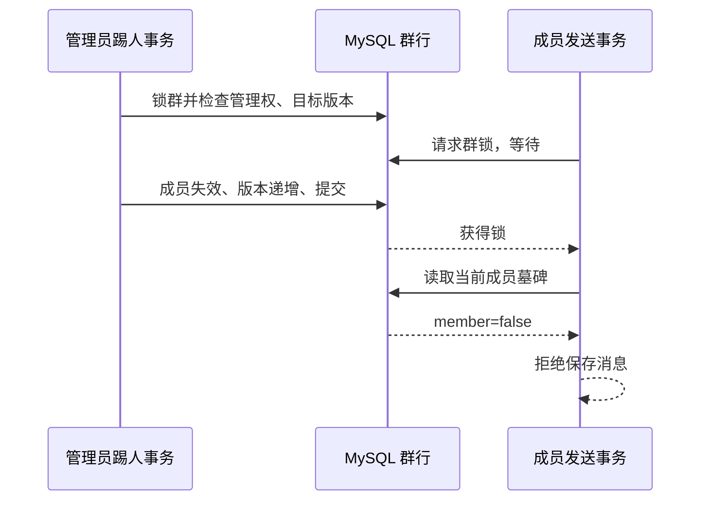

# 群业务事务、并发与权限

## 1. 群业务的不变量

| 不变量 | 持久化表达 | 保证位置 |
| --- | --- | --- |
| 一个群有一个正式会话 | `group_chat.thread_id` 引用 `chat_thread.id` | 外键及创建事务 |
| 有效群只有一个有效群主 | `owner_uid` 对应有效 `role=2`，有效 role2 数量为 1 | `MutateGroup` 群锁内检查 |
| 同一用户在同一群只有一个身份记录 | `(thread_id,user_id)` 联合主键 | MySQL 主键 |
| 失效后重入具有新身份版本 | 原行保留，`membership_version` 递增 | 加入、撤权及角色事务 |
| 一个用户在群内最多有一个待处理准入 | `(thread_id,pending_uid)` 唯一索引 | 生成列与唯一索引 |
| 管理操作与重放记录一起提交 | `group_operation(user_id,operation_id)` | 管理事务 |
| 群文本每条只保存一次 | `chat_message.recv_id=0` | `GroupOperation(Send)` |

角色 CHECK 只约束 `0/1/2`，无法表达跨多行的唯一群主。服务端业务事务维护这个约束；直接手工改角色可能形成 SQL 可接受、业务不可用的群。

模型定义见 [create_tables.sql](../sql/create_tables.sql)。完整用户操作、界面和资源流程见[群聊](群聊.md)；消息补拉与本地恢复见[聊天信息存储方案](聊天信息存储方案.md)。

## 2. 为什么授权检查必须与动作共用事务

### 2.1 当前身份与锁顺序

[GroupDatabase.h](../ChatServer1/include/GroupDatabase.h) 的 `group_db::Load` 要求调用者已经开启事务，依次执行：

1. `SELECT ... FROM group_chat WHERE thread_id=? FOR UPDATE`。
2. `SELECT role,membership_version,active FROM group_chat_member ... FOR UPDATE`。
3. 只有群有效且成员有效，才设置 `member=true` 并返回可用角色；墓碑仍返回成员版本。

`Load` 返回 true 只表示查到群。调用者仍要检查 `active`、`member` 和具体权限。请求中的 UID、角色、owner 字段无法替代认证 session 身份。

[GroupManagement.cpp](../ChatServer1/src/GroupManagement.cpp) 的 `MutateGroup` 随后按 UID 顺序锁定本群全部成员，包括墓碑，再处理准入记录。群行是同一群的公共竞争点，即使两个操作针对不同成员，也会在群行上依次执行。不同群使用不同群行；数据库连接池和其他共享资源仍可能形成额外等待。

### 2.2 发送与踢人竞争



若发送先获得锁并提交，消息合法保留，后续踢人不删除它。判断依据是数据库动作的先后，不依赖两个客户端按钮的点击时间。

实时目标授权也使用 `GroupOperation(Authorize)`。同服和跨服目标端在群锁持有期间调用 `TrySend`，使撤权提交后的迟到广播无法绕过当前成员检查。锁不能撤回此前已经进入 TCP 队列的帧，也不持续到对端实际收到或显示。

### 2.3 锁的成本与异常

群锁覆盖成员读取、SQL 更新、输出构造及预算检查；大群枚举和逐成员事件构造会延长临界区。头像可信 RPC 在管理事务前执行，避免持有 ChatServer 群锁等待网络，写库时再检查角色。

统一锁顺序降低相反顺序加锁带来的风险，不能保证所有事务永不死锁。当前数据库入口遇 SQL 异常返回 `ServerBusy` 并回滚，没有透明死锁重试或唯一键冲突重试。网络重试的业务键与数据库异常的内部重试是两个独立问题。

## 3. 管理事务的提交点

首次管理操作按以下顺序处理：

1. 检查参数、UTF-8、长度和 `operation_id`；紧凑请求不得超过 2048 字节。
2. 初查业务键，创建操作重放时由旧结果定位原群。
3. 开启事务；首次创建同时插入会话、群资料和创建者 role2 成员。
4. 锁群、自己成员和全部成员；群锁下再次锁读业务键。
5. 检查群主不变量、操作者当前身份与角色。
6. 执行首次操作的目标版本、准入状态或公告版本检查，再更新业务表。
7. 有实际群资料或成员变更时递增群版本，生成正式响应和每个收件人的事件。
8. 将真实 UID、request_id 等信封字段计入预算，响应与每个事件均须不超过 4096 字节。
9. 插入业务键、精确输入和正式结果，与业务变更一起 commit。
10. `LogicSystem::HandleGroup` 在提交后投递事件。

提交前失败由退出回滚逻辑撤销业务写入。消息或管理输出超限同样回滚，不截断公告，不跳过成员来伪装成功。自增 ID 分配不等于提交，自增序列允许空洞。

网络投递不参与 MySQL 事务。提交后通知失败，群状态保持新值；离线用户靠完整群快照、准入列表和历史恢复。当前没有将群广播结果作为持久待投递队列保存的事务 outbox。

## 4. 业务键、重放与结果不确定性

### 4.1 两种关联标识

- `request_id` 关联一次窗口或分页请求。重试可以换 request_id。
- `operation_id` 表达同一个管理意图，以 `(认证 UID,operation_id)` 作为持久主键。
- `msgid` 是文本气泡 UUID，不参与管理重放。

业务键长 1～128 字节，只允许 ASCII 字母、数字和连字符。输入去掉 `request_id/token` 后紧凑序列化；`action` 与其余字段精确匹配。额外字段和 ID 的数字、字符串表示都参与比较。同键换输入返回 `Error_Json`。

例如同一离群操作的关联部分为：

```json
{
  "request_id": "request-a",
  "operation_id": "leave-a",
  "thread_id": "501",
  "expected_membership_version": "7"
}
```

在直接使用协议处理超时重试时，应保留 operation_id、thread_id、预期版本等业务输入，只更换 request_id。用新业务键意味着新的操作意图；旧预期版本可能被拒绝。桌面 `SendGroupMutation` 每次调用都会生成新的 request_id 和 operation_id，重复点击不自动复用旧键。

### 4.2 重放仍检查当前权限

群锁下找到相同业务键后，先检查群有效、群主完整性及操作者当前权限，才返回 `replayed=true`。返回中的群身份替换为当前资料，不重新执行目标变更、不重复广播。

| 场景 | 同键重放行为 |
| --- | --- |
| 创建者仍是当前成员 | 返回原群与当前身份，允许其已转为普通成员 |
| 旧 JOIN 对应申请已处理 | 刷新原申请当前状态，不创建新申请 |
| 离群后重新加入 | 返回当前身份并去掉旧离群 reason，不退出新身份 |
| 踢人后目标已重入 | 操作者仍有管理权时返回重放结果，不再踢新身份 |
| 审批者已失去管理权 | 拒绝旧审批业务键 |
| 原群主已完成转让 | 因当前已非群主，转让重放被拒绝 |
| 群已经解散 | 先返回 `GroupUnavailable` |

重放不再次执行目标版本、好友关系和公告版本等首次操作的专用检查。它避免再次产生副作用；返回的附带业务结果可能来自旧操作，不能把其中的旧目标资料当成新的管理授权。

头像请求即使使用旧业务键，也先经过 ChatServer 的 token 读取和可信资源核验，随后才进入数据库重放判断。

### 4.3 超时不证明未提交

连接中断可能发生在 commit 之后、响应之前。管理业务键允许服务端识别同一意图，最终返回仍受当前权限影响。当前代码没有通用“查询任意旧业务结果”的独立接口，无法承诺每次超时都能原样取得旧成功。

群文本没有业务键唯一约束；相同 UUID 再发一次可能产生第二个正式 `message_id`。收到 `persisted=true` 且实时失败时，不应据此重发已保存正文。正式消息的客户端去重只能合并相同 message_id，不能合并两次不同 INSERT。

## 5. 准入状态机的并发含义

### 5.1 待处理唯一性

`pending_uid = IF(status='pending',user_id,NULL)`。唯一索引 `(thread_id,pending_uid)` 跨邀请和申请生效；终态为 NULL，可保存多条历史。

邀请只表达邀请人发出邀请，不立即建立成员。有效成员邀请自己的双向好友时，服务端检查目标用户存在、两条 friend 边存在；已有任何类型 pending 则复用。返回的 entry 可能是一条 application，界面不能一律按邀请渲染。

本人主动 JOIN 遇到 pending invitation，视为明确同意并结束邀请；该 JOIN 分支不重新检查邀请者身份。独立 `DECIDE_INVITE` 分支则检查邀请者是否仍为有效成员，失效时把邀请变为 invalid。二者都不能绕过当前审批规则。

### 5.2 同意与审批分成两个事实

| 输入 | 当前条件 | 提交结果 |
| --- | --- | --- |
| 接受有效邀请 | 审批关闭 | invitation accepted，实际加入 |
| 接受有效邀请 | 审批开启 | invitation accepted，新 application pending |
| 主动 JOIN | 无审批、无旧 pending application | 实际加入 |
| 主动 JOIN | 开启审批或已有 pending application | 创建或复用申请 |
| 管理者批准 pending application | 当前管理权成立 | application approved，必要时加入 |
| 处理任意终态 | 记录已决定 | 不覆盖终态、不再次加入 |

关闭审批不会批量批准旧申请；后续 JOIN 仍复用旧待审申请。离群或踢人使该用户发出的 pending invitation 失效；解散使全群 pending 准入失效。

终态重复决定可以随 Success 返回 `already_processed=true`，决定与现状冲突时带 `status_conflict=true`。同键重放的 `replayed`、终态重复决定的 `already_processed` 和真正发生入群的 `membership_granted` 含义不同。

### 5.3 状态变化与分页

准入状态在原 ID 上变化。`inbox/applications/results/approvals` 各自从 `after_id=0` 刷新，再按 ID 分页；永久从上次最大 ID 继续会漏掉旧 pending 的终态。审批只读取本群 pending application，要求当前 role1/2；个人三个范围不要求已入群，可恢复离线结果。

准入变更可以不增加 group.version，审批页面要响应准入事件刷新。终态缓存应阻止迟到 pending 页面恢复决策按钮。实现见 [GroupRequestsPage](../chat_app%20desktop/grouprequestsdlg.cpp) 和 `LoadGroupRequests`。

## 6. 成员版本与权限变更

### 6.1 避免旧窗口作用于新身份

假设成员 B 的版本为 5，被踢后为 6，重入后为 7。旧窗口发送 `expected_membership_version=5`，即使 UID 和群号相同，也不能操作版本 7 的身份。

- 踢人、任免管理员、转让检查目标版本。
- 自愿离群检查操作者自己的版本。
- 实际角色变化、加入、撤权递增相关成员版本。
- 任免同角色无变更，但仍可记录一次成功业务键。

群版本用于共享资料与成员集合变化；它不能替代目标成员版本。公告另有 `expected_announcement_version`；同一正文重新提交也递增公告版本。头像发布没有 expected_avatar_version CAS，同资源用新业务键发布也会递增头像版本。

### 6.2 权限矩阵的特殊条件

普通成员可聊天、读成员/历史/公告、邀请自己的好友、自愿离群。管理员增加审批、公告、头像及踢普通成员权限。群主管理管理员、踢管理员、转让、解散和审批开关。

群主不能被踢或直接离群。转让一次修改 owner_uid、新群主 role2、旧群主 role0，并递增双方成员版本；旧群主不保留管理员。所有按钮状态只是客户端预检查，服务端使用锁内当前身份。

离群、踢人和解散保留消息及成员行，失效群在本地只读。它们不关闭账号连接，不撤销私聊或其他群。当前有效成员可以读取入群前历史，SQL 没有按 joined_at 截断；失效成员不能继续拉服务端群历史。

## 7. 通知授权与隐私

| 事件 | 收件条件 | 身份用途 |
| --- | --- | --- |
| text、metadata、members | 目标端再次锁定验证当前有效成员 | 普通更新；实际新增成员的 members 另带 grant |
| inbox、result | 可投递给非成员 | 准入进度，不授予成员身份 |
| invalidated | 投递给已撤权目标 | 保存版本化墓碑 |

公告可见性按真实收件人计算。公开搜索、待审响应和本人失效通知中 `announcement_visible=false`，正文空、公告版本/作者/时间为 0。这些占位值不能作为公告清空更新本地资料。合法空公告属于成员可见且版本递增的正式更新。

`group_db::Text` 按 X Protocol 字节长度读取正文，剥离协议附加尾零并保留正文 NUL。UTF-8 校验允许合法 NUL、换行和控制字符，不执行 trim 或 Unicode 规范化；Qt 群名入口另行 trim。长度限制以 UTF-8 字节计算。

`ForwardGroup` 用 Redis 在线路由选择同服 TCP 或 `NotifyGroup`。目标端只授权和投递，不再次保存消息。单次跨服连接池等待与 RPC 共用三秒绝对期限；广播逐目标同步，整群耗时可能更长。当前内部 RPC 使用 insecure channel，需要受信网络及部署访问控制。

## 8. 客户端的权限缓存边界

[LocalChatStorageMgr](../chat_app%20desktop/localchatstoragemgr.cpp) 将共享资料与身份分开合并：

- `Metadata` 更新资料，不改变成员 active、role 和 membership_version。
- `CurrentMemberMetadata` 只允许本地原有效身份以更高版本更新角色，不激活未知或失效身份。
- `MembershipProof` 可建立新身份；已有墓碑要求严格更高成员版本才能激活。
- `SetGroupState` 只接受更高撤权版本，保存 inactive 墓碑与原因。

完整群快照从 0 开始，服务端将全量结果绑定 session 后分页；客户端暂存整轮，匹配账号、登录代次、请求和逐群 epoch 后才事务对账。缺席项变只读，不编造服务端成员版本。半轮失败不能撤权；并发确认的入群证明并入该轮资料，避免旧快照误撤新身份。

群管理和快照有请求代次关联；文本确认、文本通知及历史没有相同的 pending 关联或逐消息成员版本检查，依赖当前账号、正式元数据和已知群状态。不能将这些路径描述为完全相同的异步隔离。失效后的旧发送确认可补记正式消息，但不恢复身份。

## 9. 操作与源码定位

遇到管理冲突时，重新读取成员或公告版本，再由用户表达新的操作意图；不要换业务键自动重施旧目标版本。遇到网络失败，区分未取得响应与明确业务拒绝；取得正式保存确认后，将实时失败交给同步恢复处理。

| 学习问题 | 代码入口 |
| --- | --- |
| 谁是操作者、预算何时检查、何时广播 | [LogicSystem::HandleGroup / ForwardGroup](../ChatServer1/src/LogicSystem.cpp) |
| 管理事务、重放、准入及事件 | [MysqlMgr::MutateGroup / LoadGroupRequests](../ChatServer1/src/GroupManagement.cpp) |
| 群锁、墓碑、身份读取 | [group_db::Load](../ChatServer1/include/GroupDatabase.h) |
| 单份文本、成员和历史授权 | [MysqlMgr::GroupOperation](../ChatServer1/src/MysqlMgr.cpp) |
| 跨服目标端锁内入队 | [ChatServiceImpl::NotifyGroup](../ChatServer1/src/ChatServiceImpl.cpp) |
| 单次 RPC 期限 | [ChatGrpcClient::NotifyGroup](../ChatServer1/src/ChatGrpcClient.cpp) |
| 请求关联、完整快照及通知合并 | [TcpMgr](../chat_app%20desktop/tcpmgr.cpp) |
| 当前角色、目标版本与窗口操作 | [GroupManagementDialog](../chat_app%20desktop/groupmanagementdialog.cpp) |
| 资源片授权、群锁租约 | [ResourceAccessAuthorizer](../ResourceServer/src/ResourceAccessAuthorizer.cpp) |

群正文仅支持纯文本；`muted_until` 不构成已实现禁言功能。群头像是独立受控资源，不授予群图片/文件消息能力。初始化与迁移方式见[数据库设计](数据库设计.md)，不得以重跑建表脚本替代已有库升级。
