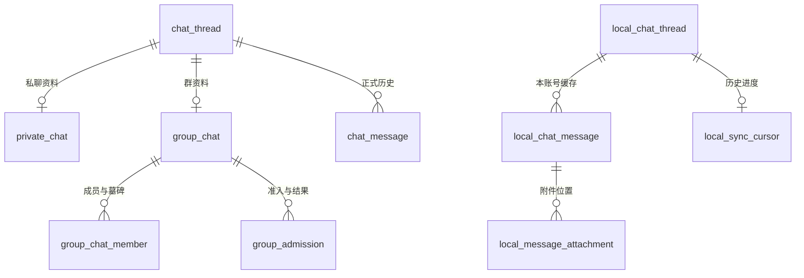

# 数据库设计

## 1. 数据分别放在哪里

| 数据 | 存储位置 | 用途 |
| --- | --- | --- |
| 账号、资料、好友、好友申请 | MySQL `chat_app_db` | 长期保存、条件查询和事务更新 |
| 私聊会话、消息及回执 | MySQL `chat_app_db` | 离线历史、会话发现、显示/已读状态同步 |
| 群聊、成员与单份群消息 | MySQL `chat_app_db` | 精确群号、申请/邀请准入、角色管理、逻辑解散与成员历史授权 |
| 每个账号的聊天列表、消息缓存和同步游标 | 客户端 SQLite | 快速打开聊天、离线查看和幂等增量同步 |
| 验证码、登录 token、在线路由、服务负载 | Redis | 有时效或高频变化的数据 |
| 图片和文件正文 | ResourceServer 管理的文件 | MySQL 只保存资源 ID 和经过核验的元数据 |



MySQL 的用户、好友和聊天表都在同一个 `chat_app_db` 中，但好友表和会话表没有指向 `user.uid` 的外键。用户身份及这些引用的有效性由服务端业务逻辑检查；聊天子表之间的会话关联则使用了外键。

## 2. 初始化与升级

| 脚本 | 作用 |
| --- | --- |
| `sql/create_tables.sql` | 全新 MySQL 环境的完整入口：创建数据库及账号、好友、会话、消息表，含当前图片/文件元数据和 `displayed_at` |
| `sql/chat_app_test_local.sql` | 本机 MySQL 集成测试 schema 的完整建库建表脚本；结构与 `create_tables.sql` 同步 |
| `sql/chat_message_storage.sql` | 旧版分步初始化兼容脚本；按当前定义创建缺失的聊天表，不升级已有表 |
| `sql/chat_image_message_migration.sql` | 为旧版 `chat_message` 补充图片/文件类型及资源元数据；可重复执行 |
| `sql/chat_message_receipt_migration.sql` | 为旧版 `chat_message` 增加 `displayed_at` 和对应索引；对旧库执行一次 |
| `sql/chat_group_migration.sql` | 已部署群表增加 owner_uid/active、缺名预留群置 inactive 并将 NULL 名归空/列改 NOT NULL、统一角色0/2及群关联外键 RESTRICT；停写备份后执行一次，保留成员与历史 |
| `sql/chat_group_management_migration.sql` | 已有 owner_uid/active 群库新增管理版本、成员 tombstone、准入及业务重放结构；执行一次，不重写已有管理员或历史 |
| `sql/client_chat_cache.sql` | 客户端 SQLite 缓存的独立建表脚本；程序也会在打开账号缓存时初始化并迁移结构 |

全新 MySQL 环境只需执行 `sql/create_tables.sql`。升级已有库时，若尚无聊天表，可用兼容脚本 `sql/chat_message_storage.sql` 按当前定义补建缺失表；若已有旧版 `chat_message`，按需依次执行图片/文件迁移和显示确认迁移，再部署会读写这些字段的服务端版本。`CREATE TABLE IF NOT EXISTS` 不会自动修正已有表，所以重跑建表脚本不能代替迁移。

## 3. 账号与社交关系

### 3.1 `user`：账号和资料

| 字段 | 类型 | 含义 |
| --- | --- | --- |
| `id` | `INT` 自增 | MySQL 行主键，内部使用 |
| `uid` | `INT` | 业务用户 ID；登录、好友关系和消息中使用 |
| `name` | `VARCHAR(255)` | 登录名；当前只有普通索引，不是唯一索引 |
| `email` | `VARCHAR(255)` | 邮箱；唯一索引 |
| `pwd` | `VARCHAR(255)` | 客户端处理后的密码串 |
| `nick` | `VARCHAR(255)` | 昵称 |
| `` `desc` `` | `VARCHAR(255)` | 个性签名；`desc` 是 MySQL 保留字，SQL 中要加反引号 |
| `sex` | `INT` | `0` 未知、`1` 男、`2` 女 |
| `icon` | `VARCHAR(255)` | 头像资源地址 |

`id` 和 `uid` 分开，是为了让内部行号与业务身份不绑定。`uid` 有唯一索引，用户资料和关系表使用它；用户主键是 `id`。`email` 由唯一索引兜底，`name` 当前没有唯一约束。

注册时，网关先分别检查邮箱和用户名，再调用 `RegUser`；`RegUser` 在一个事务内递增 `user_id` 并插入用户。因为用户名检查与插入不是同一个原子操作，而且 `name` 不是唯一索引，并发注册仍可能写入重复用户名。邮箱重复会被数据库唯一索引拒绝。这是当前实现的并发边界，不能把网关查重当成数据库唯一性约束。

`pwd` 当前存的是客户端异或处理后的串。异或可以还原原值，属于可逆混淆，不是密码哈希；若要抵御数据库泄露，需要迁移到带盐的慢哈希方案。

### 3.2 `user_id`：业务 UID 分配器

该表只有一个 `id` 字段，设计上应只保留一行；脚本在空表中初始化为 `1000`。注册事务执行 `UPDATE user_id SET id = id + 1`，再读取新值，因此按当前实现第一个新注册 UID 为 `1001`。单行更新由 InnoDB 加锁，使 UID 分配串行化；用户插入失败时事务回滚，分配值也一起回滚。表结构本身不能阻止误插入第二行，维护时要保持单行约定。

初始化或修复已有环境时，要让分配器值大于或等于现有最大 `uid`，避免后续冲突。此表当前由注册代码直接使用，没有存储过程。

### 3.3 `friend`：双向好友边

| 字段 | 含义 |
| --- | --- |
| `id` | 自增主键 |
| `self_id` | 关系所属用户 UID |
| `friend_id` | 好友 UID |
| `back` | `self_id` 用户给对方设置的备注 |

唯一索引 `(self_id, friend_id)` 防止同一方向重复。好友关系保存为两行，例如 A→B 和 B→A 各一行，这样双方备注可以不同，也方便按 `self_id` 查询好友列表。删除关系时要在事务中删除两个方向；当前表本身不声明级联删除外键。

### 3.4 `friend_apply`：单向申请

| 字段 | 含义 |
| --- | --- |
| `id` | 自增主键，用于按申请时间倒序展示 |
| `from_uid` / `to_uid` | 申请方 / 接收方 |
| `applicant_remark` | 申请方希望显示在自己好友列表中的备注 |
| `status` | `0` 待处理、`1` 已同意、`2` 已拒绝 |

唯一索引 `(from_uid, to_uid)` 保证一个方向只保留一条申请。重复提交待处理申请时会更新申请方备注；已同意或已拒绝的终态不会被新请求重置。

同意申请时，服务端事务会锁定申请记录，写入双向 `friend` 关系，创建或复用双方唯一的私聊会话，并保存认证后的首条消息。申请方备注写入申请方自己的 `friend.back`，接收方备注写入接收方自己的那一行。

## 4. 会话与消息

### 4.1 `chat_thread`：会话统一入口

`id` 是 `BIGINT UNSIGNED` 自增会话 ID，`type` 是 `private` 或 `group`，`created_at` 记录创建时间。私聊和群聊共享这张主表，消息统一引用其 `id`，客户端也使用这个 ID 标识本地会话。

### 4.2 `private_chat`：一对用户一个私聊

| 字段 | 含义 |
| --- | --- |
| `thread_id` | 主键，同时外键引用 `chat_thread.id` |
| `user1_id` / `user2_id` | 私聊双方 UID，写入时按小到大排列 |
| `created_at` | 建立时间 |

唯一索引 `(user1_id, user2_id)` 保证同一对用户只有一个私聊及 `thread_id`。另外两个组合索引分别支持按任意一方查会话。ChatServer 创建会话时使用事务和唯一索引处理并发竞争；若并发请求先后创建了临时 `chat_thread`，未被唯一私聊记录采用的那条会在提交前清理。

认证成功和显式创建私聊都会复用同一个会话。图片/文件资源归属校验仍仅覆盖私聊；群只发送纯文本。

### 4.3 `group_chat` 与 `group_chat_member`：群权限与逻辑解散

`group_chat` 以 thread_id 为群号，保存群主、有效状态、审批开关、公告及版本元数据。创建群在同事务写 thread、群与role2 owner，当前有效群恰好一个与owner_uid一致的role2。

成员角色为0普通、1管理员、2群主；成员 `(thread_id,user_id)` 永久保留 active/membership_version。加入/reactivation、离群/踢出/解散和角色变更均递增相应成员版本；有效成员查询过滤active=1。权限事务群行→成员→准入当前锁定读，管理员审批/踢role0/公告，群主管理role1/转让/解散/审批开关，成员可好友邀请及自愿离群（owner先转让）。全部历史与RESTRICT外键保留。

### 4.3.1 群管理增量结构与部署约束

三份全量 DDL 同步定义 `group_chat.version`、审批开关、纯文本公告及其独立版本、头像可信资源元数据及 `avatar_version`。`group_chat_member` 保留成员行并新增 `active/membership_version`；任何成员授权查询都必须限定 `active=1`，不能把 tombstone 当作权限。角色为0成员、1管理员、2群主；群行锁下的业务逻辑保证有效群只有一个与 owner_uid 一致的 role2。

`group_admission` 以全局自增 id 分页，kind 区分邀请和申请。邀请状态 pending/accepted/rejected/invalid，申请状态 pending/approved/rejected/invalid；生成列 `pending_uid` 和 `(thread_id,pending_uid)` 唯一索引保证两个类型共用一个待处理准入。终态不删除，离线结果可恢复。`group_operation` 按用户与 operation_id 保存精确业务输入和正式结果；request_id 仅用于回包关联，不承担防重放。

升级已有 owner_uid/active 群库时只执行 `chat_group_management_migration.sql`，不再次执行会统一重写角色的旧 `chat_group_migration.sql`。增量迁移不删除成员、会话或消息，不重置 role1；停写、备份并与读取新字段的服务一起部署。

### 4.4 `chat_message`：统一消息记录

| 字段 | 含义 |
| --- | --- |
| `message_id` | `BIGINT UNSIGNED` 自增主键；全局消息 ID，也是客户端缓存去重键及每会话历史游标的取值 |
| `thread_id` | 所属会话，外键引用 `chat_thread.id` |
| `sender_id` / `recv_id` | 发送者 / 私聊接收者 UID；群消息每条仅一行，`recv_id = 0`，实时目标成员另用通知 target_member_uid |
| `client_msg_id` | 客户端消息 UUID；服务端生成的认证消息可以为空 |
| `message_type` | `text`、`image`、`file` 或 `system` |
| `content` | 文本正文或消息内容字段 |
| `resource_id` | ResourceServer 资源 ID；不存服务器绝对路径或文件正文 |
| `resource_name` / `mime_type` / `file_size` | ResourceServer 核验后的名称、MIME 和字节数 |
| `width` / `height` | 图片像素尺寸；文本和文件通常为空 |
| `created_at` / `updated_at` | 创建和状态更新时间 |
| `displayed_at` | 接收端确认消息已进入聊天窗口的时间，可为空 |
| `status` | `0` 未读、`1` 已读、`2` 撤回（表结构/客户端状态定义） |

文本、图片和文件共用一张表与同一 `message_id` 序列。图片和文件正文留在 ResourceServer；写入消息前，ChatServer 会核验资源，再将 ResourceServer 返回的可信元数据入库。历史同步按 `(thread_id, message_id)` 查询，图片/文件与文本因此能按真实发送顺序混合分页。

索引分别服务于按会话时间或消息 ID 分页、按接收者筛选未读/显示状态，以及按消息类型查找。`fk_message_thread` 对删除会话使用 `ON DELETE RESTRICT`，避免有历史消息时误删会话。

`client_msg_id` 没有唯一索引，不提供跨请求重试去重。群文本和私聊图片/文件会持久化客户端 UUID；`SavePrivateTextMessages` 的普通私聊文本 INSERT 将该列写为 NULL，实时确认中的 UUID 由请求携带。历史恢复应以正式 `message_id` 识别消息。消息表的 `status` 取值主要由业务控制，DDL 没有对应 CHECK。

`idx_thread_message(thread_id,message_id)` 的第一列用于固定会话，第二列支持范围扫描和顺序读取：

```sql
SELECT message_id, sender_id, recv_id, content
FROM chat_message
WHERE thread_id = ? AND message_id > ?
ORDER BY message_id
LIMIT ?;
```

时间戳精度及跨请求到达顺序不适合替代正式 ID 游标。当前 `created_at` 是秒精度 TIMESTAMP；普通私聊文本实时回包的毫秒展示值取写入时的系统时间，历史则从数据库时间转换，不能要求二者毫秒值完全一致。

**显示与已读是两件事。** `displayed_at` 只表示接收端已把消息实际放进聊天窗口；`status = 1` 表示接收端随后提交了会话已读游标。显示确认写入时间戳，重复确认不会覆盖首次时间；已读状态由消息接收者和会话范围约束。不要用 `status` 代替显示状态。

当前主流程主要使用 `status` 的 `0 → 1` 转换；撤回值 `2` 出现在表和客户端状态定义中，但当前消息主流程未提供撤回操作。

## 5. 桌面端 SQLite 缓存

Qt 客户端按已登录 UID 使用独立文件 `chat_cache_<uid>.db`，放在 `QStandardPaths::AppLocalDataLocation/chat_cache/`。账号隔离可以避免不同用户共用本地聊天缓存。缓存用于快速展示和离线历史，不代替服务端 MySQL 中的消息事实。

| 表 | 主键/关联 | 用途 |
| --- | --- | --- |
| `local_chat_thread` | `thread_id` | 类型、标题、对端UID、群owner_uid/active、最后消息摘要/时间与未读数 |
| `local_sync_cursor` | `thread_id` | 每个会话已完整补拉到的 `message_id` 和同步时间；独立于缓存最大消息 ID |
| `local_chat_message` | `message_id` | 消息内容、时间、服务端状态、本地发送状态和投递阶段 |
| `local_message_attachment` | `attachment_id`；外键到消息 | 附件本地路径、远端地址、MIME、大小和下载状态 |

`local_chat_message.message_id` 直接使用服务端全局消息 ID，重复实时通知或历史同步可以按主键幂等写入。同步游标按会话保存；消息和游标应在同一事务中推进，避免消息未落盘但游标已经越过。

本地 server_status沿用服务端状态；私聊delivery_state保存已保存/实时投递/已显示/已读，发送结果由send_state记录。进入任何会话都可本地清unread_count，只有private会话另向服务端提交已读游标；群recv_id=0不发送私聊展示ACK/已读请求，不把个人阅读误作全群已读。实时消息/发送确认保存消息和摘要但保持既有连续历史cursor；完整history页成功同事务提交后才推进该cursor。

附件正文仍保存在本地文件或 ResourceServer，不放进 SQLite。`local_message_attachment` 提供路径和下载状态字段。SQLite 的 `content_type` 检查还包含 `audio`，而当前 MySQL `message_type` 不包含该类型；音频消息目前没有对应的服务端持久化链路。

程序通过 LocalChatStorageMgr 初始化缓存，启用外键和 WAL；`user_version=5`。当前缓存为群记录保存 `role`、`invalid_reason`、服务端通用 `version`、`membership_version`、`announcement_version` 与 `avatar_version`；协议 JSON 的 `version` 映射到本地通用版本，不以本地字段名推断服务端字段。账号缓存不代替服务器权限。
旧缓存通过幂等 ALTER 迁移补齐缺少字段，不重建消息表，保留消息、附件、回执、摘要和未读数。低于 v3 的缓存会清零旧同步游标以重新补拉；v3 及之后的连续历史游标保留。全部 ALTER 没有统一外层事务，不能认为迁移整体原子提交。
群成员身份由版本化授权来源合并：`Metadata` 只能更新群资料，不能改变本地成员、角色或 membership_version；`CurrentMemberMetadata` 只允许已激活成员以更高成员版本更新角色，未知/已失效身份不推进成员版本；显式 `MembershipProof` 仅在成员版本严格高于已存 tombstone 时激活。踢出/离群 tombstone 的成员版本必须保留，普通资料通知不能覆盖失效状态。完整群列表只有在当前账号与登录轮次匹配、所有分页成功后才整体对账；缺席群本地失效但不虚构成员版本。`sql/client_chat_cache.sql` 与运行时 schema v5 同步。

SQLite 的外键是每连接设置，`Initialize` 每次打开都执行 `PRAGMA foreign_keys=ON`，并启用 WAL。桌面 [CMakeLists.txt](../chat_app%20desktop/CMakeLists.txt) 引入 Qt `Sql` 模块，运行时使用 `QSQLITE` 驱动。`local_chat_message(thread_id,message_id DESC)` 支持本地向前翻页；附件与游标的外键使用 CASCADE，只约束本地数据生命周期，不影响服务端历史。

### 5.1 升级操作与模型检查

1. 确认当前服务连接的 schema；[ChatServer1/config.ini](../ChatServer1/config.ini) 的 `[Mysql]` 指定 X Protocol 端口、schema 和连接池大小。导入 SQL 使用 MySQL 客户端端口，通常为 3306，与应用默认 33060 分开。
2. 全新环境执行 [create_tables.sql](../sql/create_tables.sql)。已有环境先查看 `SHOW CREATE TABLE`，按实际缺失结构选择迁移，不以文件存在推断数据库已升级。
3. 已有聊天表按需执行 [资源字段迁移](../sql/chat_image_message_migration.sql) 和 [显示确认迁移](../sql/chat_message_receipt_migration.sql)。资源迁移先查询 `information_schema`，可重复执行；显示确认迁移按脚本要求执行一次。
4. 群库缺少 `owner_uid/active` 时，先按 [基础群迁移](../sql/chat_group_migration.sql) 补齐；在具备这些字段后，再按缺失情况执行 [群管理迁移](../sql/chat_group_management_migration.sql)。已经具备基础字段的库直接进入管理迁移，已有管理员的库不可重跑重写角色的基础迁移。两份脚本的 ALTER 都不能直接重复执行。
5. 在停写窗口处理服务端迁移，再部署读取新字段的服务。检查有效群的 `owner_uid` 对应有效 `role=2`，并且有效群主只有一人；检查成员授权查询都过滤 `active=1`。MySQL DDL 会形成独立提交边界，多个 ALTER 不构成一个可整体回滚的业务事务。
6. 客户端旧缓存交给 `LocalChatStorageMgr::CreateSchema` 自动升级；[client_chat_cache.sql](../sql/client_chat_cache.sql) 只作新库结构入口，不能代替已有缓存升级。

### 5.2 约束与业务检查的分工

| 不变量 | 数据库保证 | 业务负责 |
| --- | --- | --- |
| 同一对用户一个私聊 | 排序后的用户对唯一索引 | 写入前按 UID 排序；DDL 无大小关系 CHECK |
| 每群每用户一条成员关系 | 成员联合主键 | active、角色和版本转换 |
| 有效群唯一群主 | 角色取值 CHECK | 群锁下检查唯一群主与 owner_uid 一致 |
| 每人每群最多一个 pending | 生成列唯一索引 | 邀请同意、申请批准和失效转换 |
| 同一管理业务键不重复提交 | 用户与 operation_id 联合主键 | 精确输入匹配、当前权限、结果重放 |
| 历史缓存完整推进 | SQLite 事务 | 先验证整页；实时包保持原历史游标 |

事务与重放细节见[群业务事务、并发与权限](总结群聊.md)。`muted_until`、消息 `status=2`、SQLite `audio` 等结构预留值不等于已有禁言、撤回或音频消息业务。

## 6. 字符集、ID 与一致性边界

* MySQL 使用 `utf8mb4`，能保存 emoji 和四字节字符。
* MySQL 通过 X DevAPI 连接，默认端口为 `33060`。
* `uid` 是 `INT`；`thread_id` 和 `message_id` 是 `BIGINT UNSIGNED`。客户端缓存使用 SQLite `INTEGER`（64 位），不要把会话或消息 ID 截断到 32 位。
* `friend`、`friend_apply` 和会话成员 UID 没有到 `user` 的外键；业务写入要校验用户，删除用户时也要考虑关系和历史数据。
* 私聊消息、好友确认与群操作均有事务边界；群以 group_chat 行锁串行化权限修改和授权，目标群文本转发也持锁授权/TCP入队但不再写消息。客户端批次以本地事务保存消息和游标。
* Redis 保存有 TTL 或高频变化的状态，不能当作账号、好友或消息历史的唯一副本。
* `user.name` 目前缺少数据库唯一约束，这是当前并发注册的边界；文档记录现状，不代表数据库层已保证用户名唯一。

## 7. 相关资料

* [聊天信息存储方案](聊天信息存储方案.md)：消息落库、会话发现、客户端缓存和历史同步细节。
* [聊天可靠性与资源安全提升](聊天可靠性与资源安全提升.md)：显示确认、已读、历史分包和图片下载鉴权。
* [Redis](Redis.md)：验证码、token、在线路由和缓存用途。
* [MySQL连接库](MySQL连接库.md)：项目的 X DevAPI 使用方式。

## 8. 实现定位

| 主题 | 源码 |
| --- | --- |
| 注册 UID 事务与用户字段 | [GateServer MysqlMgr.cpp](../GateServer/src/MysqlMgr.cpp) |
| 好友申请、双向关系、唯一私聊、消息与回执 SQL | [ChatServer MysqlMgr.cpp](../ChatServer1/src/MysqlMgr.cpp) |
| 群主不变量、准入状态、操作结果与版本更新 | [GroupManagement.cpp](../ChatServer1/src/GroupManagement.cpp)、[GroupDatabase.h](../ChatServer1/include/GroupDatabase.h) |
| SQLite v5、外键开关、消息事务及成员证明合并 | [localchatstoragemgr.cpp](../chat_app%20desktop/localchatstoragemgr.cpp) |
| 历史整页校验和完整群快照 | [tcpmgr.cpp](../chat_app%20desktop/tcpmgr.cpp) |
