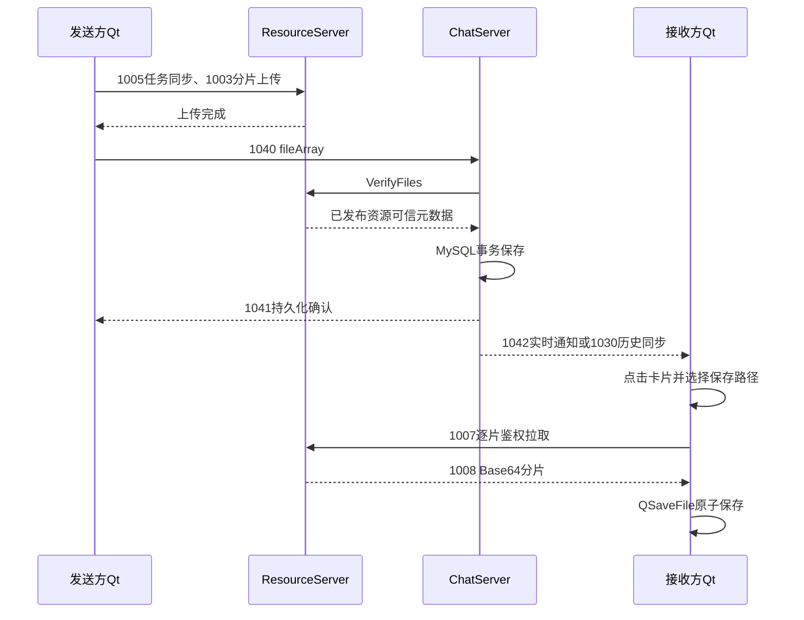

# 私聊文件传输

## 资源字节与聊天记录

文件正文通过 ResourceServer 独立 TCP 上传和下载。ChatServer 与跨服 RPC 只处理资源引用、文件名称、MIME、字节数和消息身份；MySQL、SQLite 保存文件消息元数据，不保存文件正文。



单文件上限 100 MiB。Qt 选择文件时拒绝不存在、空文件与超限文件；ResourceServer 在 1005 和每个 1003 独立检查大小，超限返回 `1022 UploadFileTooLarge`。当前群聊只支持文本，群附件不能通过文件私聊入口发送。

## 上传任务和1040协议

文件与图片共用 `ChatImageTransferTask` 的分片队列，文件公开数据类型为 `FileChatData`，不执行图片解码。客户端读取本地文件计算 MD5，用 `MD5_文件长度_1024` 生成稳定资源任务 ID。上传先取服务端 `confirmed_offset`，之后每片 1024 原始字节，Base64 编码放入 1003，按确认偏移继续。

同一任务的名称、MD5、大小、分片配置必须保持一致。上传重试会重新同步进度；同内容换名可能命中同一 ID 后返回 `1013`，不能直接覆盖已有任务。MD5 用于任务关联，服务端没有用它执行完整内容校验或用户认证。任务文件布局和状态见 [资源服务](资源服务.md)。

| 消息 | 方向 | 含义 |
| --- | --- | --- |
| 1040 | Qt → ChatServer | 文件消息请求 |
| 1041 | ChatServer → 发送方 | 资源核验与数据库持久化确认 |
| 1042 | ChatServer → 接收方 | 文件消息实时通知 |

最小请求示例：

```json
{
  "fromuid": 10001,
  "touid": 10002,
  "fileArray": [{
    "msgid": "<client-uuid>",
    "resource_id": "<upload-id>"
  }]
}
```

ChatServer 验证当前 TCP session 的 UID 等于 fromuid，接收者须不同，数组为 1～50 项；实际可发送批量仍受聊天帧字节数限制。`msgid` 用于发送项关联，非空且最长128字节。客户端额外声明的名称、MIME、大小不参与可信数据构造。

`VerifyFiles` 对整批资源检查安全 ID、任务完成、元数据、最终文件存在且磁盘大小相符。它根据发布文件名推导 MIME，未知类型使用 `application/octet-stream`；普通文件没有图片白名单、恶意代码扫描或内容格式保证。核验结果按请求顺序返回，ChatServer 校验 ID 与顺序后才保存消息。

1041 成功表示 MySQL 已提交。接收方离线、路由缺失或跨服实时投递失败时，成功确认仍保留 `persisted=true`，`realtime_delivered` 单独报告实时路径结果。跨服走 `NotifyFileChatMsg`，目标服发1042。失败响应保留原始 fileArray/msgid，供客户端定位失败卡片。

## 卡片、附件预览与用户保存

发送预览、实时接收和历史记录共用文件卡片，显示完整名称、字节数和保存提示。卡片宽度为280px，名称区按254px宽度换行，连续英文、下划线也可断行；`&` 与尖括号按普通字符显示。独立标签不截获卡片点击，悬浮可查看完整文件名。

输入框附件预览使用输入字体度量、按设备像素比绘制，名称文字区最大220px，长名称中间省略。显示省略不改变完整源路径和实际上传名称。输入框高度最多80px，超过部分内部滚动。

收到1042或加载1030只生成卡片，不自动下载。用户点击后通过 `QFileDialog::getSaveFileName` 确认保存位置，再创建下载任务。取消对话框不产生下载；失败保留卡片，重新点击时再次选择路径。

每个1007都携带当前 `uid/token/thread_id/resource_id/offset/chunk_size`。ResourceServer 调用 StatusServer 后查询私聊成员和同会话 `image/file` 消息引用，阻止持有效 token 的其他用户凭资源 ID 读取文件。`1020` 表示授权拒绝；`1021` 表示认证或数据库依赖不可用，恢复后可以重试。资源 ID、文件名或本地保存路径都不授予读取权。

Qt 每次拉取最多2048原始字节，校验 Base64、资源 ID、总大小、连续偏移和末片长度。下载写入 `QSaveFile`，关闭直接写入回退；完整长度正确后才原子替换目标，随后检查最终文件大小。未完成或失败任务取消临时文件，保留用户原来的目标文件；重试创建新任务，从偏移0开始。当前没有跨任务下载断点或下载后内容哈希比对。

## 数据模型、回执与离线恢复

| 存储位置 | 字段与意义 |
| --- | --- |
| MySQL `chat_message` | `message_type='file'`、客户端 `client_msg_id`、正式 `message_id/thread_id` |
| MySQL资源字段 | `resource_id/resource_name/mime_type/file_size`；图片宽高留空 |
| SQLite `local_chat_message` | `content` 保存可信紧凑元数据，消息按正式ID去重 |
| 会话摘要 | 文件内容显示为 `[文件]` |

发送端收到正式持久化确认后写入SQLite，不据此推进连续历史同步游标。因为单个确认不能证明此前所有消息都已同步。已读通知若先于确认到达，客户端暂存本会话读游标，确认入库后再合并；历史返回已读文件消息时也恢复气泡状态。

文件卡片插入当前聊天视图后可发送1036展示确认，表示消息元数据已经显示；它不证明文件已下载、打开或阅读。1038/1039继续以会话游标表达已读，详见 [聊天可靠性与资源安全](聊天可靠性与资源安全提升.md)。

新库执行 [完整DDL](../sql/create_tables.sql)，旧库使用 [资源字段迁移](../sql/chat_image_message_migration.sql)，回执字段使用 [回执迁移](../sql/chat_message_receipt_migration.sql)。重新运行建表脚本不会为已有表自动增加新列。

## 代码定位

- [LogicSystem.cpp](../ChatServer1/src/LogicSystem.cpp)：`HandleFileMsg`、VerifyFiles、1041确认与实时路由。
- [MysqlMgr.cpp](../ChatServer1/src/MysqlMgr.cpp)：`SavePrivateFileMessages`、历史与回执。
- [ResourceServiceImpl.cpp](../ResourceServer/src/ResourceServiceImpl.cpp)、[ResourceVerifier.cpp](../ResourceServer/src/ResourceVerifier.cpp)：批量可信文件属性与实际大小核对。
- [ResourceAccessAuthorizer.cpp](../ResourceServer/src/ResourceAccessAuthorizer.cpp)：每片私聊成员与消息引用授权。
- [chatimagetransfer.cpp](../chat_app%20desktop/chatimagetransfer.cpp)：文件上传、目标路径校验、QSaveFile和重试清理。
- [chatdialog.cpp](../chat_app%20desktop/chatdialog.cpp)、[textbubble.cpp](../chat_app%20desktop/textbubble.cpp)、[messagetextedit.cpp](../chat_app%20desktop/messagetextedit.cpp)：保存对话框、文件卡片及附件预览。
