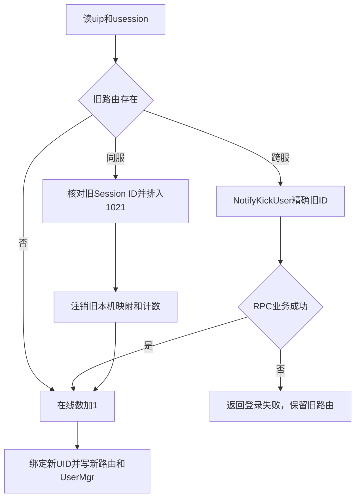

# 服务器踢人

## 账号连接与群成员身份

重复登录处理作用于整个账号的旧TCP连接：通知1021，注销旧Session，再登记新登录。群成员移除使用1056/1057及1060，仅撤销指定群的权限，账号和私聊连接继续使用。两个操作的数据模型和权限检查分开。

| 状态 | 位置 | 用途 |
| --- | --- | --- |
| `uip_<uid>` | Redis字符串 | 当前用户所在ChatServer服务名 |
| `usession_<uid>` | Redis字符串 | 当前连接代号，区分同UID不同次登录 |
| `login_lock_<uid>` | Redis锁 | 串行处理该UID的登录和断线路由清理 |
| `uid -> Session` | 本机UserMgr | 找到要通知的本机连接 |
| `session_id -> Session` | CServer | 连接登记与在线人数注销依据 |

连接代号是会话版本，不是用户身份凭据。跨服踢人携带发起方从Redis读到的旧ID，接收方必须与本机当前Session比较，防止迟到请求踢掉后来的连接。

## 锁内切换流程

1005登录通过token与用户资料校验后，获取用户登录锁。等待上限5秒、租约10秒，当前流程不自动续租。锁内步骤为：



同服存在旧Session而Redis旧ID缺失/不匹配时返回 `ServerBusy=1014`；没有真实CServer同样拒绝。同服路由存在但本机已找不到旧Session时，继续登记新连接。

跨服RPC使用 `KickUserReq {uid:int32, session_id:string}`。池不存在、无法在期限内取stub、传输失败或超时返回 `RPCFaild=1002`，新登录不覆盖旧路由。池等待与RPC共用3秒deadline。

### 旧服裁决

| 旧服状态 | 结果 |
| --- | --- |
| UserMgr没有目标UID | 成功，目标已不在本机 |
| ID为空或与本机当前连接不同 | 1014，拒绝陈旧请求 |
| 无真实CServer引用 | 1002 |
| ID相同 | `NotifyOffline()`，随后 `ClearSession()`，返回成功 |

RPC入口使用内部不加密gRPC，没有独立的调用者认证，部署应限制到受信网络。session匹配防止陈旧调用，不能替代服务间访问控制。

## 1021先发送，再关闭

```json
{"error":0,"uid":1001}
```

`NotifyOffline()`在发送锁内将1021追加到现有队列，设置 `_close_after_send=true`。普通Send随后拒绝新消息。已有业务包和1021按顺序写出，队列清空时 `HandleWrite()`调用 `HandleDisconnect()`，完成socket关闭与路由条件清理。读写错误也可提前触发同一入口。

旧服立即 `ClearSession()`，让旧连接从CServer和UserMgr注销，在线数减1；未直接关闭socket，以便1021继续异步发送。回调持有Session强引用，对象可在注销后继续活到发送结束。没有排空期限，慢对端可延迟关闭；没有1021客户端确认，成功RPC只证明旧服已处理注销和排队。

## 幂等清理与新连接保护

1. `CSession::_disconnect_handled.exchange(true)`保证同一连接只完整清理一次。
2. `ClearSession()`仅在连接容器中找到旧ID时减少在线数，重复调用不会重复减。
3. `UserMgr::RmvUserSession(uid, session_id)`比较当前ID，旧回调不能移除新UserMgr映射。
4. `HandleDisconnect()`先关闭socket并注销本机，再获取登录锁，只有Redis `usession_<uid>`仍等于本连接ID时，才删除session和路由两个key。

踢人过程中本地旧映射先注销，新登录随后覆盖Redis路由；旧连接发送结束后的清理会看到新ID并保留新路由。锁获取失败只影响Redis清理，不撤销已完成的本机注销。普通断线还向LogicSystem发送内部事件，按旧精确session清理音视频状态。

多条Redis写入、条件读取后删除均没有单条Lua事务保证，返回值也未逐项检查。固定租约过期、依赖故障和进程崩溃可留下陈旧路由；`uip/usession`没有TTL。正常启动将本服人数置0、正常退出删除人数，进程崩溃时无法保证计数准确。

## Qt提示与手动操作

Qt收到合法且 `error=0`的1021，先标记本次断线已通知、取消登录态并停止心跳，再发 `sig_off_line`。主窗口提示同账号异地登录，关闭连接并回登录页。

若未解析到1021便收到socket断开，已登录且尚未提示的客户端发 `sig_connection_lost`，显示普通断开提示。`_disconnect_notified`避免两条路径重复弹窗。单看“连接断开”不能确定客户端解析了踢人通知。

- 同服操作：两个客户端连接同一实例，先后登录同账号，旧端应返回登录页，新端继续使用。
- 跨服操作：两个客户端分别连接不同实例，登录同账号；确保 `[PeerServer]`中旧服名称可匹配Redis路由。
- 排查失败：1014关注锁和ID匹配，1002关注旧服RPC与3秒期限。先恢复旧节点或处理真实陈旧路由，避免直接删除活跃用户的在线key。
- Redis检查只观察服务名、session和计数；不要输出token。跨服失败后应保留原路由，不能根据新客户端已建立TCP就判定登录切换成功。

## 代码与交叉阅读

- [登录切换](../ChatServer1/src/LogicSystem.cpp)：`LoginHandler`。
- [旧服RPC处理](../ChatServer1/src/ChatServiceImpl.cpp)：`NotifyKickUser`；[RPC客户端](../ChatServer1/src/ChatGrpcClient.cpp)。
- [通知与统一清理](../ChatServer1/src/CSession.cpp)：`NotifyOffline/HandleWrite/HandleDisconnect`；[本机注销](../ChatServer1/src/CServer.cpp)、[UID映射](../ChatServer1/src/UserMgr.cpp)。
- [Qt通知处理](../chat_app%20desktop/tcpmgr.cpp)、[主窗口](../chat_app%20desktop/mainwindow.cpp)。
- [登录](login.md)、[异常处理](异常处理.md)、[群聊](群聊.md)。
