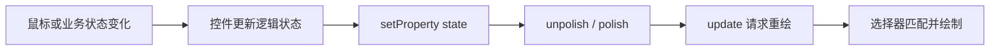

# Qt 样式表与界面复用

## 主题入口与视觉数据

[main.cpp](../chat_app%20desktop/main.cpp) 设置 Fusion 控件风格，读取资源 `:/style/stylesheet.qss`，通过 `QString::fromUtf8()` 解码后调用 QApplication 的 `setStyleSheet()`。QSS 在 [resource.qrc](../chat_app%20desktop/resource.qrc) 注册，随程序编译。

[stylesheet.qss](../chat_app%20desktop/style/stylesheet.qss) 为认证、聊天、联系人、个人设置及群管理共用的主题入口。QSS 负责视觉规则，`.ui` 和布局代码负责控件关系、伸缩、间距和尺寸约束。

| 用途 | 当前主题值 |
| --- | --- |
| 正文字体 | `Microsoft YaHei`，14px；入口另设置 `Microsoft YaHei UI` 10pt 作为应用字体 |
| 主按钮、强调色 | `#16a078` |
| 主按钮悬停、强调文字 | `#128866` |
| 正文、次要文字 | `#24362f`、`#7b8b84` |
| 页面背景、卡片 | `#f4f7f5`、`#ffffff` |
| 边框、选中背景 | `#e3ebe7`、`#e5f4ed` |
| 错误提示 | `#c44e4e` |

[mainwindow.cpp](../chat_app%20desktop/mainwindow.cpp) 将认证页面初始及最小窗口设为 440×700，聊天页初始 1080×760、最小 800×600。窗口切换时还调整聊天页的最小尺寸，避免隐藏页面的约束影响认证页。个人设置布局应在聊天页最小宽度内保持字段与头像卡片可用。

## 选择器与样式层次

[Qt 官方样式表文档](https://doc.qt.io/qt-6/stylesheet.html)说明 QSS 支持的属性和控件范围。QSS 与 CSS 有相似语法，但浏览器 CSS 的属性、布局模型和动画能力不能直接迁入 QWidget。

| 写法 | 匹配内容 |
| --- | --- |
| `QPushButton` | 此类型及其派生控件 |
| `.QPushButton` | 类名匹配，不包含其他派生类名 |
| `QLabel#err_tip` | 类型与 objectName 同时匹配 |
| `#group_info_dialog QPushButton` | 指定对象的后代按钮 |
| `QDialog > QLabel` | 直接子标签 |
| `[state="selected"]` | QObject 属性值 |
| `:hover`、`:focus`、`:disabled` | Qt 内置伪状态 |
| `QScrollBar::handle` | 控件内部子控件 |

```css
/* 示例：对象名约束页面，避免影响其他对话框。 */
QDialog#LoginDialog {
    background: #ffffff;
}
QLabel#err_tip[state="err"] {
    color: #c44e4e;
}
QLineEdit:focus {
    border-color: #16a078;
}
```

objectName 并非全局唯一 ID；不同页面重复命名时，单独的 `#name` 会匹配全部同名对象。需要限制用途时添加类型或祖先选择器。

样式可设在 QApplication、祖先控件、当前控件。控件自身样式在该控件上优先于祖先和应用样式；同一层规则按选择器特异性决定，特异性相同时后写规则覆盖前写规则。类型选择器的 C++ 继承深度不增加特异性。

主题颜色和常规表单规则集中放全局 QSS，保留少量确有局部语义的样式，例如 TextBubble 正文透明、无边框。新增内联样式前要检查是否会屏蔽主题、禁用态和焦点提示。

## 属性状态与刷新流程

ClickedLabel 和 StateWidget 把交互状态写入 `state` 属性。QSS 按字符串选择资源和颜色；属性名和值必须在代码与样式中一致。



[global.cpp](../chat_app%20desktop/global.cpp) 的 `repolish` 调用 `style()->unpolish(w)` 与 `polish(w)`。动态属性变化后，项目显式刷新样式；只改属性不能依赖 QSS 自动重新匹配。

```cpp
// 示例：state 值由业务结果决定，刷新属性选择器和画面。
ui->err_tip->setText(message);
ui->err_tip->setProperty("state", "err");
repolish(ui->err_tip);
ui->err_tip->update();
```

[clickedlabel.cpp](../chat_app%20desktop/clickedlabel.cpp) 维护普通/选中两个逻辑状态及 normal、hover、press 视觉分支。密码可见性按钮使用 unvisible、visible 等约定值切换图标，再由业务槽切换 QLineEdit 的 echoMode。

[statewidget.cpp](../chat_app%20desktop/statewidget.cpp) 用于侧边栏，状态集合为 normal、hover、pressed、selected、selected_hover、selected_pressed。选中后离开鼠标仍保持选中视觉，外部通过 `SetSelected()` 或 `ClearState()` 控制页面选择。

```css
/* 多个视觉状态可复用相同资源。 */
StateWidget#side_chat_lb[state="selected"],
StateWidget#side_chat_lb[state="selected_hover"],
StateWidget#side_chat_lb[state="selected_pressed"] {
    border-image: url(:/res/chat_icon_select_press.png);
}
```

Qt 伪状态可以组合，例如 `QPushButton:checked:hover`。普通按钮的悬停、按下和焦点可使用内建状态；页面选中、错误类型等由业务维护的状态使用属性。自定义属性不会自动带来键盘焦点、无障碍或按钮语义，这些行为仍需控件代码提供。

## 自绘控件与 QStyle

StateWidget 是 QWidget 子类，通过 paintEvent 让绘制经过 Qt 样式系统：

```cpp
// 示例：为自定义 QWidget 绘制 PE_Widget 样式原语。
void StateWidget::paintEvent(QPaintEvent *event)
{
    Q_UNUSED(event);
    QStyleOption option;
    option.initFrom(this);
    QPainter painter(this);
    style()->drawPrimitive(QStyle::PE_Widget, &option, &painter, this);
}
```

QStyleOption 初始化控件几何、调色板及标准状态，样式系统结合 widget 本身匹配动态属性。`initFrom()` 不负责把所有动态属性复制到 option。

QLabel、QPushButton 等标准控件已有自己的样式绘制路径；自定义 QWidget 的背景是否绘制还受 QWidget 属性和具体实现影响。需要自绘时保留 QStyle 绘制入口，避免只画自定义内容却忽略样式背景。`ChatView::paintEvent()` 使用相同的 PE_Widget 方式。

[logindialog.cpp](../chat_app%20desktop/logindialog.cpp) 的 `initHead()` 用 QPainter 绘制双聊天气泡标识：先按 `devicePixelRatioF()` 放大 80×80 逻辑尺寸的画布，再设置 pixmap 的 devicePixelRatio，保持高 DPI 的逻辑尺寸与像素密度相符。它与用户头像具有不同用途，头像通过 [AvatarUtil](Qt头像统一显示.md) 加载。

## 盒模型、图片与布局边界

QSS 盒模型包括内容、padding、border 和 margin。padding 影响可用内容区，border 参与外观尺寸；布局 spacing、contentsMargins、sizePolicy 以及最小/最大尺寸共同决定最终几何。

| 属性或机制 | 使用要点 |
| --- | --- |
| `padding` | 控件内容内边距；嵌套布局已有边距时避免重复累计 |
| `border-radius` | 边框圆角；不能替代头像像素裁切 |
| `border-image` | 可缩放或九宫格绘制图片，适合约定大小的图标控件 |
| `background-image` | 背景图片按背景定位/重复规则绘制，不自动变成保持比例的头像 |
| `sizeHint()` / `minimumSizeHint()` | 让内容度量反馈给布局，适合文本卡片 |
| `QFontMetrics` / 文档布局 | 测量实际字体的像素宽高，处理换行与 DPI |

项目图标采用透明背景和统一线条风格，普通图标源图主要为 128×128，应用标识为 512×512。资源路径保持稳定，QSS 使用这些路径选择图标。图片清晰度取决于实际像素、逻辑绘制尺寸、缩放方式和设备像素比。

通用滚动容器规则只匹配 `QScrollArea`。若改为 `QAbstractScrollArea`，会同时匹配 QTextEdit 等输入框，使背景和边框规则相互影响。按钮的普通 padding 与最小高度限定在 QPushButton 范围，QLineEdit 内置搜索/清除按钮沿用 Qt 原生尺寸。

聊天文件卡片 `QPushButton#chat_file_card` 的 QSS padding 为零，内部标签布局负责内容边距。卡片的推荐/最小尺寸来自内容布局，文件名按定宽区域换行，度量与绘制采用允许任意字符换行的相同规则。连续英文文件名同样需要换行，不能仅按空格分词测高。输入框附件预览的绘图还需使用当前字体和设备像素比。

## 滚动条子控件

```css
/* 教学示例：垂直滚动条的背景、滑块与按钮。 */
QScrollBar:vertical { background: transparent; width: 6px; }
QScrollBar::handle:vertical { background: #c7d6ce; border-radius: 3px; }
QScrollBar::add-line:vertical, QScrollBar::sub-line:vertical { height: 0; }
```

`::handle` 表示内部滑块，`:vertical` 表示方向；`::` 与属性状态 `[]`、伪状态 `:` 分属不同机制。定制复杂控件时还需考虑箭头、页区域、最小滑块长度等子控件，具体支持列表以 Qt 文档为准。

滚动条显隐属于行为控制。[chatview.cpp](../chat_app%20desktop/chatview.cpp) 通过视口 Enter/Leave 事件显示或隐藏滚动条，QSS 负责它出现后的颜色、宽度和边框。

## 新控件接入与定位操作

1. 在 `.ui` 或布局代码中设置语义明确的 objectName、尺寸策略及父子关系。
2. 复用现有输入框、按钮、提示和卡片规则，确有专用视觉时在全局 QSS 添加范围明确的选择器。
3. 需要业务状态时定义有限状态值，控件更新属性后调用 repolish/update。
4. 自绘 QWidget 确认绘制经过 QStyle；位图确认 qrc 路径、大小和透明背景。
5. 调整主题时同时考虑禁用、焦点、悬停、按下、选中、长文字与最小窗口尺寸。

样式未生效时，依次定位资源是否读到、objectName 与属性是否匹配、祖先/控件内联样式是否覆盖、规则特异性和顺序、控件是否支持该属性及绘制路径。QSS 错误常表现为规则未应用或输出运行期警告，不提供 C++ 编译期类型检查。

源码定位：[stylesheet.qss](../chat_app%20desktop/style/stylesheet.qss)、[statewidget.cpp](../chat_app%20desktop/statewidget.cpp)、[global.cpp](../chat_app%20desktop/global.cpp)、[logindialog.cpp](../chat_app%20desktop/logindialog.cpp)、[chatitembase.cpp](../chat_app%20desktop/chatitembase.cpp)。Qt 对象与事件寿命见 [Qt知识点](Qt知识点.md)。
