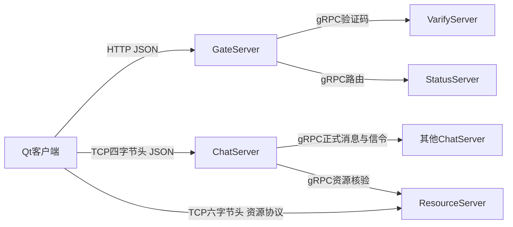

# 消息 ID 全链路

## 传输通道与标识空间



`ReqId`同时用作Qt HTTP回调索引与聊天TCP消息类型。HTTP请求不携带这个数字包头；聊天TCP使用大端 `uint16 ID + uint16 body_length + UTF-8 JSON`。ResourceServer有独立连接、独立ID空间和 `uint16 ID + uint32 body_length`头，同值不能跨协议解释。

帧ID表示操作种类；客户端 `msgid`表示一条待确认消息；数据库 `message_id`表示正式消息主键；`thread_id`表示会话；群管理 `request_id`关联一次网络请求，`operation_id`关联可持久重放的业务操作；音视频 `call_id`关联整场通话。它们的去重、权限和生命周期分别处理。

## HTTP回调ID

定义依据为[客户端global.h](../chat_app%20desktop/global.h)，请求路由依据为[GateServer LogicSystem](../GateServer/src/LogicSystem.cpp)。

| 数值 | 常量 | 请求与用途 |
| ---: | --- | --- |
| 1001 | `ID_GET_VARIFY_CODE` | `/get_varifycode`，`email`，调用VarifyService |
| 1002 | `ID_REG_USER` | `/user_register`，用户名/邮箱/混淆密码/确认密码/验证码 |
| 1003 | `ID_RESET_PWD` | `/user_resetpassword`，用户/邮箱/新密码/验证码 |
| 1004 | `ID_LOGIN_USER` | 已定义；当前登录页没有用它分发HTTP回调 |
| 1005 | `ID_CHAT_LOGIN` | 登录页实际用作 `/user_login`回调索引；也是TCP登录类型 |

验证码通过Redis保存并邮件发送，账号与密码写MySQL。`Modules`区分注册、登录、重置密码的Qt回调。当前HTTP登录字段为 `user/passwd`，成功返回 `uid/email/token/host/port`，详细操作见[登录](login.md)。

## 聊天TCP消息表

数值依据为[客户端ReqId](../chat_app%20desktop/global.h)与[服务端MSG_IDS](../ChatServer1/include/const.h)。请求方向均为Qt到ChatServer；响应和通知方向均为ChatServer到Qt。1005服务端名为 `MSG_CHAT_LOGIN`，1006名为 `MSG_CHAT_LOGIN_RSP`；其余使用表中常量名。

| 数值 | 常量 | 语义 |
| ---: | --- | --- |
| 1005 | `ID_CHAT_LOGIN` | `uid/token`认证当前连接 |
| 1006 | `ID_CHAT_LOGIN_RSP` | 登录结果、资料、申请与好友列表 |
| 1007 / 1008 | `ID_SEARCH_USER_REQ/RSP` | UID或用户名搜索 |
| 1009 / 1010 | `ID_ADD_FRIEND_REQ/RSP` | 好友申请写入结果 |
| 1011 | `ID_NOTIFY_ADD_FRIEND_REQ` | 被申请方申请通知 |
| 1013 / 1014 | `ID_AUTH_FRIEND_REQ/RSP` | 同意申请、建立关系与首条消息 |
| 1015 | `ID_NOTIFY_AUTH_FRIEND_REQ` | 原申请方认证结果及初始消息 |
| 1017 / 1018 | `ID_TEXT_CHAT_MSG_REQ/RSP` | 私聊文本请求与持久化确认 |
| 1019 | `ID_NOTIFY_TEXT_CHAT_MSG_REQ` | 接收方私聊文本通知 |
| 1021 | `ID_NOTIFY_OFF_LINE_REQ` | 重复登录的旧账号连接下线 |
| 1023 / 1024 | `ID_HEART_BEAT_REQ` / `ID_HEARTBEAT_RSP` | Ping/Pong |
| 1025 / 1026 | `ID_LOAD_CHAT_THREAD_REQ/RSP` | 私聊会话增量列表 |
| 1027 / 1028 | `ID_CREATE_PRIVATE_CHAT_REQ/RSP` | 创建或复用唯一私聊 |
| 1029 / 1030 | `ID_LOAD_CHAT_MSG_REQ/RSP` | 私聊/群消息历史分页 |
| 1031 / 1032 | `ID_UPDATE_USER_PROFILE_REQ/RSP` | 当前用户资料更新 |
| 1033 / 1034 | `ID_IMAGE_CHAT_MSG_REQ/RSP` | 图片资源核验与消息持久化 |
| 1035 | `ID_NOTIFY_IMAGE_CHAT_MSG_REQ` | 图片消息元数据通知 |
| 1036 | `ID_MESSAGE_DISPLAY_ACK_REQ` | 接收方实际绘制后的展示确认 |
| 1037 | `ID_NOTIFY_MESSAGE_DISPLAYED` | 向发送方推送展示事实 |
| 1038 | `ID_MARK_THREAD_READ_REQ` | 接收方会话已读游标 |
| 1039 | `ID_NOTIFY_THREAD_READ` | 向发送方推送已读游标 |
| 1040 / 1041 | `ID_FILE_CHAT_MSG_REQ/RSP` | 文件资源核验与消息持久化 |
| 1042 | `ID_NOTIFY_FILE_CHAT_MSG_REQ` | 文件消息元数据通知 |
| 1043 / 1044 | `ID_CREATE_GROUP_REQ/RSP` | 创建群 |
| 1045 / 1046 | `ID_SEARCH_GROUP_REQ/RSP` | 精确群号搜索 |
| 1047 / 1048 | `ID_JOIN_GROUP_REQ/RSP` | 入群或提交申请 |
| 1049 / 1050 | `ID_LOAD_GROUP_LIST_REQ/RSP` | 当前账号群列表快照分页 |
| 1051 / 1052 | `ID_LOAD_GROUP_MEMBERS_REQ/RSP` | 有效群成员分页 |
| 1053 / 1054 | `ID_GROUP_TEXT_MSG_REQ/RSP` | 群文本请求与持久化结果 |
| 1055 | `ID_NOTIFY_GROUP_TEXT_MSG` | 群文本通知 |
| 1056 / 1057 | `ID_KICK_GROUP_MEMBER_REQ/RSP` | 移除群成员 |
| 1058 / 1059 | `ID_DISSOLVE_GROUP_REQ/RSP` | 群主逻辑解散 |
| 1060 | `ID_NOTIFY_GROUP_STATE` | 指定群成员身份失效，保持账号连接 |
| 1061 / 1062 | `ID_INVITE_GROUP_REQ/RSP` | 邀请好友 |
| 1063 / 1064 | `ID_DECIDE_GROUP_INVITE_REQ/RSP` | 被邀请者接受/拒绝 |
| 1065 / 1066 | `ID_LOAD_GROUP_REQUESTS_REQ/RSP` | 邀请/申请/结果/待审批分页 |
| 1067 / 1068 | `ID_DECIDE_GROUP_APPLICATION_REQ/RSP` | 管理员或群主审批 |
| 1069 / 1070 | `ID_SET_GROUP_ADMIN_REQ/RSP` | 群主管理角色 |
| 1071 / 1072 | `ID_TRANSFER_GROUP_OWNER_REQ/RSP` | 原子转让群主 |
| 1073 / 1074 | `ID_LEAVE_GROUP_REQ/RSP` | 非群主自愿离群 |
| 1075 / 1076 | `ID_SET_GROUP_APPROVAL_REQ/RSP` | 群主设置入群审批 |
| 1077 / 1078 | `ID_UPDATE_GROUP_ANNOUNCEMENT_REQ/RSP` | 版本化公告更新 |
| 1079 / 1080 | `ID_UPDATE_GROUP_AVATAR_REQ/RSP` | 专用群头像资源核验与更新 |
| 1081 | `ID_NOTIFY_GROUP_EVENT` | 群信箱、结果、资料和成员事件 |
| 1082 / 1083 | `ID_VIDEO_TEST_REQ/RSP` | 单向固定文件测试控制 |
| 1084 | `ID_NOTIFY_VIDEO_TEST` | 单向测试通知 |
| 1085 / 1086 | `ID_VOICE_CALL_REQ/RSP` | 好友音视频操作及结果 |
| 1087 | `ID_NOTIFY_VOICE_CALL` | 好友音视频状态通知 |

1012、1016、1020、1022在聊天消息枚举中没有定义。错误码有独立空间，例如错误1016表示 `MessageTooLarge`，与帧ID没有自动对应关系。客户端1010目前没有专用回包handler，不能把服务端回包存在等同于界面处理完整。

## 登录、心跳与资料

1005验证Redis `utoken_<uid>`后，登录锁内处理旧连接、登记当前UID及在线路由。1006成功后Qt才开启心跳和聊天界面。token没有TTL或一次性消费，Status路由选择没有健康探测，详见[登录](login.md)。

1023使用JSON对象，`client_time`为可选诊断毫秒字符串；1024含 `error/server_time`。Qt成功登录后立即发送，再每20秒发送；60秒无有效1024则主动断线。服务端完整业务帧或合法心跳续期，60秒无完整收包加10秒扫描延迟清理，详见[心跳检测](心跳检测.md)。

1031提交 `uid/nick/desc/icon`，服务端用登录UID验证操作人，更新MySQL并失效Redis用户缓存。头像资源上传完成后的资源引用与资料更新是两步操作。

## 用户搜索、申请与认证

1007的 `uid`是字符串，可输入数字UID或用户名；纯数字先查UID，未命中再按用户名查询。1008返回用户展示资料。

1009提交 `uid/applyname/bakname/touid`，`bakname`保存为申请者给目标的备注 `applicant_remark`。1010表示申请处理结果，1011向目标展示申请人资料。申请记录使用 `(from_uid,to_uid)`唯一约束，已终态申请不会被新请求直接覆盖。

1013的 `fromuid`是原申请者，`touid`是处理申请者；备注属于处理者给申请者的备注。数据库在同一事务中锁申请、更新同意状态、写双向好友、创建/复用私聊并保存初始消息“我们已经是好友了，开始聊天吧。”。当前 `AddFriendApply/AuthFriend`直接使用JSON中的操作UID，没有与Session UID比较；数据库检查申请状态不能代替调用者身份授权。此路径处理同意，没有独立的好友拒绝请求字段。

1014与1015包含同一份 `textmsgs`：

```json
{"sender_id":1002,"unique_id":"friend-auth-81","msg_id":81,"thread_id":12,"msgcontent":"我们已经是好友了，开始聊天吧。"}
```

Qt按正式消息主键幂等缓存；跨服 `NotifyAuthFriend`原样携带这些字段。该protobuf的 `msg_id/thread_id`为int32，数据库路径检查范围。重复同意复用初始消息，不能推广为普通发送重试幂等。

## 私聊消息与回执

1017输入 `fromuid/touid/textArray:[{msgid,content}]`。服务端检查Session UID，先保存再通知，1018/1019每项附 `message_id/thread_id/sender_id/recv_id/created_at_ms/status`。1018的 `persisted`描述保存，`realtime_delivered`描述实时路径判定；普通Send不暴露入队失败，后者不保证客户端收到。

1033使用 `imageArray`，1040使用 `fileArray`。服务端先通过ResourceServer核验资源完成状态及可信元数据，再保存聊天记录。1034/1041成功代表已核验并持久化，资源正文走独立连接。1035/1042携带正式主键和资源元数据，文件不会因通知到达便自动下载。

1036示例：

```json
{"thread_id":"12","message_ids":["81","82"]}
```

接收端实际绘制后才上报，最多100个ID；服务端以当前UID确认所属消息，写 `displayed_at`后发1037。1038提交 `thread_id/read_through_message_id`字符串，更新该用户实际收到的私聊已读状态，1039通知发送方。群 `recv_id=0`不复用该单接收者回执。

1029请求 `thread_id/after_message_id`十进制字符串和 `page_size`，1030按正式ID正序返回 `messages/next_message_id/load_more`。默认50条、最大1000条，实际还受4096字节JSON预算限制。连续历史游标只在完整历史页缓存提交后推进，实时通知不得跳过缺失历史。文本发送UUID未持久为去重键，当前缺少安全自动重发机制。

## 群请求字段与权限

群号使用uint64 `thread_id`，Qt请求通常发送十进制字符串。查询带非空字符串 `request_id`；管理mutation还要求 `operation_id`，同一业务重放保留该值。响应回显当前请求ID，业务结果持久化在 `group_operation(user_id, operation_id)`。

| 操作 | 必要业务字段和约束 |
| --- | --- |
| 创建/加入 | `name`或 `thread_id/explanation`；审批开启可返回pending，pending没有成员权限 |
| 邀请/决定 | `target_member_uid`或 `invitation_id/accept`；邀请检查双向好友，接收者明确决定 |
| 审批 | `application_id/approve`，仅当前管理员/群主 |
| 踢人/角色/转让 | `target_member_uid/expected_membership_version`；角色更新另带role，版本指目标 |
| 离群 | `expected_membership_version`指本人，群主须先转让 |
| 审批开关 | `approval_required`，不自动处理原有pending |
| 公告 | `announcement/expected_announcement_version`，UTF-8正文最大1024字节，完整请求仍限2048 |
| 群头像 | `resource_id`，ResourceServer专用用途和服务凭据核验 |

角色0成员、1管理员、2群主。群主管理角色、转让、解散与审批开关；管理员可审批、移除普通成员和编辑公告。成员读取、发文本、历史都核对当前有效身份；有效成员可读加入前历史。

1049从 `after_thread_id=0`开始完整快照轮，客户端整轮成功才失效比较。1051使用 `after_uid/next_uid`，成员含昵称、角色与成员版本。1065的 `scope=inbox/applications/results/approvals`分别分页，游标不可混用，每轮从0以便刷新旧记录状态。

群1053使用 `thread_id/textArray`，1054/1055带 `type="group"`及正式元数据、`sender_nick`，一条正文只保存一行 `recv_id=0`消息。目标入队前在群行锁内再次授权。1060包含失效原因和目标成员版本；1081包含接收者UID、事件类型与接收者专属成员证明。普通资料/成员事件不能激活未知群或已失效身份；实际入群grant与完整成功快照有专门规则。

公告仅有效成员可见；非成员搜索、pending或本人失效返回不可缓存的空/0占位和 `announcement_visible=false`。占位不代表公告被清空。完整管理模型、版本与恢复见[群聊](群聊.md)。

## 音视频控制

1082保留单向固定文件测试的 `start/ready/stop`，1084通知对端；状态与原精确session绑定，不写聊天历史。

1085示例：

```json
{"op":"invite","request_id":"具有UUID格式的操作标识","touid":1002,"call_type":"video"}
```

真实请求的 `request_id`必须是UUID。`invite`必须携带 `call_type=audio|video`；服务端验证双向好友、当前UserMgr及Redis session，在Redis原子占用双方通话状态。随后 `accept/reject/ready/end`提交 `call_id`和新的请求UUID，携带 `call_type`会被拒绝。类型由服务端元数据权威返回，客户端不能在接听阶段改写。

1086回显 `op/request_id/call_id`，1087通知含原邀请 `invite_request_id`及成功元数据中的 `call_type`。`accepted`才携带 `app/media_url/caller_stream/callee_stream`；失败响应可能没有类型，按请求ID处理。`notified`表示信令入队，不能表示对方已听见声音或媒体连接成功。

媒体直接连接ZLM，RPC仅转发信令，当前共用 `[VideoTest] enabled/media_url`及可信回环部署，没有短时媒体授权。协议和操作见[WebRTC视频通信](WebRTC视频通信.md)。

## ResourceServer独立ID

| 数值 | 常量 | 用途 |
| ---: | --- | --- |
| 1001 / 1002 | `ID_TEST_REQ/RSP` | 资源连接测试 |
| 1003 / 1004 | `ID_UPLOAD_FILE_REQ/RSP` | 上传分片及完成结果 |
| 1005 / 1006 | `ID_SYNC_FILE_REQ/RSP` | 上传状态/断点同步 |
| 1007 / 1008 | `ID_DOWNLOAD_FILE_REQ/RSP` | 按resource_id下载分片 |

资源标识使用上传任务ID，不能把服务端磁盘路径作为下载协议。下载权限、上传用途和分片字段见[资源服务](资源服务.md)。

## 修改协议与定位

1. 查 [global.h](../chat_app%20desktop/global.h)和 [const.h](../ChatServer1/include/const.h)确认数值及传输通道。
2. 查 [TcpMgr](../chat_app%20desktop/tcpmgr.cpp)的发送方法及 `_handler`确认客户端解析，查 [LogicSystem](../ChatServer1/src/LogicSystem.cpp)的 `RegisterCallBacks`及handler确认服务端分派。
3. 涉及跨服时同时查看 [message.proto](../proto/message.proto)、[ChatGrpcClient](../ChatServer1/src/ChatGrpcClient.cpp)、[ChatServiceImpl](../ChatServer1/src/ChatServiceImpl.cpp)。
4. 涉及历史或回执时查看 [MysqlMgr](../ChatServer1/src/MysqlMgr.cpp)、[建表SQL](../sql/create_tables.sql)与Qt缓存路径，不能只添加实时handler。
5. 协议变更同时部署Qt和两个ChatServer实例；共享源码同步与独立配置规则见[聊天服务器服务](聊天服务器服务.md)。输入2048字节、历史/群输出4096字节预算详见[TCP服务器](TCP服务器.md)。
