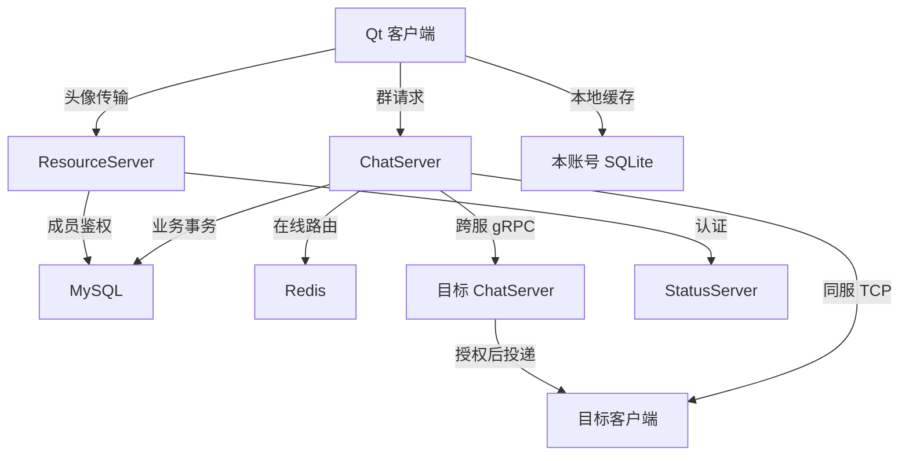
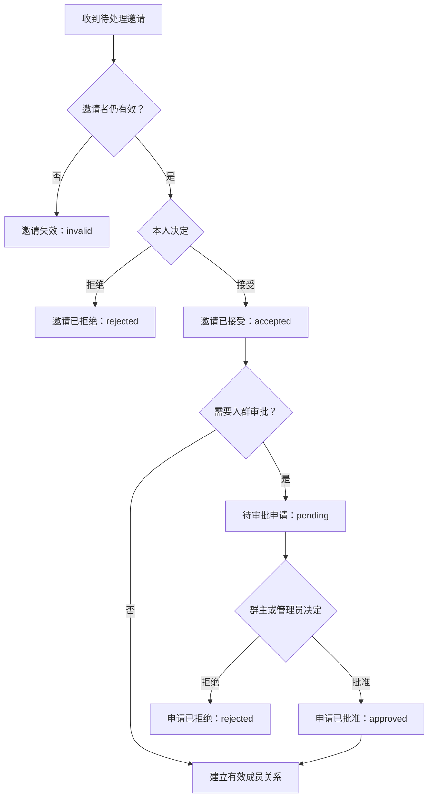

# 群聊

群聊可以拆成三件事：谁属于这个群、群里的消息如何保存和投递、客户端如何恢复自己的群状态。理解实现时，先看数据模型，再沿着创建、入群、管理、聊天和同步的流程往下读。

## 一、整体设计：服务端管事实，客户端管展示

| 组件 | 职责 | 数据依据 |
| --- | --- | --- |
| ChatServer | 处理群请求、校验身份和角色、执行事务、发送通知 | 登录 session 中的 UID，以及 MySQL 中的群和成员状态 |
| MySQL | 保存群资料、成员、邀请与申请、操作结果和正式消息 | 群业务的持久化事实 |
| Redis | 保存用户在线路由和当前 token | 决定通知发往哪台服务器，供资源请求认证 |
| ResourceServer | 保存群头像文件，核验上传资源，按成员权限提供下载 | 用户认证、群成员状态和已发布资源 ID |
| Qt + SQLite | 展示群列表与历史，保存本账号缓存、未读和同步进度 | 服务端返回的正式消息与成员证明 |



消息保存成功，由 MySQL 事务决定；消息能否立刻到达，由在线路由和网络决定。实时投递失败时，正式历史仍然存在，客户端通过补拉恢复。

群资料使用独立的 `GroupInfo`，群列表以 `thread_id` 标识会话，不把群当成“UID 等于群号”的好友。消息中的发送者始终是真实用户，即使他不在接收方好友列表中，也可以通过昵称或 UID 显示。

## 二、先分清几种 ID 和版本

### 2.1 ID 分别标识什么

| 字段 | 含义 | 使用位置 |
| --- | --- | --- |
| `thread_id` | 正式会话 ID，也是群号 | 群资料、成员关系、消息、客户端会话 |
| `message_id` | 服务端正式消息 ID | 消息去重、历史分页和本地缓存主键 |
| `sender_id / sender_uid` | 真实发送者 UID | 从认证 session 取得，不采用客户端声称的操作者 |
| `target_member_uid` | 本次通知要发给的成员 UID | 同服 TCP 和跨服 gRPC 的投递目标 |
| `recv_id` | 消息表中的接收者字段 | 群消息固定为 `0` |
| `msgid` | 客户端生成的文本 UUID | 将待确认气泡与发送结果关联起来 |
| `request_id` | 一次请求的关联 ID | 将回包匹配到窗口、账号、群和分页请求 |
| `operation_id` | 一次管理操作的业务 ID | 持久化识别同一操作的重复提交 |
| `group_admission.id` | 一条邀请或申请的 ID | 准入决策和列表分页 |
| `resource_id` | ResourceServer 中的头像资源标识 | 发布、下载与缓存定位，不是文件路径 |

例如 A 在群里发消息给 B、C：数据库只保存一条 `sender_id=A、recv_id=0` 的消息。给 B、C 的两份通知共用同一个 `thread_id/message_id`，只是 `target_member_uid` 不同。

服务端会话与消息 ID 使用 `std::uint64_t`，gRPC 使用 `uint64`；Qt 使用 `qint64`，SQLite 使用 `INTEGER`。桌面请求将这些 ID 写成十进制字符串，避免经过浮点数转换；群号输入限定为正 `qint64`。

> `msgid` 用于关联气泡，`operation_id` 用于管理操作重放，两者不是同一种去重机制。群文本采用普通 INSERT，相同 UUID 的再次提交仍可能得到新的正式消息 ID。

### 2.2 为什么需要四种版本

| 字段 | 管理的对象 | 主要用途 |
| --- | --- | --- |
| `group_chat.version` | 群资料及成员集合的变化 | 判断群资料和成员页面是否过期 |
| `group_chat_member.membership_version` | 某个人在某个群中的身份 | 区分加入、撤权、重入和角色变化，拒绝针对旧身份的操作 |
| `announcement_version` | 公告正文 | 编辑时比较预期版本，防止覆盖别人的新公告 |
| `avatar_version` | 已发布头像 | 区分异步下载结果，防止旧头像覆盖新头像 |

群版本不能替代成员版本。例如某人先被踢出、再重新加入，UID 和群号都没变，但这是一个更高版本的成员身份。针对旧身份发出的踢人请求或迟到失效通知，不应影响重入后的身份。

同样，修改公告会改变群版本，却不代表头像已经变化。头像下载应匹配 `avatar_version + resource_id`，而不是要求整个群版本始终不变。

## 三、MySQL：群、成员、准入与消息怎样关联

完整 DDL 见 [create_tables.sql](../sql/create_tables.sql)。群聊复用统一会话表与消息表，另外用四张表保存群资料、成员、准入和操作结果。

### 3.1 核心表与关联表

| 表 | 主键 | 群聊相关内容 |
| --- | --- | --- |
| `chat_thread` | `id` | `type='group'`，分配正式会话 ID |
| `group_chat` | `thread_id` | 群名、群主、群状态、审批设置、公告、头像及各自版本 |
| `group_chat_member` | `(thread_id, user_id)` | 成员角色、是否有效、成员版本、加入时间 |
| `group_admission` | `id` | 邀请和申请的目标、邀请人、解释、状态和时间 |
| `group_operation` | `(user_id, operation_id)` | 管理操作类型、原始业务输入和正式结果 |
| `chat_message` | `message_id` | 群文本正式历史，群内每条消息只存一份 |
| `user / friend` | 各表自身主键 | 邀请目标是否存在、邀请双方是否互为好友 |

`group_chat.thread_id` 关联 `chat_thread.id`；成员和准入记录关联群；消息通过 `thread_id` 关联会话。群、成员、准入及消息相关外键使用 `ON DELETE RESTRICT`，业务上的离群和解散通过状态更新表达，而不是删除历史。

### 3.2 `group_chat`：共享群资料

| 字段组 | 字段 | 说明 |
| --- | --- | --- |
| 身份与状态 | `thread_id、name、owner_uid、active、version` | 群号、群名、唯一群主、逻辑有效状态和群版本 |
| 入群规则 | `approval_required` | 是否需要管理员批准 |
| 公告 | `announcement、announcement_version、announcement_author_uid、announcement_updated_at` | 正文、版本、编辑人和编辑时间 |
| 头像 | `avatar_resource_id、avatar_mime_type、avatar_size、avatar_width、avatar_height、avatar_version` | 已发布资源及可信图片元数据 |

`active=0` 表示群已解散。有效群应满足：`owner_uid` 对应一个有效的 `role=2` 成员，并且全群有效群主只有一人。这个跨行不变量由管理事务检查和维护；角色 CHECK 约束只保证取值合法。

头像文件不放进 MySQL，数据库只记录资源 ID 和核验后的类型、大小、尺寸。

### 3.3 `group_chat_member`：保留身份的生命周期

角色定义为 `0=普通成员、1=管理员、2=群主`。判断成员权限时，既要检查群有效，也要检查成员行 `active=1`；仅仅查到一条成员记录并不够。

成员表用 `(thread_id,user_id)` 联合主键，保证一个用户在一个群中只有一条关系。离群或被踢后，这条关系保留下来，改为 `active=0、role=0`，并递增 `membership_version`。这种失效记录称为墓碑（tombstone）。

重新入群时激活原关系、恢复普通成员角色并继续递增版本，不把版本重置为 1。保留墓碑，是为了让旧请求和旧通知能够与新身份区分开。

### 3.4 `group_admission`：邀请与申请共用一套准入记录

`kind` 区分 `invitation` 和 `application`，`user_id` 是被邀请者或申请人，`inviter_uid` 记录邀请来源。

| 类型 | 待处理状态 | 可到达的终态 |
| --- | --- | --- |
| 邀请 `invitation` | `pending` | `accepted、rejected、invalid` |
| 申请 `application` | `pending` | `approved、rejected、invalid` |

邀请被接受，表示用户同意入群；申请被批准，才表示审批通过。开启审批时，接受邀请会结束邀请，并创建申请，两条记录分别保留。

同一群、同一用户最多只有一条待处理准入记录，这个限制跨邀请和申请生效。数据库通过生成列与唯一索引实现：

```sql
pending_uid BIGINT UNSIGNED GENERATED ALWAYS AS
    (IF(status='pending', user_id, NULL)) STORED,
UNIQUE KEY uq_group_pending (thread_id, pending_uid)
```

待处理记录产生实际 UID，唯一索引阻止重复；终态记录产生 NULL，MySQL 允许唯一索引中存在多个 NULL，所以历史结果能够一直保留。

### 3.5 查询如何利用索引

| 索引 | 对应查询 |
| --- | --- |
| `group_chat_member(user_id,thread_id)` | 查本账号所属群，并按群号排序 |
| `group_chat_member` 联合主键 | 查单个成员、按 UID 枚举群成员 |
| `group_admission(user_id,id)` | 查本人邀请、申请与结果 |
| `group_admission(thread_id,id)` | 查某个群的审批记录 |
| `chat_message(thread_id,message_id)` | 按群增量读取正式历史 |
| `group_operation` 联合主键 | 查本账号某次管理操作是否已经提交 |

这些列表使用 ID 游标分页，而不是依赖 OFFSET。群列表按 `thread_id`，成员按 UID，准入按 `id`，历史按 `message_id` 继续读取。

## 四、事务与授权：一次操作怎样成为正式结果

### 4.1 公共处理链

Qt 由 `TcpMgr` 发送群请求，服务端统一进入 `LogicSystem::HandleGroup`。操作者 UID 从登录 session 取得；请求中的群号和目标 UID 只是业务参数，不能替代认证身份。

数据库入口分为两类：

- `MysqlMgr::MutateGroup`：创建、准入决策、成员管理、公告、头像等写操作。
- `MysqlMgr::GroupOperation`：精确搜索、成员读取、文本保存、历史读取和实时投递授权。

二者复用 `group_db::Load`，按“群行 → 成员行”的顺序锁定读取。管理事务还按 UID 顺序锁定本群成员，再处理邀请与申请。

为什么先锁群行？同一个群中的发消息、踢人、解散、投递授权，需要基于有先后次序的当前状态作决定。例如踢人先提交，随后等待锁的发送请求就会读到成员失效，不能继续保存消息。

### 4.2 写操作的事务顺序

一次首次提交的管理操作大致经过以下步骤：

1. 校验参数和业务操作 ID，检查是否已有对应操作结果。
2. 开启事务，锁定群和成员，读取当前有效性、角色与版本。
3. 检查当前权限、群主不变量及该操作的目标版本。
4. 修改业务表，生成正式响应和发给各收件人的事件。
5. 检查响应和通知的最终 JSON 大小。
6. 将输入与结果写入 `group_operation`，与业务变更一起提交。
7. 提交之后再做网络投递。

数据库异常、授权失败或提交前发现响应过大，都会回滚业务写入；网络通知失败则不撤销已经提交的业务事实。SQL 参数通过 X DevAPI `bind()` 绑定。

### 4.3 `operation_id` 如何避免重复执行

管理请求同时带 `request_id` 和 `operation_id`：前者关联本次回包，后者表达“还是同一件业务操作”。

服务端以 `(认证 UID,operation_id)` 查询 `group_operation`，比较 `action` 与输入。输入去掉 `request_id/token` 后紧凑序列化保存，其余字段及 ID 的字符串、数字表示都参与比较。同键换操作或换输入会被拒绝。

找到同一操作，也要先检查操作者当前权限，再返回保存的结果，并用当前群身份替换旧身份资料。重放不会再次写业务表，也不会重复广播。

例如，离群后重新加入，再重放旧离群操作，只返回当前身份，不会把新身份再次退出；管理员失去权限后，也不能靠旧审批操作 ID 继续管理群。

> 业务重放防止重复执行，不是绕过当前授权的通行证。转让后原群主已不具备转让权限，群解散后也不再满足有效群条件。

## 五、创建、搜索与入群

桌面端在现有搜索框中保留用户查找，并提供“添加群聊”“创建群聊”两个紧凑入口。搜索框获得焦点时即显示入口，无需先输入内容；清空、按 Esc、点击面板外部或切换左侧导航会关闭搜索并恢复原列表，不替换右侧正在查看的页面。

“添加群聊”直接读取搜索框中的完整正整数群号，结果卡片显示头像、群名、群号及操作。“创建群聊”在搜索区域输入群名，成功确认成员身份后更新会话列表并进入新群。加载、错误与入群申请状态均在组件内显示，提交期间禁用重复操作。搜索结果按请求 ID、账号及登录代次关联，修改查询或关闭面板后迟到回包不会恢复旧卡片。

### 5.1 创建群：三张表同事务提交

创建时输入群名，群主取当前认证 UID。同一事务依次：

1. 插入 `chat_thread(type='group')`，取得 `thread_id`。
2. 插入 `group_chat`，记录群名、`owner_uid` 和初始有效状态。
3. 插入创建者成员关系，设为 `role=2、active=1、membership_version=1`。
4. 保存操作结果并提交。

初始群只包含创建者。正式响应中的当前成员证明，驱动客户端保存群资料并打开聊天。任一步失败，不能留下只有会话而没有群主的半个群。

### 5.2 精确搜索与主动加入

搜索使用群号精确查询，返回有效群的公开资料。搜索本身不写成员表，也不授予成员、聊天或历史权限。

用户确认加入后，服务端检查当前成员关系和待处理准入：

- 已经是有效成员：返回当前入群状态。
- 有待处理邀请：本次主动加入视为本人同意，先将邀请改为 `accepted`。
- 开启审批，或者已有待审申请：创建或复用 `application`，保持 `pending`。
- 无需审批且没有待审申请：新增成员，或激活原成员墓碑。

关闭审批不会自动批准旧申请，也不会让旧待审申请被新的加入请求绕过。

### 5.3 好友邀请与明确同意

任意有效成员都可以邀请自己的好友。服务端先确认目标用户存在、尚不是有效成员，并且 `friend` 两个方向的关系都存在。

发送邀请只创建准入记录，不直接拉人成员。目标可以在邀请信箱接受或拒绝；处理时服务端锁定记录，并检查邀请者仍是有效成员。



邀请终态和申请终态不可被后续决定覆盖。再次处理终态记录会返回 `already_processed`；决定与现有终态不一致时另带 `status_conflict`，不会重新授予成员身份。被拒后再次申请，需要新的业务操作 ID 来表达新的入群意愿。

### 5.4 邀请、申请和审批为什么分开显示

左侧“群通知”是嵌入式账号页面，分为“群邀请”“我的申请”“处理结果”，不再通过群菜单打开账号窗口。邀请可以接受或拒绝；待审批申请只显示进度，不按实际入群处理。群主和管理员仍从“群信息 → 设置与公告 → 待审批申请”处理指定群的申请。两种展示复用 `GroupRequestsPage` 的分页、刷新、决定和终态合并逻辑，使用四个查询范围：

| `scope` | 显示内容 | 读取身份 |
| --- | --- | --- |
| `inbox` | 本人收到的邀请，包含待处理与终态 | 当前登录账号 |
| `applications` | 本人提交的申请，包含待处理与终态 | 当前登录账号 |
| `results` | 本人是目标或邀请人的终态记录 | 当前登录账号 |
| `approvals` | 指定群的待审申请 | 当前有效群主或管理员 |

个人信箱不要求用户已经入群，所以离线期间的批准、拒绝或失效结果仍能重新读取。准入状态会在原 ID 上变化，因此刷新从 `after_id=0` 开始，不能永远只读取最大 ID 之后的新记录。

## 六、角色与成员管理

### 6.1 权限分工

下表均以群有效、操作者是有效成员为前提；最终授权由服务端事务完成。

| 操作 | 普通成员 | 管理员 | 群主 |
| --- | --- | --- | --- |
| 聊天、读公告、读成员和群历史 | 可以 | 可以 | 可以 |
| 邀请自己的好友 | 可以 | 可以 | 可以 |
| 批准或拒绝申请 | — | 可以 | 可以 |
| 编辑公告、发布群头像 | — | 可以 | 可以 |
| 踢普通成员 | — | 可以 | 可以 |
| 踢管理员 | — | — | 可以 |
| 任免管理员、转让群主 | — | — | 可以 |
| 设置入群审批、解散群 | — | — | 可以 |
| 自愿离群 | 可以 | 可以 | 先转让群主 |

### 6.2 为什么管理请求带目标成员版本

成员页返回每个人的角色和 `membership_version`。踢人、任免管理员、转让时，将选中目标的版本作为 `expected_membership_version` 发送；自愿离群则发送自己的版本。

事务中比较预期版本和当前版本，不一致就拒绝。这样，一个窗口里选中的“旧普通成员”，不会在其重入或角色变化后仍被按旧资料操作。

成员页面也按 UID 游标分页，并结合请求 ID、分页代次、群版本及已知成员版本合并，防止旧页恢复旧角色。

### 6.3 任免管理员与原子转让

任免管理员只在 `role=0` 和 `role=1` 之间切换；实际角色变化时，递增目标成员版本和群版本。

转让必须在同一事务内更新三处事实：目标成员变为 `role=2`，原群主变为 `role=0`，`group_chat.owner_uid` 改为目标 UID。新旧群主的成员版本都递增，不能分成两个网络请求分别提交。

### 6.4 离群、踢人与解散

| 操作 | 数据库变化 | 客户端结果 |
| --- | --- | --- |
| 自愿离群 | 本人成员 `active=0、role=0`，成员版本和群版本递增 | 该群保留本地历史，转为只读 |
| 踢人 | 目标成员按相同方式失效 | 目标只失去这个群的权限 |
| 解散 | 群 `active=0`，有效成员失效并递增版本，待处理准入全部 `invalid` | 成员的该群会话转为只读 |

离群和被踢还会使该用户发出的待处理邀请失效。剩余有效成员收到成员变化事件，撤权目标收到 `left/kicked/dissolved` 失效事件。

这些操作不删除正式消息，也不注销账号连接，私聊和其他群不受影响。被踢或退出后，可以按群的入群规则重新申请；解散则终止这个群的服务端业务。

## 七、群文本：只保存一次，再投递给各成员

### 7.1 从输入到正式消息

群文本使用 `ID_GROUP_TEXT_MSG_REQ`，请求示意：

```json
{
  "thread_id": "501",
  "textArray": [
    {"msgid": "f6d15415-0819-4a09-b989-79b0aee335a0", "content": "大家好"}
  ]
}
```

客户端先生成 UUID 关联待确认气泡。服务端锁定群和发送者成员关系，确认当前可发送，再读取有效成员集合。

每个文本条目只插入一条 `chat_message`：`thread_id` 是群号，`sender_id` 是认证 UID，`recv_id=0`，`client_msg_id` 保存客户端 UUID。服务端取得正式消息 ID、时间和发送者昵称，检查最终响应大小后提交。

事务提交后，发送者通过正式响应确认气泡；服务器遍历其他成员，发送同一条正式消息的通知。不能为每个接收者调用一次私聊保存逻辑，否则群历史会被重复写入。

### 7.2 同服和跨服投递

`LogicSystem::ForwardGroup` 通过 Redis 的 `uip_<目标UID>` 查询在线服务器：同服直接找目标 session，跨服调用 `ChatService::NotifyGroup`。

跨服信封 `GroupNotifyReq` 显式区分 `thread_id、sender_uid、target_member_uid、event_type、payload_json`。目标 `ChatServiceImpl::NotifyGroup` 只负责授权与投递，不再插入消息。

文本、群资料和成员事件在目标服务器重新检查接收者当前群成员权限，并在授权锁内尝试进入 TCP 发送队列。邀请信箱和业务结果可以送给非成员；失效事件专门送给已撤权者。这几类事件不能共用“必须是当前成员”的投递条件。

跨服调用的连接池等待与 RPC 共用一个三秒绝对 deadline。即使通知超时，正式消息仍保留；客户端也需要按 `message_id` 去重，处理可能重复到达的通知和历史。

### 7.3 确认、实时通知和历史分别证明什么

| 信息 | 含义 |
| --- | --- |
| `persisted=true` | 正式消息已经提交到 MySQL |
| `realtime_delivered / delivered` | 本次实时投递路径返回成功，不等于实际显示或已读 |
| SQLite 中存在正式消息 | 本账号已经缓存该消息 |
| 本地已读 | 本账号进入该群并清除了本地未读 |

群文本确认校验正式群号、发送者为自己、`recv_id=0` 等元数据后写缓存，再更新待确认气泡；实时通知还要检查目标账号和当前有效群；历史按完整页面校验后写入。

群内阅读状态保存在本账号 SQLite 中，不复用私聊的“对方已显示”和已读回执。进入群调用 `MarkThreadRead()`，清理本地消息阅读状态和会话未读摘要。

## 八、公告与群头像

### 8.1 公告：带版本的共享正文

群主和管理员提交公告正文及 `expected_announcement_version`。事务中比较当前版本，匹配才写入正文、编辑 UID、编辑时间，并递增公告版本和群版本。

公告采用合法 UTF-8，正文最多 1024 字节，空字符串表示清空；清空同样递增版本。数据库读取使用 `group_db::Text` 按原始字节长度取文本，保留正文中的 NUL，不依赖以 NUL 结束的字符串转换。

公告只对当前有效成员可见。`BuildGroupJson` 按实际收件人身份决定 `announcement_visible`；公开搜索、待审响应或本人失效事件中的正文为空、版本为 0，这只是不可见占位，不能合并成“公告被清空”。

### 8.2 头像：上传完成和发布成功是两件事

群头像由 `GroupAvatarTransfer` 协调，资源请求复用同步、上传、下载协议，并带 `purpose=group_avatar` 区分业务。完整流程为：

1. 管理者选图，客户端检查实际格式、大小和完整解码结果。
2. 创建绑定账号、群号和资源 ID 的上传任务，同步已确认偏移，再逐片上传。
3. ResourceServer 在末片完整解码图片，成功后将临时文件发布为完成资源。
4. 客户端向 ChatServer 提交 `ID_UPDATE_GROUP_AVATAR_REQ`，请求发布资源 ID。
5. ChatServer 调用 `VerifyGroupAvatar`，取得可信 MIME、大小和尺寸。
6. 群管理事务重新检查当前管理权限，将可信资源资料写入 `group_chat`，递增头像版本和群版本。
7. 成员收到新头像资料后，下载并验证文件，更新本地显示。

图片要求真实 PNG 或 JPEG、非空且不超过 2 MiB、宽高各为 1～1024。文件后缀和客户端自报尺寸都不能替代实际解码。

发布核验检查资源任务用途、上传者、本群绑定、完成状态和实际文件。ChatServer 与 ResourceServer 之间还使用 `x-resource-service-key` 配置凭据，用户 token 不能替代服务间凭据。可信 RPC 在群管理事务前执行，避免持有群锁等待网络；写库时再检查权限，处理核验期间的角色变化。

### 8.3 每片鉴权与异步缓存

每次头像同步、上传、下载请求都重新验证当前用户 token，并在 MySQL 中锁定群和成员。上传、核验要求管理权限；下载要求当前有效成员，而且资源 ID 仍是群已发布的当前头像。

离群、解散或替换头像后，后续分片按新状态授权。下载者不必是上传者，但不能把别群资源或尚未发布的上传任务当作当前头像下载。

客户端缓存按账号、群号、头像版本和资源 ID 区分，使用 `QSaveFile` 原子提交。下载结束后再检查实际大小、MIME、尺寸和完整图片解码，最后确认任务仍属于当前账号、登录代次及当前头像。

列表、聊天标题和管理页使用同一份已验证缓存。换账号或换头像后，旧任务的迟到回包不能覆盖新显示；单纯公告或角色变化，也不会无故使仍然匹配当前头像的下载失效。

## 九、SQLite：消息去重、历史补拉与身份恢复

### 9.1 本地表保存什么

缓存由 `LocalChatStorageMgr` 管理，每个 UID 使用独立的 `AppLocalDataLocation/chat_cache/chat_cache_<uid>.db`。新库 DDL 见 [client_chat_cache.sql](../sql/client_chat_cache.sql)。

| 表 | 群聊中的用途 |
| --- | --- |
| `local_chat_thread` | 群名、群主、角色、有效状态、失效原因、各类版本、公告、头像、最后消息和未读摘要 |
| `local_chat_message` | 按正式 `message_id` 保存文本、发送者昵称、发送状态和本账号阅读状态 |
| `local_sync_cursor` | 每个群的连续历史同步进度 |

本地群资料是缓存，不是服务端授权依据。普通消息写入或元数据更新不能直接把失效群改回有效。

### 9.2 去重主键不等于同步游标

假设已完整同步到消息 `100`，离线期间本群产生 `105、109`，重新连接后先收到实时消息 `120`。实时消息可以立刻存入缓存，但不能把同步游标推进到 `120`，否则补拉将跳过 `105、109`。

因此：

- 实时通知和发送确认按正式 `message_id` 去重写入，保持原历史游标。
- 历史请求携带 `after_message_id`，服务端按 ID 升序返回后续消息。
- 整页校验通过后，消息、会话摘要和 `next_message_id` 在同一 SQLite 事务提交。
- `load_more=true` 时继续请求下一页，失败不推进游标。

“连续”指本群游标之前的历史已完整取得，不要求消息 ID 数字相邻，因为正式 ID 由所有会话共同分配。重复收到同一条消息也不会重复累加未读。

群历史复用 `ID_LOAD_CHAT_MSG_REQ/RSP`，服务端检查当前有效成员后读取该群历史，包含加入前的文本。本地向上翻页则使用 `message_id < beforeMessageId` 倒序查缓存，与服务端增量补拉是两条路径。

### 9.3 完整群快照为什么从 0 开始

登录后不能只查“本地最大群号之后的群”：用户可能刚加入一个很早创建的群，离群和解散也不会生成新群号。

服务端 `LoadGroupSnapshot` 一次读取本账号全部有效群及成员身份，绑定到当前 session，再按群号分页返回。后续请求必须沿同一快照的准确游标继续，避免每页重新查询得到混杂集合。

客户端将页面绑定到账号、登录代次、请求 ID 和快照轮次。只有完整一轮全部成功，才调用 `ReconcileGroupSnapshot`，在同一事务中合并成员证明，并将缺席的本地有效群改为只读。超时、失败或半轮结果不能用来撤销身份。

这一轮期间新确认创建或加入的群，会额外纳入保护集合，避免早先取得的快照把刚加入的群判成缺席。对账使用完整缓存集合，不以聊天列表最近若干项的展示上限作为身份范围。

### 9.4 元数据、成员证明与失效通知分开处理

服务端通过 `source、member、membership_proof、membership_version` 描述当前身份；实际新增或重新加入的响应与成员事件另带 `membership_granted=true`。完整成功快照也可恢复当前成员身份。

| 合并方式 | 用途 | 是否恢复失效身份 |
| --- | --- | --- |
| `Metadata` | 更新群的共享资料 | 不恢复 |
| `CurrentMemberMetadata` | 更新原本有效成员的当前角色和身份版本 | 不恢复墓碑 |
| `MembershipProof` | 接受经请求关联与来源校验的正式成员证明 | 新群可建立身份；已有墓碑要求成员版本严格更高 |
| `SetGroupState` | 保存撤权版本和失效原因 | 只置为失效 |

`membership_proof` 是本次响应的证明标记，不作为布尔凭据持久化。SQLite 分别比较群、公告和头像版本，旧资料不能回退对应字段；缓存中已有 `active=true` 也不能反推本次回包具有成员证明。

失效通知必须匹配目标账号，并带更新的成员版本。客户端接受后保存墓碑、增加该群状态 epoch、撤销旧加入请求，再刷新 UI。更低版本的迟到失效事件不能撤销更高版本的重入。

这里的状态 epoch 是客户端已接受失效后的本地序号；登录代次隔离账号会话，快照轮次区分列表拉取，`membership_version` 才是服务端持久化的成员版本，四者不能互换。

邀请信箱或业务结果只说明准入进度，不授予身份；普通 `metadata/members` 更新也不能凭群号和 `active=true` 复活墓碑。失效后的旧成功文本确认可以补记正式历史，但不能恢复发送权限。

### 9.5 缓存升级与账号切换

运行时缓存结构为 schema v5。`CreateSchema` 根据 `PRAGMA user_version` 补齐群资料、身份版本、公告和头像等字段，保留旧消息及摘要；低于 v3 的旧同步游标会清零，重新补拉。

切换账号时关闭旧 SQLite 连接、打开新 UID 的缓存，清理在途群请求、快照、窗口、当前群和头像任务。数据库文件隔离与异步回包的账号、登录代次校验共同保证旧账号数据不会写入新账号界面。

## 十、Qt 界面与代码阅读入口

### 10.1 按职责找源码

| 模块 | 主要职责 | 源码 |
| --- | --- | --- |
| `ChatDialog` | 搜索面板与侧栏导航、选择群、文本输入、历史展示、只读状态与群头像显示 | [chatdialog.cpp](../chat_app%20desktop/chatdialog.cpp) |
| `SearchList` / `AddUserItem` | 统一用户/群入口、群结果卡片与内嵌创建/申请表单 | [searchlist.cpp](../chat_app%20desktop/searchlist.cpp) |
| `GroupManagementDialog` | 成员分页、邀请、角色、转让、离群/解散、审批设置、公告和头像操作 | [groupmanagementdialog.cpp](../chat_app%20desktop/groupmanagementdialog.cpp) |
| `GroupRequestsPage` | 嵌入式账号群通知与管理审批共用的分页、决定和终态合并 | [grouprequestsdlg.cpp](../chat_app%20desktop/grouprequestsdlg.cpp) |
| `TcpMgr` | 群协议组包、请求关联、通知分发、群快照与历史同步 | [tcpmgr.cpp](../chat_app%20desktop/tcpmgr.cpp) |
| `LocalChatStorageMgr` | 缓存迁移、成员证明合并、失效对账和消息事务 | [localchatstoragemgr.cpp](../chat_app%20desktop/localchatstoragemgr.cpp) |
| `GroupAvatarTransfer` | 上传状态推进、发布关联、下载、缓存和迟到任务过滤 | [groupavatartransfer.cpp](../chat_app%20desktop/groupavatartransfer.cpp) |
| `LogicSystem` | 群 TCP 请求入口和在线通知路由 | [LogicSystem.cpp](../ChatServer1/src/LogicSystem.cpp) |
| `MysqlMgr` | 群快照、成员、文本、历史和投递授权 | [MysqlMgr.cpp](../ChatServer1/src/MysqlMgr.cpp) |
| `MutateGroup / BuildGroupJson` | 管理事务、业务重放、事件构造和收件人资料可见性 | [GroupManagement.cpp](../ChatServer1/src/GroupManagement.cpp) |
| `group_db` | 群资料映射和锁定成员身份读取 | [GroupDatabase.h](../ChatServer1/include/GroupDatabase.h) |
| `ChatServiceImpl` | 跨服群通知的目标端授权与 TCP 入队 | [ChatServiceImpl.cpp](../ChatServer1/src/ChatServiceImpl.cpp) |
| 头像资源处理 | 分片传输、成员鉴权、可信发布核验和完整解码 | [LogicWorker.cpp](../ResourceServer/src/LogicWorker.cpp)、[ResourceAccessAuthorizer.cpp](../ResourceServer/src/ResourceAccessAuthorizer.cpp)、[ResourceServiceImpl.cpp](../ResourceServer/src/ResourceServiceImpl.cpp)、[GroupAvatarDecoder.cpp](../ResourceServer/src/GroupAvatarDecoder.cpp) |

界面按角色开放操作，但按钮状态不是授权。管理窗口结合群版本、目标成员版本及分页代次过滤旧页；群通知与审批组件记住终态，并按账号和登录代次隔离回调，防止迟到的 `pending` 回包恢复决策按钮。准入事件即使没有改变群版本，也会驱动审批列表刷新。

选择失效群时，聊天窗口保留本地历史、将输入设为只读，并在标题和列表显示失效状态。群消息走纯文本输入分支，切换会话时同步处理附件草稿与输入能力，群头像则走独立资源链路。

### 10.2 协议与分页约定

TCP 语义名称见 [服务端 const.h](../ChatServer1/include/const.h) 和 [客户端 global.h](../chat_app%20desktop/global.h)，跨服通知与头像核验见 [message.proto](../proto/message.proto)。

管理、列表和成员请求使用 `request_id` 匹配响应，写操作另带 `operation_id`。消息历史、成员、群列表和准入分页都只将游标推进到实际装入本页的最后一项，不跳过放不下的记录。

ChatServer 输入包体最多 2048 字节，群响应和通知按最终紧凑 JSON 检查 4096 字节预算。字节数包含字段名、ID、中文 UTF-8 及转义开销，所以正文长度检查不能替代整个包体检查。管理操作和文本保存会在提交前核算正式输出，防止数据库已改却无法构造合法响应。

### 10.3 数据库初始化与迁移

新环境使用 [create_tables.sql](../sql/create_tables.sql)。已有 `owner_uid/active` 的群库，使用 [chat_group_management_migration.sql](../sql/chat_group_management_migration.sql) 增加版本、成员墓碑、准入和业务重放结构；停写并备份后执行一次，保留现有管理员和消息历史。

更早的 [chat_group_migration.sql](../sql/chat_group_migration.sql) 用于补齐旧群主和状态，并重建角色 0/2。已具有管理员角色的库不能重跑它，否则会重写角色。`CREATE TABLE IF NOT EXISTS` 只创建缺失表，不能代替已有表的字段迁移。

进一步阅读：[数据库设计](数据库设计.md)、[聊天信息存储方案](聊天信息存储方案.md)、[资源服务](资源服务.md)。
