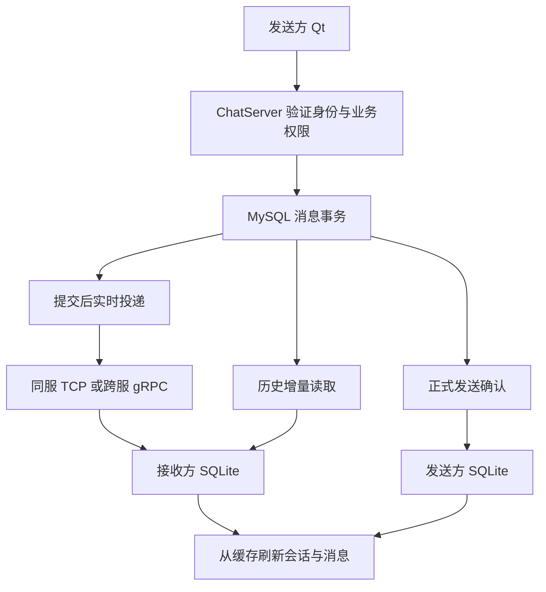

# 聊天信息存储方案

## 1. 持久化层与缓存层

| 位置 | 保存的数据 | 生命周期与用途 |
| --- | --- | --- |
| MySQL | 账号、好友、正式会话、消息、群身份、准入及管理结果 | 跨机器共享的持久化事实 |
| Redis | token、在线路由及服务负载等 | 登录与在线定位，不保存正式聊天历史 |
| ResourceServer 文件 | 完成上传的图片、文件、群头像及任务元数据 | 大型正文；消息表引用资源 ID |
| 本账号 SQLite | 会话摘要、正式消息、阅读状态、连续历史游标、群资料及成员墓碑 | 快速显示、离线查看与增量恢复 |
| 界面内存 | 乐观发送气泡、在途请求、当前会话及分页状态 | 跟随进程和登录会话，未确认消息不等于已保存历史 |

MySQL 表关系、约束和迁移见[数据库设计](数据库设计.md)。SQLite 是嵌入式数据库，Qt 通过 `QSQLITE` 在客户端进程中访问本地文件，无需独立数据库服务。事务将消息、摘要和游标组成一次本地提交，索引支持按会话分页。



## 2. 消息身份与时间

### 2.1 三类 ID

- `thread_id` 是 `chat_thread.id`，统一标识私聊和群聊；群号就是这个 ID。
- `message_id` 是 `chat_message` 全局自增主键，本地缓存沿用它，按正式主键去重。
- `msgid` 是客户端 UUID，用于将待确认气泡与回包关联，不提供服务端跨请求去重。

`recv_id` 在私聊中是接收者 UID，群文本中固定为 0。群通知另带 `target_member_uid` 指定本次收件人，数据库不为每个成员复制消息。

MySQL 的会话和消息 ID 为 `BIGINT UNSIGNED`，服务端使用 uint64，Qt 与 SQLite 使用有符号 64 位整数。桌面请求把群号、会话号、消息游标编码为十进制字符串，避免浮点精度损失；客户端可表示范围受正 qint64 上界约束。UID 接口仍有 int/int32 边界。

### 2.2 ID 顺序与展示时间

消息同步以 `(thread_id,message_id)` 排序。全局分配导致同一会话的 ID 存在数字空洞；自增值也可能因回滚出现空洞。

`created_at` 当前是秒精度 TIMESTAMP。普通私聊文本实时确认使用保存时系统时钟生成毫秒展示时间，历史从数据库时间转换；两条路径不保证毫秒值完全一致。时间用于展示，游标使用正式 ID。

群文本和私聊图片/文件将 UUID 写入 `client_msg_id`；普通私聊文本 INSERT 将该列写 NULL，当前实时确认仍从请求携带 UUID。历史消息的可靠身份是 message_id，不能要求所有历史都可恢复原乐观气泡 UUID。

## 3. 服务端保存与实时投递

### 3.1 私聊会话的并发创建

`CreatePrivateChat` 将双方 UID 排序为 `(min,max)`。事务先锁定查询已有 private_chat；不存在时创建临时 chat_thread，再插入 private_chat。唯一索引 `uniq_private_thread(user1_id,user2_id)` 提供最终唯一性约束：

```sql
INSERT INTO private_chat(thread_id,user1_id,user2_id,created_at)
VALUES (LAST_INSERT_ID(?),?,?,NOW())
ON DUPLICATE KEY UPDATE thread_id=LAST_INSERT_ID(thread_id);
```

随后在同一连接读取 `LAST_INSERT_ID()`，得到本次创建或并发已存在的正式会话。若未采用临时 thread，则提交前删除该临时行。连接在本次事务期间独占，连接局部的 LAST_INSERT_ID 不与其他池连接混用。

唯一索引保证不会留下两份用户对关系；异常分支仍可能回滚并返回失败，没有通用透明重试。不能仅凭“先查询不存在”就认定不存在并发竞争。

### 3.2 消息批次的事务

普通私聊文本由 `SavePrivateTextMessages` 保存：先创建或复用会话，再用另一事务批量 INSERT 消息。批次任一条失败则整批回滚；会话创建已经独立提交，消息失败可以留下合法的空会话。

图片和文件先由 ResourceServer 核验完成状态及资源元数据，再分别进入 `SavePrivateImageMessages`、`SavePrivateFileMessages` 的批次事务。MySQL 保存可信资源 ID、文件名、MIME、大小和图片尺寸，正文留在资源文件中。

好友认证由自己的事务锁申请、建立双向好友关系、复用私聊并保存首条认证消息；其边界与普通发送先建会话再存消息的两事务流程不同。

### 3.3 群文本保存

`GroupOperation(Send)` 同事务锁群、读取发送者当前成员、读取有效收件人集合、每个文本 INSERT 一行 `recv_id=0` 的正式消息。提交前检查完整确认和通知 JSON 预算，超限整批回滚。

提交后 `ForwardGroup` 跳过发送者，按成员 UID 查询 Redis 在线路由；同服进入 TCP 队列，跨服经 `NotifyGroup` 到目标服务器。目标端不再次 INSERT，文本投递重新检查目标当前有效成员，并在授权锁内入队。加入、踢人、转让与解散的锁和版本规则见[群业务事务、并发与权限](总结群聊.md)。

### 3.4 四种成功的含义

| 状态 | 说明 |
| --- | --- |
| `persisted=true` | MySQL 消息事务已提交 |
| `realtime_delivered / delivered` | 本次实时路径返回成功；群路径包括目标入队，私聊各路径的网络返回语义见源码 |
| SQLite 保存成功 | 当前账号缓存了正式消息 |
| 已显示、已读 | 接收端展示或阅读流程提供的独立状态 |

实时失败不回滚正式历史。跨服超时也不能证明对方绝对没有入队；当前没有独立的群离线投递队列，恢复依靠历史补拉。两端 ChatServer 和桌面须使用一致的 [message.proto](../proto/message.proto) 字段定义，避免正式元数据在跨服链路丢失。

服务端消息 INSERT 没有客户端 UUID 唯一约束。管理 `operation_id` 的重放机制不用于普通消息；确认丢失后重新发送正文可能生成第二个 message_id。已取得保存确认时，不应把实时失败解释为需重新落库。

## 4. SQLite 文件、表与本地事务

### 4.1 初始化与账号隔离

`LocalChatStorageMgr::Initialize(uid)` 使用 `QStandardPaths::AppLocalDataLocation` 下的 `chat_cache/chat_cache_<uid>.db`。该目录由 Qt、应用名和系统账号决定，业务代码不写死机器绝对路径。`Initialize(uid,cacheRoot)` 可指定独立根目录。

打开连接后启用 `PRAGMA foreign_keys=ON` 和 WAL，再执行 `CreateSchema`。外键开关是每连接设置，已有数据库也要重新开启。桌面 [CMakeLists.txt](../chat_app%20desktop/CMakeLists.txt) 链接 Qt `Sql` 模块；部署还需可用的 QSQLITE 驱动。

切换账号关闭旧连接，打开新 UID 文件，并清理在途群请求、快照、当前会话、管理窗口和资源任务。每账号数据库提供文件隔离，请求代次与任务关联负责防止异步结果应用到错误界面；各协议路径的关联强度不同。

### 4.2 表的用途

| 表 | 关键字段 | 用途 |
| --- | --- | --- |
| `local_chat_thread` | thread_id、类型、peer_uid、摘要、时间、未读数 | 会话列表；群另存角色、有效状态、失效原因和各版本 |
| `local_chat_message` | message_id、thread_id、sender/recv、content_type、content | 正式缓存消息、昵称、服务端状态、发送与阅读状态 |
| `local_sync_cursor` | thread_id、max_message_id、synced_at_ms | 每会话完整历史补拉进度 |
| `local_message_attachment` | message_id、路径、大小、下载状态 | 附件本地位置等结构；文件正文不写数据库 |

运行时结构为 schema v5，新库参考 [client_chat_cache.sql](../sql/client_chat_cache.sql)。附件表有路径和下载状态字段，不代表所有传输任务都把实时进度写入该表；图片/文件消息内容主要缓存可信资源 JSON 元数据，传输器维护文件下载任务。

### 4.3 批次写入与单调状态

`SaveReceivedMessages` 在同一 SQLite 事务中更新会话、UPSERT 正式消息和写入调用者传来的历史游标。消息 ID 必须为正，且消息 threadId 必须等于目标会话。SQL 或 commit 失败回滚，不发送本地同步成功信号。

重复 message_id 的写入保留更高 delivery_state、server_status 和 is_read；非空昵称可以补齐已有昵称。会话最后消息 ID 与时间取较大值，旧消息不能把新摘要回退。未读数由调用路径结合 `HasMessage` 与是否正在查看计算，不能仅靠 UPSERT 自动避免重复累加。

`CachedThreads/LoadThreads` 的默认摘要条数用于展示。身份查找、完整同步与群对账使用 `LoadAllThreads` 或精确查询，不能把最近 100 个摘要当作全部会话。

## 5. 增量历史与实时消息交错

### 5.1 连续历史游标的定义

已完整取得本群消息到 100，离线期间产生 105、109，重连先收到实时消息 120：

| 动作 | 缓存消息 | 连续历史 cursor |
| --- | --- | --- |
| 初始 | 已知到 100 | 100 |
| 收到实时 120 | 立即保存 120 | 仍为 100 |
| 请求 after=100，整页含 105、109、120 | 去重写入完整页 | 成功后为 120 |
| 页验证或本地提交失败 | 不作成功页提交 | 仍为 100 |

“连续”表示该会话游标之前应补拉的历史已经取得，ID 无需数字相邻。实时最大 ID 与最后消息摘要可立即变大，历史 cursor 保持独立。

实时通知与发送确认调用 SaveReceivedMessages 时传入原 cursor。只有按 after_message_id 获得并验证完整的历史页，才传入新 next_message_id。该接口本身无法推断消息来自实时还是历史，调用者承担游标含义。

### 5.2 请求与服务端查询

历史复用 `ID_LOAD_CHAT_MSG_REQ/RSP`，群请求示意：

```json
{
  "thread_id": "501",
  "type": "group",
  "after_message_id": "100",
  "page_size": 100
}
```

服务端使用认证 session UID。私聊检查其为会话双方之一，群检查当前有效群和成员；群查询不按 joined_at 过滤，允许当前成员读取加入前文本。

```sql
SELECT message_id, sender_id, recv_id, content
FROM chat_message
WHERE thread_id=? AND message_id>?
ORDER BY message_id
LIMIT ?;
```

`(thread_id,message_id)` 索引提供固定会话内的范围扫描。实际查询还带消息类型和资源等必要字段；服务端多取一条判断是否有后续，并按最终 JSON 字节预算装页。

### 5.3 数量与帧边界

历史请求 page_size 范围为 1～1000，默认 50；桌面一般使用 100。群管理分页的 1～100 上限不适用于历史请求。

响应按最终紧凑 JSON 限制在 4096 字节，包括固定字段、UID、资源元数据、UTF-8 和转义开销。放不下下一条时，仅推进到本页实际最后一条，`load_more=true`；单条连空壳都放不下则返回 MessageTooLarge，不截断正文，不静默跳过。

客户端验证正式字段、同会话、消息 ID 严格递增、类型合法、next 与最后 ID 一致，且 load_more 不能配空页。整页通过后事务写入，再请求下一页。失败页不推进 cursor；当前没有统一持久重试调度器，重新登录或相关同步触发可从原 cursor 再读。

### 5.4 消息增量不能覆盖所有状态变化

按 message_id 增量读取只会发现新消息。私聊旧消息的 displayed_at、status 更新使用实时展示/已读回执；当前同步没有独立的“所有旧回执变更游标”。发送者离线漏掉旧消息回执时，单纯从已有消息 cursor 继续补拉不会再次获取这些旧行，不能宣称重登录总能修复全部历史回执。

## 6. 会话发现与群身份恢复

### 6.1 私聊发现

登录后读取本地最大已知 private thread_id，通过 `ID_LOAD_CHAT_THREAD_REQ/RSP` 按 after_thread_id 发现新私聊；群号不参与该最大值。新机器从 0 开始分页。已有私聊和新发现私聊分别按自己的消息 cursor 补拉。

好友资料页的 `ID_CREATE_PRIVATE_CHAT_REQ/RSP` 返回双方唯一会话。客户端核对当前账号，保存正式 thread_id 并绑定列表项，保留已有摘要和未读。收到完整实时私聊元数据时也可建立本地会话，不必等待列表回包。

### 6.2 群列表必须完整读取

用户可能今天加入早已存在的群，离群和解散也不产生新群号。每轮 `ID_LOAD_GROUP_LIST_REQ/RSP` 从 after_thread_id=0 开始，服务端一次读取本账号全部有效群与成员身份并绑定 session；后续按该快照准确游标继续，避免各页查询混成不同集合。

客户端暂存页面，核对账号、登录代次、request_id、快照轮次、群号顺序与成员证明。只有整轮全部成功，且每群证明的状态 epoch 仍匹配，才调用 ReconcileGroupSnapshot：同一事务合并有效群证明，将缺席的本地有效群标记为 `not_in_snapshot` 只读。失败或超时的半轮不能撤权。

快照期间新确认创建或加入的群会合并进该轮资料并记录 epoch；已接受撤权改变 epoch 时，旧快照不能覆盖它。缺席对账不删除消息，也不虚构新的服务端 membership_version。

### 6.3 墓碑与成员证明

| 合并入口 | 允许的状态变化 |
| --- | --- |
| Metadata | 更新较新的共享资料；保留本地成员状态、角色和成员版本 |
| CurrentMemberMetadata | 本地原有效身份可接受更高成员版本和角色；失效身份保持失效 |
| MembershipProof | 建立新群身份；已有记录须成员版本严格更高才改变身份 |
| SetGroupState | 更高撤权版本置 active=0、role=0，保存原因；未知群也可建立墓碑 |

群资料 version、announcement_version、avatar_version 分别防回退。公告不可见响应的空/0占位不表示清空。`membership_proof` 是本次可信响应的来源标记，不作为永久布尔授权字段存储。

真实新增或重入响应及相应成员事件带 membership_granted；普通 metadata、审批进度或 result 不能把墓碑恢复为成员。失效旧文本确认可以补记历史，不恢复发送权。

群管理和快照有 pending 请求、账号和登录代次关联；群文本确认、实时文本和历史没有相同的管理 pending 关联，也没有逐消息成员版本检查。它们依赖正式元数据和当前缓存群身份。数据库锁不能撤回已入队的旧帧，不能将本地版本机制表述为所有网络消息都与撤权完全隔离。

## 7. 显示、已读、未读与发送恢复

私聊显示确认使用 `ID_MESSAGE_DISPLAY_ACK_REQ`：文本气泡实际插入窗口后确认，图片等完成下载并插入气泡后确认，文件卡片显示后确认。服务端只记录首次 displayed_at，再通过同服通知或 NotifyMessageDisplayed 通知发送者。

进入私聊时，MarkThreadRead 清本地未读，并以会话最后消息 ID 发送已读游标。服务端只更新当前接收者、指定会话、游标以内仍未读的行。SQLite delivery_state 表示 1已保存、2实时投递、3已显示、4已读，is_read 表示本账号阅读状态；两者使用场景不同。

群 recv_id=0，没有单一接收者，不发送私聊显示 ACK 或服务端已读游标。进入群仅清本地未读，不表示其他成员已读。

发送端先用 UUID 展示临时气泡，取得正式成功回包并完成 SQLite 提交后再确认。失败回包或本地保存失败按 UUID 标记发送失败；失败气泡没有可靠的正式主键，不按正式历史记录持久化。客户端重启后以正式缓存恢复，不能承诺保留尚未确认的草稿或失败气泡。

## 8. 图片、文件与群头像缓存

私聊图片和文件共享消息序列与历史游标，正式确认、通知和历史均使用 ResourceServer 返回的可信元数据。图片 content 缓存资源 JSON，摘要显示 `[图片]`；打开会话后下载并原子写入图片缓存。文件摘要为 `[文件]`，仅在用户点击文件卡片并选择保存路径后下载，不因同步或打开会话自动下载。

私聊资源逐片携带 UID/token、thread_id 和 resource_id；服务端核验当前用户属于私聊，且资源确实由对应类型消息引用。文件单个上限 100 MiB，宽高字段保持 NULL。资源上传完成和发送聊天消息是独立动作，不能只凭任务 completed 就认定已有正式消息。

群头像另用 `purpose=group_avatar`：上传和发布核验要求当前管理者，下载要求当前有效成员且 RID 仍为群当前已发布头像。真实 PNG/JPEG 完整解码、非空且不超过 2 MiB、宽高各 1～1024；每片重新认证与授权。可信发布 RPC 要求 `x-resource-service-key`，默认空 service_key 配置会拒绝核验，用户 token 不能代替服务凭据。

群头像缓存按 UID、群、avatar_version 和 RID 区分，使用 QSaveFile。完成后复核实际长度、格式、尺寸和完整解码，并核对当前账号、登录代次及头像标识。旧账号或旧头像任务不能覆盖新头像；普通公告更新不改变头像任务身份。已验证离线缓存可用于显示，不表示失效成员可以继续从服务器下载。

群聊天正文只支持文本；群头像不提供群图片/文件消息能力。传输细节见[资源服务](资源服务.md)、[文件传输](文件传输.md)和[群聊](群聊.md)。

## 9. 本地阅读、迁移与故障处理

打开聊天先 LoadRecentMessages 读取最近 50 条，按正式 ID 正序渲染。滚到顶部后 LoadMessagesBefore 以更小 message_id 取前 50 条，头部插入并补偿滚动位置；这是本地分页，不额外触发网络历史请求。失效群仍可翻阅本地记录。

旧 SQLite 由 CreateSchema 按字段存在情况追加迁移到 user_version=5，不删除消息表、附件、摘要或未读。低于 v3 的旧 cursor 清零以重新补拉；v3 及之后的连续 cursor 保留。多个 ALTER 没有统一外层事务，失败可能留下已完成的部分结构；不能通过删除真实账号数据库来代替升级。

| 现象 | 处理依据 |
| --- | --- |
| 本地写入失败 | 查看 LocalChatStorageMgr::LastError；本次批次不推进 cursor，不把界面刷新当作落盘 |
| 已保存但未实时投递 | 保留正式确认，重连后补拉，不再次 INSERT 正文 |
| 群列表中途失败 | 保留原身份缓存，不依据缺页撤权，后续重新完整读取 |
| 群失效 | 保留墓碑和历史；重新入群按当前规则取得更高成员版本证明 |
| 历史单条超帧 | 保留原 cursor，依据协议错误处理；不能跳过或自行截断 |
| 换账号后有旧资源回包 | 根据任务账号、代次、群及资源标识忽略，不应用到当前会话 |

## 10. 代码阅读入口

| 职责 | 源码 |
| --- | --- |
| MySQL 会话并发创建、文本/图片/文件事务、回执、群历史 | [MysqlMgr.cpp](../ChatServer1/src/MysqlMgr.cpp) |
| 消息请求、可信核验、提交后投递和历史帧预算 | [LogicSystem.cpp](../ChatServer1/src/LogicSystem.cpp) |
| 群管理重放、准入与版本 | [GroupManagement.cpp](../ChatServer1/src/GroupManagement.cpp) |
| SQLite 初始化、迁移、UPSERT、游标和身份合并 | [localchatstoragemgr.cpp](../chat_app%20desktop/localchatstoragemgr.cpp)、[接口](../chat_app%20desktop/localchatstoragemgr.h) |
| 登录后发现、快照关联、整页校验和发送确认 | [tcpmgr.cpp](../chat_app%20desktop/tcpmgr.cpp) |
| 缓存展示、本地历史、未读与回执触发 | [chatdialog.cpp](../chat_app%20desktop/chatdialog.cpp) |
| 图片/文件共用传输器与群头像任务 | [chatimagetransfer.cpp](../chat_app%20desktop/chatimagetransfer.cpp)、[groupavatartransfer.cpp](../chat_app%20desktop/groupavatartransfer.cpp) |
| 资源授权与可信服务核验 | [ResourceAccessAuthorizer.cpp](../ResourceServer/src/ResourceAccessAuthorizer.cpp)、[ResourceServiceImpl.cpp](../ResourceServer/src/ResourceServiceImpl.cpp) |
