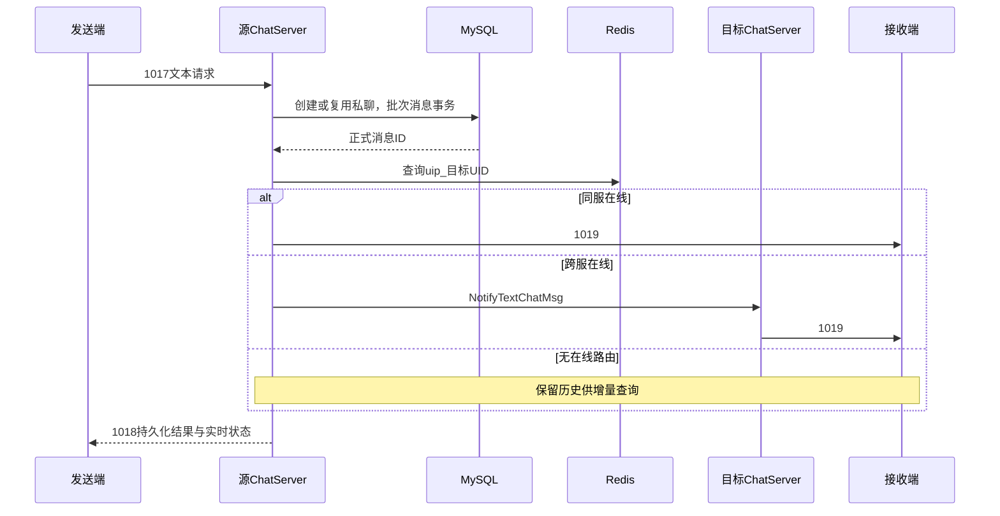

# 聊天信息收发

## 发送者身份与消息模型

客户端通过1005/1006登录绑定Session UID，私聊文本请求为1017：

```json
{"fromuid":1001,"touid":1002,"textArray":[{"msgid":"客户端UUID","content":"你好"}]}
```

`HandleTextMsg()` 检查Session UID等于 `fromuid`、目标UID为正、数组与每项UUID/正文非空。`SavePrivateTextMessages()`拒绝自发自收，并创建或复用私聊。当前普通私聊创建/文本路径没有额外查询双向好友关系；音视频好友授权和群成员授权各有独立检查，不能据它们推断私聊具备同样限制。

| 标识或字段 | 含义 |
| --- | --- |
| 帧ID，例如1017 | 操作类型，同一连接上所有文本请求共用 |
| `msgid` | 客户端UUID，关联乐观气泡与发送结果 |
| `message_id` | MySQL自增正式消息主键，历史增量游标和SQLite去重键 |
| `thread_id` | 正式会话ID，私聊双方与群共用ID空间 |
| `sender_id/recv_id` | 持久化发送者/接收者；群固定 `recv_id=0` |
| `created_at_ms/status` | 服务端提供的展示时间与消息状态；状态0未读、1已读、2撤回 |

私聊用排序后的 `user1_id/user2_id` 加唯一索引保证一对用户共用会话。会话创建事务与消息批次事务分开；消息批次失败可留下已创建的空会话。文本写入 `client_msg_id=NULL`，UUID只保留在本次返回结构，相同UUID重新发送仍可写入新行。SQL没有为 `client_msg_id` 建立去重唯一约束，图片/文件虽保存该值，也不能宣称实现发送幂等。

## 先提交，再投递



1018和1019的 `textArray` 项包含 `msgid/content/message_id/thread_id/sender_id/recv_id/created_at_ms/status`。MySQL提交后，源服才读取Redis路由：同服查UserMgr，跨服调用gRPC。目标服将protobuf字段 `msgcontent` 映射为JSON `content`，透传正式主键，不再插入消息。

### 发送结果的四个层次

| 结果 | 依据与边界 |
| --- | --- |
| `persisted=true` | 批次事务已提交；对端离线不会撤销此事实 |
| `realtime_delivered/delivered` | 源服尝试实时路径的结果；RPC失败另带 `delivery_error` |
| `peer_displayed=true` | 接收端实际绘制后上报1036并持久化展示状态 |
| 已读 | 接收端上报1038会话游标，服务端保存已读事实 |

普通私聊使用返回void的 `Send()`，其内部可能拒绝入队而调用者未读取结果，因此实时标志表示该路径判定成功，不能严格证明socket队列接受或对端收到。gRPC `Status::OK`也仅表示RPC正常返回，还须检查业务 `response.error`。任何实时成功都不能代替显示/已读回执。

MySQL提交后RPC失败仍返回保存成功，避免把离线误认为发送失败。没有确认回包时也不能安全推断事务回滚；当前私聊缺少业务去重重试，手动重发有重复消息风险。实时通知重复由正式 `message_id`在客户端缓存去重。

## 图片与文件

图片1033/1034/1035、文件1040/1041/1042沿用同类正式字段。ChatServer先调用ResourceServer `VerifyImages/VerifyFiles`取得发布完成后的可信文件名、MIME和大小；图片另有宽高。元数据核验成功才写MySQL。目标ChatServer只转发已核验记录。

二进制通过ResourceServer独立TCP连接传输，聊天帧仅含资源ID和元数据。下载仍须进行token、会话成员和资源关联授权。私聊资源规则不能自动用于群附件；群消息实现只支持纯文本。资源操作见[文件传输](文件传输.md)与[资源服务](资源服务.md)。

## 群文本与撤权次序

群文本使用1053/1054/1055，请求包含字符串 `thread_id`与 `textArray`。身份来自Session UID；源服在群事务中锁定 `group_chat` 行、检查群有效及当前成员，再批次保存单份消息。每项带 `sender_nick`、正式消息字段，`recv_id=0`。消息提交后按成员UID扇出，各接收端得到相同的正式主键，`target_member_uid`仅表示本次通知目标。

同服发送与目标服 `NotifyGroup` 均在群行锁保护下再次检查目标当前成员，锁内调用 `TrySend`入队。踢出、离群、解散与此授权使用同一群行锁，撤权提交后的迟到广播不能沿旧身份入队；撤权前已入队的消息无法从网络中撤回。

群失效使用1060，只将指定群变为不可操作状态，不关闭账号连接。群管理事件1081区分邀请信箱、处理结果、资料/成员更新；非成员信箱和结果不授予成员身份。角色0成员、1管理员、2群主及版本冲突规则见[群聊](群聊.md)。

## 历史同步、分页和回执

私聊1025/1026发现新增会话，1029/1030按 `after_message_id`正序增量获取。请求的 `thread_id/after_message_id`使用十进制字符串，避免Qt JSON double精度损失。默认 `page_size=50`，有效范围1～1000；服务端多取一条判断 `load_more`，再以紧凑JSON实际字节数切至4096字节。响应 `next_message_id`只推进到本页最后实际返回项；单条消息与响应固定字段仍无法容纳时返回1016，不跳过该消息。

群历史复用1029/1030，按请求类型或数据库会话类型分派。当前有效成员可读加入前历史；撤权或群解散后拒绝。群列表每轮从0建立完整快照，全部页面成功后客户端才进行失效比较；中间失败不能将尚未收到的群清除。

Qt按账号打开SQLite，实时消息和确认消息按 `message_id`去重写入，但不能推进连续历史游标。完整历史页校验后，消息、会话摘要和游标同事务提交，以便中断后恢复。群消息的待确认气泡还需检查 `sender_id`为本人，避免他人使用相同UUID影响本端。

1036携带 `thread_id/message_ids`，最多100个ID；服务端只允许实际接收者确认，幂等写入首次 `displayed_at`，通过1037通知原发送者。1038携带 `thread_id/read_through_message_id`，只更新该用户实际接收的私聊消息，并以1039推送游标。两条状态都先持久化，发送者离线时可从1030恢复。群 `recv_id=0`没有每成员回执模型，不能表达全员已读。

## 帧预算与操作

- 聊天输入是两字节ID、两字节长度和JSON，服务端输入包体最大2048字节；Qt需按UTF-8字节分批，不能仅按消息条数决定批次。
- 历史和群响应使用4096字节预算，群发送提交前检查确认/通知候选；Qt接收路径与服务端输入限制不同。群最终响应另有复检；若最终超预算可返回1016，分页方不能推进失败页游标。
- 排查离线消息时先看1018的保存结果，再检查Redis路由及实时RPC，最后用1029验证历史是否可读。勿用 `delivered`判断SQL是否提交。
- 修改协议时同时维护客户端枚举/handler、服务端回调、protobuf、数据库序列化和历史路径；部署实例配置独立保留。

## 代码与交叉阅读

- [LogicSystem](../ChatServer1/src/LogicSystem.cpp)：`HandleTextMsg/HandleImageMsg/HandleFileMsg/LoadChatMessages/HandleMessageDisplayed/HandleThreadRead/HandleGroup`。
- [MysqlMgr](../ChatServer1/src/MysqlMgr.cpp)：`CreatePrivateChat/SavePrivateTextMessages/MarkMessagesDisplayed/MarkPrivateThreadRead`。
- [群事务](../ChatServer1/src/GroupManagement.cpp)、[群行授权](../ChatServer1/include/GroupDatabase.h)、[跨服接收](../ChatServer1/src/ChatServiceImpl.cpp)。
- [SQL结构](../sql/create_tables.sql)、[Qt协议与缓存入口](../chat_app%20desktop/tcpmgr.cpp)、[本地缓存管理](../chat_app%20desktop/localchatstoragemgr.cpp)。
- [TCP服务器](TCP服务器.md)、[聊天服务器服务](聊天服务器服务.md)、[消息ID全链路](消息ID全链路.md)。
