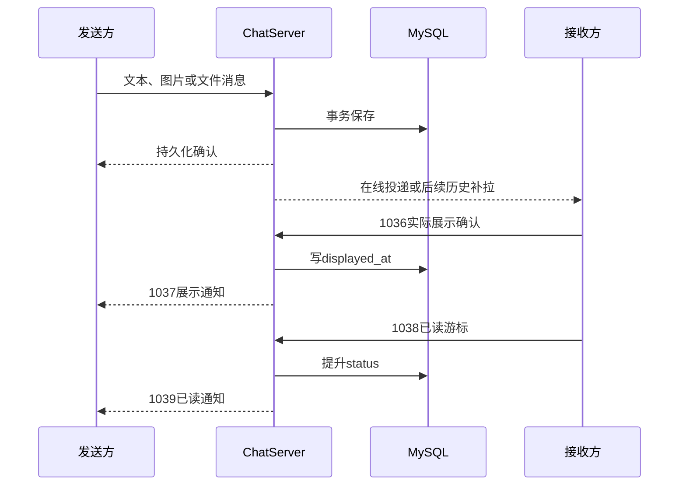

# 聊天可靠性与资源安全

## 持久化、投递、展示与已读

| 状态 | 可确认的事实 | 使用边界 |
| --- | --- | --- |
| `persisted=true` | 消息事务已提交MySQL | 对端可以仍然离线 |
| `realtime_delivered=true` | 同服发送入队或跨服实时路径返回成功 | 无法证明接收端窗口已显示 |
| `peer_displayed/displayed_at` | 接收端提交展示ACK，数据库已记录 | 客户端确认无法证明人的注意力 |
| `status=1` | 接收端提交会话已读游标 | 通知发送方仍可能因离线而延迟 |

MySQL是服务端消息与回执的持久化依据。Redis在线路由、同服TCP和跨服gRPC用于加速通知。持久化完成后实时投递失败，文本、图片与文件请求仍返回持久化成功，并分别报告实时投递结果；直接重发有可能增加另一条消息。

## 展示ACK与会话已读游标

私聊接收端在文本气泡或文件卡片插入当前聊天视图后提交1036。图片须等下载、校验并插入PictureBubble后确认，元数据到达与占位符不能代替图片展示。文件展示ACK只确认卡片元数据，不证明文件已下载或打开。

ChatServer从已登录session获取确认者UID，SQL同时限定私聊成员、thread_id、recv_id、目标消息及尚未设置的displayed_at。重复ACK不会重复提升状态；客户端不能替另一接收者确认展示。

1038提交 `read_through_message_id`，服务端只改变当前用户接收的未读消息，先读取实际提升的消息，再写status并发1039。重复提交同一游标不生成新的状态提升。客户端渲染历史时按实际取得的消息决定读游标，不能用尚未同步到本地的会话摘要最大ID直接确认阅读。

跨服 `NotifyMessageDisplayed/NotifyThreadRead` 仅转发来源服已经持久化的回执，目标服不再按RPC参数修改数据库。发送方离线或路由失败时，状态仍可由后续1030历史恢复。

SQLite以正式message_id去重，并将delivery_state单调提升为已保存、实时投递、已展示和已读。迟到的较低状态不能覆盖较高状态。发送确认只保存对应消息，不推进连续同步游标；先到的已读通知暂存并在确认到达后合并。新入站消息增加未读数，进入会话后依据实际消息清零并提交读游标。

## 历史分页与游标提交

1029/1030按 `after_message_id` 拉取历史。page_size默认50，允许1～1000，但实际回包还受紧凑JSON的4096字节预算约束。服务端逐条加入消息并测量完整响应的UTF-8字节数，含字段名、转义和分页字段；消息条数无法替代字节预算。

当下一条放不下，返回已容纳部分、最后正式ID作为 `next_message_id` 和 `load_more=true`，客户端从该位置继续。如果单条消息自身超限，返回ChatServer的 `MessageTooLarge(1016)`，保留原游标、不截断和跳过消息。客户端应处理明确错误，不能无限请求相同页。

客户端将同一页消息和游标放入SQLite事务，失败整体回滚。连续游标只随成功保存的同步页前进，避免“游标已更新而消息未保存”造成永久遗漏。本地数据库按账号区分；群与私聊使用独立会话身份，群ID不能推进私聊发现游标。

## 上传、消息核验与下载授权

资源链路中的三个步骤具有独立责任：

1. **上传任务**：ResourceServer接收Base64分片，顺序写入 `.part`，完成后发布文件。普通上传最大100MiB，当前私聊上传保留匿名接口；MD5用于任务匹配，服务端没有重新计算完整内容哈希。
2. **消息资源核验**：ChatServer调用VerifyImages或VerifyFiles，取得可信名称、MIME、大小及图片尺寸，再保存消息。客户端的同名字段不能覆盖服务端结果。核验不能证明普通资源由当前发信账号上传。
3. **逐片下载授权**：1007携带当前uid/token/thread_id/resource_id，先经StatusServer认证，再查询私聊成员和同会话image/file消息引用，授权后才读取文件。

资源ID只是引用。身份、会话成员、资源引用任何一项不满足均返回资源协议1020；StatusServer或MySQL不可用返回1021并拒绝读取。日志不应输出token、服务密钥和Base64内容。资源协议1021与ChatServer中同号业务消息无关。

上传续传依赖服务端 `.part` 的实际长度。下载协议允许指定offset；当前Qt私聊下载失败会取消QSaveFile并清零，重试从0开始。图片写入长度正确后原子提交，再执行真实解码和尺寸检查；无效缓存删除。普通文件保存到用户确认路径，只核对长度，不执行格式或恶意内容检查。

VerifyImages只检查PNG/JPEG/GIF/WebP头信息；VerifyFiles按文件名扩展名映射MIME。两者都不等于完整内容安全扫描。内部RPC使用明文连接，VerifyImages/VerifyFiles还未采用群头像专用服务密钥校验，部署需限制受信网络。

## 群消息与群头像的权限边界

群消息只支持纯文本，一条消息保存一行 `recv_id=0`，提交后向当前成员投递。群不使用私聊单接收者的展示和已读回执，也不支持图片/文件附件。

群加入、踢出、解散、发送和历史授权按统一顺序锁group_chat行及成员。实时投递在持锁验证当前成员后入队，撤权提交后的迟到广播不能重新授权。逻辑解散用active=0保留数据库历史，服务端搜索、发送和历史权限随之失效；SQLite仍可保留只读本地记录。群状态通知只影响指定群，不触发整个账号下线。

群头像有独立 `purpose="group_avatar"` 任务绑定和每片权限检查。上传须当前管理员/群主；下载须当前有效成员且资源恰为当前已发布头像。VerifyGroupAvatar另外要求非空服务密钥、有效用户token、上传者/群/用途绑定，以及完整PNG/JPEG解码。ChatServer发布事务再次检查当前管理权限，避免核验期间撤权后继续发布。头像被替换、用户离群或群解散后，后续旧资源分片拒绝读取；已经入队或已下载到本地的数据无法远程收回。

## 故障处理与运行要求

| 故障 | 恢复操作 | 不应推断的结果 |
| --- | --- | --- |
| 在线推送失败但persisted成功 | 重新登录或恢复连接后历史补拉 | 无需据此盲目重复发送 |
| 私聊发送确认丢失 | 先检查历史和正式消息身份 | 相同客户端msgid重试不保证服务端去重 |
| 资源1020 | 检查当前账号、token和资源所属会话 | 单纯重连无法改变成员权限 |
| 资源1021 | 恢复StatusServer/MySQL与网络后重试 | 依赖失败不能放宽授权 |
| 下载/解码/磁盘失败 | 修复环境后重新下载 | 不能将占位符标记为图片已展示 |
| 历史单条超限 | 处理明确错误并检查数据与协议预算 | 不得丢弃该条并前移游标 |

新数据库导入 [完整DDL](../sql/create_tables.sql)。已有库需具备 [资源字段](../sql/chat_image_message_migration.sql) 与 [displayed_at回执字段](../sql/chat_message_receipt_migration.sql)，群管理按对应迁移维护；重复运行CREATE IF NOT EXISTS不能升级旧表。服务端重启与客户端重连不能补齐缺失的表结构。

## 代码定位与测试层次

- [LogicSystem.cpp](../ChatServer1/src/LogicSystem.cpp)：持久化确认、历史字节分页、1036/1038及资源核验入口。
- [MysqlMgr.cpp](../ChatServer1/src/MysqlMgr.cpp)、[GroupManagement.cpp](../ChatServer1/src/GroupManagement.cpp)：事务、回执幂等筛选及群权限锁。
- [ChatServiceImpl.cpp](../ChatServer1/src/ChatServiceImpl.cpp)：跨服通知接收。
- [localchatstoragemgr.cpp](../chat_app%20desktop/localchatstoragemgr.cpp)、[chatdialog.cpp](../chat_app%20desktop/chatdialog.cpp)：SQLite状态合并、游标和界面确认。
- [LogicWorker.cpp](../ResourceServer/src/LogicWorker.cpp)、[ResourceAccessAuthorizer.cpp](../ResourceServer/src/ResourceAccessAuthorizer.cpp)：资源分片与逐片授权。
- [测试知识](测试.md)区分数据层、网络、资源解码与Qt界面覆盖；具体操作见 [测试运行指南](../tests/README.md)。
