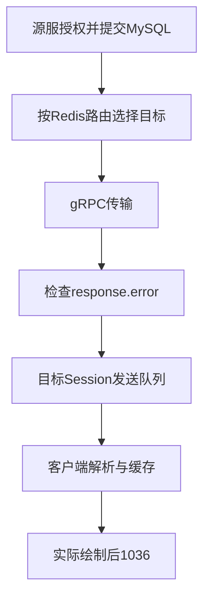

# 聊天服务器服务

## 协议与运行入口

共享定义为 [proto/message.proto](../proto/message.proto)，包名 `message`。根[CMakeLists.txt](../CMakeLists.txt)调用 `protoc`生成protobuf与gRPC源码，编译为 `chat_proto`，各C++服务链接同一目标。协议修改应改源proto，生成文件由构建产生。

ChatServer的客户端TCP监听与gRPC监听共用一个 `CServer`会话容器。`ChatServer.cpp`将其同时交给LogicSystem和ChatServiceImpl；跨服踢人因此能访问真实TCP连接。服务端使用 `InsecureServerCredentials`，连接池使用不加密通道，RPC入口依赖可信网络隔离，没有统一的服务间调用者认证。

`[SelfChatServer] rpcport`为本机RPC端口；`[PeerServer] servers`列出其他实例配置段，客户端以该段 `name`建立5个stub的池。Redis `uip_<uid>`存服务名，这个值必须能命中池键。客户端TCP端口与RPC端口不能混用。

## RPC与TCP的对应关系

| RPC | protobuf载荷 | 目标TCP/职责 |
| --- | --- | --- |
| `NotifyAddFriend` | `AddFriendReq/Rsp` | 1011申请提示，源服先保存申请，离线后由登录查询 |
| `NotifyAuthFriend` | `AuthFriendReq/Rsp` | 1015资料与初始消息，目标查询认证者资料后通知 |
| `NotifyTextChatMsg` | `TextChatMsgReq/Rsp` | 1019已提交文本 |
| `NotifyImageChatMsg` | `ImageChatMsgReq/Rsp` | 1035已核验并保存的图片元数据 |
| `NotifyFileChatMsg` | `FileChatMsgReq/Rsp` | 1042已核验并保存的文件元数据 |
| `NotifyMessageDisplayed` | `MessageDisplayedReq/Rsp` | 1037已保存的展示确认 |
| `NotifyThreadRead` | `ThreadReadReq/Rsp` | 1039已保存的私聊已读游标 |
| `NotifyKickUser` | `KickUserReq/Rsp` | 1021旧账号连接下线，精确session校验 |
| `NotifyGroup` | `GroupNotifyReq/Rsp` | 1055群文本、1060群失效或1081群事件 |
| `NotifyVideoTest` | `VideoTestNotifyReq/Rsp` | 1084单向固定文件测试信令 |
| `NotifyVoiceCall` | `VoiceCallNotifyReq/Rsp` | 1087好友音视频通话信令 |
| `SendChatMsg` | `SendChatMsgReq/Rsp` | proto保留单条接口声明；ChatServiceImpl没有覆盖实现，当前文本路径使用批次接口 |

`RplyFriendReq/Rsp`有消息定义，没有对应ChatService方法。不能仅凭message声明推断有可调用业务。

## 正式消息数据

`TextChatMsgReq`含 `fromuid:int32`、`touid:int32`、`textmsgs:repeated TextChatData`。正式条目为：

| 字段 | 类型 | 用途 |
| --- | --- | --- |
| `msgid` | string | 客户端UUID，关联确认 |
| `msgcontent` | string | 正文，转TCP JSON时名为 `content` |
| `message_id/thread_id` | uint64 | 消息主键与正式会话ID |
| `sender_id/recv_id` | int32 | 私聊双方 |
| `created_at_ms` | uint64 | Unix毫秒展示时间 |
| `status` | int32 | 0未读、1已读、2撤回 |

源服MySQL提交后填充这些字段，目标只映射JSON并发送，不二次插入数据库。图片与文件条目包含同类正式字段，以及 `resource_id/name/mime_type/file_size`；图片额外有 `width/height`。资源正文不经过ChatServer的gRPC。

好友认证 `AuthFriendReq.fromuid`为同意者，`touid`为原申请者；`textmsgs`的 `AddFriendMsg`使用 `sender_id/unique_id/msg_id/thread_id/msgcontent`。其中 `msg_id/thread_id`仍为int32，源数据库路径检查协议范围；普通消息uint64范围不能套用于这组字段。初始消息在好友事务中产生，稳定标识为 `friend-auth-<message_id>`，重复同意可复用同条正式消息。

## 传输成功与持久化成功



`grpc::Status`描述传输，`response.error`描述目标处理。源服已提交消息时，后续实时失败只影响 `delivered/realtime_delivered/delivery_error`，不能回滚源事务。接收者之后经1030获取历史。

文本、图片、文件目标会话缺失返回 `UidInvalid`。好友申请目标离线按成功处理，因为申请记录可由登录读取；展示/已读通知发送者离线也按成功处理，状态已在源数据库保存。普通私聊 `Send()`返回void，RPC成功不能精确证明实际队列接纳；群和音视频用 `TrySend()`检查队列结果。

超时策略按方法区分：文件、展示/已读回执、踢人、群、音视频专用路径的池等待与RPC共用3秒deadline。图片路径分别计算接近的两个3秒截止时刻；普通好友及私聊文本转发沿用 `getConnnection()`及无deadline上下文，可能长期等待。`NotifyAddFriend`客户端的作用域清理会把 `error`置成功，不能用其结果作可靠送达依据。

## 群信封与目标权限

```protobuf
message GroupNotifyReq {
  uint64 thread_id = 1;
  int32 sender_uid = 2;
  int32 target_member_uid = 3;
  GroupEventType event_type = 4;
  string payload_json = 5;
}
```

`GroupEventType`的数字为TEXT=0、INBOX=1、RESULT=2、METADATA=3、MEMBERS=4、INVALIDATED=5。`sender_uid`表示源操作人，`target_member_uid`表示真实收件人，群消息数据库 `recv_id`固定0。

TEXT/METADATA/MEMBERS在目标执行 `GroupOperation(Authorize)`，锁群行并检查群有效与收件人当前成员身份，持锁调用 `TrySend`后才结束事务。踢出/解散与该锁共享次序。INBOX/RESULT允许发给非成员；INVALIDATED使用1060只失效群，不关闭账号。管理payload包含实际收件人 `uid`和 `type="group"`，不能把源操作UID写成收件人。

字段4使用enum，旧bool协议的true会被解释为INBOX，部署必须同步更新两台ChatServer。源提交后的实时失败不删除已保存的群消息，离线恢复依赖群列表、准入记录和历史查询。

## 回执与重复登录

`MessageDisplayedReq`含 `sender_id/reader_id/thread_id/message_ids`，主键列表1～100项；`ThreadReadReq`含同类身份与 `read_through_message_id`。来源TCP先根据登录读者UID更新数据库，再构造RPC，目标只通知发送端，不依据RPC参数再次修改历史。群没有每成员已读回执。

`KickUserReq`的 `uid/session_id`必须匹配旧服当前会话。找不到会话按幂等成功，相同则追加1021并注销本机映射，ID不匹配返回1014。源服仅在目标成功后覆盖在线路由。发送排空后才实际关闭socket，RPC成功不表示旧端已解析1021。详见[服务器踢人](服务器踢人.md)。

## 音视频信令

`VideoTestNotifyReq`和 `VoiceCallNotifyReq`均含 `target_uid`、`target_session`、`payload_json`，目标同时核对Redis当前登录与本机会话，禁止旧通话通知投递给新登录。返回 `notified`只表示TCP队列接纳。

1085的 `invite`必须含UUID `request_id`、好友 `touid`、`call_type=audio|video`。服务端检查双向好友关系并在Redis原子保存双方精确session、类型和状态。后续 `accept/reject/ready/end`使用服务端 `call_id`，不能重新提交 `call_type`。基于已有元数据的成功响应/通知返回权威类型和最初 `invite_request_id`；失败响应可缺少类型，客户端用当前 `request_id`匹配。

接听成功才公开服务端生成的 `app/media_url/caller_stream/callee_stream`。媒体直接连接ZLM，gRPC不传音视频数据。`[VideoTest] enabled/media_url`是共用配置；当前可信回环部署没有媒体短时授权。完整媒体状态与部署操作见[WebRTC视频通信](WebRTC视频通信.md)。

## 代码与操作

- [RPC客户端](../ChatServer1/src/ChatGrpcClient.cpp)、[连接池](../ChatServer1/include/ChatGrpcClient.h)、[RPC服务实现](../ChatServer1/src/ChatServiceImpl.cpp)。
- [音视频信令](../ChatServer1/src/VoiceCall.cpp)、[固定文件测试](../ChatServer1/src/VideoTest.cpp)、[服务入口](../ChatServer1/ChatServer.cpp)。
- 先检查源事务结果，再检查服务名到池的映射、RPC传输和业务error，最后检查目标Session；不要把媒体不可达归因为聊天数据库保存失败。
- 共享实现维护于ChatServer1；[同步脚本](../sync_chatservers.ps1)负责共享文件和源清单，实例配置独立保留。协议变更应同时部署客户端和两台服务。
- [消息ID全链路](消息ID全链路.md)、[聊天信息收发](聊天信息收发.md)、[登录](login.md)。
