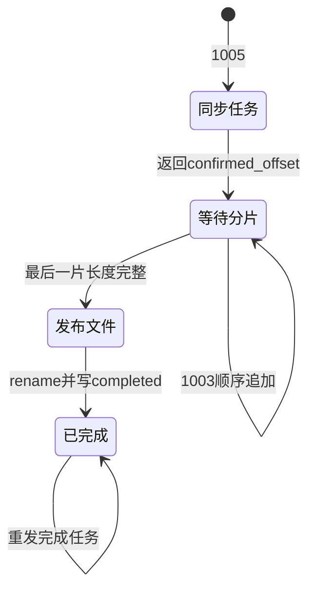

# 资源服务

## 帧与服务职责

ResourceServer 的 TCP 帧由网络字节序的 `uint16 消息ID + uint32 JSON字节数 + JSON` 组成，头长 6 字节，包体上限为 4096 字节。二进制分片编码为 Base64 放入 JSON；偏移、总大小均按解码后的原始字节计算。ChatServer 使用另一套 4 字节头，两个连接不能共用帧解析规则。

| 请求 / 响应 | 作用 | 主要字段 |
| --- | --- | --- |
| 1005 / 1006 | 创建或同步上传任务 | `upload_id, md5, name, total_size, chunk_size` |
| 1003 / 1004 | 追加一个上传分片 | `upload_id, md5, name, total_size, offset, data, is_last` |
| 1007 / 1008 | 拉取一个下载分片 | `resource_id, uid, token, thread_id, offset, chunk_size` |

客户端从应用目录的 `config.ini` 读取 `[ResourceServer] host/port`；ChatServer 调用资源核验 RPC 使用各自配置的 `host/rpcport`。ResourceServer 还需要 `[StatusServer]` 与 `[Mysql]` 配置完成下载授权。默认端口只是部署配置，协议不依赖某个固定端口。

## 上传任务与发布文件

`upload_id` 标识上传任务，聊天业务把同一值保存为 `resource_id`。它是资源引用，不能替代下载授权。ID 长度最多 160，字符仅限字母数字、下划线和连字符，避免路径分隔符进入任务目录名。

每个任务在配置的 `file_path` 下拥有独立目录：`meta.json` 保存名称、声明大小、MD5、分片大小和完成标记；`data.part` 保存尚未发布的字节；完成后用文件名的 basename 定位最终文件。客户端不能提交服务器绝对路径来指定读取位置。旧个人头像响应仍可能包含 `resource_url`，聊天图片和文件持久化只使用 `resource_id`。



1. 1005 比较已存任务的 MD5、原始名称、总大小和分片大小；不同则返回 `1013`，不能用同一 ID 改名覆盖。
2. 未完成任务以 `data.part` 的实际长度返回 `confirmed_offset`。客户端重新连接后先同步，再从该偏移读取源文件。
3. 1003 必须声明 `is_last == (offset + 解码字节数 == total_size)`。偏移等于服务端确认位置才追加；较早偏移返回已有进度、不重复写；较晚偏移返回 `1014`，要求重新同步。
4. 最后一片写完后重命名文件并记录完成。读取和 RPC 核验要求元数据明确完成，最终文件存在且实际大小等于元数据。

普通上传上限为 100 MiB，1005 和每个 1003 都在创建或写入文件前检查；超过上限返回 `1022`。Qt 私聊传输另外拒绝空文件。MD5 在当前服务端用于任务属性匹配，上传过程没有重新计算整个文件的 MD5；它不提供内容完整性签名或上传者身份认证。私聊上传接口仍允许旧匿名上传，保护范围与群头像不同。

## 拉取式分片下载

每次 1007 只返回一片，原始分片大小须为 1～2048 字节。2 KiB 的上限为 Base64 膨胀和 JSON 字段预留帧空间。示例中的 token 须替换为当前账号真实登录凭据：

```json
{
  "resource_id": "<upload_id>",
  "uid": 10001,
  "token": "<login-token>",
  "thread_id": 42,
  "offset": 0,
  "chunk_size": 2048
}
```

```json
{
  "error": 0,
  "resource_id": "<upload_id>",
  "total_size": 4096,
  "offset": 0,
  "data": "<base64-data>",
  "is_last": false,
  "name": "photo.png"
}
```

客户端写入成功后用 `offset + decoded_data.size()` 请求下一片，并核对总大小、偏移连续性和最后一片标记。协议允许从指定偏移拉取；当前 Qt 私聊任务失败时取消 `QSaveFile` 临时文件，重新下载从 0 开始，不保留跨任务下载断点。上传续传与下载重试具有不同的持久性。

每一片私聊下载都先通过 StatusServer 校验 `uid/token`，再查询 `private_chat JOIN chat_message`：请求用户必须属于该私聊，且该 `thread_id` 下有 `image` 或 `file` 消息引用同一资源。未写入聊天消息的匿名上传不能直接使用私聊下载接口读取。授权依赖不可用时拒绝读取；通过某一片授权不会使后续片永久放行。

| 资源错误码 | 含义与处理 |
| --- | --- |
| 1013 | 上传任务属性冲突，检查名称、MD5、大小和分片配置 |
| 1014 | 偏移不一致，上传重新同步进度 |
| 1015 | 上传文件创建、写入或发布失败 |
| 1016 / 1017 | 资源不存在或大小不一致 / 尚未完成 |
| 1018 / 1019 | 文件读取失败 / 图片格式核验失败 |
| 1020 | 凭据、成员或资源归属拒绝，检查账号和会话 |
| 1021 | StatusServer 或数据库暂不可用，恢复依赖后重试 |
| 1022 | 文件超过当前用途的大小上限 |

错误码属于资源协议；相同数字在 ChatServer 协议中可能另有含义。

## 可信元数据与批量核验

ChatServer 收到图片或文件消息后，通过共享 [proto](../proto/message.proto) 调用 RPC，再保存 MySQL：

| RPC | 核验与返回数据 |
| --- | --- |
| `VerifyImages` | 完成状态、磁盘大小、PNG/JPEG/GIF/WebP 文件头；返回 ID、名称、MIME、大小、宽高 |
| `VerifyFiles` | 完成状态、磁盘大小；返回 ID、名称、MIME、大小 |
| `VerifyGroupAvatar` | 服务凭据、用户与群管理身份、任务绑定、完整图片解码；返回头像 ID 和可信属性 |

前两个 RPC 接受 1～100 个资源，整批先核验再返回有序结果，任一失败不返回部分成功。ChatServer 的聊天入口另外限制每批最多 50 项，仍受聊天帧字节上限约束。

图片 MIME 和尺寸来自文件头解析，读取头部最多 256 KiB，尺寸须为正且每边不超过 100000；普通文件 MIME 根据发布文件名扩展名映射，未知扩展名为 `application/octet-stream`。普通文件无内容白名单和恶意软件扫描。私聊图片头解析也不能证明完整压缩像素流有效，Qt 下载后还要实际解码。

上传、下载和 RPC 资源解析共用进程内文件锁，避免读到并发发布中的状态。RPC 不返回本机路径。`VerifyImages/VerifyFiles` 当前没有群头像式服务密钥检查，应仅向受信内部网络开放；资源核验也不证明私聊上传者身份。

## 群头像用途与逐片授权

群头像上传和下载都带 `purpose="group_avatar", uid, token, thread_id, resource_id`，上传还带相等的 `upload_id`。Qt 使用独立 UUID，避免按内容哈希复用其他账号任务。任务元数据绑定 `purpose/owner_uid/thread_id`，不保存 token。已经受保护的任务不能通过删除 purpose、换 UID、换群或旧私聊接口继续写入、核验或读取。

上传每片要求当前角色为管理员或群主；下载每片要求有效群、当前有效成员，并且资源正是当前已发布头像。授权持有群与成员数据库锁到响应入队；离群、踢出、解散和替换头像提交后，新分片请求无法沿用旧授权。关联回包携带 purpose、uid、thread_id、resource_id、upload_id 与 task_id，token 不回传；这些字段供客户端区分任务，身份仍由服务端校验。

群头像仅接受 PNG/JPEG，最大 2 MiB、每边最大 1024。生产解码器使用 libpng/libjpeg-turbo，在像素分配前检查边界，再完成像素解码；PNG 校验 chunk、CRC 与 IEND 终止，JPEG 要求完整解码、EOI 并拒绝 warning。

`VerifyGroupAvatar` 还要求 metadata `x-resource-service-key`。双 ChatServer 与 ResourceServer 的 `[ResourceServer] service_key` 必须相同且非空。ChatServer 核验后在发布事务内再次检查当前管理身份，只保存可信 ID 与元数据，递增群版本及头像版本。当前内部 gRPC 使用明文连接，服务密钥不能防窃听；部署时须限制访问网络和配置文件权限。

## 代码定位与操作入口

- [LogicWorker.cpp](../ResourceServer/src/LogicWorker.cpp)：上传同步、顺序分片、发布、逐片下载及群用途绑定。
- [ResourceVerifier.cpp](../ResourceServer/src/ResourceVerifier.cpp)：安全 ID、完成资源解析、图片文件头与普通文件 MIME。
- [ResourceAccessAuthorizer.cpp](../ResourceServer/src/ResourceAccessAuthorizer.cpp)：StatusServer 认证、私聊资源关联 SQL、群锁租约。
- [ResourceServiceImpl.cpp](../ResourceServer/src/ResourceServiceImpl.cpp)、[GroupAvatarDecoder.cpp](../ResourceServer/src/GroupAvatarDecoder.cpp)：批量核验、服务密钥与群头像完整解码。
- [chatimagetransfer.cpp](../chat_app%20desktop/chatimagetransfer.cpp)、[resourceclient.cpp](../chat_app%20desktop/resourceclient.cpp)：Qt 队列、分片校验和原子写入。
- [图片传输](图片传输.md)、[文件传输](文件传输.md)：聊天业务协议和界面操作；[测试运行指南](../tests/README.md)：构建及测试入口。
