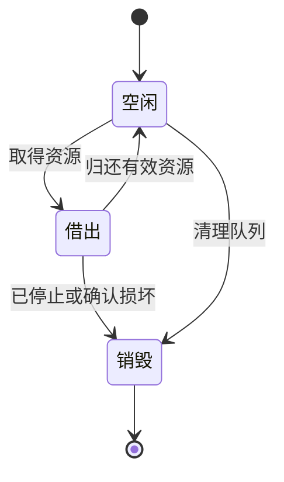

# 连接池与执行上下文池

## 资源种类与并发模型

| 资源类别 | 实现 | 所管理资源 | 当前容量来源 |
| --- | --- | --- | --- |
| MySQL 会话池 | `MySqlPool` | `unique_ptr<mysqlx::Session>` | `[Mysql] poolsize` |
| Redis 连接池 | `RedisConPool` | hiredis `redisContext*` | RedisMgr 构造传入 5 |
| gRPC Stub 池 | `RPConPool`、`StatusConPool`、`ChatConPool` | 对应服务的 Stub | 验证码 5、状态 10、每个 ChatServer 对端 5 |
| Asio 执行上下文池 | `AsioIOServicePool` | `io_context`、work guard 与工作线程 | 默认 `hardware_concurrency()` |

前三类用空闲队列实现借还，第四类按轮询分配执行上下文，不进行借还。一个 `io_context` 可以承载多个 socket，项目没有为每个连接创建独立线程。gRPC 还有直接复用一个 Stub 的 [ResourceGrpcClient](../ChatServer1/include/ResourceGrpcClient.h)，因此“所有 RPC 都经过池”不符合当前实现。

数据库连接建立包含 TCP、认证及会话初始化。池复用这些资源并限制同时占用数；容量不足时调用者排队。容量过大增加服务器连接和内存压力，过小则增加等待；容量要结合业务线程数、数据库承载量和调用延迟配置，不能直接照搬 CPU 核数。

## 借还队列与条件变量

典型借用过程是加锁，等待“池停止或队列非空”，从队首移动资源并出队，再将资源交给业务。`condition_variable::wait` 在等待期间释放互斥锁，唤醒后重新取得锁，并通过谓词处理虚假唤醒。

- `unique_lock` 支持等待所需的解锁与重锁。
- `lock_guard` 适合归还时保护短队列操作。
- `notify_one()` 通知一个等待者有资源可取。
- 停止标志必须包含在等待谓词内，`notify_all()` 才能让空池等待者退出。
- 资源离开队列后由借用者独占，队列锁不覆盖完整业务操作。

`unique_ptr` 通过 `std::move` 转交所有权；其析构负责销毁对象，不会自动放回队列。项目中的 MySQL 和部分 gRPC 调用使用 `Defer` 进行作用域归还；hiredis 普通操作主要依靠显式释放 reply 和归还 context。清理责任应在借用成功后建立，并覆盖异常与提前返回。

## MySQL：会话有效性与事务

[GateServer MySqlPool](../GateServer/src/MysqlMgr.cpp) 借出及归还时执行 `SELECT 1`，异常后创建新 Session。它处理已知失效连接，没有周期心跳线程；会话仍可能在业务执行期间失效。

当前探测与重建在互斥锁内进行，慢网络会使其他借还等待。`CreateSession()` 可抛异常，部分调用把 `GetConnection()` 放在 `try` 外；归还的重建也可能抛异常，Defer 析构过程中的异常不能忽略。`ReturnConnection(nullptr)` 直接返回，不会补充容量。

同一事务的全部语句必须使用同一个借用 Session，并在归还前完成提交或回滚。不能将有未结束事务的会话交给下一请求。数据库业务与 X DevAPI 用法见 [MySQL连接库](MySQL连接库.md)。

## Redis：独占 socket 与实际容量

hiredis 同步 context 不支持多线程并发命令。池让一个请求暂时独占一条 socket；Redis 服务端单条命令原子性与客户端线程安全属于两个层次。

[GateServer RedisConPool](../GateServer/include/RedisMgr.h) 初始化逐条连接并认证，失败项被跳过，可能形成小于 5 的池。普通 `getConnection()` 无超时，全部失败时会一直等待。AUTH reply 在读取类型前缺少空指针检查。

[ChatServer RedisConPool](../ChatServer1/include/RedisMgr.h) 额外提供 `getConnectionFor()` 给锁和脚本使用；归还可以标记 broken，损坏连接会释放，但不会补建。停止后归还也会释放 context。GateServer 和 StatusServer 的停止后归还分支直接返回，裸指针没有在该分支释放。

各池没有统一的自动重建或后台补齐功能，不能把 MySQL 的探活行为推广到 Redis。reply 与 context 的释放细节见 [Redis连接库](Redis连接库.md)。

## gRPC：代理复用、限并发与 deadline

[RPConPool](../GateServer/src/VarifyGrpcClient.cpp)、[StatusConPool](../GateServer/src/StatusGrpcClient.cpp) 和 [ChatConPool](../ChatServer1/include/ChatGrpcClient.h) 保存服务 Stub，每个条目创建时传入 Channel。

Channel 负责传输状态、按需连接及重连，创建 Channel 不证明已经连接成功。底层 HTTP/2 连接可以承载多个 RPC；gRPC Channel 和生成 Stub 支持并发调用，项目采用独占借用是应用层的并发限制与对象复用策略。Stub 数量与 TCP socket 数量没有一一对应保证。

每次 RPC 单独创建 `ClientContext`，保存 deadline、metadata、取消状态；不能放入池中跨调用复用。请求、响应及 context 在同步调用返回前必须有效。

`ChatConPool::getConnectionUntil(deadline)` 使用绝对截止时间等待，群通知、文件、回执等路径将同一个 deadline 交给 `ClientContext`，从而把排队和 RPC 限制在同一时间范围。只有设置 RPC deadline、却无界等待借用，无法限制总延迟。图片路径目前分别创建两个约三秒的截止时刻，不应当作严格统一的总计时模板。旧好友、文本路径仍包含无界借用与未设置 deadline 的同步调用。

池停止时借用返回空，调用方必须判断。GateServer 部分客户端直接解引用借用结果，不能据此宣称支持任意时刻安全关闭。`StatusConPool::returnConnection()` 当前也没有停止后拒绝入队检查。服务间调用细节见 [gRPC](grpc.md)。

## Asio：分配执行环境

[AsioIOServicePool 头文件](../ChatServer1/include/AsioIOServicePool.h) 保存多个 `io_context`、work guard 和线程。[实现](../ChatServer1/src/AsioIOServicePool.cpp) 每个线程执行一个 `run()`，`GetIOService()` 用原子下标递增取模轮询。

work guard 使没有就绪任务的 `run()` 仍可等待新任务。`Stop()` 依次 reset guard、stop context、join 线程。`stop()` 让 `run()` 尽快退出，不保证所有已排队业务都执行完毕，也不等同于自动关闭所有 socket。

默认 `hardware_concurrency()` 允许返回 0，当前构造未提供非零兜底；空容器会使轮询取模无效。关闭还必须避免当前池线程 join 自己。执行上下文是否停止与连接对象的业务清理需由服务启动/退出流程协调。

## 关闭操作与所有者生命周期

可靠的使用顺序是：停止接收新业务，唤醒并结束等待者，等待已借出的操作归还，再销毁池及依赖对象。具体服务还需协调 Asio 回调、业务队列和 gRPC 服务端 `Shutdown()/Wait()`。

`Close()` 只改变标志、唤醒等待者或清理空闲队列，不会自动 join 外部借用者。析构时取得一次队列锁，也不能证明所有借出资源均已返回。闭包引用的池、局部连接变量和 `this` 必须在 Defer 执行时仍存在。

配置和排查应分别观察“初始化成功数量”“当前空闲数量”“借用等待时间”“远端调用耗时”；项目当前没有统一暴露这些指标。不能只根据池的声明容量判断服务仍有可用连接，也不能在持有数据库事务或登录锁时无限等待另一个池。
