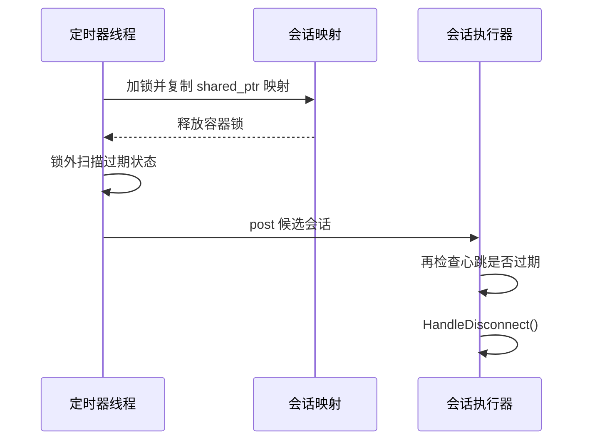

# 锁粒度与临界区控制

## 锁保护的对象

`ChatServer1/src/CServer.cpp` 使用 `_mutex` 保护 `_sessions` 容器。访问容器、插入和移除连接需要遵守这把锁；取得一个 `shared_ptr<CSession>` 后，会话对象自身的可变状态仍由会话的同步机制管理。

| 同步对象 | 保护范围 |
| --- | --- |
| `CServer::_mutex` | 连接映射及其迭代器有效性 |
| `shared_ptr<CSession>` | 持有期间的对象生存期 |
| 会话原子量、发送锁、socket 执行器 | 对应会话状态与异步操作顺序 |
| Redis 登录锁 | 同 UID 的跨实例身份变更 |
| MySQL 行锁与事务 | 持久业务状态及并发约束 |

对象仍然存活与对象内部数据可并发访问是两项不同条件。

## 心跳扫描中的快照

`CServer::on_timer()` 在锁内复制 `_sessions`，锁外扫描快照、收集过期会话，再把清理工作投递到各 session 的 socket 执行器。

快照保留了会话引用，锁外扫描时即使原映射删除连接，对象也不会立即析构。快照中的集合可能已经过期：扫描后收到新心跳、或连接已被其他路径关闭，都需要在实际执行清理时重新判断。

## 为什么不在容器锁内清理

`HandleDisconnect()` 会进入 `CServer::ClearSession()`，后者再次获取 `_mutex`。若扫描线程持有这把非递归互斥锁调用清理，就会形成同线程锁重入。

断线还可能等待 Redis 登录锁、执行网络命令。把这些动作放入全局容器临界区，会延迟其他连接的登记和注销，也让锁顺序更难分析。

临界区应只覆盖共享结构的必要读写。删除映射后，再执行不依赖该锁的在线计数更新和其他外部操作。当前 `ClearSession()` 的在线计数递减位于容器锁外。

## 快照的成本

复制整个 `unordered_map` 需要分配节点、复制键和增加所有 `shared_ptr` 的引用计数，时间与连接数量成正比。快照把状态检查移出临界区，但复制本身仍在持锁期间完成。

另一种设计是在锁内筛选并只保存候选 `shared_ptr`。它减少复制量，同时要求状态检查足够短、线程安全，且不能在检查中调用会重入容器锁的操作。选择时需要比较扫描成本、分配成本和临界区长度。

## 锁顺序与幂等清理

- 先明确每把锁保护的数据，避免为“整个函数”笼统加锁。
- 涉及多把锁时记录获取顺序，特别检查本机锁、用户级 Redis 锁和数据库行锁之间的调用链。
- 外部 RPC 和 Redis 网络等待尽量离开全局容器锁。
- 异步动作执行前重新核验时效条件，例如心跳时间、session ID 或成员版本。
- 断线采用 `_disconnect_handled.exchange(true)` 作为一次性入口；多个读写错误共享同一路径，避免重复递减计数。
- 旧会话清理远端路由时比较 `session_id`，只处理仍属于自己的在线身份。

阅读实现时同时查看 `CServer::on_timer()`、`ClearSession()`、`CSession::HandleDisconnect()`。相关知识：[心跳检测](心跳检测.md)、[分布式锁](分布式锁设计.md)、[异常处理](异常处理.md)。
