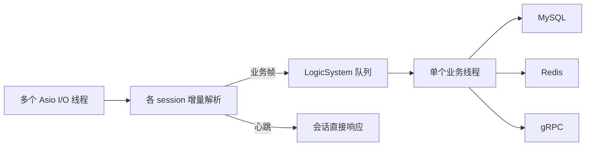

# 业务调度与性能分析

## ChatServer 的执行模型

`ChatServer1/src/LogicSystem.cpp` 的构造函数启动一个 `_worker_thread`。`CSession` 解析业务帧后，通过 `PostMsgToQue()` 写入共享队列；`DealMsg()` 取出队首，释放队列互斥锁，再执行对应回调。ChatServer2 使用相同模型。

队列锁只覆盖入队和出队，慢 SQL 或 RPC 不会一直占有队列互斥锁。业务回调仍在同一个消费线程中串行执行，一个耗时请求会延后其他业务请求。

心跳由 `CSession` 直接处理，避免排在慢业务后面。断线媒体清理以内部事件交给业务队列，减少 I/O 线程同步等待跨服 RPC 的机会。

## 先区分瓶颈

| 观察量 | 能回答的问题 | 需要同时观察 |
| --- | --- | --- |
| 空闲连接数 | socket、内存和客户端端口能保持多少连接 | 客户端资源、服务端句柄、心跳 |
| 业务队列等待时间 | 请求排队是否占主要延迟 | 消费耗时、队列长度 |
| SQL 与连接池等待 | 数据库执行或借用是否阻塞 | 索引、事务锁、池容量 |
| RPC 延迟与错误 | 跨服依赖是否拖慢请求 | 目标在线状态、deadline、网络 |
| 发送队列积压 | 对端消费速度是否不足 | 消息大小、网络、断线策略 |

空闲 TCP 容量无法推出聊天吞吐量。性能比较应固定消息大小、用户数、跨服比例、数据库规模和测试时长，并观察延迟分位数、错误率及服务端资源。

## 按会话分配 Worker 的设计

当前 ChatServer 尚未采用多 Worker 调度。可研究的拆分方式是让调度器维护 `session_id → Worker` 绑定，每个 Worker 管理自己的队列与线程，建立会话时分配，关闭会话时解除。

| 规则 | 原因 |
| --- | --- |
| 同一会话固定进入同一 Worker | 保留登录、发送和管理请求的入队顺序 |
| 每个 Worker 独立队列和条件变量 | 减少全局队列竞争，隔离部分慢请求 |
| 数据库/RPC 在队列锁外执行 | 允许 I/O 持续投递和其他生产者入队 |
| 停止接收后排空已接收事件 | 避免销毁业务依赖时仍有任务访问 |
| 明确绑定和断线事件的先后关系 | 避免解除映射后旧任务被重新分配 |

`ResourceServer/src/LogicSystem.cpp` 与 `LogicWorker.cpp` 提供已有的调度结构参考；资源任务顺序要求和聊天身份事务不同，迁移时需逐项检查业务约束。

## 多 Worker 带来的共享状态问题

会话内串行只能保护该队列中的先后关系。两个用户可能同时认证好友、创建同一个私聊、接受同一群邀请，或操作同一个群，因此仍需：

- 用数据库事务和唯一索引维持唯一私聊、好友双向关系及消息一致性。
- 用群行锁、成员版本与操作结果记录控制并发群管理。
- 用同一用户的 Redis 登录锁控制跨实例身份替换。
- 为 `UserMgr`、服务器会话表、通话状态等共享管理器保留独立同步。
- 区分 TCP 业务队列与 gRPC 服务线程；跨服调用可从不同线程进入共享状态。

增加线程会增加数据库与 Redis 连接竞争。Worker 数量应结合连接池和依赖吞吐确定，不能直接把 CPU 核数当作业务并发容量。

## 队列与停止顺序

发送队列按 session 串行写出，消费慢时受 `MAX_SENDQUE` 约束。接收队列常量存在并不说明每个入队点都实施了限流，分析时要直接检查 `PostMsgToQue()` 和调用方。

停止过程需要先阻止新增连接和服务请求，再处理已接收业务，最后释放会话管理器、连接池与 I/O 上下文。单独设置停止标志不能证明异步回调已经结束；取消后的回调仍会被调度。

相关知识：[TCP 服务器](TCP服务器.md)、[连接池](连接池.md)、[锁粒度](锁的精度控制.md)、[异常处理](异常处理.md)。
